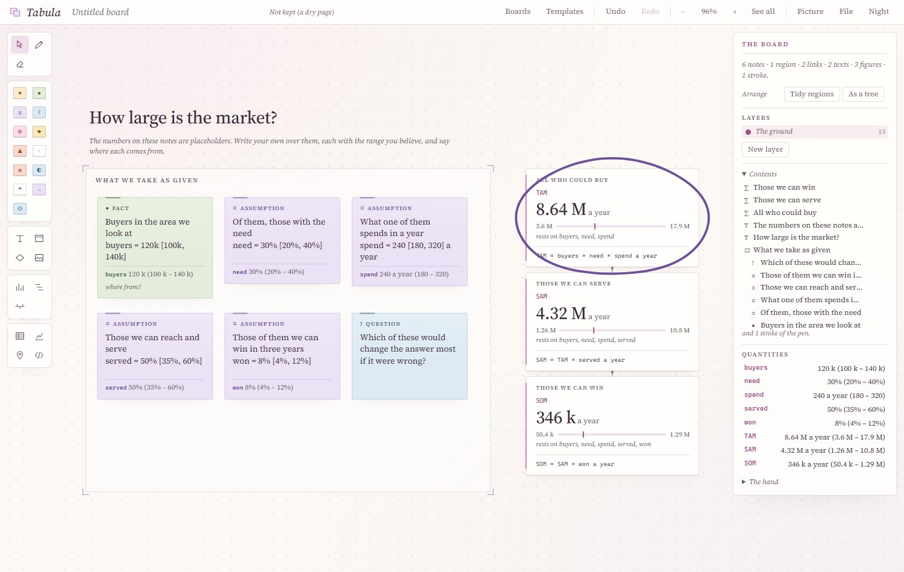
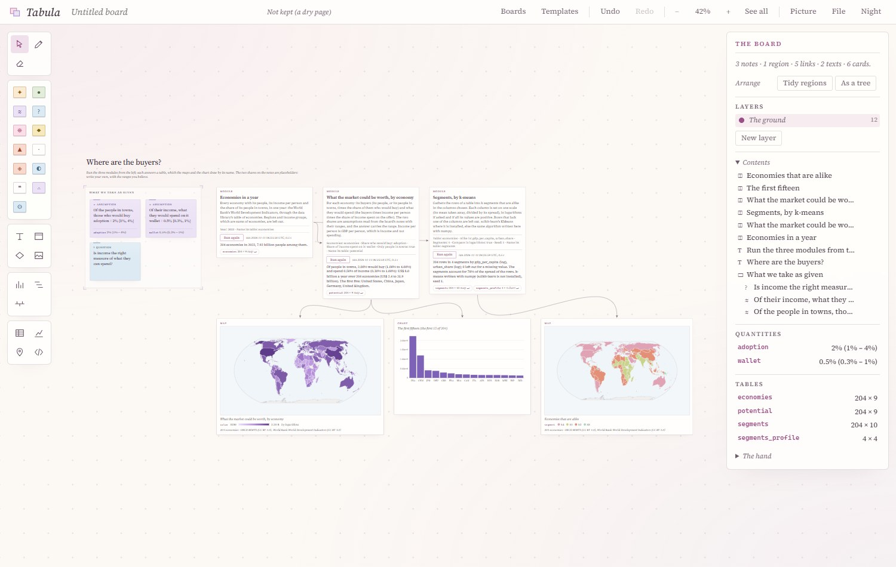
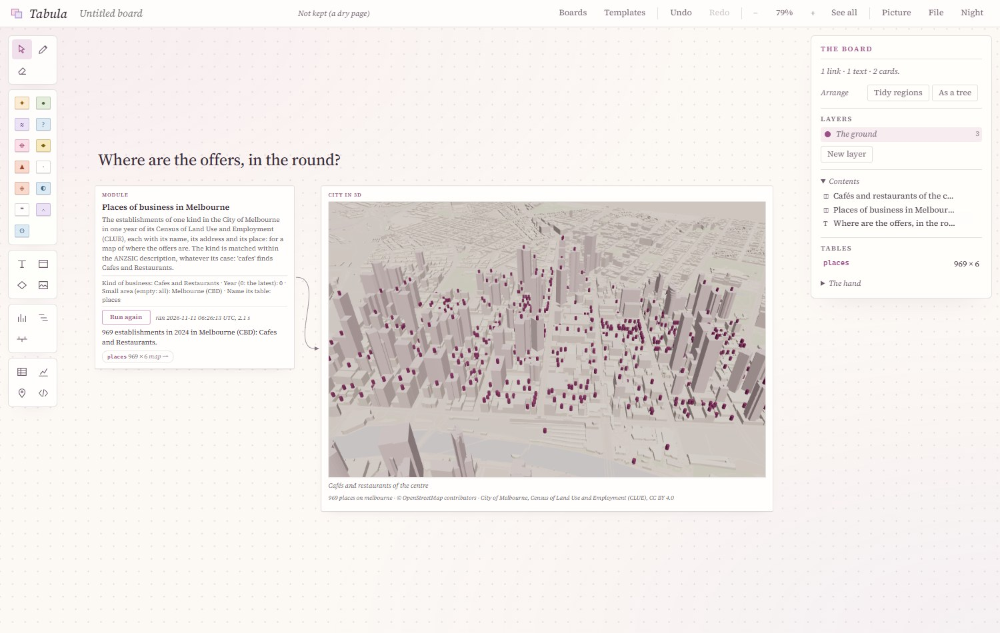
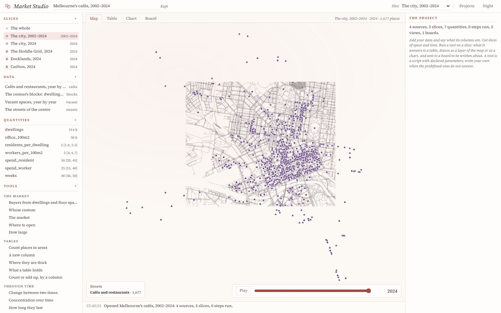
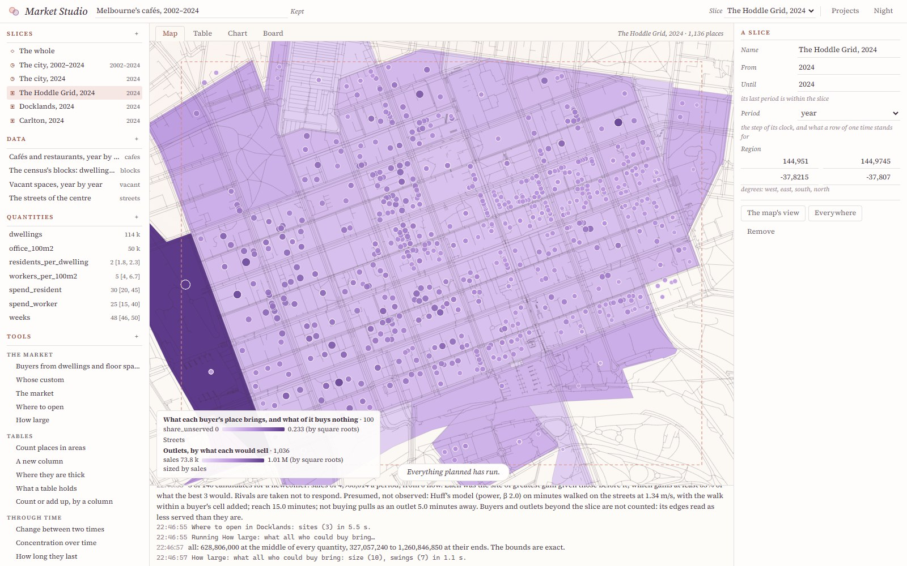
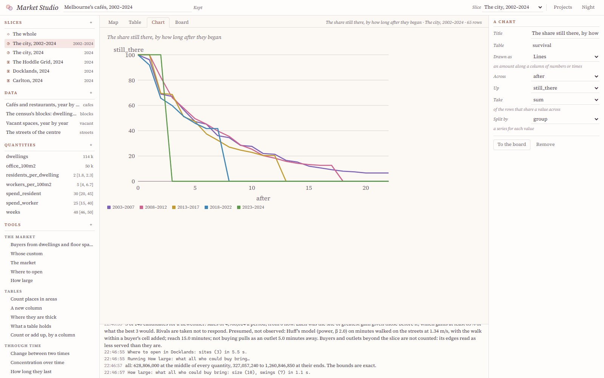

# Noetarium: The Science and Humanity Infrastructure

An integrative infrastructure for learning, using and researching all domains of science and the humanities, as one connected body of knowledge. Foundation libraries carry mathematics, computation and physics. Each science is a domain: a library of its own objects and models, pure and tested, that runs on its own with only the domains beneath it. Applications and studies, organised by purpose, compose the domains they need.

<p align="center">
<a href="docs/gallery.md"></a>
<a href="docs/gallery.md"></a>
<a href="docs/gallery.md"></a>
</p>
<p align="center"><i>The Earth Atlas and the Celestial Atlas, the first two applications: see the <a href="docs/gallery.md">gallery</a>.</i></p>

<p align="center">
<a href="docs/gallery.md"></a>
<a href="docs/gallery.md"></a>
<a href="docs/gallery.md"></a>
</p>
<p align="center">
<a href="docs/gallery.md"></a>
<a href="docs/gallery.md"></a>
<a href="docs/gallery.md"></a>
</p>
<p align="center">
<a href="docs/gallery.md"></a>
<a href="docs/gallery.md"></a>
<a href="docs/gallery.md"></a>
</p>
<p align="center"><i>The Brain Atlas: every part of the brain clickable for its anatomy, with sections, atlases, data, the head and its electrodes, and the mouse; and EEG, MEG and fMRI carried onto the brain.</i></p>

<p align="center">
<a href="docs/gallery.md"></a>
<a href="docs/gallery.md"></a>
<a href="docs/gallery.md"></a>
</p>
<p align="center"><i>The Spiking Simulator: networks of classical and quantum spiking neurons, run by the neuroscience domain's C++ engine and shown with their statistics and the engine's profile.</i></p>

<p align="center">
<a href="docs/gallery.md"></a>
<a href="docs/gallery.md"></a>
<a href="docs/gallery.md"></a>
</p>
<p align="center">
<a href="docs/gallery.md"></a>
<a href="docs/gallery.md"></a>
<a href="docs/gallery.md"></a>
</p>
<p align="center"><i>The Complex Atlas: cell complexes with their exact invariants and the gauge fields on them, and the generation of spacetime by field theories, quantum and group field theories alike, from an action through its Feynman graphs and spin foams to the condensed phase and the continuum.</i></p>

<p align="center">
<a href="docs/gallery.md"></a>
<a href="docs/gallery.md"></a>
<a href="docs/gallery.md"></a>
</p>
<p align="center"><i>The History Complex: histories of art, music, letters, philosophy, science and the relations of states, from Athens to Vienna, built into 2-complexes of occasions, lives and ties, their signed ties read as the spin foam of a ℤ₂ gauge theory fitted to the record.</i></p>

<p align="center">
<a href="docs/gallery.md"></a>
<a href="docs/gallery.md"></a>
<a href="docs/gallery.md"></a>
</p>
<p align="center">
<a href="docs/gallery.md"></a>
<a href="docs/gallery.md"></a>
<a href="docs/gallery.md"></a>
</p>
<p align="center"><i>The Genome Workbench: genomes mapped, aligned, indexed, read, assembled and placed on their trees by a C++ engine on the genomics and evolution domains, and a toolbox of instruments for one's own sequences and files.</i></p>

<p align="center">
<a href="docs/gallery.md"></a>
<a href="docs/gallery.md"></a>
<a href="docs/gallery.md"></a>
</p>
<p align="center"><i>The Economy Atlas: the world's trade, or flows of one's own, split into exchange, drive and circulation on the triangles of their places, analysed by plug-ins in Python and C++ and by a toolbox of quantitative economics; currencies held and exchanged as a spacetime whose curvature is the departure from interest parity; production as a circular flow; and the loop deficits of transfer networks.</i></p>

<p align="center">
<a href="docs/gallery.md"></a>
<a href="docs/gallery.md"></a>
<a href="docs/gallery.md"></a>
</p>
<p align="center">
<a href="docs/gallery.md"></a>
<a href="docs/gallery.md"></a>
<a href="docs/gallery.md"></a>
</p>
<p align="center"><i>Cosmopoiesis: the Solar System as one world, from a crater's floor to the orbit of Pluto, on a console drawn as a precision instrument; its fields, the Earth's magnetic field, the Moon's crust and the Earth's interior, drawn in the world and read over a cube about any point; the ground saying where each of its heights comes from, the sea floor and the sea's temperature; the Earth beneath any place, to its centre, with the earthquakes of the sinking plates; any point written in one line and answered in every frame; and instruments, virtual and physical, each reading marked by whether it was observed, modelled or assimilated.</i></p>

<p align="center">
<a href="docs/gallery.md"></a>
<a href="docs/gallery.md"></a>
<a href="docs/gallery.md"></a>
</p>
<p align="center">
<a href="docs/gallery.md"></a>
<a href="docs/gallery.md"></a>
<a href="docs/gallery.md"></a>
</p>
<p align="center"><i>The Urban Science Workbench: Melbourne in three dimensions, its streets read as a sea from the city's pedestrian counts: the tide each street's walkers rise and fall to, and its surge on a holiday; walkers each way at their true numbers; the waves of a crowd at the crossings of Swanston Street; and the city's tides and currents read together.</i></p>

<p align="center">
<a href="docs/gallery.md"></a>
<a href="docs/gallery.md"></a>
<a href="docs/gallery.md"></a>
</p>
<p align="center">
<a href="docs/gallery.md"></a>
<a href="docs/gallery.md"></a>
<a href="docs/gallery.md"></a>
</p>
<p align="center"><i>The Body Atlas: the whole body of an adult man, every part named by the Foundational Model of Anatomy and measured by the anatomy domain, by system, cut in the planes of imaging and drawn as anatomical plates; a card for each part with what is known of it, where it lies, what it touches, and for a vessel its calibre along its course.</i></p>

<p align="center">
<a href="docs/gallery.md"></a>
<a href="docs/gallery.md"></a>
<a href="docs/gallery.md"></a>
</p>
<p align="center"><i>Fabrica: vessels reconstructed from images by the medical-imaging domain on the image foundation eikon. Arteries and veins are told apart by integrating a CT and an MRA of one body, and a liver's veins are reconstructed from a real CT and held to its experts' labels.</i></p>

<p align="center">
<a href="docs/gallery.md"></a>
<a href="docs/gallery.md"></a>
<a href="docs/gallery.md"></a>
</p>
<p align="center"><i>Market Studio: projects of market analysis on one's own data. Slices of space and time, tools with declared parameters and one's own scripts, layers that move with a clock, charts, and a board to write on.</i></p>

<p align="center">
<a href="docs/gallery.md"></a>
<a href="docs/gallery.md"></a>
<a href="docs/gallery.md"></a>
</p>
<p align="center"><i>Tabula: a board on which thought is set out and tied to evidence. Assumptions written on notes compute with their ranges; modules get data and run models on the board; subjects come to it as plug-ins, market analysis first.</i></p>

<p align="center">
<a href="docs/gallery.md"></a>
<a href="docs/gallery.md"></a>
<a href="docs/gallery.md"></a>
</p>
<p align="center"><i>The Urban Science Workbench, one view from the whole Earth to a doorstep: any city in the world opens as one comes down to it, with the world's development data on it, a wave of minutes down its streets, and Freetown's flood risk recomputed from its own events.</i></p>

## Quick Start

**Online, with nothing to install.** The three atlases run on our online server; the Spiking Simulator, the Complex Atlas, the History Complex, the Genome Workbench and the Economy Atlas do not:

- **Earth Atlas:** http://173.212.213.207:9201/ — the atmosphere, the ocean, the land, the people and the solid Earth on one globe.
- **Brain Atlas:** http://173.212.213.207:9202/ — the human brain in the round, every part with its anatomy; sections, atlases, data, the head and its electrodes, the mouse brain, and EEG, MEG and fMRI mapped onto the brain.
- **Celestial Atlas:** http://173.212.213.207:9200/ — the Sun, the Moon, the planets, the stars and the galaxies, at any instant from 1849 to 2150.
- **Spiking Simulator:** not run on our online server, whose resources the other applications already take much of — networks of spiking neurons, classical and quantum, composed in the page and run by the neuroscience domain's C++ engine. Each run is a simulation that takes seconds on every core of the machine serving it, so for now it runs on your own computer: see [the Spiking Simulator on your computer](#the-spiking-simulator-on-your-computer), four lines.

- **Complex Atlas:** not run on our online server, whose resources the other applications already take much of — cell complexes, their invariants and the fields on them, computed by a C++ engine on the foundations morphe and physis; so for now it runs on your own computer: see [the Complex Atlas on your computer](#the-complex-atlas-on-your-computer).

- **History Complex:** not run on our online server either — histories recorded as occasions, beings and ties, built into a 2-complex whose topology and signed ties a C++ engine on the history domain reads; it runs on your own computer: see [the History Complex on your computer](#the-history-complex-on-your-computer).

- **Genome Workbench:** not run on our online server either — genomes mapped, aligned, indexed, read, assembled, quantified and placed on their trees by a C++ engine on the genomics and evolution domains, kept alive as workers that share out large jobs, with a toolbox of instruments for your own sequences and files; it runs on your own computer, and can enlist others: see [the Genome Workbench on your computer](#the-genome-workbench-on-your-computer).

- **Economy Atlas:** not run on our online server either — the world's trade split into exchange, drive and circulation on a map, currencies held and exchanged as a spacetime whose curvature is the departure from a price system, production as a circular flow, and the loop deficits of transfer networks, computed by a C++ engine on the economics domain, on the library's data or your own, with plug-ins in Python and C++ and a toolbox of 27 tools of quantitative economics (regression, panels, instruments, time series, inequality, index numbers, the gravity of trade, growth, games and voting); it runs on your own computer: see [the Economy Atlas on your computer](#the-economy-atlas-on-your-computer).

- **Chemistry Workbench:** not run on our online server either — a workbench of plug-ins for chemistry, the first of which executes and verifies a manuscript on chemical structure generation through symmetry breaking: graph grammars of molecules, point groups and character tables, autocatalytic selection as an exact Markov chain, and a group field theory's Feynman complexes; it runs on your own computer with g++: `python applications/chemistry-workbench/serve.py --open` builds its engine from the page and opens http://127.0.0.1:8950/.

- **Fabrica** (formerly the Body Atlas): not run on our online server either — the whole body of an adult man in the round, by system, every part with its card and measures, cut in the planes of imaging; vessels reconstructed from CT and MRA; `python applications/fabrica/serve.py --open` after its recipe.

- **Market Studio:** not run on our online server either — projects of market analysis on one's own data: files left as they are with their columns bound to roles, slices of space and time, fourteen predefined tools (the market, whose custom, where to open, how large; openings, survival and concentration through time; tables) and scripts of one's own, layers of a map that move with a clock, charts, and boards; an example on Melbourne's cafés, 2002–2024; `python applications/market-studio/serve.py --open` after its recipe (g++ in WSL or natively).
- **The Design Studio:** not run on our online server either — a building drawn by hand on any lot of any street, in plan, in the round and walked through at a person's height: its rooms measured and furnished from a catalogue, their light and air, the rules of a scheme one by one, a brief, quantities and their cost as a range; `python applications/design-studio/serve.py --open`, then **Build the engine** on the page the first time (g++ 11 or later, natively or in WSL). It now has an outside and a street: a roof, claddings and a garden, elevations, the light at its glass, and the street it stands on in section.
- **The Category Studio:** not run on our online server either — experiments in category theory written as a script and answered statement by statement: categories by generators and equations or from families, functors, natural transformations, adjoints, limits, data on a schema with its Kan extensions, theories with their string diagrams and models; each claim holds with its evidence, fails with the place where it fails, or is said not to be decided, and is drawn beside the script; eleven examples; `python applications/category-studio/serve.py --open`, then **Build it** on the page the first time (g++ 11 or later, natively or in WSL).
- **The Urban Studio:** not run on our online server either — the analysis of cities and the life in them, project by project: one's data with their columns bound to roles, slices of space and time, tools brought by plug-ins (the first, ecology and life: what a city's forest is made of against declared limits, its diversity and what a fuller count would find, its carbon, its future under planting, the canopy people live under, how the canopy holds together as habitat, occupancy from repeated visits, any population by stages) or written as one's own scripts, boards, and a placed table opened in the Urban Science Workbench in three dimensions; two examples, Melbourne's urban forest and New York's street trees; `python data/acquisition/recipe.py applications/urban-studio/recipe.json`, then `python applications/urban-studio/serve.py --open`.

- **Tabula:** not run on our online server either — a board on which thought is set out and tied to evidence: notes of kinds, links that say how they stand to each other, a pen, plans and chronicles, assumptions that compute with their ranges, tables, maps, charts, and modules in Python that get data and run models on the board; subjects come to it as plug-ins, market analysis first; an agent works on it from what one says, with one's own key (`pip install anthropic`); `python applications/tabula/serve.py --open` (Python with numpy, no g++).

- **Urban Science Workbench:** not run on our online server either — a three-dimensional GIS from the whole Earth to a doorstep, where any city in the world opens as one comes down to it (its buildings, streets, parks and water, lit by the real Sun at any hour) with the analysis of streets on top, Melbourne's streets read as a sea: the tide of their walkers rising and falling with the clock, its surge on a date, the currents of walkers each way at their true numbers, the waves of a crowd at the crossings of Swanston Street, shops open or closed by their declared hours, the rhythm of a street on the calendars, its response to rain and holidays, the mix of its uses, two stores picked on the map solved as a pathway in space and time, and crowds as kinematic waves; it runs on your own computer with g++: `python applications/urban-science-workbench/serve.py --open` builds its engine and fetches the records from the page and opens http://127.0.0.1:8970/.

The Earth and Celestial Atlases link to each other: a place on the Earth leads to its sky, and a sky to its weather.

**On your own computer.** You need [Git](https://git-scm.com/), [Python 3.12 or later](https://www.python.org/downloads/) (on Windows, tick *Add python.exe to PATH* when installing) and a current browser. Nothing else: no Node, no build step, no account. Paste the block for your system into a terminal, in the folder where you keep code. The first run downloads about 450 MB of public data and takes ten to thirty minutes, most of it waiting for data servers.

Windows (PowerShell or Command Prompt):

```
git clone --recurse-submodules https://github.com/huangwanhong-maker/Noetarium-The-Science-and-Humanity-Infrastructure.git
cd Noetarium-The-Science-and-Humanity-Infrastructure
python -m venv .venv
.venv\Scripts\python -m pip install -r data\requirements.txt
.venv\Scripts\python data\acquisition\recipe.py applications\earth-atlas\recipe.json
.venv\Scripts\python data\acquisition\recipe.py applications\celestial-atlas\recipe.json
.venv\Scripts\python applications\earth-atlas\serve.py --open
```

macOS and Linux:

```
git clone --recurse-submodules https://github.com/huangwanhong-maker/Noetarium-The-Science-and-Humanity-Infrastructure.git
cd Noetarium-The-Science-and-Humanity-Infrastructure
python3 -m venv .venv
.venv/bin/python -m pip install -r data/requirements.txt
.venv/bin/python data/acquisition/recipe.py applications/earth-atlas/recipe.json
.venv/bin/python data/acquisition/recipe.py applications/celestial-atlas/recipe.json
.venv/bin/python applications/earth-atlas/serve.py --open
```

The Earth Atlas opens in your browser at http://127.0.0.1:8790/. For the Celestial Atlas, run the last line with `applications/celestial-atlas/serve.py` in a second terminal; it opens at http://127.0.0.1:8770/, and the two link to each other. For the Brain Atlas, fetch its data (about 80 MB) and serve it:

```
python data/acquisition/recipe.py applications/brain-atlas/recipe.json
python applications/brain-atlas/serve.py --open
```

It opens at http://127.0.0.1:8810/.

<a id="the-spiking-simulator-on-your-computer"></a>**The Spiking Simulator on your computer.** It needs [Git](https://git-scm.com/), [Python 3.12 or later](https://www.python.org/downloads/) and a C++ compiler, `g++` (GCC 11 or later); no data and no Python packages. First the compiler, once:

- **Linux:** `sudo apt install g++` (or your distribution's GCC).
- **Windows:** WSL with g++ in it. In PowerShell as administrator, `wsl --install`, restart, open the *Ubuntu* app and run `sudo apt install g++`. The simulator finds it there by itself.
- **macOS:** untried; the `g++` of Apple's command-line tools (`xcode-select --install`) may serve.

Then, in a terminal (on macOS and Linux, write `python3`; skip the first two lines if you have the repository already):

```
git clone --recurse-submodules https://github.com/huangwanhong-maker/Noetarium-The-Science-and-Humanity-Infrastructure.git
cd Noetarium-The-Science-and-Humanity-Infrastructure
python data/acquisition/recipe.py applications/spiking-simulator/recipe.json
python applications/spiking-simulator/serve.py --open
```

The third line builds the engine (a minute or two, once; the page offers to do it too), and the fourth opens the simulator at http://127.0.0.1:8830/. Choose one of the eight examples (Brunel's balanced network, the classes of excitability, quantum emitters, STDP and more) and press **Run**; its activity, statistics and the engine's profile follow in the tabs. Its [README](applications/spiking-simulator/README.md) tells the rest.

<a id="the-complex-atlas-on-your-computer"></a>**The Complex Atlas on your computer.** It needs what the Spiking Simulator needs (Git, Python, g++), and no data:

```
python applications/complex-atlas/engine.py build
python applications/complex-atlas/serve.py --open
```

The first line builds its engine (a minute or two, once; the page offers to do it too), the second opens the atlas at http://127.0.0.1:8850/. Choose a complex from the catalogue (a surface, a lattice torus, a triangulated 3-sphere, a melonic graph of a tensor model) or type your own as words (`abAB`) or facets (`0 1 2; 0 2 3; …`); read its invariants, click a generator to see it on the complex, run a gauge field in **Fields** or a Turaev–Viro sum in **State sums**. Its [README](applications/complex-atlas/README.md) tells the rest.

<a id="the-history-complex-on-your-computer"></a>**The History Complex on your computer.** It needs the same (Git, Python, g++), and no data:

```
python applications/history-complex/engine.py build
python applications/history-complex/serve.py --open
```

The first line builds its engine, the second opens it at http://127.0.0.1:8870/ on the canon of Europe, 1785–1828: the foam of its lives and ties rising through time in three dimensions, its loom, the network of any moment, the loops, shells and spin foams of its complex, and every assertion beside its sources; guided tours walk each canon. Its [README](applications/history-complex/README.md) tells the rest.

<a id="the-genome-workbench-on-your-computer"></a>**The Genome Workbench on your computer.** It needs the same (Git, Python, g++), and fourteen genomes from NCBI (a few megabytes):

```
python data/acquisition/recipe.py applications/genome-workbench/recipe.json
python applications/genome-workbench/serve.py --open
```

The first line builds its engine for your processor (a few minutes, once) and fetches the genomes; the second opens it at http://127.0.0.1:8890/ on *Escherichia coli*: its circular map, its origin of replication found from the skew, its genes found from the sequence alone. Then align two sequences and watch each algorithm's footprint on the edit graph, read and call a diploid, assemble a genome from its reads, place primate mitochondria on their tree, and in **Engine** watch a job spread over the workers. Drop your own FASTA, FASTQ, GenBank or VCF files anywhere on the page, and run them through the **Toolbox**; Ctrl K finds any view, tool, genome, file, position or motif. Its [README](applications/genome-workbench/README.md) tells the rest, including how to add workers on other machines.

<a id="the-economy-atlas-on-your-computer"></a>**The Economy Atlas on your computer.** It needs the same (Git, Python, g++), and about 60 MB of public data from the OECD, the ECB and the BIS:

```
python data/acquisition/recipe.py applications/economy-atlas/recipe.json
python applications/economy-atlas/serve.py --open
```

The first line builds its engine and fetches the data (a few minutes, once); the second opens it at http://127.0.0.1:8910/ on the world's trade in 2024. Countries are coloured by how much value their trade draws in or sends out; arcs are the largest net flows; eddies turn where trade circulates among neighbours. Then follow twenty currencies month by month against the euro, solve an input–output table, or build a circuit of transfers and read its loop deficits. Give it data of your own (flows between any places, or a record of currencies, as CSV or JSON: **+ your data**), and analyse them with plug-ins in Python or C++ dropped into its `plugins/`, whose results it draws on the map. Its [README](applications/economy-atlas/README.md) tells the rest.

*If something goes wrong.*

- **A data step failed** (a data server was down, or a network blocked it). Everything else still works: open the page, click **Data** at the top right, and fetch the missing steps there with one click, now or later. Running the recipe again does the same; it skips what is already there, and `--status` lists the steps.
- **`python` is not found,** or Windows opens the Store: install Python from python.org with *Add python.exe to PATH*, open a new terminal, and start again at the third line.
- **`foundations/` is empty:** the clone was made without submodules. Run `git submodule update --init`.
- **The Spiking Simulator says there is no engine:** it found no g++. Install one as above (on Windows, in WSL), then build again, from the page or with the recipe.
- **The port is taken:** add `--port 8791` (or any free port) to the last line.
- **Serving other computers:** add `--host 0.0.0.0`, and `--sibling URL` with the other atlas's address so that the links between them work. Each atlas's README has the details.

The checks (`node development/tools/run-tests.mjs`) need Node 22, and nothing else does.

## Abstract

**English.** This programme treats the sciences as one connected body of knowledge, to be learned, used and extended in theory and in practice. They share their foundations: mathematical structure (symmetry, algebra, geometry and topology), computation, physical law, and the logic of inference from data. They also meet in shared forms: fields on curved spaces, networks, sequences, populations and rates of change. The programme has three tiers. Foundation libraries hold mathematics, computation and physics. Each science is a domain: a library of its own objects and models, pure and tested, which runs on its own with only the domains beneath it. Applications and studies, organised by purpose, compose the domains they need. Each part can grow, change or be replaced without disturbing the others. The first domains are those of the Earth and the sky: metrology, geodesy, astronomy, geophysics, geography, oceanography and meteorology, with climate, tides, navigation and air–sea exchange as bridges between them.

**中文.** 本计划把各门科学视为一个相互联系的知识整体，从理论与实践两方面加以学习、应用和拓展。它们共享基础——数学结构（对称、代数、几何与拓扑）、计算、物理定律以及从数据进行推断的逻辑——并在共同的形式中相遇：弯曲空间上的场、网络、序列、种群与变化率。本计划分为三层：基础库承载数学、计算与物理；每门科学是一个领域，即一个关于其自身对象与模型的库，纯粹且经过检验，仅凭其下的领域即可独立运行；应用与研究按目的组织，组合各自所需的领域。各部分都可以成长、改变或被替换，而不影响其他部分。首批领域是关于地球与天空的：计量学、大地测量学、天文学、地球物理学、地理学、海洋学与气象学，并以气候、潮汐、导航与海气交换作为它们之间的桥梁。

**日本語.** 本プログラムは、諸科学を一つのつながった知識体系として捉え、理論と実践の両面から学び、使い、発展させる。諸科学は基盤を共有している。すなわち、数学的構造（対称性・代数・幾何・位相）、計算、物理法則、そしてデータからの推論の論理である。また、曲がった空間上の場、ネットワーク、系列、個体群、変化率といった共通の形式において出会う。本プログラムは三つの層からなる。基盤ライブラリが数学・計算・物理を担う。各科学は一つの分野であり、その対象とモデルを収めた純粋で検証済みのライブラリとして、その下にある分野だけで単独に動く。目的ごとに組織されたアプリケーションと研究が、必要な分野を組み合わせる。各部分は、他を乱すことなく成長し、変化し、置き換えられる。最初の分野は地球と空に関わるものである。計量学・測地学・天文学・地球物理学・地理学・海洋学・気象学であり、気候・潮汐・航法・大気海洋間の交換がそれらを結ぶ橋となる。

## 1. Motivation and Scope

### 1.1 Structures Shared by the Sciences

The sciences are taught and practised apart, yet the same structures recur across them.

- **Symmetry.** Groups act on molecules and crystals, on the sphere of the sky, on quantum states and on sequences. Their representations give spectra, selection rules and harmonics.
- **Conservation and change.** The same partial differential equations transport heat in the ocean, chemicals in a cell and populations across a landscape.
- **Networks.** Food webs, neural circuits, reaction networks and economies are graphs with dynamics on them.
- **Sequences and grammars.** Genomes, languages and programs are strings with structure, studied by formal language theory.
- **Inference.** Every field estimates hidden states from noisy observations, and quantifies its uncertainty.

An infrastructure that holds the sciences together can make these connections explicit. It can also share one implementation of each method, test it once, and reuse it everywhere.

### 1.2 The First Domains: the Earth and the Sky

The first domains share a geometry, and meet in phenomena.

- **Spheres and rotations.** The celestial sphere, the figure of the Earth, and the ocean and atmosphere, thin fluid shells on a rotating sphere, are all described in the language of the sphere and of SO(3). Changes of reference frame are elements of SO(3), and fields on the sphere expand in spherical harmonics, which carry its irreducible representations.
- **Tides join astronomy to oceanography.** The Moon and the Sun set up a tide-generating potential to which the ocean responds; each tidal constituent oscillates at an integer combination of six fundamental astronomical frequencies, so the tidal spectrum carries a lattice.
- **Geography maps the surface on which the others meet,** on geodesy and map projections; its climatic zones follow from how sunlight falls on the sphere.
- **Navigation joins astronomy to geography:** a position at sea is fixed from star sights by solving a spherical triangle.
- **Ocean and atmosphere form one coupled fluid system,** exchanging momentum, heat, water and gases at the sea surface, both driven by sunlight whose distribution astronomy sets.
- **The solid Earth moves beneath them all:** plates turning about their poles, earthquakes on their boundaries, the crust above the mantle.

### 1.3 Three Activities

Every artefact serves one of three activities, and says which:

- **Learning:** derivations, worked examples and expositions, written to be understood;
- **Use:** tested tools whose numbers can be relied on;
- **Research:** open questions, experiments and new results, built on the first two.

## 2. Design Philosophy

The programme will grow over decades and change direction as it learns. Its governing principle is **modular, extensible, revisable**.

- **Knowledge by subject, work by purpose.** A domain holds one science's objects and models; an application or a study composes as many domains as its purpose needs. Works cover the domains; none owns one.
- **Independent, and checked to be.** Each domain declares what it may depend on; the declared order is acyclic, and each domain passes its checks alone with what lies beneath it.
- **Extension by addition.** A new science is a new domain, and a new general method is added to a foundation. Neither requires editing what already exists.
- **General before particular.** Mathematics, computation and physics are written once, in the foundations, and used by every domain.
- **Revisable by record.** Decisions are recorded with their reasons, and are superseded, never rewritten. Every module and note carries a status: planned, seed, draft, stable or deprecated.
- **Verifiable.** Numbers are checked against authoritative references, and theory is checked by computation where it can be.

## 3. Architecture

| Tier | What it holds | Where |
|---|---|---|
| Works | Applications and studies, organised by purpose, each composing domains | `applications/`, `research/`, `notebooks/` |
| Shared edges | Data (registry, acquisition, products, requests on demand), visualization, observation and sensors, and the API for other programs | `data/`, `visualization/`, `observation/`, `api/` |
| Domains | One library per science, pure and tested; fields, and bridges between them | `domains/` |
| Foundations | [calx](https://github.com/huangwanhong-maker/calx) (computation), [morphe](https://github.com/huangwanhong-maker/morphe) (mathematical structures), [physis](https://github.com/huangwanhong-maker/physis) (geometry and physics), [tyche](https://github.com/huangwanhong-maker/tyche) (chance and inference), [peira](https://github.com/huangwanhong-maker/peira) (designs and the mechanisms of observation), [nomos](https://github.com/huangwanhong-maker/nomos) (the methods of the social sciences), [eikon](https://github.com/huangwanhong-maker/eikon) (images and what is recovered from them), [heuresis](https://github.com/huangwanhong-maker/heuresis) (search over spaces too large to enumerate), [syntaxis](https://github.com/huangwanhong-maker/syntaxis) (grammars whose words are geometric), [kategoria](https://github.com/huangwanhong-maker/kategoria) (categories computed with, claims answered with evidence) | `foundations/` (submodules) |

The domains are ordered by what each may depend on:

```
height 5   ecology
height 4   climate
height 3   tides · navigation · air-sea · planetary-science
height 2   astronomy · geophysics · geography · oceanography · meteorology ·
           microbiology · physiology · developmental-biology · social-provision
height 1   geodesy · evolution · cell-biology · urban-science · medical-imaging · markets
height 0   metrology · neuroscience · history · genomics · economics · robotics · architecture ·
           molecular-science · anatomy · physical-computing · demography · sociology
           ─────────────────────────────── foundations: physis ─► calx, morphe
```

Dependencies point down. No foundation depends on a domain; no domain depends on an edge or a work; nothing depends on an application. The full design is in [docs/architecture.md](docs/architecture.md), and its reasons in [ADR 0026](development/decisions/0026-domains-as-libraries.md).

## 4. The Sciences and the Order of their Implementation

Every science is meant to become a domain here: a library of its own objects and models, placed in the order by what it may depend on, tested against published references, and drawn by the works that need it. The sciences are taken in the broad sense of the German *Wissenschaft*, with the social sciences and the humanities among them, for they too measure, model and infer, and they share structures with the rest (§1.1): a language is a grammar, a chronology is a reference frame, a market is a network, a melody is a signal.

This section lists every science once, and gives each a priority. *Status: the order of tier 1 was set by the user on 2026-10-23; the rest is proposed, and revisable.*

### 4.1 Foundations, Domains and Modules

Each discipline appears in the list exactly once, as one of three things.

- **A foundation** holds laws and methods that name no object in nature: mathematics, computation, physics, inference. A discipline made of such methods, such as logic, statistics, optics or control, is part of a foundation, not a domain.
- **A domain** holds the objects of one science and their models, in a library of its own. It is a *field*, or a *bridge* when it exists to join several fields beneath it, as tides join astronomy and oceanography. Its *height* is the length of the longest chain of domains beneath it.
- **A module** is a part of a domain. A discipline whose objects a domain already holds is a module of that domain, not a domain of its own: hydrology is a module of geography, volcanology of geophysics. A module may graduate into a domain when it grows large enough to stand alone (ADR 0026).

The branches under which the domains are grouped below, the Earth and the sky, matter, life and the rest, are headings for the reader. Like a programme, they own nothing.

### 4.2 The Tiers of Priority

| Tier | Meaning |
|---|---|
| **built** | Has code and checks against published references; every built domain is a `draft` |
| **1** | The next work, in the order the user set |
| **2** | The work the roadmap already plans for the built domains (Phases 1–3): the three planned bridges and the inference foundation |
| **3** | One step beyond: domains that stand directly on what is built or in tier 1, and serve a work that exists |
| **4** | The rest of the map, each when a work reaches it |

A priority such as 1.3 is the third place in tier 1. Within a tier, a domain comes after the domains it stands on. Between two candidates, the one comes first on which more later domains stand, which reuses more of what exists, or whose results can be checked against open references.

### 4.3 The Foundations

| Priority | Foundation | What it holds | Status |
|---|---|---|---|
| built | [**calx**](https://github.com/huangwanhong-maker/calx) | Computation: the retargetable stack, and numerical methods on floating-point numbers and arrays; with morphe, the theory of computation and information theory. Its C++ stack is roadmap Phase 0. | draft |
| 1.1 | [**morphe**](https://github.com/huangwanhong-maker/morphe), the algebraic foundation | Mathematical structures and their equivalences. Written: exact integers and rationals; the Smith normal form, homology with generators, presented and finite groups; graphs; CW and simplicial complexes with their homology, fundamental groups, surfaces, collapses, duals and coloured graphs ([ADR 0039](development/decisions/0039-complexes-symmetry-and-fields.md)). Next: arithmetic (ℤ, ℚ, finite fields, polynomial rings); algebra (groups, rings, modules, representations, lattices, homological algebra); category theory (functors, natural transformations, limits, monoidal structure, algebras and coalgebras of functors); topology (simplicial and CW complexes, homology and cohomology, persistent homology, fundamental groups); geometry (algebraic geometry with Gröbner bases and varieties; differential geometry with physis); equivalence (canonical forms, bisimulation); formal structures (words, trees, automata, grammars, rewriting) | draft |
| 1.2 | [**physis**](https://github.com/huangwanhong-maker/physis), the foundation of theoretical physics | Geometry and the laws of physics, on morphe and calx. Written: units, dynamics, the open qubit; Lie groups and recoupling; metrics and curvature; exact spacetimes, Regge geometry and causal sets; lattice field theory and Feynman graphs; lattice gauge theory on 2-complexes; Turaev–Viro state sums, tensor and matrix models ([ADR 0039](development/decisions/0039-complexes-symmetry-and-fields.md)). Next: units as a free abelian group; differential and Riemannian geometry and the rotation groups; Lagrangian and Hamiltonian mechanics; gravitation and general relativity; thermodynamics; continuum mechanics; radiative transfer; and, to be proposed in its own decision log, electromagnetism and optics, acoustics, plasma physics, quantum mechanics, statistical mechanics and field theory | draft |
| 2.1 | **inference**: [tyche](https://github.com/huangwanhong-maker/tyche) ([ADR 0048](development/decisions/0048-the-inference-foundation-tyche.md)) | Statistics and estimation, least squares and harmonic analysis, data assimilation, uncertainty, control, machine learning | begun: probability, description, regression, time series, and since then spatial statistics, spectra, change points, testing and learning |
| 3.8 | **the quantitative social methods**: [nomos](https://github.com/huangwanhong-maker/nomos), on tyche ([ADR 0056](development/decisions/0056-nomos-and-a-toolbox-of-quantitative-economics.md)) | Measurement (scales, reliability, item response theory); samples and surveys; causal inference (potential outcomes, directed acyclic graphs, matching, instruments, differences in differences, regression discontinuity); panels, event histories and durations; networks (centrality, communities, diffusion); strategy and choice (games and equilibria, social choice and voting, mechanism design); agent-based simulation | begun: measurement, index numbers, games, matching, social choice, econometrics (panels, instruments, differences in differences, PPML) |
| built | **images**: [eikon](https://github.com/huangwanhong-maker/eikon), on calx, morphe and physis ([ADR 0070](development/decisions/0070-structures-reconstructed-from-images.md)) | Images and what is recovered from them, for every science with images. Written: oriented grids and NIfTI-1, phantoms with a known truth, Gaussian scale space, vesselness (Frangi, Sato, Jerman), segmentation, the exact distance transform and fast marching, homotopic thinning to skeleton graphs, marching tetrahedra, rigid registration by mutual information and ICP, STAPLE, clDice and Betti numbers. Planned: tomography, denoising, deformable registration, tracking, level sets, learned segmentation | draft |
| built | **search**: [heuresis](https://github.com/huangwanhong-maker/heuresis), on calx, morphe, physis and tyche ([ADR 0073](development/decisions/0073-the-search-foundation-heuresis.md)) | Search for solutions in spaces too large to enumerate, for every science that designs, plans or discovers. Written: the ask–tell search process with keyed draws and simulated distributed workers; representations and their kernels; selection; evolutionary algorithms and the (1+(λ,λ)) GA; local search; CMA-ES, differential evolution; swarms; search distributions and their samplers; quantum-inspired and Grover adaptive search on an exact emulation of the device's law; annealing and tempering; NSGA-II, NSGA-III, SMS-EMOA, MOEA/D and exact hypervolumes; novelty search and MAP-Elites; programs typed by physical dimensions and grammatical evolution; island and cellular models; Bayesian optimisation; landscapes; the analysis of runs. Planned: graphs as genotypes, coevolution, neuroevolution, noise, dynamics, algorithm configuration | draft |
| built | **geometric grammars**: [syntaxis](https://github.com/huangwanhong-maker/syntaxis), on calx, morphe and physis ([ADR 0083](development/decisions/0083-syntaxis-grammars-whose-words-are-geometric.md)) | Grammars whose words are geometric or topological, for every science whose structures repeat: streets, plans, molecules, organisms. Written: canonical keys up to similarity; a straight-line geometric graph grammar learned by compression and replayed exactly; the syntax analyser and its parse forests; categories by shape, the PCFG and the PCSG with sampling; grammars whose words are 2-simplices, by gluing and by replacement, with their analyser. Planned: hyperedge replacement, an exact parser, grammars on 3-complexes | draft |
| built | **categories**: [kategoria](https://github.com/huangwanhong-maker/kategoria), on morphe ([ADR 0100](development/decisions/0100-kategoria-and-the-category-studio.md)) | Categories computed with, for every science whose structures compose: schemas of data, processes, rewriting. Written: finite categories as tables and categories presented by generators and equations (completed by Knuth–Bendix on paths, with derivations a small checker verifies); functors, natural transformations, equivalences, adjoints from universal arrows, monads; limits and colimits decided; set-valued functors with Kan extensions and the classifier of subobjects; symmetric monoidal theories, their string diagrams and models; a language of scripts. Every claim is answered with its evidence: what makes it hold, where it fails, or why it is not decided. Planned: rewriting of diagrams modulo a theory, enriched and higher categories, the internal language |

### 4.4 The Domains

Fifty-eight domains: eighteen built, and ten more placed in the order as planned, each with a directory of its own. A name links to the domain's directory where it exists; the others are placed in the order only when their work begins.

**The Earth and the sky.**

| Domain | Kind | Stands on | Scope | Priority |
|---|---|---|---|---|
| [metrology](domains/metrology/) | field | — | Time scales, reference frames, Earth orientation | built |
| [geodesy](domains/geodesy/) | field | metrology | The figure of the Earth, its gravity and rotation, reference systems; places, distances, directions | built |
| [astronomy](domains/astronomy/) | field | metrology, geodesy | Ephemerides, apparent places, the rotation of the bodies, galaxies; later astrophysics and cosmology | built |
| [geophysics](domains/geophysics/) | field | geodesy | Plate motion, earthquake mechanisms and aftershocks, the crust, sections | built |
| [geography](domains/geography/) | field | geodesy | Cartography and GIS, remote sensing, physical and human geography, terrain and drainage, zonal statistics | built |
| [oceanography](domains/oceanography/) | field | geodesy | The ocean column, waves, seawater, the sea floor, tsunami travel times | built |
| [meteorology](domains/meteorology/) | field | geodesy | Atmospheric dynamics, our own models, cyclones, fire weather, heat, settling of ash | built |
| [climate](domains/climate/) | bridge | meteorology, oceanography, geography, astronomy, air-sea | Climate classes; later energy balance and orbital forcing | built |
| [tides](domains/tides/) | bridge | astronomy, geodesy, oceanography, meteorology | The tide-generating potential, ocean and atmospheric tides, tidal analysis and prediction | 2.2 |
| [air-sea](domains/air-sea/) | bridge | meteorology, oceanography | Exchange of momentum, heat, water and gases at the sea surface | 2.3 |
| [navigation](domains/navigation/) | bridge | astronomy, geodesy, geography | The catalogue of the Solar System's frames, satellites' orbits by SGP4, the attitude of vehicles; later celestial navigation, charts and routes, satellite positioning | built |
| cryosphere | field | geodesy | Ice sheets, glaciers, sea ice, snow, permafrost | 3.4 |
| geology | field | geophysics, chemistry | Minerals, rocks, strata, the geological time scale | 3.5 |
| [planetary-science](domains/planetary-science/) | bridge | astronomy, geophysics, meteorology | The planets and moons as worlds: surfaces, interiors, atmospheres; first the Moon's crustal magnetism and the solar wind's field about it | built |
| space-weather | bridge | astronomy, geophysics, meteorology | The Sun's activity, the magnetosphere, the ionosphere | 4 |

**Matter.**

| Domain | Kind | Stands on | Scope | Priority |
|---|---|---|---|---|
| [molecular-science](domains/molecular-science/) | field | — | Atoms and molecules: their graphs, shapes, energies and motions; proteins and nucleic acids in space; reactions between named molecules and their rates ([ADR 0061](development/decisions/0061-the-domains-of-life.md)) | 1.6 |
| chemistry | field | molecular-science | Substances in bulk: equilibria, solutions, electrochemistry; inorganic, organic and analytical chemistry | 3.1 |
| condensed-matter | field | — | Crystals and their defects; electronic, magnetic and mechanical properties; materials | 4 |
| nuclear-physics | field | — | Nuclides, their decays and reactions; radiometric dating | 4 |
| particle-physics | field | — | The particles and their interactions; scattering | 4 |

**Life**, from the molecule to the ecosystem, every domain placed in the order ([ADR 0061](development/decisions/0061-the-domains-of-life.md)).

| Domain | Kind | Stands on | Scope | Priority |
|---|---|---|---|---|
| [neuroscience](domains/neuroscience/) | field | — | The brain: reference spaces, parcellations and maps, the head and its electrodes; networks of spiking neurons | built; its module of spiking networks 1.3 |
| [genomics](domains/genomics/) | field | — | Genomes and their sequences: alignment as a sum over an edit graph in a semiring, indexes and sketches, k-mers and assembly, mapping and variants, HMMs and annotation, multiple alignment, expression; RNA structure by grammars and group grammars of nucleic acids ([ADR 0043](development/decisions/0043-the-genome-infrastructure.md), [ADR 0047](development/decisions/0047-group-grammars-and-advanced-genome-analysis.md)) | built |
| [evolution](domains/evolution/) | field | genomics | Phylogeny, population genetics, selection, haplotypes; the systematics of plants, animals and fungi | built |
| [cell-biology](domains/cell-biology/) | field | genomics, molecular-science | The cell as a system: gene regulation, signalling and metabolism as networks, membranes, the cell cycle, the states of cells | 3.3 |
| [ecology](domains/ecology/) | field | geography, climate, evolution | Populations, communities, behaviour; biodiversity, the distributions of species and biogeography; ecosystems; fisheries. Built: individuals named at their ranks and their distinctness; diversity counted and estimated, areas at one coverage; stage-classified populations and what a constant input sustains; a forest of individual trees with declared allometry and limits, its future and its canopy; connectivity of habitat by patches and circuits ([ADR 0101](development/decisions/0101-ecology-founded-the-urban-forest.md)) | begun |
| [microbiology](domains/microbiology/) | field | genomics, evolution, cell-biology | Bacteria, archaea and viruses: growth, pangenomes, systematics, microbiomes, phages, infection within a host | 4 |
| [physiology](domains/physiology/) | field | cell-biology, neuroscience | Organisms as regulated systems: excitable tissues, circulation, respiration, homeostasis, immunity, energetics; the physiology of plants | 4 |
| [developmental-biology](domains/developmental-biology/) | field | cell-biology | How an organism forms: gradients and positional information, Turing patterns, segmentation clocks, fates, tissues as cell complexes, growth by rewriting | 4 |

**Health.**

| Domain | Kind | Stands on | Scope | Priority |
|---|---|---|---|---|
| drug-discovery | bridge | genomics, molecular-science | Evidence joining targets and compounds, molecular properties, pharmacological models | 1.7 |
| epidemiology | field | demography | Disease in populations, its causes and its spread; public health | 3.10 |
| [anatomy](domains/anatomy/) | field | — | The structures of the body, as models and as images: the anatomical frames and the planes of imaging, FMA's parts and the systems of the body, the measures and sections of BodyParts3D's body; vascular trees, rooted, measured and named ([ADR 0066](development/decisions/0066-the-anatomy-domain-and-the-body-atlas.md), [ADR 0070](development/decisions/0070-structures-reconstructed-from-images.md)) | built |
| [medical-imaging](domains/medical-imaging/) | field | anatomy | Images of the body and the structures reconstructed from them: DICOM series in the patient frame, the modalities' physics and forward models, vessels reconstructed from one image and integrated across several, arteries told from veins; its methods on images are eikon's ([ADR 0070](development/decisions/0070-structures-reconstructed-from-images.md)) | built |
| clinical-medicine | bridge | anatomy, physiology, drug-discovery, epidemiology | Diagnosis and treatment, under uncertainty | 4 |

**Mind and language.**

| Domain | Kind | Stands on | Scope | Priority |
|---|---|---|---|---|
| linguistics | field | — | Computational linguistics first: automata, context-free grammars, parsing, grammar inference, syntax, semantics and generative representations | 1.4 |
| psychology | field | neuroscience | Perception, learning, memory, emotion, personality | 4 |
| cognitive-science | bridge | neuroscience, psychology, linguistics | Minds as systems that compute | 4 |

**Society**, on the foundations of the quantitative social methods, nomos, and of designs and the mechanisms of observation, peira (ADR 0082).

| Domain | Kind | Stands on | Scope | Priority |
|---|---|---|---|---|
| [demography](domains/demography/README.md) | field | — | Births, deaths, migration, populations by age. Built: the life table, reproduction, projection and the stable population, on peira's cohorts ([ADR 0085](development/decisions/0085-demography-on-peira.md)) | 3.9, begun |
| [markets](domains/markets/README.md) | bridge | economics, demography | Markets for goods and services: buyers, offers and the kernel between them. Built: demand, structure, trade areas as densities, segments and diversion; the size of a market from data and assumptions with ranges; Huff's model, a new outlet and where to open ([ADR 0092](development/decisions/0092-the-markets-domain-and-agora.md)). Planned: choice from stated and revealed data, competition, dynamics | begun |
| [economics](domains/economics/) | field | — | Value carried between positions and through time: transfer networks and their loop deficits, the circulation of flows on a map, production as a circular flow, the spacetime of transactions (ADR 0044); growth, the short run, and the partners and gravity of trade (ADR 0056); later markets and money | built |
| [urban-science](domains/urban-science/) | field | — (later geography, economics) | Streets and buildings as open systems, after the user's Street Oceanography: terrain and its dominance order, the departure from mixing, the effective terrain in time, rhythm on the calendars' lattice, response to forcing, the affinity and catalysis of uses, kinematic streets, transit and circulation (ADR 0060); later architecture, culture and human flow | built |
| [sociology](domains/sociology/README.md) | field | — | Groups, institutions, social networks, stratification. Built: `time`, a day as a composition of activities in Aitchison's geometry, and `relations`, ties among people, on tyche's compositions and networks ([ADR 0104](development/decisions/0104-sociology-founded-time-and-relations.md)) | 4 (begun) |
| [social-provision](domains/social-provision/README.md) | bridge | economics, markets, demography, sociology | How what sustains life reaches people: households, care, public services and commons, outside markets as well as through them. Built: `households` and `care` ([ADR 0105](development/decisions/0105-social-provision.md)) | 2 (begun) |
| political-science | field | — | States, elections, conflict, policy | 4 |
| anthropology | field | evolution | Cultures, kinship, human variation | 4 |
| education | field | — | Learning and teaching, assessment | 4 |
| law | field | — | Legal systems, their rules and their reasoning | 4 |

**The humanities.**

| Domain | Kind | Stands on | Scope | Priority |
|---|---|---|---|---|
| [history](domains/history/) | field | — (later metrology, astronomy) | Records of histories by a codebook; chronology and calendars; the history complex and its signed ties, their spin foam computed exactly on physis; the history as a field theory (ADR 0041, 0042) | built |
| archaeology | bridge | history, geology | The material remains of the past, and their dating | 4 |
| philology | field | linguistics | Texts, their transmission and their style; literature; the classics | 4 |
| philosophy | field | — | Knowledge, reasoning and ethics; the philosophy of each science | 4 |
| musicology | field | — | Music: its scales, harmony and performance | 4 |
| art-history | field | — | Images: their colours, techniques and dating | 4 |
| religious-studies | field | philology, history | Traditions, their texts and their calendars | 4 |

**Engineering.**

| Domain | Kind | Stands on | Scope | Priority |
|---|---|---|---|---|
| electrical-engineering | field | — | Circuits, signals, power systems | 4 |
| mechanical-engineering | field | — | Machines and mechanisms; flight | 4 |
| civil-engineering | field | — | Structures, hydraulics, transport | 4 |
| [architecture](domains/architecture/) | field | — (later astronomy, civil-engineering) | Buildings: their form, plans and districts as cell complexes, the frontage at which a building meets its street, the rules that bound them, their environment ([ADR 0060](development/decisions/0060-streets-as-open-systems.md)) | planned, at the user's word |
| chemical-engineering | field | chemistry | Processes and reactors at scale | 4 |
| [robotics](domains/robotics/) | field | the foundations; later mechanical-engineering, electrical-engineering | Systems that sense and act: first vehicles on a sphere at two fidelities, following waypoints, surveys and sensors' mounts; then a hopping rabbit with joints, its controller and three methods of its motion ([ADR 0058](development/decisions/0058-a-body-with-joints.md)) | built |
| [physical-computing](domains/physical-computing/) | field | the foundations; later neuroscience, robotics | Computation by the dynamics of matter: substrates held as computers in fourteen families (analogue electronics, spintronics, memristive, probabilistic, photonics, chemical, molecular, fluids, soft matter, mechanical, learning networks, living, quantum, swarms); tasks carried onto them by a pipeline after calx's and TVM's, each family's simulator its first backend; the cost of a verified result in energy and materials ([ADR 0076](development/decisions/0076-physical-computing.md)) | built in part, at the user's request |
| energy-systems | bridge | meteorology, electrical-engineering, economics | Power from wind and sun, storage, grids | 4 |

### 4.5 Disciplines Held as Modules

These disciplines are not domains here. Each is held by the foundation or domain named, and may graduate into a domain of its own when it outgrows it.

| Discipline | Held by |
|---|---|
| Logic, the theory of computation, information theory | morphe and calx |
| Optics, acoustics, plasma physics, electromagnetism, quantum and statistical mechanics | physis |
| Statistics, data assimilation, control, machine learning and artificial intelligence | the inference foundation, tyche |
| Econometrics, psychometrics, survey methodology, game theory | the quantitative social methods, nomos |
| Cartography and GIS, remote sensing, hydrology, soils, human, economic and urban geography | geography |
| Seismology, volcanology, geomagnetism, gravimetry | geophysics |
| Astrophysics, cosmology | astronomy |
| Atmospheric chemistry, aerosols, atmospheric radiation | meteorology |
| Chemical and biological oceanography | oceanography |
| Palaeoclimate | climate |
| Mineralogy, petrology, stratigraphy, geochemistry, palaeontology | geology |
| Spiking neural networks (1.3), connectomics, the brain's signals | neuroscience |
| Structural biology, biochemistry, quantum chemistry of molecules | molecular-science |
| Systems biology, synthetic biology, cell signalling, metabolic networks | cell-biology |
| Pharmacology, until it graduates onto physiology | drug-discovery |
| Botany, zoology and mycology as systematics; population genetics | evolution |
| Bacteriology, virology, the microbiome; the systematics of microbes | microbiology |
| Behavioural ecology, biodiversity, biogeography, fisheries | ecology |
| Immunology, endocrinology, nutrition, plant physiology | physiology |
| Embryology, morphogenesis, regeneration | developmental-biology |
| Medical imaging, histology | anatomy |
| Public health | epidemiology |
| Computational linguistics (1.4), phonetics, typology, historical linguistics | linguistics |
| Chronology and calendars, beside metrology's time scales | history |
| Literature, stylometry, the classics | philology |
| Materials science and engineering | condensed-matter |
| Aerospace engineering | mechanical-engineering |

### 4.6 The Order of Implementation

```
first    the toolchain and the build (roadmap Phase 0)
tier 1   morphe → physis → spiking neural networks → linguistics → genomics → molecular-science
         → drug-discovery
tier 2   inference → tides → air-sea → navigation
tier 3   chemistry → evolution → cell-biology → cryosphere → geology → planetary-science → ecology
         → the quantitative social methods → demography → epidemiology
tier 4   the rest of §4.4, each when a work reaches it
```

The domains built, those of tiers 1 to 3, and the other domains of life, in the order, by height; a superscript is the tier, and a name without one is built:

```
height 5   ecology³
height 4   climate
height 3   tides² · navigation · air-sea² · geology³ · planetary-science
height 2   astronomy · geophysics · geography · oceanography · meteorology · cryosphere³ ·
           microbiology⁴ · physiology⁴ · developmental-biology⁴ · social-provision
height 1   geodesy · evolution · drug-discovery¹ · chemistry³ · cell-biology³ · epidemiology³ · urban-science · markets
height 0   metrology · neuroscience · history · genomics · economics · robotics · architecture ·
           anatomy · physical-computing · demography · sociology · linguistics¹ · molecular-science¹
```

*Rationale.*

- **Tier 1** is the user's order. Each step reuses what the one before made:
  - spiking networks are placed in the Brain Atlas's structures;
  - linguistics stands on morphe's formal structures;
  - genomics reuses the sequences, grammars and graphs;
  - molecular science stands on physis's chemistry and thermodynamics;
  - drug discovery joins genomics and molecular science.
- **Tier 2** finishes what the built domains began, as the roadmap plans:
  - the inference foundation and tides form the first vertical slice (Phase 1), with NOAA's predictions as the reference;
  - air–sea is the bridge that climate already declares (Phase 3);
  - navigation joins the sky of the Celestial Atlas to the charts of the Earth Atlas. It was founded early, for the frames and satellites of Cosmopoiesis ([ADR 0049](development/decisions/0049-the-spacetime-of-the-earth-and-the-moon.md)); its celestial navigation, charts and routes remain in this tier.
- **Tier 3** opens the next branches where the existing works already reach:
  - chemistry, for the chemistry of the ocean and the air, and for geology;
  - evolution and cell biology, on genomics. Evolution was founded early, beside genomics ([ADR 0043](development/decisions/0043-the-genome-infrastructure.md)); cell biology is placed in the order, with molecular science beneath it and the rest of the domains of life ([ADR 0061](development/decisions/0061-the-domains-of-life.md));
  - the cryosphere, geology and planetary science, for sea ice, the rocks beneath the plates, and the bodies of the Celestial Atlas. Planetary science was founded early, at the user's request, for the Moon's magnetic field in Cosmopoiesis ([ADR 0052](development/decisions/0052-fields-known-in-part.md)); its surfaces, interiors and atmospheres remain in this tier;
  - ecology, over the Earth Atlas's vegetation and climate classes;
  - the quantitative social methods, and on them demography and epidemiology, over the Earth Atlas's population grids and its measures of exposure.

## 5. Applications

- The [Celestial Atlas](applications/celestial-atlas/README.md) shows the Sun, the Moon, the planets, the stars and the galaxies, at any instant from 1849 to 2150, and the sky from any place on the Earth.
- The [Earth Atlas](applications/earth-atlas/README.md) shows the atmosphere, the ocean, the land, its people and the solid Earth on one globe:
  - forecasts from NOAA's models, from an AI model we run ourselves (Pangu-Weather) and from two simple models of our own;
  - tropical cyclones tracked in every forecast;
  - the ocean beneath any place, in depth;
  - the plates and their motion, 20,000 GPS stations and 70,000 earthquake mechanisms;
  - the crust, and sections through subduction zones.

- The [Brain Atlas](applications/brain-atlas/README.md) shows the human brain in the round, its cortex by gyrus and its deep nuclei, ventricles and fibre bundles drawn as surfaces, every part clickable for its anatomy: where it lies, what it does, what it connects, what supplies it and what follows when it fails. It cuts the brain and shows it in sections, colours the cortex by Julich-Brain's areas or Schaefer's networks, maps data by structure and by coordinate, places the electrodes of the 10–20 system on the scalp and carries their values onto the cortex, scales the brain to a subject's head, and shows the mouse brain in the Allen framework.

- The [Spiking Simulator](applications/spiking-simulator/README.md) composes networks of spiking neurons from twenty-two models, classical and quantum, and runs them in the neuroscience domain's C++ engine, exactly where the dynamics are linear and with the same spikes on any number of threads. Its examples include Brunel's balanced network in its four states, the classes of excitability, quantum emitters and STDP. It is not run on our online server, whose resources the other applications already take much of; it runs on your own computer, with g++ (in WSL on Windows), as [the Spiking Simulator on your computer](#the-spiking-simulator-on-your-computer) shows in four lines.

- The [Complex Atlas](applications/complex-atlas/README.md) shows cell complexes, their invariants and the fields on them, from foundations written for it: a surface glued by its word, a lattice torus, a triangulated 3-sphere, the 2-complex of a Feynman graph of group field theory, or any complex typed in. It draws the complex in the round, as a net of polygons or as the diagram of its cells; reads its homology with generators drawn on it, its fundamental group, the kind of surface or manifold it is and whether it collapses; runs lattice gauge fields of ℤ_N, U(1), SU(2) and SU(N) on it, coloured by their holonomies and compared with the exact values of two-dimensional Yang–Mills; and sums the Turaev–Viro invariant of a 3-manifold, the Ponzano–Regge model of three-dimensional gravity made finite. Its Generation mode follows a field theory, quantum or group field theory, from its action through its Feynman graphs, the discrete spacetimes and spin foams they are, and the large-N or condensed phase, to the continuum: the planar matrix model and its 2D gravity, tensor models and their branched polymers, Boulatov's spin foams opened vertex by vertex onto their quantum tetrahedra, and a condensate whose universe bounces instead of beginning in a big bang ([ADR 0040](development/decisions/0040-the-generation-of-spacetime.md)).

- The [History Complex](applications/history-complex/README.md) builds histories into 2-complexes, from the history domain's records ([ADR 0041](development/decisions/0041-the-history-domain.md)). Occasions are its vertices, the lives of beings between them its edges, and each tie between two beings, between two of their meetings, a 2-cell, so that a 2-cell's cyclic order is time. It draws a history in three dimensions as a foam of lives and ties rising through time, cut at any date into the network of that moment, and as a loom. It reads the loops where the record is silent, the shells where triangles of ties persist, the history's other complexes (with its shells filled, Dowker's complex of who met whom, its persistent homology in time), and the signed ties as the spin foam of a ℤ₂ gauge theory: spins, amplitudes and the Gauss law derived by the character expansion, Wilson loops, the reconstruction of the signs the sources do not give, and the power of each being over it, all computed exactly by physis, with the couplings fitted to the record by their exact likelihood ([ADR 0042](development/decisions/0042-the-history-as-a-field-theory.md)). It also reads a history as one Feynman graph of a group field theory, its occasions the interaction vertices and its amplitude exact, and in time as one sample path, whose rates it estimates and tests. Its canons are classical facts of several ages and disciplines, which it can also join into one record.

- The [Genome Workbench](applications/genome-workbench/README.md) draws genomes and computes with them, on the genomics and evolution domains ([ADR 0043](development/decisions/0043-the-genome-infrastructure.md), [ADR 0045](development/decisions/0045-the-genome-workbench.md)). It maps a genome in the round, finds its origin of replication from the skew and its genes, CpG islands and repeats from the sequence alone. It aligns two sequences as what an alignment is, a path through an edit graph whose score is a sum over paths in a semiring, and draws the footprint of each algorithm that computes it (the full matrix, a band, the wavefronts of equal penalty, bit vectors, vector lanes), every one held to the generic sum; in other semirings the same graph counts the alignments, gives each pair its probability, or yields every optimal alignment of every scoring at once as a polygon and its normal fan. It indexes genomes by suffix arrays and the Burrows–Wheeler transform; reads a diploid, maps the reads, calls the variants and scores the calls against the truth; assembles a genome from its reads on a de Bruijn graph cleaned step by step; quantifies an RNA-seq sample and tests what changed between conditions; places genes and genomes on their trees by distances, likelihood and sketches, and measures the selection on a gene; and simulates populations. Its engine is kept alive as workers, here and on other machines, among which large jobs are cut into shards whose answer does not depend on how they were cut; the browser's GPU scores alignments beside them. Its Toolbox puts the same instruments to the user's own sequences and files (FASTA, FASTQ, GenBank, VCF, Newick, SAM), each tool declared once as a schema from which its form is built, so that new algorithms join without new pages. Its Grammar view makes the user's draft on group grammars for genomes exact and visible ([ADR 0047](development/decisions/0047-group-grammars-and-advanced-genome-analysis.md)): the bases as a torsor of the Klein group, whose cosets are IUPAC's codes and whose characters are the classifications of the bases; parsing up to a symmetry, with the draft's orbit-only scan shown accepting a word outside the language; a genome's strand symmetry (Chargaff's second rule, found as a group); and the genetic code as a function on (C₂)⁶. The survey of advanced genome analysis behind it added RNA structure by stochastic grammars, spectra, taxonomic classification, whole-genome comparison and haplotype models to the domains.

- The [Economy Atlas](applications/economy-atlas/README.md) draws value carried between places and through time, on the economics domain ([ADR 0044](development/decisions/0044-value-in-space-and-time.md)). A leg of a transfer network carries a transport, the value registered for each unit surrendered; re-describing value changes every transport but no loop's product, whose deficit is the share of value lost going round, and every deficit vanishes exactly when a price system exists. On the map, the world's trade in goods is split into reciprocal exchange and net flows, and the net flows, each link conducting its gross trade and on the triangles of neighbouring economies, into a driven part, up a single potential from the economies that send value to those that draw it, local eddies round the triangles, and global circulation through distant links. In spacetime, twenty currencies are held at their central banks' rates and exchanged with the euro month by month: every month's loop has a curvature, the departure from uncovered interest parity, and the atlas measures how much of the exchange rates' curvature the rates of holding remove: month by month, almost none. It also solves input–output tables as circular flows and reads the circuits of the user's paper on loop deficits. It reads one's own data, flows between any places or a record of currencies on any base, and runs plug-ins in Python and C++ on the network the map shows, drawing their results as its layers ([ADR 0046](development/decisions/0046-the-economy-atlas-data-and-plugins.md)). Its Toolbox holds 27 tools of quantitative economics on two new foundations, tyche for statistics and nomos for the methods of the social sciences, and on the domain's growth, short run and trade: regression, logit and Poisson, panels with Hausman's test, instruments, differences in differences, the convergence of incomes, the time series of macroeconomics, inequality, poverty and index numbers, the gravity of trade by PPML, the Solow model and IS–LM, games, matching and voting; their values for the economies become layers of the map, which finds a place, plays through the years and colours the economies by the World Bank's indicators ([ADR 0056](development/decisions/0056-nomos-and-a-toolbox-of-quantitative-economics.md)).

- [Cosmopoiesis](applications/cosmopoiesis-lab/README.md), a repository of its own attached as a submodule, is a framework for constructing and simulating physical worlds, designed from its formalism up: a world's frames form a groupoid, and what it observes are invariants. Its first slice is the Solar System as one world, at any instant from 1849 to 2150, or now ([ADR 0049](development/decisions/0049-the-spacetime-of-the-earth-and-the-moon.md), [ADR 0050](development/decisions/0050-instruments-and-their-acquisition.md)). Every body of JPL's DE440 is drawn in its place, from a crater's floor to the whole system, and the Earth and the Moon have terrain and imagery that refine as one comes near. Any point is written in one line, from `moon(43.31 S, 11.36 W)` to the Galaxy's centre, and answered in every frame and coordinate system of navigation; the frames form one catalogue whose loops measure how far two standards disagree. Instruments read the world: the time scales, GNSS, a Sun sensor, a magnetometer on WMM2025, a barometer and a radiosonde on the 1976 standard atmosphere, a gravimeter, and live feeds of space weather and earthquakes. They are scheduled with deadlines, as real-time systems are, and every reading is coloured by whether it was observed, modelled or assimilated. The page is a console laid out as a flight deck, in pink and purple. It runs on your own computer, with g++.

- The [Chemistry Workbench](applications/chemistry-workbench/README.md) is a workbench of plug-ins for chemistry ([ADR 0051](development/decisions/0051-the-chemistry-workbench.md)). Its first, *Symmetry and generation*, executes the user's manuscript on chemical structure generation through symmetry breaking and verifies it claim by claim: its graph grammars by double pushouts with relabelling (morphe), the point groups of molecules with their character tables and the responses they allow, Frank's autocatalysis as an exact Markov chain, and Boulatov's tetrahedral field over finite groups with its Feynman 2-complexes (physis). Its note proves what holds and lists what the manuscript should revise.

- The [Urban Science Workbench](applications/urban-science-workbench/README.md) is a three-dimensional GIS from the whole Earth to a doorstep, any city standing on it ([ADR 0078](development/decisions/0078-the-whole-earth-in-the-urban-workbench.md)), with analyses on top, built of plug-ins ([ADR 0060](development/decisions/0060-streets-as-open-systems.md)). A city stands in an exact local frame on WGS 84: OpenStreetMap's buildings at their mapped heights, its ways at their widths, its parks and water, lit by the Sun of the chosen instant in the city's own time zone. Its first plug-in, *Street Oceanography*, on the urban-science domain, reads streets as open systems. On the map, Melbourne's streets as a sea: each sensor's street a channel of water standing to the tide the calendars predict, rising and falling with the clock, or to the day's count against it (its surge); walkers each way at their true numbers in real time, keeping left, with the net current as an arrow; the crowd on Swanston Street as a kinematic wave, second by second, queuing at red; shops standing tall while open, and businesses by use. Beside it: the tides and currents of the whole city (when its high water comes, the commuters' flood and ebb, the walkers' entropy production bounded below by the measured edges, which way they keep); the rhythm of a street against red noise with its lines read on the calendars, and whose clock it keeps at each change of daylight saving; its response to rain and holidays beside every other street's; the mix of its uses and the scale of its heterogeneity; the hours of its shops and who they draw; two stores picked on the map solved as a pathway with a coupling length and a coupling window; circulation that only a drive round the blocks sustains; and kinds of streets. Cultural analysis is planned. Its plug-in *Geometric syntax* learns a grammar from any place's streets, plays its derivation on the map, parses another place by it and samples new streets, and reads blocks and buildings as words of triangles, on the foundation syntaxis ([ADR 0083](development/decisions/0083-syntaxis-grammars-whose-words-are-geometric.md)); and shows how each street stands in the whole, its choice and integration, beside Melbourne's counted walkers ([ADR 0084](development/decisions/0084-the-configuration-of-streets.md)); and who can reach care, schools and shops, and who is left without, anywhere, with the Rural Access Index ([ADR 0086](development/decisions/0086-access-to-services-and-unmet-need.md)); and what a change to the streets did there and around it, for any city whose record of changes and counts the data library holds ([ADR 0087](development/decisions/0087-what-a-change-did-and-around-it.md)); and what people pay for, revealed in home prices with the spatial dependence they carry and stated in a survey about a street it designs ([ADR 0088](development/decisions/0088-what-people-pay-for.md)); and its plug-in *Architecture* designs what could be built on a block anywhere, under rules one declares, searched by heuresis and judged at once by floor, winter sun on the streets and on the neighbours' faces, the heat a winter day needs, the streets' integration and the floor within a walk ([ADR 0089](development/decisions/0089-what-could-be-built.md)). *Land use and transport* runs the years after a change placed anywhere (a road closed or widened, more dwellings allowed, jobs added): where households would live and how they would travel, on urban science's `luti` ([ADR 0094](development/decisions/0094-land-use-and-transport-interacting.md)).

- [Fabrica](applications/fabrica/README.md), the Body Atlas renamed ([ADR 0070](development/decisions/0070-structures-reconstructed-from-images.md)), reconstructs vessels from images: from one CT, and from a CT and an MRA together, registered, fused and told apart as arteries and veins, with their centrelines, radii and agreement with a reference, on the medical-imaging domain and the foundation eikon. It shows the whole body of an adult man, BodyParts3D's 2,234 parts named by the Foundational Model of Anatomy, through the anatomy domain ([ADR 0066](development/decisions/0066-the-anatomy-domain-and-the-body-atlas.md)). Its seventeen systems are shown, drawn as glass or hidden. Every part has a card: what is known of it, its vertebral level, its measures against the database's, what it touches, its place in FMA's trees and, for a vessel, its calibre along its course. A cut by any cardinal plane shows its face; the Sections mode draws the cut as a plate in the conventions of imaging; four tours follow the body in layers, the heart and the great vessels, the venous return from the foot, and the trunk in sections.

- [Market Studio](applications/market-studio/README.md) is a project-based platform for the analysis of markets in space and time ([ADR 0093](development/decisions/0093-market-studio.md)), which replaced Agora. A project holds one's data as they are, with their columns bound to roles; slices of space and time; quantities with ranges; tools that were run and what they answered; layers of a map that move with a clock, and charts; and boards. A tool is a script with declared parameters, from which its form is built: fourteen are predefined (who sells and how much of the spend buys, whose custom an outlet's is, where to open, how large a market is; openings and closings, how long outlets last, concentration over time; tables), on the markets domain where they ask of a market, and a project holds its own. The kernel of a market is presumed (Huff's model) and every answer says so.
- The [Design Studio](applications/design-studio/README.md) is a studio in which a person draws a building by hand on any lot of any street ([ADR 0095](development/decisions/0095-the-design-studio.md)), the first of five stages. The studio tells what the drawing does as it is drawn: each room's area inside its walls, its light and air, how it is reached; the rules of a scheme of rules, one by one with their clauses; a brief, statement by statement; quantities, cost as a range and the heat the fabric loses. The place's streets and neighbours are read from the world's map, and the building stands among them under that place's Sun. Its rooms are furnished from a catalogue of pieces built here to their size, each found within its room, usable and reached, and the building is walked through at eye height, with a small plan of where one stands ([ADR 0096](development/decisions/0096-what-stands-in-the-rooms.md)). Nothing is generated: assistants are its last stage. The building has an outside ([ADR 0097](development/decisions/0097-the-shell-of-a-drawn-building.md)): a roof flat, shed, gabled or hipped (the footprint's straight skeleton, in physis), claddings and a garden, four elevations drawn from the plan, and at its glass the hours of sun, the sky and the daylight among its neighbours. And it stands on a street ([ADR 0098](development/decisions/0098-the-street-a-building-stands-on.md)): a way taken in hand, measured between the faces that stand on it, divided by hand into strips, with the sun on its footpaths and how high each building beside it may rise before it takes that sun.
- The [Category Studio](applications/category-studio/README.md) is a studio for experiments in category theory ([ADR 0100](development/decisions/0100-kategoria-and-the-category-studio.md)). A script declares categories (by generators and equations, or from families), functors, natural transformations, set-valued functors and monoidal theories, and states claims about them. Each statement is answered in order beside the script: it holds, with what makes it so (a derivation step by step, a limit with its legs, an adjoint with its unit and counit); it fails, with the place where it fails; or it is not decided, and says why. Each answer is drawn: a category by arrows that generate it, a functor between two, a cone, data as slips of elements, string diagrams. Its mathematics is the foundation kategoria.
- The [Urban Studio](applications/urban-studio/README.md) is a studio for the analysis of cities and the life in them ([ADR 0102](development/decisions/0102-the-urban-studio.md)): project-based and programmable, as Market Studio is, on the API's host for project-based works and the visualization layer's studio page, which both now share. Its subjects arrive as plug-ins that bring tools, templates, an engine and declared schemes; the first is ecology and life, on the ecology domain ([ADR 0101](development/decisions/0101-ecology-founded-the-urban-forest.md)); the second, time, care and provision, on sociology and social provision ([ADR 0104](development/decisions/0104-sociology-founded-time-and-relations.md), [ADR 0105](development/decisions/0105-social-provision.md)): how people's days are divided, who carries the unpaid work, years lived in health, the care a population will need, a labour market's flows and ties among people, on seven Eurostat datasets. A placed table goes to the Urban Science Workbench as a record in space and time: the two works share no code, and a document passes between them.
- [Tabula](applications/tabula/README.md) is a board for thought ([ADR 0090](development/decisions/0090-a-board-for-thought.md)): the ground on which what is assumed, heard, doubted and decided is set out and tied to the data, the maps and the models that bear on it. Notes are of kinds; links say *supports* or *contradicts*; a pen draws; a plan is written as lines and drawn as a Gantt chart; a note's line such as `share = 3% [2%, 5%]` is a quantity that figures and models use with its range. A subject comes to the board as a plug-in of templates, cards and modules, each declaring the parameters it needs, from which the panel builds its inputs. Market analysis is the first: the size of a market from assumptions, the economies of the world by what it could be worth in each, the places of business of a city on a map and in three dimensions, segments by k-means, and how fast adoption would spread among buyers who look to one another. An agent is a plug-in too ([ADR 0091](development/decisions/0091-an-agent-on-the-board.md)): one says what one wants on the board, and a language model sets it out by the board's own operations and the plug-ins one allows, each step undone like any other; its key is one's own, kept outside the repository.

The three atlases run online on the project's server, the [Celestial Atlas](http://173.212.213.207:9200/), the [Earth Atlas](http://173.212.213.207:9201/) and the [Brain Atlas](http://173.212.213.207:9202/), and on your own computer in a few lines (Quick Start, above). The [index of applications](applications/README.md) lists those planned.

## 6. Organisation of the Repository

```
.
├── foundations/     calx · morphe · physis · tyche · peira · nomos · eikon · heuresis · syntaxis · kategoria (git submodules)
├── domains/         metrology · geodesy · astronomy · geophysics · geography · oceanography ·
│                    meteorology · tides · navigation · air-sea · climate · neuroscience (submodule) ·
│                    history · genomics · evolution · economics · planetary-science · robotics ·
│                    urban-science · architecture · anatomy · medical-imaging · markets · physical-computing (planned) ·
│                    ecology (begun, ADR 0101); the other domains of life, planned:
│                    molecular-science · cell-biology · microbiology · physiology ·
│                    developmental-biology
├── data/            registry · acquisition · formats · products · terrain tiles · requests on demand
├── visualization/   scene model · renderers · styles; provisional drawing helpers: globes, a GIS of cities, maps of the sphere (ADR 0069)
├── observation/     instruments · field work · sensors
├── api/             the service and its clients in Python, C and C++, JavaScript; the classes of
│                    plug-ins, over fields and over networks of places
├── applications/    celestial-atlas · earth-atlas · brain-atlas · spiking-simulator · complex-atlas ·
│                    history-complex · genome-workbench · economy-atlas · cosmopoiesis-lab (submodule) ·
│                    chemistry-workbench · urban-science-workbench · fabrica · tabula · market-studio ·
│                    design-studio · category-studio · urban-studio
├── research/        questions · experiments · papers
├── notebooks/       exploration and teaching
├── docs/            architecture · gallery
├── development/     decisions · ideas · roadmap · tools
└── assets/          images · fonts · style tokens
```

To clone it with the foundations and the neuroscience domain:

```
git clone --recurse-submodules https://github.com/huangwanhong-maker/Noetarium-The-Science-and-Humanity-Infrastructure.git
```

To run every check (the dependency rules, the suites of the foundations, domains, visualization and applications, and each domain alone):

```
node development/tools/run-tests.mjs
```

To run an application, follow the Quick Start at the top of this page; each application's README has the details, and their data come through the data library ([data/README.md](data/README.md)).

## 7. Status

**As of 2026-10-29.** Eleven applications work. The three atlases run online and on any computer (Quick Start). Eight more run on any computer with g++, each computing with a C++ engine on its domains or the foundations: the Spiking Simulator ([ADR 0038](development/decisions/0038-the-spiking-simulator.md)), the Complex Atlas ([ADR 0039](development/decisions/0039-complexes-symmetry-and-fields.md)), the History Complex ([ADR 0041](development/decisions/0041-the-history-domain.md)), the Genome Workbench ([ADR 0045](development/decisions/0045-the-genome-workbench.md)), the Economy Atlas ([ADR 0044](development/decisions/0044-value-in-space-and-time.md), [ADR 0046](development/decisions/0046-the-economy-atlas-data-and-plugins.md)) Cosmopoiesis ([ADR 0049](development/decisions/0049-the-spacetime-of-the-earth-and-the-moon.md)) the Chemistry Workbench, whose first plug-in executes and verifies the user's manuscript on chemical structure generation ([ADR 0051](development/decisions/0051-the-chemistry-workbench.md)), and the Urban Science Workbench, whose first plug-in makes the user's street oceanography exact on real streets ([ADR 0060](development/decisions/0060-streets-as-open-systems.md)). Seventeen domains have code. Those of the Earth and the sky are provisional JavaScript, with C++ beneath metrology, geodesy and astronomy and the navigation bridge founded in C++ ([ADR 0049](development/decisions/0049-the-spacetime-of-the-earth-and-the-moon.md)), tested against published references and closed-form answers in 847 checks. Neuroscience, the first domain beyond the Earth and the sky, is a repository of its own attached as a submodule, drawn by the Brain Atlas ([ADR 0028](development/decisions/0028-neuroscience-and-the-brain-atlas.md)). History, the first domain of the humanities, genomics and evolution, the first of the life sciences, and economics, the first of the social sciences beside history, are C++ from the start; so is robotics, the first of engineering, founded for Cosmopoiesis's rover, whose mission learns the Moon's crustal field from its readings ([ADR 0054](development/decisions/0054-bodies-dynamics-and-knowledge.md)); and so is urban science, streets as open systems ([ADR 0060](development/decisions/0060-streets-as-open-systems.md)). Each domain writes no general method of its own: what it needs that names no object in nature goes to the foundations, calx, morphe and physis, and the domain uses it there. The [map of the mathematics](docs/mathematics.md) places every area of mathematics in a foundation ([ADR 0035](development/decisions/0035-the-mathematical-foundations.md)). The whole run counts 7472 checks in thirty-five suites, and each domain passes its checks on its own but genomics, where work is in progress. Two applications take plug-ins in Python and C++. The Earth Atlas's run on fields, for prediction, assimilation and analysis ([ADR 0027](development/decisions/0027-earth-atlas-plugins.md), [ADR 0029](development/decisions/0029-plugins-in-python-and-cpp.md)). The Economy Atlas's run on networks of places, on the world's trade or on data of one's own, and their results are drawn as its layers. The neuroscience domain's networks of spiking neurons simulate Brunel's network of 12,500 neurons and 15.6 million synapses at 2.6 times real time on a laptop, with the same spikes on any number of threads ([ADR 0036](development/decisions/0036-spiking-networks.md)). The next steps are in the [roadmap](development/roadmap.md), in the order of §4.6:

- Phase 0, the toolchain and the build;
- tier 1: the foundations morphe, the algebraic foundation (category theory, algebra, topology, geometry), and physis, the foundation of theoretical physics; then spiking neural networks, computational linguistics, genomics, molecular science and drug discovery;
- tier 2: the inference foundation (begun, tyche); the planned bridges tides and air–sea; and navigation's celestial navigation, charts and routes;
- tier 3: chemistry, evolution, cell biology, the cryosphere, geology, planetary science, ecology, the quantitative social methods (begun: nomos, and peira for designs, surveys, survival, missing data, quasi-experiments, causal graphs and cohorts), demography (begun) and epidemiology.

## 8. License

The software is released under the MIT License. See [`LICENSE`](LICENSE). The foundation libraries carry the same licence, and datasets keep their own.

Each contributor keeps the copyright in what they contributed. Contributions are made under the same MIT License, to everyone, with a sign-off (`git commit -s`) that certifies the [Developer Certificate of Origin](https://developercertificate.org/); there is no contributor agreement. [`CONTRIBUTORS.txt`](CONTRIBUTORS.txt) holds these terms and the register of contributors, and each repository of the infrastructure has its own.

The infrastructure is a project of [Serendip Commons Society](https://serendip.ngo/science-infrastructures/), a nonprofit, under its Project Approval `SCS/PA/2026/05` ([ADR 0057](development/decisions/0057-a-project-of-serendip-commons-society.md)). The Society is its steward, not its owner: it holds no copyright or other intellectual property in it and cannot relicense it. Anyone may use it, change it, fork it and carry it on, with or without the Society.
