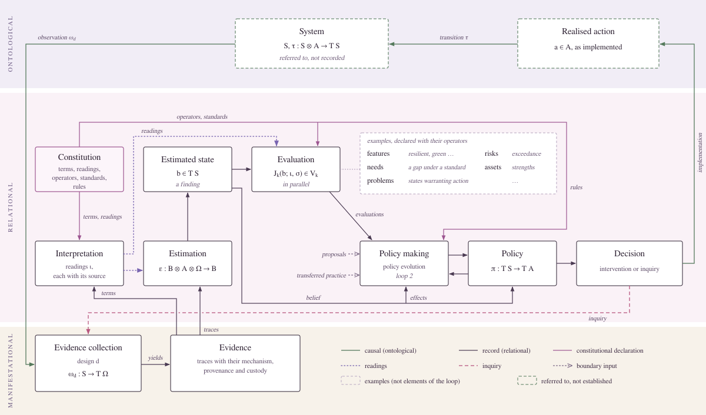
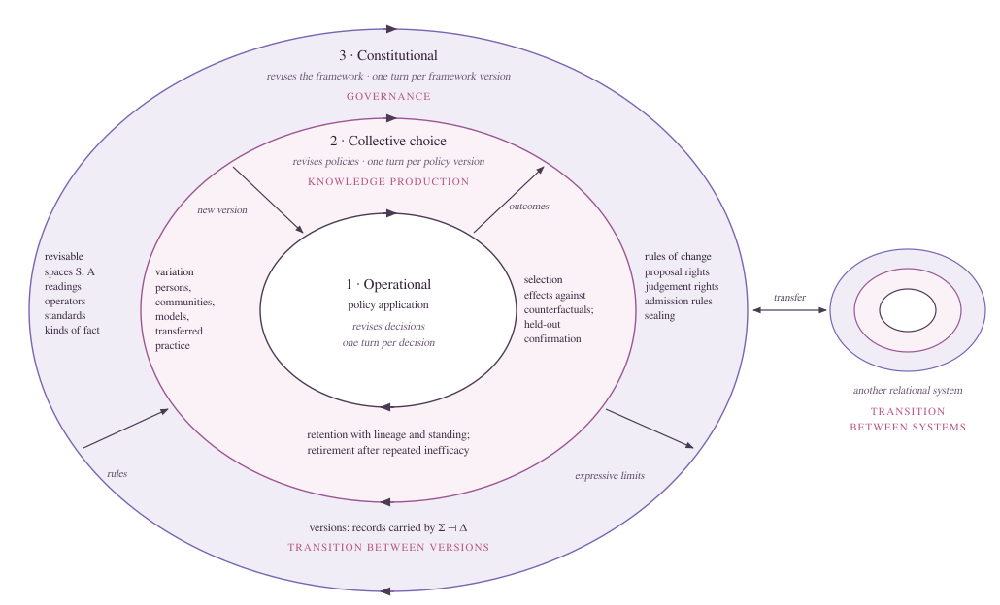
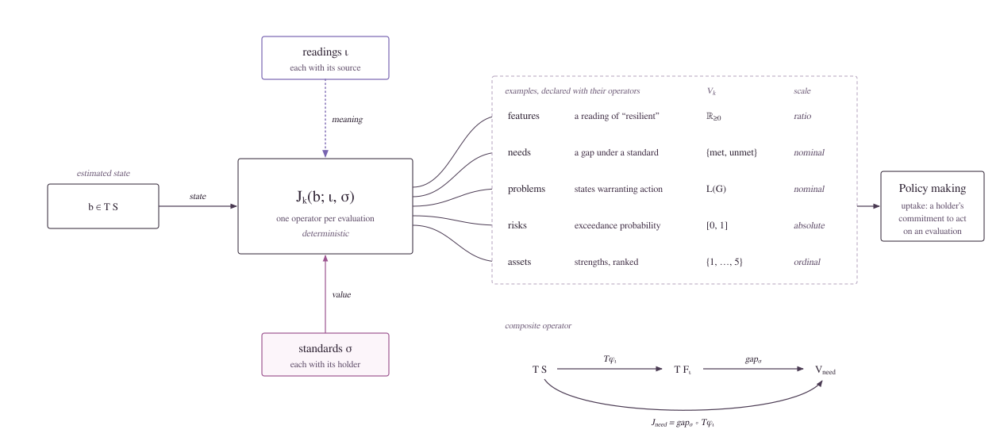
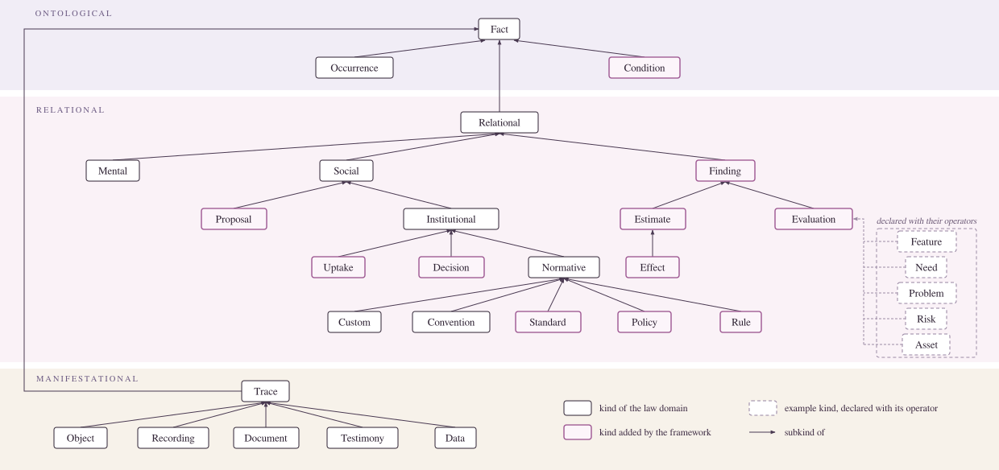
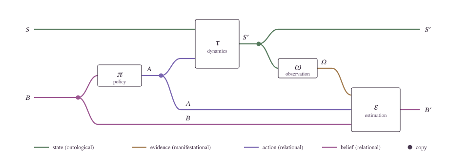
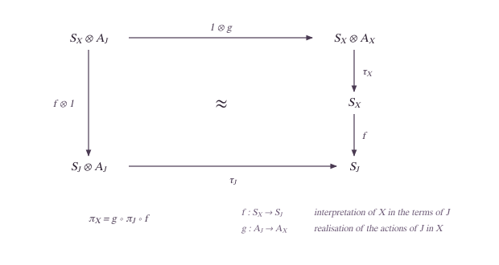
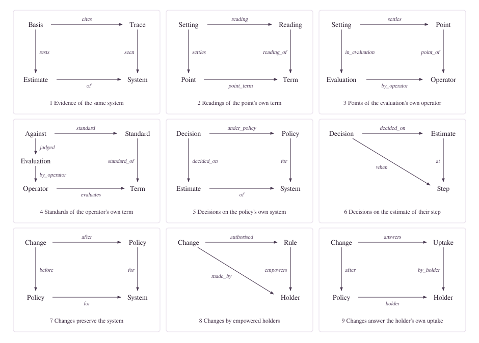

# From Evidence to Action: An Evolutionary Framework of Knowledge, Policy and Governance

*Status: seed (2026-11-18); promoted in part on 2026-11-18 to the foundation kybernesis ([ADR 0130](../decisions/0130-kybernesis-steering-by-evidence.md)): the architecture as data, admission of methods, the first methods and the loop. Policy making as evolution, transfer and the constitution remain here as seeds. The user's idea, as they gave it, and the four rounds of discussion that revised it (§1.4). The name is provisional (§9.1). Its figures for publication, with their captions, are in [publication/](2026-11-18-from-evidence-to-action/publication/README.md), and its verified schema is [schema.cat](2026-11-18-from-evidence-to-action/schema.cat).*

## 1. The Occasion and the Idea

### 1.1 The Occasion

The occasion was a description of the practitioner programmes of the Tokyo Development Learning Center (TDLC), a partnership of the Government of Japan and the World Bank Group: a "learning-to-action journey" of needs identification, collaborative learning, a technical deep dive in Japan, advisory support, community engagement and results capture; Japanese and global practices translated into "actionable inputs for operations and policy dialogue"; lessons captured and disseminated. The cities it serves are to become "green, inclusive, resilient and productive".

The user saw in it a general structure, and proposed to build it as a highly abstract framework, each part open to many methods, usable in many domains, which they first called an *Evidence-based Solution Development Framework*.

### 1.2 The Idea as the User Gave It

1. Evidence collection, and evidence, are needed.
2. From evidence to the estimation of states. This may involve interpretation and processing: formal models, estimators learned by machines or language models, human interpretation and judgement, Bayesian estimators such as POMDPs, and other methods.
3. Evidence should align with the infrastructure's taxonomy of facts, built in the law and archive work, and can be verified formally by the foundation of category theory.
4. From estimated states, by observation and interpretation, a morphism or an operator yields the system's features (green, resilient, inclusive, productive, and so on), represented in some geometry: a manifold, or a space of natural language L(G).
5. From estimated states, by observation and interpretation, needs and problems are also generated. They are objects of the framework with a place in the category theory, and belong to one of the kinds of fact or reality the foundations established.
6. Features (4) and needs and problems (5) are inputs to policy making.
7. The system holds a policy, and policy making makes the policy evolve. In the user's emphasis: **it is an evolutionary knowledge production, transition and governance framework**, and this should be recorded.
8. A policy, from an estimated state, produces an action.
9. The state space should be definable with no limit on its geometry or topology (any kind of mathematical space), and so should the space of possible actions, infinite ones included.

### 1.3 The Order of Work the User Proposed

1. Discuss and revise the idea; draw conceptual figures of its highest layers; write its documents.
2. A formal model in algebra and category theory, verified, with ontology and category consistent.
3. A foundation or a domain for it.
4. An urban policy-making application, or a plug-in of the Urban Studio.

The first two were named as the work of now. §8 agrees with the order and amends it.

### 1.4 The Course of the Discussion

The record keeps each round, so that what was revised, and why, stays visible.

1. **First round.** The idea revised point by point (§3), three figures and a first schema verified by kategoria.
2. **Second round: Interpretation had no input.** The user found that in Figure 1 the box Interpretation had outputs and nothing feeding it, and asked whether the design is well formed. A criterion was adopted from the Generative Relational framework: every relational fact states its emergence, persistence and efficacy, and whatever enters from outside the loop is declared. Faults of the same kind were found in the figure and in the schema alike, and repaired (§3.10).
3. **Third round: needs and problems are not basic.** The user found that Features → Needs → Problems was drawn as a chain. In their words, needs and problems "are not natural, not basic elements in our ontological framework", and "their generation is through some operator/morphism, from the estimated state, so I don't think needs should connect problems"; they might be made "observed outcome examples".

   The design now has one structural element, **evaluation**: operators on the estimated state, in parallel. Features, needs, problems, risks and assets are examples of what operators yield, declared at first by domains and, since the fourth round, with their operators. Taking something up became an act of policy making, an **uptake** (§3.4, §3.5). The figure and the schema were changed together, and kategoria verifies the new form (§6).

   This returns the design to the user's own points 4 to 6, which had features and needs in parallel. The first round had departed from them.
4. **Fourth round: figures for publication, in a relational and formal register.** The user asked for publishable figures, with unnecessary sentences removed and missing diagrams added. While they were drawn, the user made three corrections:
   - "Another place" was weird. "We have a relational philosophy, and also not fall into dualism of space and time"; "another relational system" is better.
   - "And no necessary space/time, even disciplinaries."
   - Terms such as "what was done" are too oral: no question form in figures; present things "more directly, formally".

   The figures were redrawn as seven ([publication/](2026-11-18-from-evidence-to-action/publication/README.md)). Three are new: evaluation, the kinds of fact, and the rules as commuting diagrams. The former formal skeleton was split into one step and transfer. Throughout:
   - transition is *between versions* and *between relational systems*, not in time or in space;
   - loops are counted in turns (per decision, per policy version, per framework version), not in units of a clock;
   - examples are declared with their operators, not by disciplines;
   - labels are formal nouns ("realised action", "proposal rights", "states warranting action").

   The record follows the same usage (§2.4, §3.7).

## 2. What the Framework Is

The framework describes how a system known only through evidence is steered by a policy, and how the policy, and the terms in which the system is described and judged, evolve under declared rules. It names no object in nature. A city, a river basin, a court, a clinic and a forest are instances of it, which is why it belongs among the foundations (§7).

Its philosophy comes before its structure, in four commitments.

### 2.1 Three Uncertainties Kept Apart

What a policy maker does not know is of three kinds, and each has its own mathematics:

1. **About the state**, epistemic: what the system's condition is. Estimators answer it with a belief: a distribution, a credal set, a set of possibilities, a point.
2. **About meaning**, semantic: what the words in the evidence and in the goals mean. Which income counts as low, and what "resilient" means here. Interpreters answer it with readings of open terms, each reading with its source (tekmerion's `construal`).
3. **About value**, normative: by whose standard a gap is a need. Standards answer it, each held by someone (Bradshaw's normative, felt, expressed and comparative).

A fourth uncertainty, about the law by which the system moves, is either taken into the state (unknown parameters estimated with it) or kept as a set of models with no probability over them (deep uncertainty, where robust decisions and adaptive pathways belong).

*Rationale.* Methods that fold these together hide where a conclusion may fail. A gap that is "clear" may be clear only under one reading of its words, or only by one person's standard, or only if the state is what the point estimate says. Kept apart, each can be contested where it is weak. The infrastructure already keeps them apart in different places (tyche's beliefs; tekmerion's readings; the needs domain's standards). The framework is the first place that holds all three at once.

### 2.2 The Registers Respected

The framework places its objects in the three registers of the Generative Relational framework (ADR 0113 adapted them for law):

- **Ontological.** The system's condition, and the realised action, are referred to and never established. The true state never appears in the record.
- **Manifestational.** Evidence: traces with the mechanism by which they came to be observed, their provenance and custody. A trace may manifest several facts, and traces that coincide merge nothing.
- **Relational.** Everything the framework computes or decides: estimates, features, needs, problems, policies, decisions, standards, rules. Each meets the register's three criteria. It emerged from a procedure (an estimator, a judgement, a deliberation). It persists until revised. It is efficacious, since the policy acts on it.

*Remark.* The last criterion is the point of the framework. An estimate becomes efficacious when a policy acts on it. That is why the framework must record how each estimate emerged, and must refuse estimates whose emergence it cannot state.

### 2.3 Evolution as the Way Knowledge Is Made

Policies are not derived. They are proposed, tried, judged and kept or retired, and the terms in which they are judged are revised in turn. The framework makes this explicit as variation, selection and retention, in three nested loops (§3.7, Figure 2), under rules of proposal, of judgement and of admission.

The selection must not deceive itself. Outcomes are estimated against what would have been, confirmations are made on evidence the search never saw, and errors are controlled as decisions accumulate. The needs domain's protocol (ADR 0125) is the first instance.

### 2.4 Spaces Without a Fixed Form

The state, action and evidence spaces may be any mathematical objects: finite sets, manifolds, function spaces, spaces of graphs or complexes, languages L(G), spaces of measures. Three things are kept apart:

- **the space**, an object of some category of spaces;
- **its representation** in a computer: a finite presentation, a sampler, a parametric family, a symbolic description;
- **the structure a method needs**: its *doctrine* (§5.1).

"Space" here is meant in the mathematical sense. The framework presupposes no physical space and no time, and no division into disciplines. Where a system has places or instants, they are part of its declared state space, as any other structure is; the order of the loop's steps is an order of events, not a clock.

A method declares what it needs. A space that lacks it is refused with the reason, never approximated in silence. An approximation is itself a declared map, such as a discretisation $S \to S_n$ stated with its error.

## 3. The Idea Revised, Point by Point

Each point keeps what the user proposed and says what changed, and why.

### 3.1 Evidence and Its Collection (Points 1 and 3)

**Kept.** Evidence, and its collection, as the framework's ground.

**Changed.**

1. *Collection is an action.* What to observe next is chosen by the policy, by the value of what it would teach (tyche's value of information and its budget of tests; tekmerion's POMDP interpreter, which probes when what it learns is worth it). The action space is a sum $A = A_{\text{intervene}} + A_{\text{inquire}}$. Evidence collection therefore lies inside the loop, not before it.
2. *Evidence carries its mechanism.* A trace is kept with the design that produced it: what was observed, of whom, and how units came to be observed (peira: full data coarsened by a mechanism). Without the mechanism, no estimator can correct for selection, nonresponse or censoring. Formally, a design $d$ fixes an observation channel $\omega_d : S \to T\Omega$.
3. *Evidence is kept as an archive keeps it,* by digest, provenance and custody (archeion), and charted, weighed and graded (tekmerion).
4. *The mechanism may depend on the policy.* Campbell's law: the more an indicator is used for decisions, the more it is subject to corruption (Campbell 1979). A framework that evolves policies by selecting on indicators exerts that pressure itself. The channel is therefore $\omega_{d,\pi}$, and the record must be able to say when a policy changed how its own evidence arises.

### 3.2 From Evidence to Estimated States (Point 2)

**Kept.** Many estimators (formal models, learned estimators, people, Bayesian filters, POMDP beliefs), none privileged.

**Changed.**

1. *Interpretation is not estimation.* Interpretation fixes what the evidence's words mean: readings of open terms, each with its source (authority, convention, analyst, data, proposal). Estimation infers what state the evidence supports under a reading. They are separate steps, and either may be done by a person, a model or a formal method. An estimate is therefore a family indexed by readings, $\iota \mapsto \hat b_\iota$.
2. *An estimate is not a point.* It is an element of $TS$, where $T$ expresses the estimator's kind of uncertainty: distributions, credal sets, sets of possibilities, or points (§5.1). Estimators of different kinds are compared by mapping into a common kind: a distribution to its support, a point to its Dirac measure. These maps are monad morphisms, so features computed before or after the comparison agree (§5.5).
3. *A model's estimate is a proposal.* As everywhere in the infrastructure, a language model proposes and never judges. Its estimate stands at grade C, enters as a proposal, and becomes the record's only when a person accepts it with an argument (tekmerion §4; ADR 0126).
4. *An estimate is a relational fact.* It records its estimator, the traces it rests on, the readings it was made under, its step and its standing. The schema verifies that an estimate rests only on traces of its own system (§6, rule 1).

### 3.3 Alignment With the Taxonomy of Facts (Point 3)

**Kept, and verified today** (§6).

**Corrected.** The taxonomy is the law domain's (`domains/law/schema/facts.cat`, with its theory note `domains/law/theory/facts-and-their-registers.md`). archeion holds manifestations, and the history domain has its own order of historical objects. A general framework cannot depend on a domain, since a foundation never does. So the general core of law's taxonomy has to move down to a foundation, and law then declares it, keeping what is its own: standing in a proceeding, roles in reasoning, adjudicative and legislative scope. The core is the registers, the kinds that are not tied to a proceeding, and the forms of a fact.

**What the schema shows.** The framework's kinds extend law's conservatively: the inclusion is full and faithful, so nothing new is said about law's kinds. It puts law's kinds in the registers where law puts them. It has a left adjoint: each of the framework's kinds has a most specific legal kind above it. An estimate or an evaluation is to law a relational fact; an uptake or a decision an institutional one; a policy or a standard a normative one; a system's condition a fact of the ontological register.

### 3.4 Evaluations of the Estimated State (Points 4 and 5)

**Kept, and made the structure.** The user's points 4 and 5 had the same form. From the estimated state, by observation and interpretation, a morphism or operator yields what the policy maker attends to: in point 4 the system's features, in point 5 its needs and problems. Both enter policy making in parallel (point 6). The framework therefore has one structural element here, **evaluation**: a family of operators applied to the estimated state, each yielding an evaluation, all in parallel. Features, needs, problems, risks and assets are **examples** of what operators yield. They are declared with their operators, in a constitution; the framework presupposes none of them, and no discipline (§3.5; §1.4).

1. *Morphism and operator, both.* An evaluation operator is a morphism $J_k : B \to V_k$ out of the object of beliefs, into a space $V_k$ of its own. It is parametrised by readings $\iota$ of its open terms and, where it has one, a standard $\sigma$: $J_k(b; \iota, \sigma)$. A feature of the state is the special case of an observable $\varphi : S \to F$ lifted to beliefs by the functor $T$: $J = T\varphi$, the pushforward. Over time a feature is acted on by an **operator**: a feature of the state one step on is $\varphi \circ \tau$, the Koopman operator applied to $\varphi$, adjoint to the transfer operator on beliefs (kinesis computes the transfer operator on a partition). Other evaluations are not lifts of state functions. The chance that a flood exceeds a depth is a functional of the belief, not the image of any feature. That is why the general form is a morphism out of $B$.
2. *An evaluation is deterministic.* Given the belief, the readings and the standard, the evaluation is determined. What is uncertain about the state is already in the belief, about meaning in the readings, and about value in the standard. In a Markov category this is the law $\mathrm{copy}\circ J = (J\otimes J)\circ\mathrm{copy}$ (Fritz 2020, Definition 10.1), and the same law for features of states. The schema verifies both: a noisy feature and a noisy evaluation are each refused (§6).
3. *Many evaluated words are thick concepts.* Green, resilient, inclusive and productive are descriptive and evaluative at once (Williams 1985), like negligence or good faith in law, whose facts already carry an "evaluative" form. Each has many readings. Resilience can mean an engineering return time, or an ecological basin width (Holling 1973, 1996), or adaptive capacity. An operator therefore declares its **open points**, and an evaluation settles each by a reading. A conclusion about resilience is clear, arguable or untenable over the admissible readings, as tekmerion's `construal` reads any finding. Some readings are computed by tools the infrastructure holds: return rates, basins with their widths, and signs of criticality such as slowing down, in kinesis.
4. *Each evaluation space is its own, and its scale decides what may be said.* Each $V_k$ is an object with its own structure. The structure that governs meaning is its **scale**, the group $G_k$ of admissible transformations (Stevens 1946; Krantz, Luce, Suppes and Tversky 1971):
   - nominal: every bijection;
   - ordinal: the increasing bijections;
   - interval: $x \mapsto ax + b$ with $a > 0$;
   - ratio: $x \mapsto ax$;
   - absolute: the identity.

   A statement about evaluations is **meaningful** exactly when its truth is invariant under the group. The mean of ordinal inclusiveness scores across districts is not meaningful. "Twice as green" is not meaningful on an interval scale. An evaluation in a language L(G) (a statement about a place in a controlled grammar, as the needs domain writes statements of need) is a word of the language. Comparing two such words needs a semantics $[\![\cdot]\!] : L(G) \to V$, which is itself declared.
5. *Evaluations together are partially ordered at best.* Their product $\prod_k V_k$ has no order of its own. Policies are compared there by trade-offs (Pareto fronts, as heuresis computes them) or by a declared aggregation: a composite indicator, whose weights are themselves an open term with readings (nomos's composite indicators).
6. *Composites are facts about operators, not arrows of the framework.* A domain may compute a need from a feature: the gap under a standard of a feature read under a reading, $J_{\text{need}} = \mathrm{gap}_\sigma \circ T\varphi_\iota$. That is one operator made by composing two, in the category. It draws no arrow from features to needs in the framework, since another domain's need, or its problem, may be read from the state directly.

### 3.5 Needs, Problems and the Other Examples

**The first revision, withdrawn.** The first round of this discussion ran three things together as a chain: a condition, a need (a gap judged by a standard someone holds) and a problem (a need taken up, after Kingdon 1984). It drew Features → Needs → Problems, and made Need and Problem kinds of the framework. The user corrected it (§1.4). Needs and problems are not basic elements of the ontological framework. Each is generated from the estimated state by an operator, so a need should not lead to a problem.

**What remains of it, now in its right place.**

- *A need* is what a need operator yields: a gap under a standard someone holds, Bradshaw's four kinds of standard among its parameters (the needs domain, after Bradshaw 1972).
- *A problem* is what a problem operator yields: what should be acted on, read from the state under declared purposes and readings.
- *Taking something up* is not an evaluation. Kingdon's "conditions become defined as problems when we come to believe that we should do something about them" describes an act of someone who will act. In the framework that act is an **uptake**, made in policy making where the agenda is set. It is an institutional fact, and what it takes up is an evaluation of any kind: a need, a problem, a risk, a feature that has fallen.
- *Strengths as well as gaps.* Assets and opportunities are evaluations too (Kretzmann and McKnight 1993), and capabilities may be read as sets of what people can do and be (Sen 1999). A framework that sees only deficits frames every place as lacking.

**The schema keeps it so.** Features, needs, problems, risks and assets form a category of *examples* that may be declared with operators, each a kind of evaluation, with no arrow among them. Declaring them changes nothing in the framework: the inclusion of the framework's kinds is full and faithful. The framework reads every example as an evaluation: the inclusion has a left adjoint sending each to Evaluation (§6).

**Problems still evolve with their solutions,** through uptake. For wicked problems, "the formulation of a problem is the problem" (Rittel and Webber 1973), and in design, problem and solution co-evolve (Dorst and Cross 2001). The evolutionary loop therefore varies and selects pairs: an operator that frames what should be acted on, with a policy for it. This is also a precise sense for the user's first name, *solution development*: a solution is such a pair whose effect has been estimated and which has standing. In the schema every change of policy answers an uptake, and only one made by whoever holds the policy (§6, rule 9).

### 3.6 The Inputs to Policy Making (Point 6)

**Kept.** The evaluations (features, needs, problems and whatever else the declared operators yield) enter policy making together.

**Widened.** Policy making also takes:

- the policy in force and its lineage;
- the record of outcomes, as effects estimated against what would have been (peira);
- practice of other relational systems, carried by transfer (§3.7);
- proposals from people, communities and models;
- the constitution: operators, standards, readings, rules.

It is a **process**, an operator on policies, not a function of the evaluations. It is also where uptakes are made: which evaluations someone undertakes to act on.

### 3.7 Evolution: Knowledge Production, Transition and Governance (Point 7)

**Recorded as the user's central claim:** the framework is an evolutionary framework of knowledge production, transition and governance.

**Structured** as three nested loops (Figure 2), each setting the bounds of the one inside it, and counted in turns rather than by any clock:

| Loop | What it revises | One turn per | Ostrom | Argyris and Schön | Hall |
|---|---|---|---|---|---|
| 1. Operational | decisions, under a fixed policy | decision | operational | single loop | first order: settings |
| 2. Collective choice | policies and framings of problems | policy version | collective choice | double loop | second order: instruments |
| 3. Constitutional | spaces, readings, operators, standards, kinds, rules of evidence and of change | framework version | constitutional | (later "triple" loop) | third order: goals |

(Kiser and Ostrom 1982; Argyris and Schön 1978; Hall 1993.) Sabel and Zeitlin's experimentalist governance runs the same cycle: framework goals, local discretion, reporting and peer review, revision of the goals (Sabel and Zeitlin 2008). For a development bank's practice, the nearest relative is problem-driven iterative adaptation (Andrews, Pritchett and Woolcock 2013, 2017). The others are adaptive management (Holling 1978; Walters 1986), dynamic adaptive policy pathways (Haasnoot et al. 2013), evolutionary epistemology (Campbell 1960) and Lindblom's incrementalism (1959). *Evolutionary Governance Theory* is already the name of a body of work (Van Assche, Beunen and Duineveld 2014), which bears on naming (§9.1).

**Knowledge production** is loop 2's selection, done honestly. Policies, and pairs of problem and policy, are varied: by persons, by transferred practice, by models, by generators. They are judged on effects estimated against counterfactuals, confirmed on evidence the search never saw, and controlled for error as decisions accumulate. Every test is sealed in a journal. They are retained with their lineage, and retired after repeated inefficacy. What is retained, with its standing, is the knowledge the framework produces: claims about what works, in which systems, by what mechanism. This is Campbell's "reforms as experiments" (1969) made operational, and heuresis's `evolution` with the needs protocol is its machinery.

**Transition** is of two kinds.

1. *Between versions.* When loop 3 changes the schema, records move along the change by functorial data migration (the pullback $\Delta$ and the left Kan extension $\Sigma$, as law's records already do; Spivak 2012).
2. *Between relational systems.* This is TDLC's mission exactly, where the systems are cities: a practice that worked in one carried to another (lesson-drawing, Rose 1991; policy transfer, Dolowitz and Marsh 2000). Formally a practice is a policy $\pi_J$ over the state space $S_J$ of the system it came from. Carrying it to $X$ needs two maps (Figure 6):
   - $f : S_X \to S_J$, the interpretation of $X$ in the terms of $J$;
   - $g : A_J \to A_X$, the realisation of the actions of $J$ in $X$.

   Then $\pi_X = g \circ \pi_J \circ f$, up to $T$. The pair $(f, g)$ is a **lens**. The transfer is valid when the mechanism commutes,
   $$f \circ \tau_X \circ (1 \otimes g) \;\approx\; \tau_J \circ (f \otimes 1) \quad : S_X \otimes A_J \to S_J,$$
   within a declared tolerance. Cartwright and Hardie's support factors are what make it commute (Cartwright and Hardie 2012). Pearl and Bareinboim's transportability says when the commuting can be checked from data (Pearl and Bareinboim 2014). The policy domain's `transfer` and peira's transport are its first pieces.

**Governance** is loop 3's rules over loops 2 and 1: who may propose, who judges, by what standard a change is admitted, what is sealed. The schema verifies its first rule: a change of policy is made only by one whom the authorising rule empowers (§6, rule 7).

*Caveat (what evolution can do wrong).*

- Selection on indicators corrupts them (§3.1.4).
- Selection on what is quickly observed favours the short term.
- Selection by whom is a question of legitimacy, not of method.
- Retained policies create path dependence and lock-in.

The framework cannot remove these. It can record them, and make each visible where it acts.

### 3.8 From Estimate to Action (Point 8)

**Kept.** A policy takes what is estimated to an action.

**Changed.**

1. *A policy takes beliefs, not states:* $\pi : TS \to TA$, a Kleisli arrow, possibly randomised. Acting on a point estimate (certainty equivalence) is a declared simplification, optimal only in special cases.
2. *Actions include inquiries,* which close the loop to evidence (§3.1).
3. *The decided action is not the action done.* Implementation is a channel $A \to T(A_{\text{done}})$ (Pressman and Wildavsky 1973), observed by results capture.
4. *Urban policies are often contingent plans:* signposts (features watched), triggers (thresholds on them) and actions, laid out as adaptive pathways (Haasnoot et al. 2013). That is a policy on beliefs with thresholds on features, and it fits the form above.
5. *"Policy" has two senses,* kept apart. In the framework's mathematics a policy is a rule from beliefs to actions. In government, a policy is a normative fact: a rule adopted by a holder for a purpose by an instrument. The second contains the first. The schema's kind Policy is the second.
6. *Many hold policies.* A city, its ministries, its residents and its firms each hold one, and the joint outcome is a game (nomos's games; tyche's decentralised POMDPs). Who holds the policy the framework evolves must be declared.

### 3.9 Spaces Without Limit (Point 9)

**Kept.** State, action and evidence spaces of any kind, infinite ones included.

**Made precise** by §2.4 and §5.1. The framework is parametric over a doctrine (a category of spaces with a kind of uncertainty), and every method states what it requires of a space:

- Bayesian inversion needs conditionals, as standard Borel spaces under the Giry monad have;
- possibilistic filtering needs only sets;
- a Kalman filter needs linear spaces and Gaussian laws;
- exact POMDP solution needs finite sets.

An infinite or uncountable space is admitted as an object, and computed with through a representation. kinesis already answers every tool with the levels at which a system is known and with refusals, and physis keeps a field's fibre, representation and provenance apart. The framework takes both habits.

### 3.10 The Design Checked for Well-Formedness

**The user's observation.** In the first drawing of Figure 1, Interpretation had outputs and no input: readings came from nowhere. The user asked whether the design as a whole is well formed.

**The criterion.** It is the Generative Relational framework's own. A design is well formed when:

1. **Emergence.** Every relational fact states what it emerged from, and not only what it is about.
2. **Persistence.** It states from which step of the loop it holds: an order of events, not a clock.
3. **Efficacy.** Something uses it.
4. **Declared boundary.** Whatever enters from outside the loop is drawn and named as a boundary input, never left implicit.

In a drawing, criteria 1 and 3 mean every box has an input and an output. In the schema they mean every relational table has references to what it rests on, and is referred to.

**Faults found, in the figure and in the schema alike.** The figure and the schema had the same holes, which is some evidence that the criterion is the right one:

| Fault | In the figure | In the schema | Repair |
|---|---|---|---|
| Readings emerged from nothing | Interpretation had no input | a Reading referred only to its term (what it is about) | Interpretation reads the evidence's words and the constitution's terms and declared readings; a Reading states its `from` (authority, convention, analyst, data, proposal) and may rest on traces (`Ground`) |
| Estimates were not tied to their readings | the arrow Interpretation → Estimation had no counterpart | an Estimate had no readings | `Construal`: an estimate is made under readings of the evidence's terms ("flooded" read as over ten centimetres) |
| Standards came from nowhere | Needs were "judged by a standard someone holds", drawn from nothing | (a Standard had its term and holder) | the constitution, drawn as a box: terms and readings, standards and who holds them, rules; loop 3's state, a declared boundary of loop 1. Since the third round, standards are inputs of evaluation operators (rule 4) |
| Problems had no effect | Problems → Policy making had no counterpart | nothing referred to a Problem | a Change of policy `answers` what was taken up, by its holder. Since the third round, what is answered is an uptake of any evaluation (rule 9) |
| A box of inputs with no inputs | "Also brought in" had no arrows in | (none) | removed: the policy in force is an arrow back to policy making; effects are a branch of the belief's path; proposals and practice elsewhere are declared boundary inputs |

The schema verifies the repairs (§6). A reading that states no source cannot even be written: in a set-valued functor every reference is a total function, and kategoria refuses such a record with "the action of from is not given".

**What the audit leaves open,** said so that it is not mistaken for done:

- *Persistence* is stated only by estimates and decisions, by their step. Evaluations, uptakes and policies inherit or omit it, and the constitution has no versions in the schema yet.
- *Evidence collection* is drawn and not yet in the schema. A trace does not name its design, and an inquiry does not commission one; a join `Commission` (decision × design) is the planned form, since not every design was decided in the record.
- *Proposals* are drawn as a boundary and kept apart, as tekmerion keeps them, but have no tables. They must get tables that never enter the record's verdicts.
- *The check itself* was made by reading. A mechanical check needs each reference's role declared (emergence, persistence, aboutness), which is a small addition to the schema language or a tool beside it.

**A principle drawn from it.** Every arrow of Figure 1 that lies inside the record should be a reference of the schema, and every reference should be an arrow. The arrows that cross registers (observing the world, carrying out an action) are not references: they are morphisms of the process signature (`Steering`, §5.2). The figure is thus the union of two verified objects, and can be checked against both.

## 4. The Revised Architecture

Seven figures, drawn for publication. Each is an SVG with a PDF and a PNG beside it, and their full captions are in [publication/README.md](2026-11-18-from-evidence-to-action/publication/README.md).



*Figure 1. The loop from evidence to action across the three registers.*



*Figure 2. Three nested loops: knowledge production, governance, and transition between versions and between relational systems.*



*Figure 3. Evaluation: operators on the estimated state in parallel, their three arguments carrying state, meaning and value; examples with their value spaces and scales; a composite operator; uptake in policy making.*



*Figure 4. The kinds of fact in the three registers: the law domain's, the framework's additions, and example kinds declared with their operators.*



*Figure 5. One step of the loop as a string diagram in a Markov category.*



*Figure 6. Transfer between two relational systems as a lens.*



*Figure 7. The nine rules of the record as commuting diagrams.*

| Part | Mathematical object | Kind (register) | Where the infrastructure holds it today |
|---|---|---|---|
| The system | $S$ with $\tau : S \otimes A \to TS$ | Condition (ontological) | kinesis's declared systems; the domains' models |
| Evidence collection | a design $d$; $\omega_d : S \to T\Omega$ | an inquiry decided | peira's designs; tyche's value of information; tekmerion's looks bought |
| Evidence | traces in $\Omega$, with mechanism, provenance, custody | Trace (manifestational) | archeion's holdings; tekmerion's charts and reviews; zetesis's coding |
| Interpretation | readings $\iota \in I$ of open terms, read from the evidence's words and the constitution's declared readings | each reading's kind is its source's (a norm, a convention, a finding, a proposal) | tekmerion's `construal`; apodeixis's $D(\varphi)$ |
| The constitution | terms and declared readings, standards and their holders, rules; a version of the schema | Standard, Rule (normative); loop 3's state, a boundary of loop 1 | kategoria's schemas and migration; archeion's sealed journal |
| Estimation | $\varepsilon : B \otimes A \otimes \Omega \to B$, beliefs $b \in TS$ | Estimate (finding) | tyche's Bayes, filters, HMMs and POMDP beliefs; kinesis's laws from records; tekmerion's interpreters |
| Evaluation | operators $J_k(b; \iota, \sigma) : B \to V_k$ with open points, standards and scale groups $G_k$; features are the case $T\varphi$ | Evaluation (finding) | for its examples: urban science's `indicators` and nomos's measurement (features); the needs domain (needs); tyche's exceedance (risks); kinesis's basins and criticality (readings of resilience) |
| Uptake | someone undertakes to act on an evaluation | Uptake (institutional), made in policy making | the policy domain's `change` (theories of change for what is taken up) |
| Policy making | $\Pi : \mathrm{Pop}(P) \otimes R \to T\,\mathrm{Pop}(P)$ | a process | heuresis's `evolution`; the policy domain; tyche's `decision` |
| Policy | $\pi : P \otimes TS \to TA$ (parametrised) | Policy (normative) | tyche's POMDP policies; the policy domain's `adoption` |
| Decision and action | $a \in A$; implementation $A \to T A_{\text{done}}$ | Decision (institutional), then Occurrence | (none yet) |
| Transfer | a lens $(f, g)$ with a commuting square | (a relation between two systems) | the policy domain's `transfer`; peira's transport |

## 5. The Formal Model, First Sketch

### 5.1 The Doctrine

The setting is a **Markov category** $\mathcal C$ (Fritz 2020): a symmetric monoidal category in which every object carries a commutative comonoid (copy and delete), compatible with the monoidal structure, with delete natural. Typically $\mathcal C$ is the Kleisli category of a commutative monad $T$ on a cartesian category of spaces. The instances the framework needs:

| Doctrine | Spaces | $T$ | What an estimate is |
|---|---|---|---|
| deterministic | sets | identity | a point |
| possibilistic | sets | non-empty powerset ($\mathrm{Kl}(P^+)$, total relations) | a set of possible states |
| probabilistic | standard Borel spaces | Giry | a distribution; conditionals exist (Cho and Jacobs 2019) |
| linear Gaussian | finite-dimensional real spaces | Gaussian laws | a mean and covariance |
| credal | sets or Borel spaces | convex sets of distributions | a credal set |

*Caveat.* Combining probability and non-determinism has no distributive law in the plain sense. The credal monad needs a weak one (Goy and Petrişan 2020), and it is the doctrine to be worked out last.

### 5.2 The Signature of a Steered System

The signature has objects $S, A, \Omega, B$, $F_\iota$ and $V_k$, and morphisms

$$\tau : S \otimes A \to S, \quad \omega : S \to \Omega, \quad \varepsilon : B \otimes A \otimes \Omega \to B, \quad \pi : B \to A, \quad \varphi_\iota : S \to F_\iota, \quad J_k : B \to V_k,$$

with each $\varphi_\iota$ and each $J_k$ deterministic. $B$ is any object read as beliefs over $S$. In the probabilistic doctrine with $B = TS$, $\varepsilon$ is the Bayesian filter, built from the Bayesian inversion of $\omega$ composed with $\tau$. Bayesian updates compose as optics (Smithe 2020), which is what lets estimators be chained.

### 5.3 The Closed Loop

One step is the string diagram (Figure 5)

$$\mathrm{step} : S \otimes B \to S \otimes B$$

that copies the belief, applies the policy, copies the action, moves the state, copies it, observes it, and updates the belief. $(S \otimes B, \mathrm{step})$ is then a Markov chain on states and beliefs, the POMDP of Kaelbling, Littman and Cassandra (1998) in this doctrine. No wire runs from $S$ to $\pi$: the policy sees the system only through evidence, by typing alone.

### 5.4 The Soundness of an Estimator

Let $m : S \otimes B \to S \otimes B$ be the partial identity on the pairs whose state lies in the belief (possibilistic doctrine). An estimator is **sound** when

$$m \mathbin{;} \mathrm{step} \;=\; m \mathbin{;} \mathrm{step} \mathbin{;} m,$$

that is, one step from a true belief always lands in a true belief. kategoria decides it on the riverside world (§6). The exact possibilistic filter is sound. The estimator that takes the evidence at its word is not: a false alarm over a dry district makes it believe a flood. This is the first formal statement of why the framework keeps a model's word as a proposal.

### 5.5 Evaluations Across Doctrines

A monad morphism $\theta : T \Rightarrow T'$ compares estimators of two kinds. Two examples:

- Dirac, $\delta : \mathrm{Id} \Rightarrow D$;
- support, $\mathrm{supp} : D \Rightarrow P$ on finite distributions. It is a monad morphism: the support of a mixture is the union of the supports of its components of positive weight.

By naturality, for every feature,

$$T'\varphi \circ \theta_S = \theta_F \circ T\varphi.$$

Computing a feature and then coarsening the estimate agrees with coarsening and then computing. So heterogeneous interpreters can be compared feature by feature without fixing one doctrine for all. An evaluation that is not the lift of a feature (the chance of exceeding a depth) must be given in each doctrine. Comparing it across them needs $\theta_V \circ J = J' \circ \theta_S$, a condition to be checked for each operator, never assumed.

### 5.6 Evaluations, Readings and Meaningfulness

Estimates and evaluations are families over the space of interpretations $I = \prod_k P_k$ (one factor per open point), objects of the slice over $I$. An operator declares its open points, and an evaluation settles each by a reading (rules 2 and 3 of the schema). Where a standard $\sigma$ applies, the verdict is a map $J_\sigma : V \to \{\text{met}, \text{not met}\}$, judged only by a standard of the operator's own term (rule 4). It is **meaningful** when $J_\sigma(g \cdot x) = J_\sigma(x)$ for every $g$ in the scale's group. Over the admissible readings it is clear, arguable or untenable (tekmerion §9), and its standing is read from an argumentation framework (apodeixis), as a need's already is.

### 5.7 Policies and Their Evolution

A policy is a parametrised morphism, an arrow of $\mathrm{Para}(\mathcal C)$, $\pi : P \otimes B \to A$ (Capucci, Gavranović, Hedges and Rischel 2022; Cruttwell et al. 2022). A population is a finite multiset of parameters, whose structure may itself vary (a policy's form, not only its numbers). Policy making is a step

$$\Pi : \mathrm{Pop}(P) \otimes R \to T\,\mathrm{Pop}(P)$$

on populations given the record $R$, and evolution is $\Pi$ iterated, interleaved with loop 1. Systems that interact (the world and the institutions that steer it, or several holders of policies) are wired as lenses, or as polynomial functors and their coalgebras (Niu and Spivak 2023).

### 5.8 The Record and Its Rules

A record is a set-valued functor on a schema whose objects are tables, whose arrows are references and whose equations are rules (Spivak 2012). This is the form law's records take. The first version has eight rules (§6). A change of the constitution is a map of schemas, and records move along it by $\Sigma \dashv \Delta$.

### 5.9 What Is Shown and What Is Not

**Shown, by kategoria on finite instances:** the ontology's consistency with law's; the signature's models in two doctrines; determinism refusing a noisy feature; soundness of one estimator and its failure for another; the record's eight rules, each refusing what it should.

**Standard, cited:** the Markov category axioms of the doctrines; Bayesian inversion in standard Borel spaces; naturality of monad morphisms; Para and lenses.

**Conjecture, to be proved:**

- soundness of the Bayesian filter, stated in any Markov category with conditionals, where it becomes almost-sure support preservation;
- composition of transfers: two commuting squares within tolerances $\epsilon_1, \epsilon_2$ compose within $\epsilon_1 + L\epsilon_2$, $L$ a Lipschitz constant;
- reflexive channels $\omega_\pi$ as a fixed-point problem.

## 6. What kategoria Verified Today

The script is [schema.cat](2026-11-18-from-evidence-to-action/schema.cat), and its answers are in [figures/README.md](2026-11-18-from-evidence-to-action/figures/README.md). There are 42 statements, every one as expected. Run from the repository root:

```
node applications/category-studio/tools/draw-schema.mjs development/ideas/2026-11-18-from-evidence-to-action/schema.cat development/ideas/2026-11-18-from-evidence-to-action/figures
```

1. **Kinds.** The framework's kinds form a thin category of 26 objects with Fact terminal; Evaluation and Uptake are among them, and Feature, Need and Problem are not.
   - Law's kinds include into it fully and faithfully. The inclusion followed by the registers is naturally isomorphic to law's own map to the registers. The inclusion has a left adjoint, verified with both triangle identities.
   - The examples that may be declared with operators (features, needs, problems, risks, assets, each a kind of evaluation, none related to another) form a thin category of 31 objects. The framework's kinds include into it fully and faithfully, so declaring examples changes nothing. The inclusion has a left adjoint that reads every example as an evaluation.
2. **The loop.** The signature `Steering` has 6 types, 16 generators and 19 laws, an evaluation of the belief among them. Its step is well formed, $S \otimes B \to S \otimes B$. It has a model among functions (`Sure`) and one among relations (`Possible`), each satisfying all 19 laws entry by entry. In both, the evaluation is a concern when the belief allows a flood.
   - A model whose feature is noisy fails the law of determinism for features, at output 1, input 0.
   - A model whose evaluation answers one belief two ways fails the law of determinism for evaluations, at output 1, input 2.
   - The possible world's dynamics are not deterministic: the world's uncertainty is not a feature's.
   - The exact possibilistic filter is sound. The face-value estimator is a lawful model of the signature, and is not sound.
3. **The record** has 22 tables, 36 references and 9 rules:
   1. an estimate rests only on traces of its own system;
   2. a point is settled by a reading of that point's own term;
   3. an evaluation settles only the open points of its own operator;
   4. an evaluation is judged only by a standard of the term its operator evaluates;
   5. a decision is taken on an estimate of the system its policy is for;
   6. a decision is taken on what was estimated at its step;
   7. a change of policy keeps its system;
   8. a change is made by one whom its authorising rule empowers;
   9. a change answers an evaluation taken up by whoever holds the policy it changes.

   Readings state their source and may rest on the words of traces, and estimates are made under readings (§3.10). Which kind of evaluation an operator yields is the declaring domain's business, not the record's.

   A small invented record of a riverside district satisfies all nine. Three operators (resilience, reach and a need for recovery) are applied to one estimate under readings from an authority, a convention and the data. Two standards are held by different people. One evaluation is taken up by the city, and the policy is changed to answer it. Seven records are refused, each by the rule it breaks:
   - evidence of another relational system taken without a transfer (1);
   - a point of "resilient" settled by a reading of "inclusive" (2);
   - an evaluation settling another operator's point (3);
   - an evaluation of resilience judged by a standard of greenness (4);
   - a decision on an estimate made later (6);
   - a policy changed by someone the rule does not empower (8);
   - the city's policy changed to answer an evaluation only the ministry took up (9).

   Outside the script, a record whose reading states no source is refused before any rule is applied, since every reference is a total function.

*Caveat.* kategoria decides claims about finite categories and finite models. The general propositions of §5 are cited or remain to be proved; the finite checks are instances of them, and catch errors in the schema, not in the theorems.

## 7. Where It Would Live (a Proposal, Awaiting Agreement)

By CLAUDE.md §6.5, nothing below is built until the user agrees.

1. **A foundation.** The framework names no object in nature. It would be the highest of the foundations, on tekmerion (evidence, readings, interpreters), tyche (beliefs, decisions), peira (designs, mechanisms, effects, transport), heuresis (evolution), kinesis (dynamics, features of dynamics), apodeixis (standing), archeion (records, journals) and kategoria (schemas, migration). Its name is the user's choice (§9.1).
2. **The general core of the taxonomy of facts moves down** to it, or to tekmerion, and law declares it (§3.3).
3. **The policy domain becomes its first domain.** EBPM's decision (adopt, reject or study first) is one step of the loop. Its actions are an intervention, the null action and an inquiry, and its `transfer` is a first lens.
4. **Its first modules,** each small:
   - `system`: signatures, doctrines, requirements and refusals;
   - `loop`: one step, soundness, the record of a step;
   - `evaluation`: operators with open points, standards, scales and meaningfulness, and the declaration of examples by domains (the needs domain's statements of need would be one such declaration);
   - `evolution`: populations of policies and of the operators that frame what is to be acted on, with uptakes and the honest protocol, on heuresis;
   - `transfer`: lenses and commuting squares;
   - `constitution`: versions, rules, migration and the journal.
5. **The work.** A plug-in of the Urban Studio first, rather than a new application. The Urban Studio already holds the parts as plug-ins (evidence in space and time, needs, population, cities across scales, provision), and the framework is what composes them. The Policy Studio's appraisal would be one of its tools. A work of its own can come when the plug-in outgrows the studio.

*Remark (the learning-to-action journey).* Read against the framework, TDLC's journey is one turn of loop 2:

| The journey | The framework |
|---|---|
| needs identification | evaluations: needs and problems among the declared examples, §3.4 and §3.5; uptake |
| collaborative learning | variation by many proposers |
| a technical deep dive in Japan | transfer: reading a city in a Japanese city's terms, $f$ and $g$, and finding the support factors that make the square commute |
| advisory support | policy making |
| community engagement | felt and expressed needs, standards held by residents, and legitimacy |
| results capture | selection on estimated effects |

Its knowledge products are what loop 2 retains, with their standing. The Sendai Framework's priorities (understanding risk, governance, investment, preparedness) fall on the same loop. The resilient city is the clearest first case: readings of resilience are computable, the evidence is rich, and Japanese practice is well documented.

*Remark (coordination).* Another session is founding domains of disaster risk, climate risk and risk management, and a plug-in of lifelines for the Urban Science Workbench, with Japan's hazards in the data library (uncommitted at the time of writing). They would be natural first instances of the framework, and their authors should be consulted before either side fixes shared names.

## 8. The Order of Work, Revised

The user's order is right, and formalisation before code is the infrastructure's habit. Amended:

1. **Discussion and documents.** This seed, then a theory note in the foundation when it is founded.
2. **The formal model, verified.**
   - (a) The first schema: done (§6).
   - (b) Transfer as a lens, and a second version of the record schema that admits evidence of other relational systems through a declared transfer, with records migrated along the change.
   - (c) Scales as groups, with meaningfulness checked on finite scales.
   - (d) The conjectures of §5.9 proved on paper.
   - (e) The constitution's levels as a schema of rules over rules.
3. **An ADR** proposing the foundation, its name, its place in the order, and the move of the taxonomy's core; then its first modules, each with checks.
4. **The work:** a plug-in of the Urban Studio on one real case, with real data and one transfer, every assumption declared.

## 9. Open Questions for the User

### 9.1 The Name

The user's name, *Evidence-based Solution Development Framework*, names loop 2 precisely (§3.5). Alternatives:

- **kybernesis** (κυβέρνησις, steering, government) for the foundation. It is the root of both "govern" and "cybernetics", and names the user's three at once: steering learns (knowledge), carries its craft to other systems (transition), and holds a course under rules (governance).
- *bouleusis* (βούλευσις, Aristotle's deliberation about what is in our power), if deliberation should be in the name.
- *pronoia* (forethought).

For the framework's public name: *Steering by Evidence*, or *From Evidence to Action*, close to TDLC's "learning-to-action".

### 9.2 Other Questions

1. A foundation, as §7 proposes, or a domain?
2. Where the core of the taxonomy of facts moves: to the new foundation, or to tekmerion.
3. One holder of the policy at first, or many, as a game, from the start.
4. Which doctrines first. Recommended: possibilistic and finite probabilistic first, Gaussian next, credal last.
5. Whether loop 2 evolves pairs of problem and policy (recommended), or policies alone.
6. The first case. Recommended: the resilience of a city to floods, with one Japanese practice transferred and its support factors examined, coordinated with the risk domains under way.
7. The work: a plug-in of the Urban Studio (recommended), or a new application.

## 10. References

- Andrews, M., Pritchett, L. and Woolcock, M. (2013). Escaping capability traps through problem driven iterative adaptation (PDIA). *World Development* 51, 234–244.
- Andrews, M., Pritchett, L. and Woolcock, M. (2017). *Building State Capability: Evidence, Analysis, Action*. Oxford University Press.
- Argyris, C. and Schön, D. A. (1978). *Organizational Learning: A Theory of Action Perspective*. Addison-Wesley.
- Bradshaw, J. (1972). The concept of social need. *New Society* 30, 640–643.
- Campbell, D. T. (1960). Blind variation and selective retention in creative thought as in other knowledge processes. *Psychological Review* 67(6), 380–400.
- Campbell, D. T. (1969). Reforms as experiments. *American Psychologist* 24(4), 409–429.
- Campbell, D. T. (1979). Assessing the impact of planned social change. *Evaluation and Program Planning* 2(1), 67–90.
- Capucci, M., Gavranović, B., Hedges, J. and Rischel, E. F. (2022). Towards foundations of categorical cybernetics. *Applied Category Theory 2021*, EPTCS 372, 235–248.
- Cartwright, N. and Hardie, J. (2012). *Evidence-Based Policy: A Practical Guide to Doing It Better*. Oxford University Press.
- Cho, K. and Jacobs, B. (2019). Disintegration and Bayesian inversion via string diagrams. *Mathematical Structures in Computer Science* 29(7), 938–971.
- Cruttwell, G. S. H., Gavranović, B., Ghani, N., Wilson, P. and Zanasi, F. (2022). Categorical foundations of gradient-based learning. *ESOP 2022*, LNCS 13240.
- Dolowitz, D. P. and Marsh, D. (2000). Learning from abroad: the role of policy transfer in contemporary policy-making. *Governance* 13(1), 5–23.
- Dorst, K. and Cross, N. (2001). Creativity in the design process: co-evolution of problem–solution. *Design Studies* 22(5), 425–437.
- Fritz, T. (2020). A synthetic approach to Markov kernels, conditional independence and theorems on sufficient statistics. *Advances in Mathematics* 370, 107239.
- Giry, M. (1982). A categorical approach to probability theory. *Categorical Aspects of Topology and Analysis*, LNM 915, 68–85.
- Goy, A. and Petrişan, D. (2020). Combining probabilistic and non-deterministic choice via weak distributive laws. *LICS 2020*.
- Haasnoot, M., Kwakkel, J. H., Walker, W. E. and ter Maat, J. (2013). Dynamic adaptive policy pathways. *Global Environmental Change* 23(2), 485–498.
- Hall, P. A. (1993). Policy paradigms, social learning, and the state. *Comparative Politics* 25(3), 275–296.
- Holling, C. S. (1973). Resilience and stability of ecological systems. *Annual Review of Ecology and Systematics* 4, 1–23.
- Holling, C. S. (ed.) (1978). *Adaptive Environmental Assessment and Management*. Wiley.
- Holling, C. S. (1996). Engineering resilience versus ecological resilience. In *Engineering Within Ecological Constraints*, National Academy Press, 31–44.
- Kaelbling, L. P., Littman, M. L. and Cassandra, A. R. (1998). Planning and acting in partially observable stochastic domains. *Artificial Intelligence* 101, 99–134.
- Kingdon, J. W. (1984). *Agendas, Alternatives, and Public Policies*. Little, Brown.
- Kiser, L. L. and Ostrom, E. (1982). The three worlds of action. In E. Ostrom (ed.), *Strategies of Political Inquiry*, Sage, 179–222.
- Krantz, D. H., Luce, R. D., Suppes, P. and Tversky, A. (1971). *Foundations of Measurement*, vol. I. Academic Press.
- Kretzmann, J. P. and McKnight, J. L. (1993). *Building Communities from the Inside Out*. ACTA Publications.
- Lindblom, C. E. (1959). The science of "muddling through". *Public Administration Review* 19(2), 79–88.
- Niu, N. and Spivak, D. I. (2023). *Polynomial Functors: A Mathematical Theory of Interaction*. Preprint.
- Pearl, J. and Bareinboim, E. (2014). External validity: from do-calculus to transportability across populations. *Statistical Science* 29(4), 579–595.
- Pressman, J. L. and Wildavsky, A. (1973). *Implementation*. University of California Press.
- Rittel, H. W. J. and Webber, M. M. (1973). Dilemmas in a general theory of planning. *Policy Sciences* 4, 155–169.
- Rose, R. (1991). What is lesson-drawing? *Journal of Public Policy* 11(1), 3–30.
- Sabel, C. F. and Zeitlin, J. (2008). Learning from difference: the new architecture of experimentalist governance in the EU. *European Law Journal* 14(3), 271–327.
- Sen, A. (1999). *Development as Freedom*. Oxford University Press.
- Smithe, T. St C. (2020). Bayesian updates compose optically. arXiv:2006.01631.
- Spivak, D. I. (2012). Functorial data migration. *Information and Computation* 217, 31–51.
- Stevens, S. S. (1946). On the theory of scales of measurement. *Science* 103, 677–680.
- Van Assche, K., Beunen, R. and Duineveld, M. (2014). *Evolutionary Governance Theory: An Introduction*. Springer.
- Walters, C. (1986). *Adaptive Management of Renewable Resources*. Macmillan.
- Williams, B. (1985). *Ethics and the Limits of Philosophy*. Fontana.
