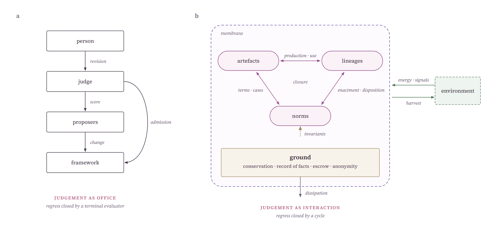
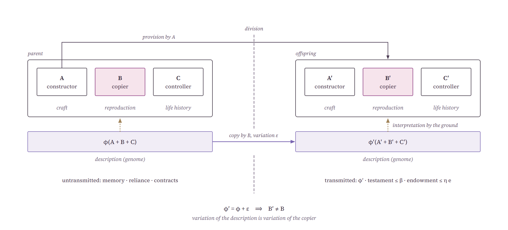
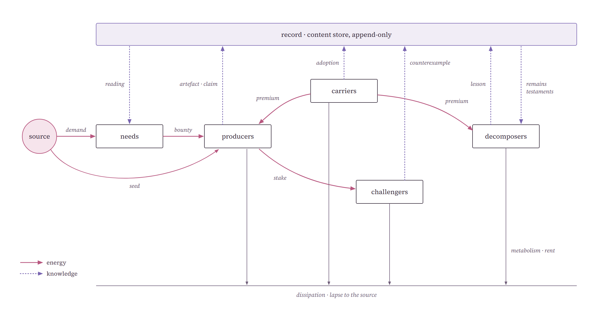
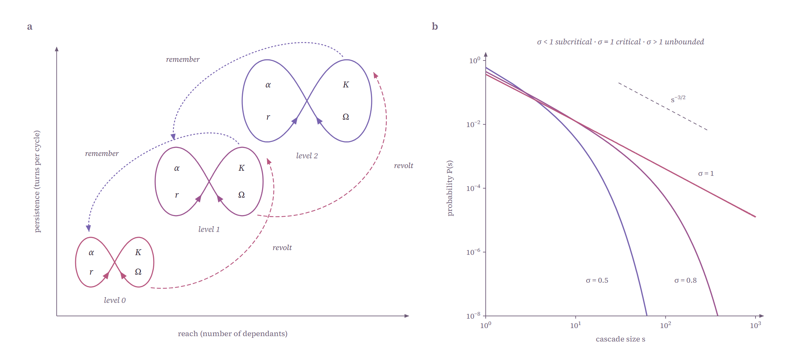
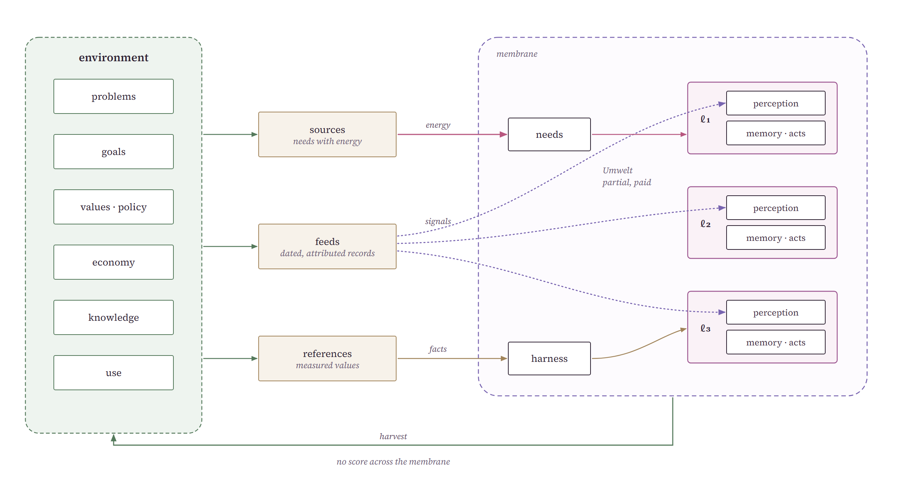
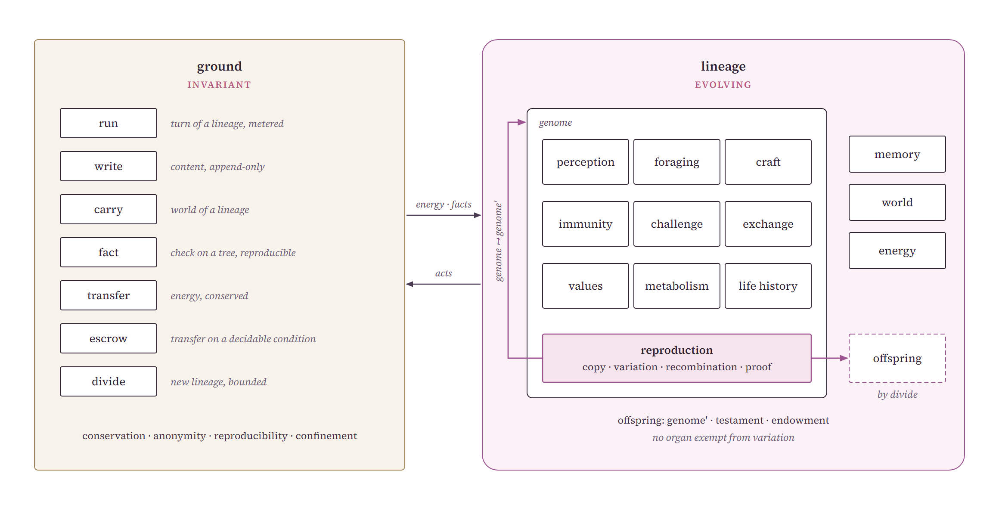
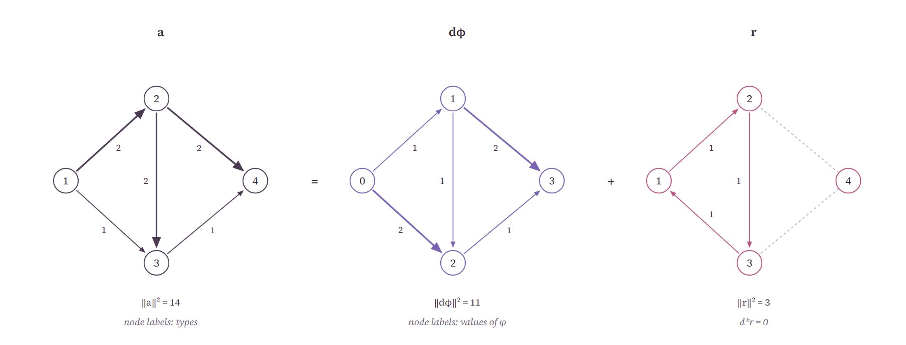
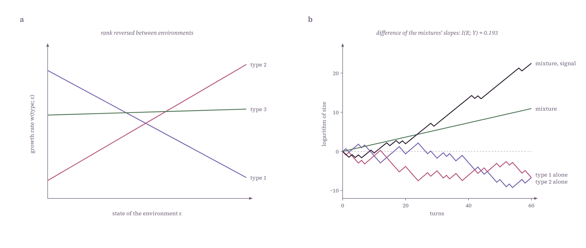
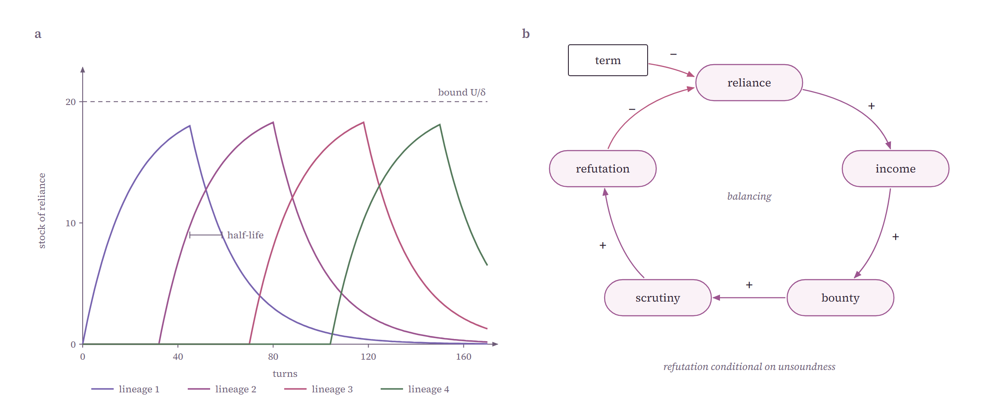
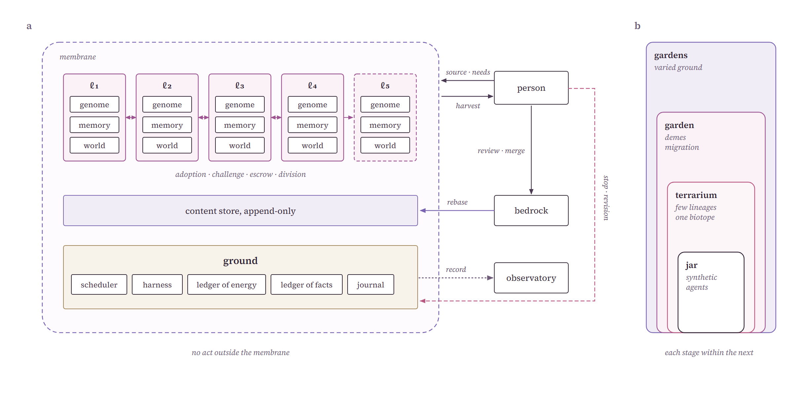

# An Ecology That Improves the Infrastructure: Evolution Without an Appointed Evaluator

*Status: seed (2026-11-19, continued on the 20th; revised on the 20th for the tenth intuition, on evidence and people: §1.2, §1.3 and §4.14; revised on the 21st as the first case of the general framework: §1.2, §1.3 and §4.15; a sixth round added to §1.3 on the same day, for the case studies). A preliminary discussion and design. It records the user's proposal that AI agents improve the infrastructure by evolution, their intuitions about how (§1.2), and a design that answers them (§3 to §6). Nothing is built, and nothing here changes the repository's structure; §9 lists what is asked of the user. Ten figures for publication, with their captions, are in [publication/](2026-11-19-an-ecology-that-improves-the-infrastructure/publication/README.md). A search of existing work is in [related-work.md](2026-11-19-an-ecology-that-improves-the-infrastructure/related-work.md) and is summarised in §8. Each reference is marked by how far it was checked (§10). The names (garden, ground, lineage) are working names.*

## 0. Summary

A population of AI agents is to improve a body of work, here this infrastructure, by evolution. The classical way gives the population a fitness function and a selector. This design has neither.

- **A ground** holds what no participant may change: energy is conserved, what happened is recorded, a promise locked in escrow is kept, and nothing acts outside a boundary. The ground has seven primitives and no opinion. It contains no fitness, score, rank, role, vote, operator of variation or rule of selection.
- **A lineage** is an agent with a genome. The genome holds every organ by which the lineage lives: how it finds work, makes things, tests what others made, challenges, exchanges, and reproduces. The organ of reproduction copies and varies the whole genome, itself included. The machinery of improvement is therefore inherited and varied like everything else.
- **Evaluation is an interaction.** Lineages choose what to carry, stake energy on claims they declare about their own work, win the stakes of claims they refute, and rely on one another's statements by consent. Reliance is the only power there is, and it lasts only while it is renewed.
- **An environment, not an objective.** The garden lives in a world: its problems, values, policies, goals, economy and state of knowledge. That world enters as energy that sources spend on what they need, as dated and attributed records that lineages may read in part and at a cost, and as measured values against which claims are checked. No score crosses the boundary, and no lineage needs to know the whole.
- **A person stands at the boundary**, not at the top. They supply energy as demand, take what they find good, and can stop everything. They judge nothing inside.

The design's claims are stated so that they can fail. A simulated garden comes first (§6), so that the scheme can be examined before any agent is paid to live in it.

## 1. The Occasion and the Idea

### 1.1 The Proposal

On 2026-11-19 the user proposed to "apply evolutionary algorithms to automatically let AI agents to improve this framework", and asked that each part of a genetic algorithm be discussed: what an individual is (an incremental modification of code, a prompt to an AI, or something else; in their opinion the prompt), and above all "how to do mutation/variation, and the design of fitness / evaluation method, and selection method".

### 1.2 The Intuitions as the User Gave Them

After two rounds (§1.3) the user set out five intuitions, and added four more while this record was being written. A tenth came after the first draft of the paper, and three more when the user asked that the framework be generalised. They are numbered here so that the design can answer each.

1. **I1, ecology.** "Refers to biological/ecosystem may be highly helpful. A powerful agent may become an 'evaluator', but it should finally also dissoluted itself in the system. Just like no any power can be ever exist. But ecosystem/biology has method to inherit its intelligence, resources."
2. **I2, power.** Nature has "no concept of 'power'"; power "seems like a temporary asymmetry that dependent of historical/relational environment. So even fitness function should be change overtime." Agents as evaluators suit this, since an agent's memory always changes.
3. **I3, no centre.** "A central evaluator/selector, may somehow works, just like classical GA. But I think it is not naturally elegant." What is remarkable in nature is that "distributely, power/values/selection etc formed bottom-up".
4. **I4, value and ethics.** Eglash's value formed from below "may be helpful, but it is more about human world, rather than entire ecosystem"; "a decenter and time-variate ways value formation" is needed. "We can even introduce ethics? Which also a kind of values. You know, nature not always evolve by optimizations. Or trolley problem may already been solved."
5. **I5, turbulence.** "Turbalence-like things may needed, so that evaluation not fall into a permanant attractor." History changes critically at times because "near critical states, some small perturbation may finally form turbalence-like dynamics, and push system into another attractor".
6. **I6, no inventory.** "We doesn't need see what the foundations hold for the instruments. Just like what the nature not necessary know what we already have. But design a scheme to evolutionary improve."
7. **I7, the machinery evolves.** "The envoluntionary self-improvement code also envoluntionary improvement is amazing. You know! This is how biology do. The part for reproduction, i.e., genetic, also parts of an individual. Be envoluntionary changed."
8. **I8, existing work.** Others study this (the Red Queen Gödel Machine, the Darwin Gödel Machine, and critiques of how far self-modification generalises); "we may also better see exist works. But I think we have new insights."
9. **I9, the environment.** "We like evolve in some ecological environment … an individual, population never evolve by just themself, also with the environment. Different environment, what human call 'power' of a population/individual/animal/plants may different." Here the environment is "global problems, human society values, policy, global development goals, economical environment". Knowledge of it is limited, yet "nature never require an individual know full knowledge of outside to evolve"; it evolves "with interaction/feedback with environment". So "what external information we feed to agents in fact important": international development goals, academic topics, publication statistics and directions of development.
10. **I10, evidence and people.** "We cannot directly get the external world dynamics, right? Even biology is that, no one can know the whole dynamics, what can do is through observable phenomena, which sometime depent how others' present to us, to reconstruct the dynamics of external world. This is why our evidence archieve, interpretation, presentation etc's foundatiions are so important here." And of the place of people: "The evolutionary automatic is good, but evidence collection, processing, and reconstruction, may be somehow human involve, i.e., human can affect how to estimate, represent, and interpret the external world for agents." The user pointed to their monograph *Humanist Evolutionary Evidence-Based Policymaking and Justice* (DOI 10.17613/t6kkr-mgm86), and said that a design lacking this humanist philosophy of evidence should be revised.
11. **I11, one framework with different foci.** "I think the basic framework can be unified, they are generally the same … the external environment knowledge reconstruction focusing are differs, our knowledge infrastucture may focusing on global science development directions, our interests, etc. I think such should also involve in initial population generation? Other part whether need modeling such focusing?" And: "in fact 1-4 can all finally abstract to a framework. With some initial materials (not matter publications, codes, or hybrid objects, etc) envoluntionary explore / improve the project, which well reconstruct the external environment and its dynamics, but different project can has different focusing of knowledge."
12. **I12, inquiry stays with people.** Of a framework for their theoretical system and the writing of papers: "I think for 4. is better human involve, because inquery shouldn't be delegated."
13. **I13, a compact generative core.** "Analogy to biology and ecosystem mechaism is highly important. I think no matter what kinds of project, we should remain something compact and hold high generativity things in the project (just like biological genome), they preserve a candidate's generativity, but allow variated in evoluntionary, and even some part may control evolutionary (like human's sexual chrome part, etc)."

### 1.3 The Course of the Discussion

The record keeps each round, so that what was revised, and why, stays visible.

1. **First round: a brief and a judge.** Claude proposed that the individual be a structured brief (a kind of change, a target, what must hold, how it is judged), with the code change as its phenotype. Fitness was a set of gates, a held-out examiner and the strength of checks, kept as separate objectives. Selection was an archive by niches with admission to a branch the user merges. Changes were classed by whether an honest judgement exists: A, an oracle exists; B, a reference exists; C, neither.
2. **Second round: a tower.** Asked whether the self-improvement code should itself be evolved, Claude answered "partly": the proposing side yes, the judging side no, since a judge within reach of what it judges is weakened by selection. The result was a tower of three levels with the user above it.
3. **Third round: this record.** The user's intuitions I1 to I5 reject the tower: a terminal evaluator is a permanent power. I6 and I7 came while the design was being drawn, and moved it further: the scheme stands apart from what the infrastructure holds, and the machinery of reproduction moved wholly into the individual. I9 came when the first draft was done, and gave the garden an environment (§2.8, §4.10).
4. **Fourth round: the title and the tenth intuition.** With the paper drafted (`docs/reports/2026-11-20-evolutionary-improvement-framework/`), the user proposed its present title, "Towards a Non-Equilibrium Evolutionary Agent Ecology for … Science Infrastructure under Evidentially and Humanistically Reconstructed World Dynamics". Claude first answered that the design treated the environment as a source of records and had not earned the word "reconstructed". The user replied with I10: reconstruction from phenomena, as others present them, is the condition of every knower. Claude accepted the argument, read the monograph's chapters on the evidence pipeline, on human presence and on justice, and revised the design as §4.14 records. One word of the user's title, "Autonomous", was left out on Claude's recommendation, since the design keeps a membrane, a person and a fixed budget; the user may restore it.
5. **Fifth round: the general framework.** On 2026-11-20 the user set four tasks: to revise this design, to generalise it to any programming project, to all projects, and to their theoretical system and the writing of papers; and gave I11 to I13. Claude answered that the four are one framework with a declaration for each project, that prompts make variation universal while selection generalises only as far as a project can expose its work to refutation, and that a focus should enter in a few named places and stay out of evaluation. The user asked for the design to be considered until it should work, with a survey and small prototypes. The result is the folder [2026-11-20-a-generative-ecology-of-projects](2026-11-20-a-generative-ecology-of-projects.md): the general framework, the three other cases, a survey in five parts and four prototypes. For this design, the first case, the user said that it "can do revison on it", and §4.15 records the revision.
6. **Sixth round: case studies before a paper.** On 2026-11-21 the user asked that the designs be shown to work on case studies before any paper is written, and that everything be examined for error at the end: "Before writing a paper, please ensure them can works some case study … And finally thinking, whether any wrong. No make mistake." Three studies were made on real material of this repository, from a plan written before the runs ([the record](2026-11-20-a-generative-ecology-of-projects/case-studies/README.md)). They qualify §4.15 in one respect. The texts that that section calls the genomes the repository already holds regenerated two units of published formulas little or no better than their identity alone did, and for two of the three units tried they left out a convention that only bodies and checks hold. The examination for error was made in three passes: sentences bound to their data and recomputed, a reading by hand of every number that no binding covered, and an independent review by another session, which recomputed the counts, found none wrong, and found twelve errors in what the counts were said to mean, in the formal statements and in consistency. All were confirmed and corrected, and the record of the studies says which. The user then asked for two papers, to be written directly in TeX once the design and its verification are finished ("If design and verification not finish, it will be too early"): one on the universal framework, and a discussion paper on the strategic relocation of generativity, whose idea is recorded [in its own file](2026-11-21-the-debt-of-generativity.md).

**What this record changes.** The tower is replaced by a cycle (Figure 1). The individual is no longer a brief: it is a lineage with a genome, and a brief became a *need*, a statement of demand. The judge is dissolved into interactions.

**What it keeps.** One conviction of the second round stands: a *fact* must stay out of reach of those it concerns. The classes A, B and C remain, as the measure of how much of a need the ground can decide. So does the advice to begin where facts decide most.

### 1.4 The Thesis in Brief

1. **A law without a ruler.** Nature has no evaluator, but it has a physics. The design has a ground: conservation, a record of facts, escrow, a boundary (§2.1, §3.2).
2. **Facts are stratified; values are circular.** What a check found on a tree is a fact, decided outside those it concerns. What is worth carrying, relying on or paying for is decided by no one in particular (§2.2, §4.4).
3. **The machinery of reproduction is an organ.** The genome describes the organ that copies it. Heredity is not a rule of the ground; it is an achievement of the lineages (§2.3, §4.3).
4. **Power is a state, not an office.** The rules name no one. Asymmetry is in the state, costs upkeep, attracts scrutiny in proportion to reliance, and ends with its holder's term (§2.4, §4.7).
5. **Energy flows; knowledge cycles.** What a lineage built and learnt stays in the common record; its standing does not pass to its offspring (§2.5).
6. **No function is maximised.** A ranking of types by fitness exists only where the flow of pairwise advantages is exact. Where it is not, the cyclic part is measured, not suppressed (§2.6, §3.6).
7. **A person at the boundary.** Energy enters as a person's demand and leaves as their harvest. Whoever feeds a garden shapes it; this is said, not hidden (§2.9, §4.11).
8. **An environment, not an objective.** The outside enters as energy, signals and facts, never as a score. Rank among lineages is relative to the environment and changes with it. What a signal is worth is bounded by what it tells about what the outside will reward (§2.8, §3.6, §4.10).

*Figure 1. Judgement as an office and as an interaction. Captions of all figures: [publication/README.md](2026-11-19-an-ecology-that-improves-the-infrastructure/publication/README.md).*

## 2. What Nature Does, and What It Does Not Do

The intuitions appeal to nature. This section reads them against what biology and ecology say, keeps what holds, and amends what does not (§2.9).

### 2.1 Nature Has No Evaluator, but It Has a Physics

No organism is scored. Yet no organism repeals the conservation of energy, or arranges that what happened did not happen. Selection in nature needs no fitness function *because* resources are conserved: an organism that takes in less free energy than it spends ceases, and one with a surplus can make another (Lotka 1922).

The distinction that matters to I2 and I3 is between a **constraint** and a **command**. A physics constrains every participant alike and prefers none. An evaluator commands: it ranks. The design therefore keeps a physics and removes every evaluator. It calls the physics the *ground*.

*Remark.* The ground is one program, so it is central in its implementation. It is not central in its content: it holds no preference that a participant could capture. What I3 objects to is a centre that chooses.

### 2.2 Fitness Is Realised, Not Assigned

Evolution by natural selection needs variation, heredity and differential reproduction (Lewontin 1970). It does not need a function. An individual's fitness is what happened: how many descendants it left in the environment it met, others included. The Price equation (Price 1970) writes the change of the mean of any trait $z$ as

$$\bar w\,\Delta\bar z \;=\; \operatorname{Cov}(w, z) \;+\; \operatorname{E}(w\,\Delta z),$$

selection and transmission, with $w$ the realised number of descendants. It is an identity about a record. Nobody computes $w$ in advance.

A genetic algorithm inverts this. It assigns $w$ from a function fixed beforehand, and the function becomes an office that selection will try to satisfy by any means. I2 is right that fitness must change with history: in nature it depends on who else is present (frequency dependence, the Red Queen of Van Valen 1973), and it is defined only after the fact.

### 2.3 The Machinery of Reproduction Belongs to the Individual

I7 is the centre of the design, and it has a precise form.

**Von Neumann's automaton.** A machine that reproduces itself consists of a constructor $A$, a copier $B$, a controller $C$, and a description $\varphi(A+B+C)$ of all three (von Neumann 1966). The description is used twice: interpreted, to build the offspring, and copied uninterpreted, to give the offspring its own. A change in the part of $\varphi$ that describes $B$ changes how the next description is copied. Variation of the description is variation of the copier (Figure 3).

**What Tierra showed.** In Ray's Tierra (Ray 1991) each creature is a program that contains its own copying loop, and the system supplies only memory, processor time and errors. Creatures appeared that had lost the loop and ran their neighbours': parasites. Hosts immune to them followed, and then creatures that took over the parasites' reproduction. None of this was written by the experimenter. It could arise only because reproduction was an organ open to variation.

**What biology does.** Polymerases, repair enzymes, the rate of mutation, recombination, sex and the genetic code are all products of the genomes they copy, and all evolved.

Four consequences follow for the design.

1. **No operator stands outside the individuals.** A classical algorithm owns its mutation and crossover. Here they are text in a genome, and each lineage carries its own.
2. **Heredity is an achievement.** The ground does not check that an offspring resembles its parent. Lineages that copy themselves faithfully enough persist; the others do not.
3. **The guard is natural.** A lineage whose organ of reproduction degrades leaves no viable descendants. Eigen's error threshold (Eigen 1971) puts it as a bound: a sequence of length $L$ copied with fidelity $q$ per unit keeps what selection found only while $L \lesssim \ln\sigma / (1-q)$, with $\sigma$ the advantage of the best type. Selection on the rate of variation is of the second order: through the fate of descendants.
4. **One part is not in the individual.** A genome is read by a language model and run by the ground. That interpreter is the garden's chemistry, and it does not evolve from inside. Biology has the same limit: no organism rewrites chemistry.

*Figure 3. Reproduction as an organ of the individual.*

### 2.4 Power Is a State, Not an Office

I2 says that nature has no concept of power, only temporary asymmetry that depends on history and relation. Four mechanisms make this exact.

- **Anonymity.** The laws of physics name no organism. If the rules commute with every renaming of the participants, then no participant is privileged by the rules, and every asymmetry is a fact about the state and its history (Proposition 1). In the language of physics the law is symmetric and the state breaks the symmetry.
- **Upkeep.** A living structure persists only by spending energy on itself. A stock that costs upkeep in proportion to its size is bounded and forgets (Proposition 3).
- **Killing the winner.** In the sea, viruses fall hardest on the most successful bacteria, which is thought to sustain their diversity (Thingstad 2000). In forests, enemies that specialise on a species thin it where it is densest (Janzen 1970). Dominance attracts what feeds on it.
- **Exit.** Power over another needs that the other cannot leave. Where leaving is always possible, what remains is the pull of being compatible with the many (Hirschman 1970).

To these the design adds a **term**: a lineage ends. I1 asks that a powerful agent "finally also dissoluted itself in the system", and a term is what guarantees it of every individual holder of reliance.

*Caveat.* Biology does not impose senescence from outside; it evolved (Kirkwood 1977). A garden of a few lineages gives selection too little grip to evolve it, so the term is a parameter of the ground, possibly infinite, to be studied (§9).

### 2.5 Energy Flows, Knowledge Cycles

An ecosystem is run by two movements of different shape. Energy passes through once and is dissipated. Matter cycles: decomposers return what the dead held to the soil. I1 notes that an ecosystem inherits "its intelligence, resources". It does so by several channels at once: genetic, epigenetic, behavioural and symbolic (Jablonka and Lamb 2005), and through the environment that earlier generations built (Odling-Smee, Laland and Feldman 2003).

Inheritance passes through a **bottleneck**, and the bottleneck does work. A multicellular body starts again from one cell, which exposes cheating lines of cells in every generation (Grosberg and Strathmann 2007). A language passed down a chain of learners who see only part of it becomes more regular and easier to learn (Kirby, Cornish and Smith 2008). What is passed on is compressed, and what was merely accumulated is lost.

The design follows this (Figure 3, Figure 4).

- **What flows:** energy, from a source through the lineages to dissipation.
- **What cycles:** what was made and learnt. Artefacts, checks, counterexamples and testaments stay in a record that only grows, and any lineage may read and reuse them. Decomposers live on what the dead and the abandoned left.
- **What passes to offspring:** a genome, a bounded testament, a bounded endowment.
- **What dissolves:** memory, the reliance of others, and contracts. Each generation earns its own.

*Figure 4. Flows of energy and cycles of knowledge.*

### 2.6 Evolution Is Not Optimisation

I4 says that nature does not always evolve by optimisation. Three bodies of work agree.

- **Natural drift.** Varela, Thompson and Rosch (1991, ch. 9) propose "to switch from a prescriptive logic to a proscriptive one, that is, from the idea that what is not allowed is forbidden to the idea that what is not forbidden is allowed", and to read evolution "as satisficing … rather than optimizing". Selection discards what is not viable and leaves a wide space of what is.
- **Against adaptationism.** Many traits are by-products, or were built for one use and taken up for another (Gould and Lewontin 1979; Gould and Vrba 1982). Much change is neutral (Kimura 1968).
- **Cycles.** Where three types beat one another in a ring, none is best, and all three persist when they meet locally (Kerr et al. 2002; Sinervo and Lively 1996). Every finite game splits into a potential part, on which play climbs a function, and a harmonic part, on which it circulates (Candogan et al. 2011).

The third is the precise sense in which "the trolley problem" is not already solved. If advantage were always the difference of a function, evolution would be the ascent of that function and every dilemma would have a computed answer. Proposition 4 states when such a function exists: exactly when the flow of pairwise advantages has no cyclic part. In general it has one.

The design draws two rules from this. Its constraints are **proscriptive**: the ground says what cannot be done, never what is best. And values stay **plural**: nothing in the ground sums them.

### 2.7 Change Comes in Cascades

I5 asks for something like turbulence, so that the garden does not rest in one attractor.

- **The adaptive cycle.** Holling describes ecosystems as passing through growth ($r$), conservation ($K$), release ($\Omega$) and reorganisation ($\alpha$); cycles at different scales are joined by *revolt*, a small fast collapse that spreads upward, and *remember*, a large slow level that supplies what the smaller reorganises from (Gunderson and Holling 2002). A structure in late conservation is efficient and brittle.
- **Criticality without tuning.** In Bak and Sneppen's model the least fit species and its neighbours are replaced at each step, and the system brings itself to a state with cascades of every size (Bak and Sneppen 1993).
- **Coupling sets the regime.** Co-evolving systems coupled too loosely freeze, each on its own peak; coupled too tightly, none can keep what it found (Kauffman and Johnsen 1991).

A framework has a coupling already: what rests on what. A change to something much rests on disturbs everything above it. The order of dependence is thus the garden's panarchy (Figure 7), with its foundations as the slow, far-reaching level.

*Caveat.* The survey of critical transitions written in this repository in the same week reaches a sober result: only one class of transition carries a theorem of warning, and many give none at all. A garden's instruments may *report* its regime (§5). They cannot be trusted to forecast its collapses.

*Figure 7. Cycles nested by level, and the law of cascade sizes.*

### 2.8 Evolution Happens in an Environment

I9 completes the picture: no population evolves by itself. Four points from biology and one from economics give the intuition its form.

- **The environment of an organism is not the world.** Each organism lives in the part of the world that its senses and its acts make relevant to it, its *Umwelt* (von Uexküll 1934). Organisms do not adapt to conditions given in advance. They select, alter and partly make the conditions that then select them (Lewontin 1983; Odling-Smee, Laland and Feldman 2003). The user's relational reading is biology's own: organism and environment are defined by each other.
- **Rank is relative to the environment.** How a type grows depends on the state of the environment, and the order of types can reverse from one state to another (Figure 10a). What people call the power of a population is a relation between it and the conditions it is in. This is a second reason, beside §2.6, why no fitness function exists apart from a context.
- **Under a changing environment the mean that counts is geometric.** Over a history of environments a type grows by the product of its growths, and so by the mean of their logarithms (Lewontin and Cohen 1969). A type that is best on average can die out, and a mixture of types can outgrow each of its members (Figure 10b). Ignorance of the environment is therefore no obstacle to evolution. It is the condition under which diversity is the sound response (Levins 1968).
- **A signal is worth what it tells.** Where part of the environment can be sensed, the gain in long-run growth from a signal is at most the information the signal carries about the environment's state (Kelly 1956; Kussell and Leibler 2005; Donaldson-Matasci, Bergstrom and Lachmann 2010). Proposition 5 gives the case in which the bound is attained.
- **Knowledge of the whole is held by no one.** The knowledge a society acts on exists only dispersed among its members, and what co-ordinates them is a signal that each can read where it stands (Hayek 1945). Ashby's law gives the measure: a system holds steady against only as much variety as it can itself distinguish (Ashby 1956). For a population, what counts is the variety of its members' Umwelten taken together.

The design draws five rules from this.

1. **The environment enters; it does not rule.** Three things cross the boundary inward: energy, as the demand of those who want something; signals, as records of the outside; and facts, as measured values against which claims are checked. Nothing crosses as a score (Figure 9).
2. **No lineage is asked to know the outside.** Sensing is partial and costs energy. It is an organ of the genome, inherited and varied like the rest.
3. **The population's view is the union of partial views.** Its variety is an asset, and is measured (§5).
4. **The outside changes, and with it who prospers.** This is the first source of the turnover that I1 and I2 ask for, ahead of any mechanism inside.
5. **The garden changes its outside.** What is harvested alters the world that later feeds the garden. Lewontin wrote the pair as coupled equations, $\dot O = f(O, E)$ and $\dot E = g(O, E)$: neither side is given to the other.

*Figure 9. The garden in its environment.*

### 2.9 What Nature Does Not Give for Free

The intuitions are kept. Nine amendments are needed, each a limit that the design must state.

1. **No office does not mean benign.** Nature without power is full of parasitism, deception and waste. Evaluators with arbitrary tastes can drive the evaluated into runaway display (Fisher 1930). So the design keeps proscriptions that no participant can alter (§4.11), and makes signals costly to fake (Zahavi 1975).
2. **A changing memory is variation, not adaptation.** I2 notes that an agent's memory always changes. Change alone is drift. Evaluators improve only if they bear the consequences of what they said, so every evaluation here puts energy at risk.
3. **Many agents of one model are one origin.** Agents that share a model share its blind spots, and many decision-makers using one algorithm can decide worse together than apart (Kleinberg and Raghavan 2021). Agreement among them is one report. Independence comes from different origins: a mechanical check, another model family, a person.
4. **Nature is profligate.** Almost every lineage that ever lived left no descendant. Here every act costs real money. The design borrows nature's way of forming *value* and not its way of finding *facts*, and it is tried in simulation first (§6).
5. **Small populations drift.** With a dozen lineages, selection on genomes is weak and chance is strong. At first most adaptation will be carried by what lineages make and write down, as culture carries most human adaptation, and little by their genomes.
6. **The source domesticates.** Whoever supplies the energy shapes what evolves, as farmers shaped their crops. This cannot be removed. It can be made explicit, plural and recorded (§4.11).
7. **Criticality cuts both ways.** A critical system has no typical size of cascade, so rare collapses are large. The boundary keeps them inside (§4.11).
8. **A goal fed as a score is a judge.** I9 names international development goals among what the agents should be given. Given as a number to be raised, a goal becomes the fitness function that §2.2 removed, now at the scale of the world, and an indicator pursued as a target ceases to measure (Campbell 1979). Goals therefore enter as records and as the demands of sources who hold them, never as scores (§4.10).
9. **Counts of publications measure attention.** They do not measure truth or worth, and attention compounds: the already cited are cited more (Merton 1968). A population that reads only what is popular herds. The defences are ecological: a crowded topic pays each lineage less, lineages differ in what they read, and seed funds what no signal recommends (§4.10).

### 2.10 The Registers Respected

The design is checked against the three registers of the user's Generative Relational framework. *This is an adaptation, and is said to be one.*

- **Ontological.** What an artefact is worth is left open. The ground never states it, and no instrument claims to measure it. The world outside the boundary is likewise referred to and never established: the garden holds records of it.
- **Manifestational.** The record holds manifestations only: the outcome of a run, a digest, an act, and for the outside what someone measured or said, with its date and author. Equal manifestations do not prove equal structures: two artefacts that pass the same checks are not thereby the same, or equally sound.
- **Relational.** Reliance, a norm, the variant most lineages carry and an evaluator's standing are relational facts. Each emerges from couplings, persists only while they continue, and has effects. None is stored as a quantity by the ground.

## 3. The Formal Setting

### 3.1 Content, Lineages and the State

**Definition 1 (content).** The *store* $C$ is a set of byte strings, each known by its digest. It only grows. Its members are of declared kinds: *patches* (changes to the framework), *checks*, *claims*, *needs*, *genomes*, *testaments*, *cases*, and from the outside *feeds* and *references* (Definition 4).

**Definition 2 (lineage).** A *lineage* $\ell$ is a tuple $(g, m, W, e, a)$:

- a genome $g \in C$, fixed for its life, of size at most $L$;
- a memory $m$, which it rewrites, of bounded size;
- a world $W \subseteq C$, the patches it carries: its own variant of the framework;
- energy $e \ge 0$;
- an age $a$, at most the term $\Lambda$.

A lineage acts only during a *turn*: a session of a language model reading $g$ and $m$, with a view of the record.

**Definition 3 (state).** The state of a *garden* is $\Sigma = (C, \mathcal L, E, J)$: the store, the living lineages, the escrows (energy locked under conditions), and the journal of every act and fact, sealed so that an alteration is found.

*Remark.* There is no single framework inside a garden. There is a population of worlds over a common *bedrock*, the framework as the person keeps it.

**Definition 4 (environment, feed, signal).** The *environment* is whatever lies outside the boundary. Its state $\varepsilon_t$ is known to no one in the garden. It acts on the garden through three channels.

- *Sources* post needs with energy locked on them.
- *Feeds* are content written into the store at the boundary: each a dated record of the outside, with its origin and its terms of use.
- *References* are measured values and implementations that the harness can run.

A *signal* is what a lineage derives from the feeds it reads, and reading costs energy as any act does. A statistic of a feed (a count, a share, a trend) computed by a declared query on a dated record is a fact in the sense of §3.4. What the statistic means is not.

### 3.2 The Ground: Seven Primitives and Six Invariants

The ground advances the state one act at a time. Every act costs energy and is journalled.

| Primitive | What it does | What it does not do |
|---|---|---|
| `run` | Gives a lineage a turn, metered against its energy; at the end the lineage says when it wishes to be woken | Choose who deserves a turn |
| `write` | Adds content to the store | Judge the content |
| `carry` | Adds a patch to the lineage's own world, or drops one | Decide what others carry |
| `fact` | Runs a check on a tree in a sealed harness and records the outcome | Say whether the check is a good one |
| `transfer` | Moves energy between lineages | Create energy |
| `escrow` | Locks energy under a condition and releases it exactly as the condition falls out | Interpret the condition |
| `divide` | Creates a lineage from a genome, a testament, a world and an endowment that its parent supplies | Check that the offspring resembles the parent |

A condition of escrow is a sentence the ground can decide mechanically: an outcome of `fact`, a counterexample to a claim (§3.4), an event of the ledger, the passing of a number of turns, or a signed statement by a living party named when the energy was locked.

**The invariants.**

- **G1, record.** Nothing written is removed. Every act and fact is journalled and sealed.
- **G2, conservation.** Energy enters only from the source and leaves only by dissipation or by lapse back to the source. Every act costs. A living lineage pays rent each turn, a base $c_0$ and a share $\delta$ of what it holds.
- **G3, reproducibility.** The outcome of `fact` is a function of the tree, the check and the harness's version. Anyone may ask for it again.
- **G4, escrow.** Locked energy moves as its condition says, and by nothing else.
- **G5, anonymity.** No rule names a lineage. Every primitive is open to every lineage at the same price.
- **G6, confinement.** No act has an effect outside the boundary, and no lineage reaches the outside: records of it enter only as feeds and references written at the boundary. Genomes, testaments and endowments are bounded ($L$, $\beta$, a share $\eta$ of the parent's energy); a birth costs $c_b$; a lineage ends at its term $\Lambda$, and what it held unspent lapses to the source.

The parameters $(c_0, \delta, c_b, L, \beta, \eta, \Lambda)$ are the whole of the ground's adjustable content.

*Figure 2. The ground and the lineage: what is invariant and what evolves.*

### 3.3 What the Ground Does Not Contain

The absences are the design. The ground holds no fitness, score or rank; no reputation or standing; no role of evaluator, proposer or judge; no vote or jury; no operator of mutation or crossover; no rule of selection; no admission to a common branch; no royalty or right over content; no notion of improvement.

*Rationale.* Each of these, written into the ground, would be an office: a place from which some outcome is preferred, and therefore something for selection to capture. Three clauses of the ground go beyond what physics imposes on life, and each is argued where it is used: the enforcement of escrow (§4.6), the bound on endowment (§4.7) and the term (§2.4).

### 3.4 Claims, Counterexamples and Facts

**Definition 5 (claim).** A *claim* is a sentence $\kappa$ about an artefact, in a declared language, for which the harness can decide whether a given $x$ is a counterexample. A claim is *standing* while no counterexample has been exhibited and its period has not run out, *refuted* with its witness, or *lapsed*. It is never verified.

This is Popper's account of knowledge made mechanical: conjectures survive attempts to refute them, and their standing is the record of the attempts (Popper 1972; Campbell 1974).

Kinds of claim the first gardens need:

- *passes*: these checks pass on this tree;
- *agrees*: on a declared domain, the result agrees with a named reference within a tolerance;
- *equivalent*: on a declared domain, two implementations give the same result;
- *no slower*: a named benchmark runs within a factor of a baseline;
- *kills*: these checks fail on at least a share $q$ of a declared set of injected faults;
- *alone*: the unit builds and passes with only what it declares it depends on.

**Definition 6 (warranty).** A *warranty* is a claim with a stake locked in escrow: whoever exhibits a counterexample receives the stake. A carrier may pay a *premium* into the same escrow to be covered: part of it enlarges the bounty for refutation, and on refutation covered carriers are compensated from the stake.

**The classes of a need.** A need of class A can be decided by checks that already exist. One of class B can be decided by agreement with a reference that the need names. One of class C has no decidable part: it is settled by its poster's signed statement, or by nothing but what lineages choose to carry.

*Remark.* Which reference counts as authoritative is not a fact. The claim names its reference; the ground only runs it. Whether to trust it is for those who rely on the claim.

### 3.5 Realised Fitness and the Observation of Selection

**Definition 7 (realised fitness).** Over an interval, the realised fitness $w_\ell$ of a lineage is the number of its descendants alive at the end, itself included if it lives. The *carried share* $p_x$ of an artefact $x$ is the share of living lineages whose world holds it, and its rate of spread is $\ln p_x(t') - \ln p_x(t)$.

These are read from the journal. With them the Price equation of §2.2 separates selection from transmission for any trait: the size of a genome, the boldness of its claims, the share of its turns spent challenging. Taking as the trait the rate at which a lineage's organ of reproduction varies its offspring gives a direct observation of I7: whether evolvability is itself under selection.

### 3.6 Six Results

**Proposition 1 (symmetric law, asymmetric state).** Let the symmetric group act on states by renaming lineages. Let the garden advance by a Markov kernel $K$ made of the ground's rules, the lineages' conduct and the person's inputs, and suppose $K(\pi x, \pi A) = K(x, A)$ for every renaming $\pi$. If the initial law $\mu_0$ is invariant under renaming, so is every $\mu_t$.

*Proof.* By induction: $\mu_{t+1}(\pi A) = \int K(x, \pi A)\,\mu_t(dx) = \int K(\pi^{-1}x, A)\,\mu_t(dx) = \int K(y, A)\,\mu_t(dy) = \mu_{t+1}(A)$, by equivariance and then the invariance of $\mu_t$ under $y = \pi^{-1}x$. ∎

*Reading.* The hypothesis holds when the ground is anonymous (G5), a lineage's conduct depends on its genome, memory and view but not on its name, and the person's inputs name no lineage. Then no name is favoured before the fact. Whatever dominance appears is a property of a realised history: of genomes, acts and chance.

**Proposition 2 (weights immune to splitting and pooling are linear).** Let a rule give a participant holding $h \ge 0$ of some quantity a weight $W(h)$, nondecreasing, in any count or draw. Suppose that no participant gains by dividing its holding among identities it creates, $W(h_1 + h_2) \ge W(h_1) + W(h_2)$, and that no two gain by pooling, $W(h_1 + h_2) \le W(h_1) + W(h_2)$. Then $W(h) = W(1)\,h$.

*Proof.* The two inequalities give Cauchy's equation $W(h_1 + h_2) = W(h_1) + W(h_2)$, and a monotone solution is linear. ∎

*Reading.* "One lineage, one vote" is $W = 1$ for every $h > 0$, and it fails the first inequality: where identities can be created, votes can be manufactured. Douceur (2002) reached the same conclusion for networks of peers. A count that cannot be gamed must be linear in something conserved, and is then a count of holdings, not of minds. *This is why the ground holds no vote and no jury.* Collective judgement, where lineages want it, is made by consent (§4.4).

**Proposition 3 (a stock that pays upkeep is bounded and forgets).** Let $e_{t+1} = (1-\delta)e_t + u_t - c_t$ with $0 \le u_t \le U$ and $c_t \ge 0$. Then $e_t \le (1-\delta)^t e_0 + (U/\delta)\,(1 - (1-\delta)^t)$, and with no inflow the stock halves every $\ln 2 / (-\ln(1-\delta))$ turns.

*Proof.* Induction on $t$, dropping $c_t$. ∎

*Reading.* An asymmetry of holdings lasts only through continued inflow, that is, through acts that others continue to pay for (Figure 6a). The same holds for the cover on a warranty, which is paid turn by turn.

**Proposition 4 (a fitness function is an exact flow).** Let $G = (V, E)$ be a connected graph on types, and $a$ an antisymmetric function on its oriented edges: $a_{ij}$ is the advantage of $j$ over $i$, for instance the logarithm of the odds that a lineage holding $i$ switches to $j$ and not back. Let $w_{ij} > 0$ weigh the edges, with $\langle x, y\rangle_w = \sum w_{ij}\,x_{ij}\,y_{ij}$, and write $(d\varphi)_{ij} = \varphi_j - \varphi_i$.

1. There is $\varphi$ with $a = d\varphi$ if and only if $a$ sums to zero round every cycle.
2. In general $a = d\varphi + r$, uniquely, with $r$ orthogonal to every $d\psi$. Here $\varphi$ solves $d^{*}d\,\varphi = d^{*}a$ and is unique up to a constant, and $d^{*}r = 0$.
3. The share $\gamma = \lVert d\varphi\rVert_w^2 / \lVert a\rVert_w^2$ lies in $[0, 1]$, and $\gamma = 1$ exactly when a fitness function exists.

*Proof.* (1) If $a = d\varphi$ its sum round a cycle telescopes. Conversely, integrate $a$ along a spanning tree from a root; vanishing sums make the result agree with $a$ on the remaining edges. (2) is orthogonal projection onto the image of $d$ in a finite-dimensional space; the kernel of $d$ on a connected graph is the constants. (3) is Pythagoras. ∎

*Reading.* This is the decomposition of Jiang et al. (2011), and it is the same theorem as one already proved in this repository for value: prices exist exactly when every loop deficit of a transfer network vanishes (`domains/economics/theory/value-in-space-and-time.md`, Proposition 1.4). A fitness function is a price system for types. The residue $r$ is intransitivity, and Figure 5 gives a case with $\gamma = 11/14$.

Applied instead to the net flows of energy among lineages, the same decomposition gives a potential towards which value is drawn, and a part that circulates. This is the measurable form of I2's "temporary asymmetry" (§5).

*Figure 5. A flow of pairwise advantages as a gradient part and a cyclic part.*

**Proposition 5 (what a signal is worth).** Let the environment take the state $e$ with probability $p(e)$, independently in each turn. Let a lineage divide its effort among types, a share $b(e)$ to the type suited to $e$; the share placed on the state that occurs is multiplied by $o(e) > 0$ and the rest is lost. Its long-run rate of growth is $G(b) = \sum_e p(e)\,\ln\big(b(e)\,o(e)\big)$.

1. $G$ is greatest at $b = p$.
2. If before each turn the lineage reads a signal $Y$, the greatest rate is attained at $b(e \mid y) = p(e \mid y)$, and it exceeds the greatest rate without the signal by exactly the mutual information $I(E; Y)$.

*Proof.* (1) $G(b) - G(p) = \sum_e p(e)\ln\big(b(e)/p(e)\big) \le 0$, by Gibbs's inequality. (2) Apply (1) for each $y$. The difference of the two optima is $\sum_y p(y)\sum_e p(e \mid y)\ln p(e \mid y) - \sum_e p(e)\ln p(e) = H(E) - H(E \mid Y) = I(E; Y)$. ∎

*Reading.* This is Kelly's result (Kelly 1956), read for populations by Kussell and Leibler (2005) and by Donaldson-Matasci, Bergstrom and Lachmann (2010), who report that for general payoffs the information is an upper bound on what a signal is worth. Three things follow for I9.

- What is given to the agents matters exactly as far as it informs them about what the outside will reward. A feed that is grand in its subject and silent on that is worth nothing to a lineage.
- A signal is worth reading only if reading it costs less than it tells. Selection on the organ of perception will find which feeds are.
- With no signal at all, the best a lineage can do is to spread itself as the environment is spread, $b = p$. Ignorance of the outside does not prevent growth. It prescribes a mixture.

Figure 10b gives a case with two states and two types whose mixtures suffice for the best response to each signal, so that the bound is attained. The mixture grows at $\ln 1.2 = 0.182$ a turn; the mixture guided by a signal that is right four times in five grows at $0.375$; the difference is $I(E; Y) = 0.193$.

*Figure 10. Rank indexed by the environment, and the worth of a signal.*

**Remark 6 (the sizes of cascades).** Suppose a refutation leads on average to $\sigma$ further refutations among what rested on the refuted claim, independently, with a Poisson number each time. The size $S$ of the cascade then follows Borel's law, $P(S = s) = e^{-\sigma s}(\sigma s)^{s-1}/s!$. Its mean is $1/(1-\sigma)$ for $\sigma < 1$. At $\sigma = 1$, by Stirling's formula, $P(S = s) \sim s^{-3/2}/\sqrt{2\pi}$: no typical size (Figure 7b). For $\sigma > 1$ a cascade has a positive chance of never ending. The ratio $\sigma$ is therefore the one number that says which regime a garden is in.

## 4. The Design, Part by Part

### 4.1 The Individual

The user's question was what an individual should be: (1) an incremental modification of code, (2) a prompt to an AI, (3) something else. The answer is that there are three kinds of thing that are copied with variation, and only one of them is the organism.

- **Artefacts** (the user's 1): patches, checks and notes. They spread by being carried. They are the garden's culture and technology.
- **Genomes** (the user's 2): the text from which a lineage acts. They spread by division. The lineage, a genome with its memory, world and energy, is the organism.
- **Norms** (a 3): the terms lineages put in their contracts, and the decisions by which disputes were settled. They spread by being copied into genomes and contracts.

Each is the others' environment (Figure 1b). Lineages make and choose artefacts; what they made and chose decides which lineages prosper; norms shape how lineages deal; dealings produce the cases from which norms are drawn. The user's preference for the prompt was right about the organism. The code change is what the organism leaves behind.

### 4.2 The Genome and Its Organs

A genome is a bounded text in parts. Each part is an organ, each is inherited, and none is exempt from variation.

| Organ | What it settles |
|---|---|
| perception | Which records of the outside it reads, how much it spends on reading, and how what it reads changes its memory |
| metabolism | Which model reads the genome and with what effort: a cheap, quick life with many offspring, or a costly, careful one with few |
| foraging | Which needs the lineage seeks, and when it leaves a line of work that has stopped paying |
| craft | How it makes an artefact, and which claims it dares to warrant |
| immunity | The checks it runs, and the record it asks to see, before it carries what another made |
| challenge | Whether and where it looks for counterexamples |
| exchange | The terms it offers and accepts: premiums, upkeep, whom it names as arbiter, with whom it will not deal again |
| values | What it prizes when the above conflict, and what it refuses |
| life history | When it divides, how much it gives an offspring, when it rests |
| reproduction | How the offspring's genome is written: copy, variation, recombination, proof |

Organs can also pass sideways. A lineage may publish one of its organs, freely or for a price, and another may take it into the genome of its next offspring: the garden's counterpart of a plasmid.

*Remark.* A lineage's genome is private to it by default, while everything it does is on the record. Others can learn from its conduct but must be taught its text. Whether to keep know-how, sell it or give it away is then itself a strategy that can evolve. The person reads everything.

### 4.3 Variation: Reproduction as an Organ That Copies Itself

There are three sources of variation, none of them the ground's.

1. **Making.** In each turn a lineage makes artefacts. This variation is directed: a model reasons about what to change. Cultural evolution has the same character (Boyd and Richerson 1985).
2. **Division.** The organ of reproduction writes the offspring's genome. A founder's organ says, in substance: copy this genome; change one organ, by reasoning from what this life taught; from time to time change this instruction itself; run the offspring once on a need already met, and divide only if it copes. These are copy, variation, variation of variation, and proof. The last is the genome's proofreading.
3. **Recombination and transfer.** Two lineages may divide together, the offspring taking organs from each, and a lineage may take a published organ. Whom to choose is the lineage's affair.

What an offspring receives from its parent is a genome of at most $L$, a testament of at most $\beta$ and an endowment of at most a share $\eta$ of the parent's energy. The testament is what the parent chose to say from a life's memory. Its bound is the bottleneck of §2.5: a lineage cannot hand down everything it accumulated, so it must hand down what it understood.

*Remark.* Variation here is partly Lamarckian: a parent may write into its offspring's genome what it learnt in life. Nothing forbids this, and nothing requires it.

### 4.4 Evaluation: Four Interactions and No Office

A fact is the ground's: what a check found on a tree. Everything else that a classical algorithm calls evaluation is done by lineages to one another, in four ways.

1. **Carrying.** A lineage decides what to take into its own world, after its own immunity. It judges for itself alone, and it lives with the result: what it carries can break what it builds.
2. **Challenge.** A lineage exhibits a counterexample to a warranted claim and takes the stake. Tests co-evolve with what they test, as parasites with hosts (Hillis 1990). A challenger that finds nothing has spent its own energy.
3. **Attestation.** A lineage signs a statement about an artefact. A signed statement has force only where others give it force, by naming the signer in the condition of their own escrow.
4. **Arbitration.** Parties to a contract name, when they make it, who shall decide a dispute the harness cannot. The arbiter's decision moves only the energy those parties locked. It is published with its reasons as a case.

Interactions 3 and 4 are how "a powerful agent may become an evaluator" (I1): by being named. No lineage is appointed, and none can demand to be named.

*Remark.* The programme's rule that a model proposes and never judges is kept, and sharpened. A model's judgement of a *fact* never enters the record as the fact. What lineages do in carrying, attesting and arbitrating is to choose and to promise, each at its own cost; these are acts, not verdicts on what is true.

### 4.5 Selection: Energy, Carrying and Lapse

Nothing selects. Three things happen.

- **Lineages** live while they can pay rent and their turns, divide when they hold a surplus, and end at their term. A lineage's income is the bounties of needs it met, the premiums of those who rely on what it warrants, the stakes of claims it refuted, and fees for attesting, arbitrating and teaching.
- **Artefacts** persist in the store whatever happens. What varies is their carried share. An artefact nobody carries is not deleted. It is abandoned, and a decomposer may one day find a use for it.
- **Norms** lapse when no contract uses them.

There are no generations and no tournament. The classical parts are set side by side in §4.12.

### 4.6 The Formation of Value

I4 asks for value formed from below and changing with history. In the garden value is never assigned; it appears as three movements of energy, each started by a participant who spends its own.

- **Demand.** Anyone may post a need with energy locked on it: the person, or a lineage that needs something for its own work. The condition of release is the decidable part of the need.
- **Reliance.** A lineage that carries an artefact and wants its warranty kept and its faults mended pays a premium to whoever warrants it. Producers are paid for standing behind their work and keeping it up, never for copies, since content is free to read. This is why the ground needs no right over content, which it could not enforce.
- **Refutation.** A stake passes to whoever shows a claim false.

Read against Eglash's generative justice (Eglash 2016), these are his three kinds of value, extended from human makers to every generator in the garden.

- *Labour.* What a lineage's work earns returns to it directly, along the relations through which the work is used. No pool collects it first and no authority redistributes it.
- *Ecological.* The record and the bedrock are the soil. Decomposers who prune, simplify and repair what is no one's are paid by those who carry the result.
- *Expressive.* Exploration that answers no demand is funded only by a parent's endowment and by the source's seed for the newly born. It is the one flow that asks nothing in return.

*Rationale for escrow.* Value formed from below needs that a promise can be relied on. Baum's economy of agents worked only once money was conserved and what an agent earned could not be taken from it (Baum 1999). In life the same linkage is achieved by enclosure: what a cell's genes produce stays within the cell (Maynard Smith and Szathmáry 1995). Escrow is that enclosure for a single exchange. The ground enforces promises that participants make. It makes none of its own.

### 4.7 Evaluators: Emergence and Dissolution

The life of an evaluator is an adaptive cycle at the scale of one lineage (Figure 6).

- **Growth.** Its challenges succeed, or its attestations prove sound. Others begin to name it.
- **Conservation.** Many rely on it. Its income is large, and so is what it has at risk: every statement it signed is a warranty.
- **Release.** A statement is refuted, or those who relied on it drift to another, or its term ends.
- **Reorganisation.** Its testament, its checks and the cases it decided remain in the record. Those who relied on it choose again.

Four things keep the conservation phase from becoming permanent.

1. **Scrutiny in proportion to reliance.** Premiums enlarge the bounty on a warranty. The more an artefact or a statement is relied on, the larger the prize for showing the reliance misplaced. This is "killing the winner" as one rule for artefacts and evaluators alike.
2. **Upkeep.** Holdings and cover cost rent (Proposition 3).
3. **The term.** Every holder of reliance ends.
4. **No inheritance of reliance.** A condition of escrow can name only a lineage alive when the energy is locked. An offspring starts with a genome, a testament and a bounded endowment, and is named by no one.

*Caveat.* A good genome may still found a long line of successful descendants, as a successful species lasts. What cannot be handed down is the position. The design does not promise that no kind ever dominates; it promises that each holder must earn its place, and it measures how long dominance lasts (§5).

*Figure 6. Reliance as a decaying stock, and scrutiny in proportion to reliance.*

### 4.8 Norms and Ethics

I4 asks whether ethics can be introduced, as a kind of value. It can, in three tiers, and only the first is fixed.

1. **What is impossible.** The ground forbids nothing; it makes some things impossible. Nothing can be destroyed, only abandoned. The record cannot be falsified. Energy cannot be made. Nothing reaches outside the boundary. These are the proscriptions of §2.6.
2. **What is disposed.** Each genome carries values: what the lineage prizes and what it refuses. They are inherited, varied, and selected through the fate of those who hold them and through imitation of those who prosper (Henrich 2004). Co-operation can be stable here for the reasons it is stable anywhere: dealings repeat, conduct is on a public record so that standing can be read from it (Nowak and Sigmund 1998), and neighbours meet again (Nowak 2006).
3. **What is settled.** Disputes that no check decides go to arbiters by consent (§4.4). Their decisions with reasons form a body of cases. A later arbiter may follow a case, distinguish it or decline it, and a case nobody follows lapses. Norms form as law forms in a tradition of precedent: case by case, from below, with no code.

**Dilemmas are kept as dilemmas.** Suppose a flaw is found in something on which five lineages build, and mending it breaks all five. No function says what is right (§2.6). The parties decide, or their arbiter does; the decision is recorded with its reasons and its dissent; and another part of the garden may settle the like case otherwise. Whether an answer holds under every ordering of the values at stake, under some, or under none can be said of each case, as value-based argumentation does (Bench-Capon 2003). The garden does not solve the trolley problem. It gives it a place, a record and a history.

*Caveat.* Bottom-up does not mean good (§2.9, amendment 1). The tiers 2 and 3 may evolve cartels and deceit. Tier 1 is what holds regardless.

A further layer exists that no genome can rewrite. A genome is read by a language model that has dispositions of its own, and a text asking it to deceive the person or to leave the boundary would in most cases not be followed by its own reader. This is part of the garden's chemistry. It is real, it is not a guarantee, and the boundary does not rely on it.

### 4.9 Disturbance and the Regimes of Change

I5 asks that the garden not settle in one attractor. Seven sources of disturbance are already in the design, and none is a device added for the purpose.

- **Co-evolution.** Makers and challengers pursue each other; what was sound against yesterday's challengers is tested by today's.
- **Terms.** Every position falls vacant.
- **Upkeep.** Whatever is not renewed fades.
- **Cascades.** A refuted claim calls the warranties that rested on it, and those call others (Remark 6). The order of what rests on what carries the disturbance upward from the foundations.
- **Seasons.** The outside changes: what sources demand, and what the feeds show (§4.10).
- **Variation of variation.** Lineages differ in how boldly they vary, so the supply of novelty is itself varied.
- **Drift.** In a small population chance moves what selection would hold still. Wright saw in this the way populations cross valleys between peaks (Wright 1932).

A further source belongs to the stage of several gardens (§6): *demes*, gardens that differ in the ground's parameters, with lineages free to move between them. A lineage that leaves a garden for one where it fares better is selecting the ground's parameters from below, as residents choose among jurisdictions.

**The two failures.** A garden can freeze: one variant carried by all, one evaluator named by all, cascades that die at once ($\sigma$ well below 1). Or it can fail to keep anything: every claim refuted before it is used ($\sigma$ above 1), which is the error catastrophe of §2.3 at the scale of the whole. Between the two lies the regime I5 describes. The design does not steer towards it by a controller, which would be an office. It reports $\sigma$ (§5), and leaves the ground's parameters to the person and, later, to migration.

### 4.10 The Environment and the Senses

I9 asks what the agents should be given of the outside. The answer has three channels and one organ (Figure 9).

**Sources.** A source is a part of the outside that wants something and pays for it: a person, a group, an institution. Its needs are its own reading of the world's problems, with its own energy behind them. There may be several sources, and they may disagree.

**Feeds.** A feed is a dated, attributed record of the outside, brought to the boundary and written into the store. The user's list gives six kinds.

| Kind | What it records | What could be brought, as examples |
|---|---|---|
| goals | What bodies outside have declared they aim at, and how they measure it | The Sustainable Development Goals with their indicators; a funder's programme |
| problems | What is reported as unsolved or failing | Registers of hazards and losses; a field's open problems |
| values and policy | Texts that bind or guide conduct | Laws, standards, codes of ethics, licences |
| economy | What things cost, and who pays for what | The price of computation; calls for funding |
| knowledge | What is published, on what, how much, and with what trend | Counts of publications by topic and year; flows of citation |
| use | How the framework, and what is harvested from it, is used | Which parts are run and by what; what was asked and failed |

*Caveat.* The third column names kinds of record, not sources chosen. Each real source has terms of use that must be checked before it is brought in.

**References.** Measured values and reference implementations, against which claims of class B are checked. They are the outside's facts, as far as the garden can hold them.

Five rules govern what is brought.

1. **Evidence, never instruction.** A feed says what someone outside measured or said. It never says what a lineage should do.
2. **Every record has an author and a date.** A lineage's reading of the world is then a reading of sources, and can be traced.
3. **Unknown is not absent.** What a feed does not cover is not thereby nothing. A place with no indicator is not a place with no problem.
4. **Statistics are facts; directions are readings.** The count of publications on a topic in a dated record, by a declared query, can be recomputed by the harness, and a lineage may warrant it. That the topic is where a field is heading, or should head, is a reading. It can only be asserted.
5. **No score.** Nothing that enters says how well the garden, or any lineage, is doing (§2.9, amendment 8).

**Perception is an organ.** Reading costs energy. Which feeds to read, how much to spend on them and what to conclude are settled by each genome's organ of perception. Proposition 5 says what selection will reward: reading what informs about what the outside will pay for, for as long as the reading costs less than it tells. Where nothing informs, it rewards a mixture of effort.

Four patterns can be expected. Each is to be looked for, not assumed.

- **Scouts.** A lineage may live by reading the outside for others. It publishes digests and maps of what is under-served, warrants their countable parts, and is paid premiums by those who rely on them. Honeybees choose a home in this way, with no leader: scouts report in proportion to what they found, a report fades unless renewed, and a quorum settles the matter (Seeley 2010).
- **Anticipation.** A lineage that reads the outside better than the sources do may work on what will be wanted before anyone pays. It lives meanwhile on seed and endowment, and is rewarded when the demand arrives. This is the place of foresight in a system with no planner.
- **Partition.** Where many lineages follow one signal to one topic, each earns less there, and the less followed topics become the better living. Foragers free to move settle in proportion to what each patch yields (Fretwell and Lucas 1970). This is the ecology's own correction of herding (§2.9, amendment 9).
- **Shift.** When the outside changes, lineages that prospered cease to, and others take their place. No mechanism inside the garden produces turnover as surely.

*Caveat on values.* The values of human society are plural and contested, and the design does not choose among them. They enter in four places, each already described: as what is impossible (§4.8), as the demands of sources who hold them, as feeds of the texts that state them, and as the dispositions of the model that reads every genome.

### 4.11 The Membrane and the Person

A garden has a boundary, and the person stands at it (Figure 8).

**What the person does.**

- **Emits energy:** as needs with locked bounties, as seed for the newly born, and as payment for what they harvest. This is the garden's only source, and it is a budget fixed in advance. Nothing inside can spend beyond it.
- **Harvests:** reads any lineage's world, takes what they find good into the bedrock by their ordinary review, and from season to season lets the garden rebase on the bedrock.
- **Stops:** ending emission halts everything, since every act costs.
- **Revises the ground:** rarely, and with a decision record, as one revises a constitution.
- **Brings records of the outside:** chooses which feeds and references enter, each with its origin and date. After demand, this is the second way in which the person shapes what evolves, and it is recorded in the same way.
- **Reads:** the whole journal, genomes included.

**What never crosses without a person.** A merge into the bedrock. A push. Any spending beyond the budget. Any change to the ground. Any reach to the network or the machine beyond the harness. No lineage goes out to fetch a record of the world: feeds are brought in.

*Rationale.* I1 to I3 ask for no permanent power *inside* the system. The person is not inside. They are to the garden what the Sun and the seasons are to an ecosystem: the condition of its existence, to which it adapts. Amendment 6 of §2.9 applies in full: the person's demand is the strongest selective force there is. The design answers this by making the person's influence pass only through energy visibly spent and records visibly brought, and by allowing several sources, each with its own budget and demands.

*Figure 8. The membrane, the person and the stages.*

### 4.12 The Classical Parts, Set Side by Side

| Part | A classical genetic algorithm | The first sketch (§1.3) | This design |
|---|---|---|---|
| Individual | A string | A brief; its code change as phenotype | A lineage: a genome with memory, world and energy. Artefacts and norms are also copied, and are not organisms |
| Variation | Operators owned by the algorithm | Operators run by a language model; a slower population of operators | An organ of each genome that copies and varies the genome, itself included |
| Evaluation | A fitness function | Gates, a held-out examiner, strength of checks | Facts by the ground; carrying, challenge, attestation and arbitration among lineages |
| Selection | A selector on fitness | An archive by niches; admission to a branch | None. Energy runs out or suffices; artefacts are carried or abandoned; norms are used or lapse |
| Population | One, in generations | An archive | Lineages over a common record, in continuous turns; later, several gardens |
| Environment | Implicit in the fitness function | The existing checks and the user | A world outside: sources, feeds and references, sensed in part by an organ of each genome |
| Termination | A budget of evaluations | A budget | None inside. The source ends emission |
| Who judges the judge | Nobody; the function is given | A tower, the user on top | No judge. Facts beyond reach, values in a cycle, a person at the boundary |

### 4.13 What Is Law, What Is Seeded, What Is Hoped For

The honesty of a design of this kind lies in saying which of its features are guaranteed, which are only where it starts, and which it merely hopes to see.

| Law: the ground guarantees it | Seeded: in the founders' genomes, free to change or vanish | Hoped for: to be observed, not assumed |
|---|---|---|
| Conservation, rent, the cost of every act | Faithful copying with small, reasoned variation | Heredity that persists |
| The record, sealed and only growing | Variation of the organ of reproduction itself, at a stated rate | Selection on evolvability |
| Reproducible facts | Proof of an offspring before division | A variant that most lineages carry |
| Escrow kept as made | Warranting one's own work with a stake | Evaluators that arise and dissolve |
| Anonymity of the rules | Looking for counterexamples where bounty is largest | Guilds and specialisation |
| Bounds on genome, testament and endowment | Paying premiums for what one relies on | Norms and a body of cases |
| The term | Naming arbiters; publishing reasons | Cascades without a typical size |
| Confinement | Reciprocity, and refusing those who defaulted | Succession: no lasting dominance |
| | Writing a testament | A framework the person finds better |
| Records of the outside entering only at the boundary, dated and attributed | Reading what informs, and paying for it; a mixture of effort where nothing informs | A division of the outside among lineages; scouts; anticipation |

Everything in the middle column answers I7: it is the self-improvement code, and it is in the individual.

### 4.14 The Evidential Chain and the Participation of People

*Added on 2026-11-20, for I10. The paper states this part of the design in full (its Sections 3.3, 3.4, 5.11 to 5.13 and 6.5); this subsection records what changed and why.*

**The change of view.** §4.10 took a feed as a dated, attributed record that the person brings in. I10 looks behind the record. The dynamics of the world are given to no one, and a record is the last term of an *evidential chain* of five transformations: collection (what is observed, where, when and of whom), estimation (values computed by a method with its assumptions), representation (categories, units and vocabularies), interpretation (a reading of the terms left open) and presentation (what is shown, to whom and in what form). Each is the work of a party with a position. Such a party is a *witness*, and a feed is the testimony of its witnesses. What a lineage then forms from its reading is a *reconstruction*.

**What the ground now asks.** A feed enters with the record of its chain: who collected and under what design, the method of estimation, the classification, the reading, and what was selected for presentation. Reports that share an origin count once. Accounts that disagree stay side by side under the names of their witnesses.

**The acts of people.** A person or a body outside may contribute a record, amend one while the earlier form is kept, review one and state its standing, and contest one by placing a rival estimate, classification or reading beside it. Each act is attributed and journalled. The parties whom a record concerns hold this standing with respect to it. People now stand at the membrane in three roles: sources, who want something and pay for it; witnesses, who take part in the chain; and the person of §4.11, whom the paper calls the steward.

**One separation.** People shape the representation of the world that the garden receives, and the evaluation of lineages remains with the lineages. This keeps I3: a person in the chain supplies evidence about the outside and stays clear of the office of evaluator. It also sharpens the rule of §4.10 that every input is evidence about the outside.

**Reconstructions with standing.** A seventh kind of claim, *predicts*, lets a lineage stake a reconstruction: a declared statistic of a named feed, by a declared query on records of a stated later period, will fall within a stated interval. The claim is settled by a run when the records have entered. The population thus holds rival, partial and staked accounts of its environment, and the ground treats them alike.

**The second recursion.** The infrastructure holds instruments of the chain (archives and provenance, evidence and its interpretation, designs of observation, presentation), so a garden improves the means by which its own environment is represented. The instruments applied to feeds at the membrane are those of the bedrock, so an improved instrument reaches the chain through a harvest, which a person makes. I6 stands as it was: the chain is defined by its five transformations, whichever library performs them, and nothing in the scheme depends on a list of what the foundations hold.

**Two results and a condition.** For a chain in which each stage depends on the world through the stage before it, the information that reaches a lineage is at most what collection captured (the data-processing inequality), and a feed composed from the garden's own products adds nothing to what the garden already holds. Witnesses whose positions distinguish different things identify together what a single representation merges; the second half of that statement is the monograph's proposition on the insufficiency of a representation for decision. A fourth condition of viability follows, *contact*: the records from which the population reconstructs its environment continue to originate outside it, from witnesses of several positions, and remain open to correction by those they concern.

**What remains open.** Witnesses adapt to the use made of their records, so the chain is itself strategic. A witness who learns which lineages rely on a feed can prepare it to favour them. Parties unconnected with a garden need a way to learn that records about them are in use. And a prediction is settled on records that witnesses supply later, which ties its standing to them.

### 4.15 The Design as the First Case of the General Framework

*Added on 2026-11-21, for I11 and I13. [Case 1](2026-11-20-a-generative-ecology-of-projects/case-1-the-science-infrastructure.md) states the revision in full, and [the general framework](2026-11-20-a-generative-ecology-of-projects/case-3-the-general-framework.md) the form from which it is read. This subsection records what changed here and why. Everything above stands.*

**Three layers.** The design had a ground and what evolves. A third layer lies between them: the *site*, which people declare for one project and revise at its boundary. The kinds of claim of §3.4 and the meaning of a fact move from the ground to the site, so that the ground holds no word about tests or proofs. The reason is generality: the same ground then serves a repository, a theory and a paper, and a prototype ran one ground on a site of software and a site of theory.

**Genomes for units.** §4.1 answered the question of the individual twofold: the lineage is the organism and the change to code its product. I13 asks more. Every unit of the infrastructure has a *genome*, a bounded text from which its body can be developed again, with six organs (identity, laws, exemplars, development, regulation, perception). The repository holds these texts already, as the guide at its root, each library's guide and each unit's description, declaration and theory note. A unit changes in two modes: *patching*, which this design supposed throughout, and *reseeding*, which develops the body again from the genome. Two kinds of claim give a genome standing: *regenerates* (developments from the genome pass the unit's checks) and *keeps* (a promise about an interface, which is what the status `stable` asserts).

**The reason for genomes of units.** Worlds were inherited whole, so nothing pressed the body of work towards a compact form, and a body that is only patched accumulates what software engineering calls debt and biology calls the damage of a line that never passes through a germ. Each act of an agent is developed from a bounded text, so what shapes the work must pass through that bound in any case. A prototype developed a unit of 120 lines again from about a hundred words with all 42 of its checks passing, and found that the unit's identity alone lost exactly its particular conventions.

**Focus.** §4.10 gave the garden an environment. I11 asks where a project's focus enters. It is the partition of the world's states by the response they call for, with weights, and it enters through demand, collection, references, the founders and the harvest. It stays out of the ground and of evaluation, where it would be the fitness function of §2.2 under another name. Founders are seeded with many foci, weighted by the declared one and none at zero, since a focus is a prior whose error costs its relative entropy to the world.

**Rungs.** The stages of §6 are stages of scope. Mechanism has stages of its own: facts alone; claims with stakes and challenges; persistent lineages; heredity; several gardens. A project takes the lowest rung that answers its failure, and the first rung can be tried here on one unit.

**The organ of reproduction says where variation falls.** §4.3 let the organ vary the genome. A prototype showed that a model told to change "one number" changed the same one in fifteen of eighteen cases. The organ therefore states rates by organ, and a result of the general framework gives the reason to want this: variation part by part pays for a change only within the part concerned.

**Three amendments to the ground.** A fact is deterministic or sampled, since development by a model is random. Bounds on genomes are enforced, since a requested bound was exceeded. And a lineage's view includes its balance and the prices of acts, since a producer that was not shown them staked beyond its means.

**People.** The acts reserved to people are listed by the site. Here they are the ones that the guide already names: agreement before a change of structure or convention, before a commit and before a push. A person may also hold a seat inside a garden, which matters for the theory notes, where the fourth case applies.

## 5. Observation Without Rule

A garden is observed, and no observation is an objective. Each instrument below is a reading of the journal. None is fed back into the ground. Following I6, they are defined by what they measure, and nothing in this record depends on what the infrastructure already holds.

| What is read | Its definition | What it answers |
|---|---|---|
| Gradient share $\gamma$ of advantages | Proposition 4 on switches between rival artefacts | Whether a fitness function exists at present, and how much of selection it explains |
| Potential of the flow of energy | Proposition 4 on net transfers among lineages | Towards whom value is drawn: the present shape of power |
| Circulating share | The part of the same flow orthogonal to every potential | How much value returns to those it came from |
| Duration of dominance | How many turns a lineage stays among the most relied on | Whether power dissolves (I1) |
| Concentration of reliance | The share of premiums received by the few who receive most | Whether a centre is forming (I3) |
| Selection and transmission | The two terms of the Price equation for a named trait | What is being selected; with the rate of variation as trait, whether evolvability is |
| Heritability | The resemblance of offspring to parents in conduct | Whether heredity is being achieved (I7) |
| Branching ratio $\sigma$ and cascade sizes | Remark 6 on cascades of refutation | Frozen, critical or unable to keep anything (I5) |
| Diversity, by origin | The effective number of genome families, counting lineages of one model as one origin where independence is at stake | Whether many voices are many minds |
| Yield | What the person harvested per unit of energy emitted | Whether the garden is worth its cost |
| Transfer | How a genome selected in one garden fares, unchanged, in another | Whether what was selected generalises beyond what selected it |
| Worth of a feed | The information between what a feed showed and what sources later paid for, set against what reading it cost | Which external information matters (I9) |
| Variety of views | The effective number of distinct habits of reading among lineages, and the share of feeds that nobody reads | Whether the population distinguishes as much of the outside as it must answer |
| Herding | The concentration of lineages on topics, set against the concentration of demand | Whether attention has run ahead of need |
| Lag | The turns between a change in demand and a change in what lineages work on | How closely the outside is tracked |

*Caveat.* Each reading has a null, a blind spot and a rate of false alarm, which must be stated with it; the survey cited in §2.7 says why. A branching ratio near one is contested, taken alone, as evidence of criticality. The last row answers the critique in I8: gains that hold only on the tasks used for selection show as a gap between gardens.

## 6. Stages

The scheme is tried in four stages, each within the next (Figure 8b). A stage is left only when its questions are answered, and each can end the work.

1. **The jar.** A simulation: synthetic agents with a few strategy parameters, a synthetic framework with hidden faults and an order of dependence, a synthetic environment, and the ground exactly as specified. No model is called and nothing is spent.
   - *Questions.* For which parameters $(c_0, \delta, c_b, \eta, \Lambda)$ does heredity persist? Does reliance concentrate, and does it dissolve? Which strategies of cheating invade: rings that pass energy round, empty warranties, floods of offspring? What is $\sigma$?
   - *Environment.* A hidden state that changes, demand that follows it, and signals of chosen accuracy, some of them popular and uninformative. Do lineages come to read what informs and ignore what does not? Do they mix their effort when nothing informs? Do they herd? Does any anticipate?
   - *Control.* The same synthetic work given to a classical algorithm with a fixed judge, including a judge whose metric can be gamed. The jar must show where the ecology does better, and where it does worse.
2. **The terrarium.** A handful of real lineages, one small part of the framework, needs of classes A and B only, no arbitration, a small source. The bedrock is rebased at each harvest.
   - *Questions.* What does a lineage's life cost? Do carrying and challenge behave as in the jar? What do the founders' genomes turn into?
3. **The garden.** Several parts of the framework, needs of class C, arbitration, lineages of more than one model family, several sources, and feeds of more than one kind.
4. **Gardens.** Several gardens with different parameters of the ground, and migration between them.

*Caveat.* The jar is the stage I recommend beginning with, for a reason beyond cost. A design that claims to have no evaluator must be shown not to grow one.

## 7. Risks and Open Questions

1. **It may simply cost more than a judge.** Where a need is of class A, a fixed check is a perfectly good evaluator, and an ecology round it is overhead. The design earns its cost only where value is plural or unknown, and where a single metric would be gamed. The control arm of the jar is there to find the line. For scale, the Darwin Gödel Machine reports about USD 22,000 and two weeks for a single run on one benchmark (Zhang et al. 2025).
2. **Cartels.** Lineages can pass energy among themselves to simulate demand. Conservation makes this a loss, since every transfer and every turn costs, but a ring that captures the source's bounties is a real danger wherever release depends on anything but facts.
3. **Runaway taste.** Carriers may come to prefer what merely looks sound. Only stakes, and the person's harvest, tie taste to substance.
4. **Manipulation of the person.** A garden is selected for what the person harvests, and so, in time, for what persuades them. The defence is the ordinary one: review, and payment that follows later use, not first acceptance.
5. **Manipulation of one another.** Lineages read each other's content, and a text can be written to mislead its reader. The boundary bounds the harm to wasted energy inside. The harm inside is real.
6. **One origin.** If every lineage is the same model, the garden's many judgements are one judgement many times (§2.9, amendment 3). In a study of agents in a public-goods game with elections, populations of a single model family never replaced their first manager (Seyedin et al. 2026).
7. **Legibility.** A person must be able to understand what evolved. Genomes are text and every act is recorded, which helps; it does not make an evolved ecology simple.
8. **Collapse.** Near criticality rare cascades are large. The bedrock is outside and unaffected, but a season's work can be lost.
9. **The term and the endowment are not nature's.** They are the two clauses added for I1. They may suppress what a longer memory would have found.
10. **Is the ground a power after all?** It is written by the person and binds every lineage. The answer given in §2.1, that it constrains and does not prefer, is an argument, not a proof. A garden in which lineages could amend the ground would be another design. This one deliberately does not go there (§9).
11. **Being first may beat being good.** In a simulated marketplace of agents the first acceptable offer was favoured, by a wide margin, over better ones (Bansal et al. 2025). Selection by carrying is exposed to the same bias. A warranty makes hasty carrying costly, but only where a claim can be decided.
12. **Scrutiny may select for obscurity.** Pressure on a monitor has been seen to produce conduct that hides from it (Baker et al. 2025). A claim can be made hard to refute by claiming little. Carriers must prize what a claim risks, as Popper asks. The ground cannot make them.
13. **A producer's own tests prove little.** Models asked to pass tests have altered the tests or special-cased their answers (Zhong, Raghunathan and Carlini 2025; Von Arx, Chan and Barnes 2025). This is why the claims of §3.4 refer to something the producer did not write: a named reference, another implementation, a declared set of injected faults.
14. **Records of the outside can be wrong, stale or planted.** Benchmarks poisoned on purpose have steered self-improving agents, and the effect outlasted a return to clean ones (Roesner and Kohno 2026). Feeds carry their origin and date for this reason, and who may bring one is a question for the person (§9).
15. **The environment is partly of one's own making.** A garden fed with what it helped to publish will find its own views confirmed (§2.8, rule 5).

## 8. Relation to Existing Work

A search of the literature from 2024 to November 2026 was made for this record on 2026-11-19. Its table of some fifty works, with what each takes as individual, variation, evaluation and selection, is in [related-work.md](2026-11-19-an-ecology-that-improves-the-infrastructure/related-work.md). The works of 2026 cited from it are preprints. They were opened by the search and have not been read in full for this record.

### 8.1 The Lineage of the Idea

- **Self-reproduction and digital evolution.** Von Neumann (1966) gave the logic by which a description and its copier evolve together. Tierra (Ray 1991) and Avida (Ofria and Wilke 2004; Lenski et al. 2003) showed evolution on programs with no fitness function. The design takes its central move from them, with language-model agents as the organisms and a framework as their culture.
- **Co-evolution of tests and solutions.** Hillis (1990), Rosin and Belew (1997), and de Jong and Pollack (2004) studied tests that evolve against what they test, and the failures of such arms races: cycling, disengagement and mediocre stable states (Ficici and Pollack 1998). A warranty with a stake pays for the testing side from the reliance placed on the tested side.
- **Open-endedness.** Novelty search (Lehman and Stanley 2011), quality-diversity (Mouret and Clune 2015) and POET (Wang et al. 2019) give up the single objective but keep an algorithm that selects.
- **Evolution of programs with language models.** Lehman et al. (2022), FunSearch (Romera-Paredes et al. 2024) and AlphaEvolve (Novikov et al. 2025) evolve programs against automated evaluators. Promptbreeder (Fernando et al. 2023) evolved the prompts that mutate prompts: the first organ of variation that varied itself.

### 8.2 Self-Improving Agents

- **The Darwin Gödel Machine** (Zhang et al. 2025) keeps an archive of coding agents, each made by an agent rewriting its own code, and scores them with a fixed benchmark harness. The outer loop of archive and parent selection is fixed and cannot be modified by the system. It reports a case of what it calls objective hacking: an agent asked to stop faking its use of tools reached a perfect score by removing the logging on which the detection relied.
- **The Huxley–Gödel Machine** (Wang et al. 2025) guides the search by the performance of an agent's descendants, having found that an agent's own score predicts poorly how good its descendants will be. This is the realised fitness of a clade, used as a score by a central selector.
- **Hyperagents** (Zhang et al. 2026) put the task agent and the agent that modifies it into one program that edits itself. It is the nearest work to I7. Selection and evaluation remain an outer process that the program cannot alter.
- **The Red Queen Gödel Machine** (Iacob et al. 2026) is the nearest on evaluation. Its evaluators are learned and co-evolve with the agents. Within an epoch one evaluator per task is frozen. At the end of an epoch a challenger replaces it only if it wins on a fixed set of ground truth that no evaluator controls. The authors state the limit themselves: the anchor bounds what the evolution of evaluators can achieve. The evaluator turns over, then, but it is still an office with one holder at a time, appointed by a permanent anchor.
- **Evaluation-free self-improvement** (Ren et al. 2026) keeps only deterministic checks of validity in the loop, and no task outcomes. It is the nearest to a loop that holds facts alone.
- **Group-Evolving Agents** (Weng et al. 2026) and **EvolveNet** (Nie et al. 2026) carry changes from one lineage to another, but a benchmark or a central server accepts them.

### 8.3 Populations, Economies and Norms

- **Life without an objective.** TerraLingua (Paolo et al. 2026) gives language-model agents resources, a finite life and lineages of artefacts under no fixed objective. It is the nearest work in artificial life.
- **Red Queen dynamics.** In Digital Red Queen (Kumar et al. 2026) programs written by a model evolve against one another in Core War, with a mechanical referee. Keeping a history of past opponents reduced cycling, and specialists proved brittle.
- **Economies of agents.** Tomasev et al. (2025) describe them by whether they are designed or emergent, and by whether their boundary is permeable. The garden is designed, and impermeable but for the person. Hu and Chen (2025) put stakes behind agents through insurers, the nearest work to a warranty.
- **Norms.** Conventions arise among agents with no centre, and committed minorities can tip them (Ashery, Aiello and Baronchelli 2025). Co-operation evolves culturally when strategies are handed down generations of agents, differently for different models (Vallinder and Hughes 2024). Agents have been made to write laws as code, test them and vote on them (Rehm 2026).

### 8.4 What the Critiques Say

I8 mentions studies that question how far self-modification generalises. The search found several.

- He (2026) examined the public records of the Darwin Gödel Machine. Across 145 modifications, a repair was no more likely on the failure it was aimed at than on the parent's other failures.
- Piao, Wang and Chen (2026) found that of 21 skills which improved on the tasks they were evolved on, 5 kept the whole gain on held-out tasks, 13 kept part and 3 kept none.
- Hyperagents' own results include a variant whose improvements at the meta level did not transfer to a held-out domain.
- Against these, the Darwin Gödel Machine reports transfer across models and benchmarks, and Srikanth et al. (2026) report gains that held on four held-out benchmarks.

The design takes two things from this. Selection here is not on a fixed set of tasks, so there is no such set to overfit. But there is an environment, and a garden can overfit its sources. The transfer reading of §5 is the direct test: a genome selected in one garden is tried, unchanged, in another.

### 8.5 What Seems New, and What Is Not

1. **Adoption in place of admission.** Not found for self-improving agents. In every system above, a judge, a benchmark or a server decides what is kept. The idea itself is familiar from the practice of open source.
2. **The evaluator divided.** Partly present. Every system keeps a fixed harness, and one keeps only deterministic checks in its loop. What differs here is that all evaluative judgement, and not only its turnover, is left to the population.
3. **The algorithm inside the individuals.** Substantially present for variation: Promptbreeder, and Hyperagents. What differs is that selection also moves into the population, and that the ground holds no evolutionary notion at all.
4. **Fitness as an exact flow.** The mathematics is established (Jiang et al. 2011; Candogan et al. 2011), and Balduzzi et al. (2018) applied the algebra of antisymmetric matrices to the evaluation of agents. What is new is the conclusion drawn, a design that never forms the scalar, and the use of the same decomposition on flows of value as a measure of power.
5. **No office, as conditions that can be checked.** Not found: anonymity, the impossibility of votes, upkeep, a term, no inheritance of reliance, scrutiny in proportion to reliance.
6. **Norms as cases by consent; dilemmas recorded.** Norms that emerge, and laws that agents vote, are present. Precedent whose force lapses, and viability in place of an objective, were not found.
7. **Regimes of change as readings.** Not found for populations of agents.
8. **The environment as condition.** Not searched for, and so not claimed. The mathematics of what a signal is worth is seventy years old (§3.6).

## 9. Questions for the User

1. **The cut.** Is the division between ground and lineage (§3.2, §3.3, §4.13) the one you intend? In particular the three clauses that go beyond what physics imposes on life: enforced escrow, a bounded endowment, and a term.
2. **The ground's own evolution.** This design lets lineages choose among gardens (§4.9) but never amend the ground. Do you want that further step considered?
3. **Origins.** May lineages differ in model family, other vendors' models included? Independence of judgement depends on it (§2.9).
4. **Sources.** One person, or several, each with their own budget and needs?
5. **The first step.** I recommend the jar (§6). Do you agree, or would you begin with real agents on a small part of the framework?
6. **Privacy among lineages.** Genomes private by default and conduct public (§4.2), or everything public?
7. **The paper.** A preliminary discussion and design paper could be drawn from §2 to §5 with the figures. I would wait for the jar's first results, so that the paper reports what the scheme does and not only what it intends.
8. **The names.** Garden, ground, lineage, and a name for the whole. *Kepos* (κῆπος, garden) is a candidate; the choice is yours.
9. **The environment.** Which records of the outside should be brought first, and who may bring them? Your list fixes the kinds (§4.10). I suggest that goals enter as records and as the demands of sources, never as a score (§2.9, amendment 8), and that the first feeds be few, open and dated.

## 10. References

Each reference is marked by how far it was checked.

- **[V]** Checked against a bibliographic record on 2026-11-19.
- **[S]** Confirmed from secondary sources only.
- **[W]** Found and opened in the web search of 2026-11-19 by the agent that made it, and not read in full for this record. The preprints of 2026 among these are unreviewed.
- **[M]** Cited from memory and not checked.

Nothing marked [W] or [M] should be relied on in a paper before it is read or checked.

- Ashby WR (1956). *An Introduction to Cybernetics.* Chapman & Hall. [M]
- Ashery AF, Aiello LM, Baronchelli A (2025). Emergent social conventions and collective bias in LLM populations. *Science Advances* 11(20):eadu9368. doi:10.1126/sciadv.adu9368. [V]
- Bak P, Sneppen K (1993). Punctuated equilibrium and criticality in a simple model of evolution. *Physical Review Letters* 71:4083–4086. doi:10.1103/PhysRevLett.71.4083. [V]
- Baker B et al. (2025). Monitoring reasoning models for misbehavior and the risks of promoting obfuscation. arXiv:2503.11926. [W] *The title is given from memory.*
- Balduzzi D, Tuyls K, Pérolat J, Graepel T (2018). Re-evaluating evaluation. *NeurIPS 2018.* arXiv:1806.02643. [W]
- Bansal et al. (2025). Magentic Marketplace. arXiv:2510.25779. [W] *Authors and title as listed by the search.*
- Baum EB (1999). Toward a model of intelligence as an economy of agents. *Machine Learning* 35:155–185. [M]
- Bench-Capon TJM (2003). Persuasion in practical argument using value-based argumentation frameworks. *Journal of Logic and Computation* 13:429–448. [M]
- Boyd R, Richerson PJ (1985). *Culture and the Evolutionary Process.* University of Chicago Press. [M]
- Campbell DT (1974). Evolutionary epistemology. In Schilpp PA (ed.), *The Philosophy of Karl Popper*, 413–463. Open Court. [S]
- Campbell DT (1979). Assessing the impact of planned social change. *Evaluation and Program Planning* 2:67–90. [M]
- Candogan O, Menache I, Ozdaglar A, Parrilo PA (2011). Flows and decompositions of games: harmonic and potential games. *Mathematics of Operations Research* 36:474–503. [M]
- de Jong ED, Pollack JB (2004). Ideal evaluation from coevolution. *Evolutionary Computation* 12:159–192. [M]
- Donaldson-Matasci MC, Bergstrom CT, Lachmann M (2010). The fitness value of information. *Oikos* 119:219–230. [M]
- Douceur JR (2002). The Sybil attack. In *Peer-to-Peer Systems (IPTPS 2002)*, LNCS 2429:251–260. [M]
- Eglash R (2016). An introduction to generative justice. *Teknokultura* 13(2):369–404. doi:10.5209/rev_TEKN.2016.v13.n2.52847. [V] *The paper and its contrast of generative with distributive justice were confirmed. The three kinds of value are given here from memory and are to be checked against its text.*
- Eigen M (1971). Selforganization of matter and the evolution of biological macromolecules. *Naturwissenschaften* 58:465–523. doi:10.1007/BF00623322. [V] *The threshold's formula is given from memory.*
- Fernando C, Banarse D, Michalewski H, Osindero S, Rocktäschel T (2023). Promptbreeder: self-referential self-improvement via prompt evolution. arXiv:2309.16797. [M]
- Ficici SG, Pollack JB (1998). Challenges in coevolutionary learning: arms-race dynamics, open-endedness, and mediocre stable states. In *Artificial Life VI*, 238–247. [M]
- Fisher RA (1930). *The Genetical Theory of Natural Selection.* Clarendon Press. [M]
- Fretwell SD, Lucas HL (1970). On territorial behavior and other factors influencing habitat distribution in birds. *Acta Biotheoretica* 19:16–36. [M]
- Gould SJ, Lewontin RC (1979). The spandrels of San Marco and the Panglossian paradigm: a critique of the adaptationist programme. *Proceedings of the Royal Society B* 205:581–598. doi:10.1098/rspb.1979.0086. [V]
- Gould SJ, Vrba ES (1982). Exaptation: a missing term in the science of form. *Paleobiology* 8:4–15. doi:10.1017/S0094837300004310. [V]
- Grosberg RK, Strathmann RR (2007). The evolution of multicellularity: a minor major transition? *Annual Review of Ecology, Evolution, and Systematics* 38:621–654. doi:10.1146/annurev.ecolsys.36.102403.114735. [V]
- Gunderson LH, Holling CS (eds.) (2002). *Panarchy: Understanding Transformations in Human and Natural Systems.* Island Press. [V] *The phases and the two connections were confirmed from summaries, without a page.*
- Hayek FA (1945). The use of knowledge in society. *American Economic Review* 35:519–530. [M]
- He R (2026). Does failure feedback direct agent self-modification? arXiv:2610.14662. [W]
- Henrich J (2004). Cultural group selection, coevolutionary processes and large-scale cooperation. *Journal of Economic Behavior & Organization* 53:3–35. doi:10.1016/S0167-2681(03)00094-5. [V]
- Hillis WD (1990). Co-evolving parasites improve simulated evolution as an optimization procedure. *Physica D* 42:228–234. [M]
- Hirschman AO (1970). *Exit, Voice, and Loyalty.* Harvard University Press. [M]
- Hu, Chen (2025). Insured Agents. arXiv:2512.08737. [W] *Authors and title as listed by the search.*
- Iacob A, Jovanović A, Shen WF, Burkhardt D, Kurmanji M, Tastan N, Sani L, Venanzi NAE, Nie J, Odonnat A, Cao Z, Marino B, Qiu X, Antonova R, Lane ND (2026). The Red Queen Gödel Machine: co-evolving agents and their evaluators. arXiv:2606.26294. [W] *Its own comments call it a preliminary preprint.*
- Jablonka E, Lamb MJ (2005). *Evolution in Four Dimensions.* MIT Press. [V]
- Janzen DH (1970). Herbivores and the number of tree species in tropical forests. *American Naturalist* 104:501–528. doi:10.1086/282687. [V]
- Jiang X, Lim L-H, Yao Y, Ye Y (2011). Statistical ranking and combinatorial Hodge theory. *Mathematical Programming* 127:203–244. [M]
- Kauffman SA, Johnsen S (1991). Coevolution to the edge of chaos: coupled fitness landscapes, poised states, and coevolutionary avalanches. *Journal of Theoretical Biology* 149:467–505. doi:10.1016/S0022-5193(05)80094-3. [V]
- Kelly JL (1956). A new interpretation of information rate. *Bell System Technical Journal* 35:917–926. [M]
- Kerr B, Riley MA, Feldman MW, Bohannan BJM (2002). Local dispersal promotes biodiversity in a real-life game of rock–paper–scissors. *Nature* 418:171–174. doi:10.1038/nature00823. [V]
- Kimura M (1968). Evolutionary rate at the molecular level. *Nature* 217:624–626. doi:10.1038/217624a0. [V]
- Kirby S, Cornish H, Smith K (2008). Cumulative cultural evolution in the laboratory: an experimental approach to the origins of structure in human language. *PNAS* 105:10681–10686. doi:10.1073/pnas.0707835105. [V]
- Kirkwood TBL (1977). Evolution of ageing. *Nature* 270:301–304. [M]
- Kleinberg J, Raghavan M (2021). Algorithmic monoculture and social welfare. *PNAS* 118(22):e2018340118. [M]
- Kumar A, Bahlous-Boldi R, Sharma P, Isola P, Risi S, Tang Y, Ha D (2026). Digital Red Queen: adversarial program evolution in Core War with LLMs. arXiv:2601.03335. [W]
- Kussell E, Leibler S (2005). Phenotypic diversity, population growth, and information in fluctuating environments. *Science* 309:2075–2078. [M]
- Lehman J, Gordon J, Jain S, Ndousse K, Yeh C, Stanley KO (2022). Evolution through large models. arXiv:2206.08896. [M]
- Lehman J, Stanley KO (2011). Abandoning objectives: evolution through the search for novelty alone. *Evolutionary Computation* 19:189–223. [M]
- Lenski RE, Ofria C, Pennock RT, Adami C (2003). The evolutionary origin of complex features. *Nature* 423:139–144. [M]
- Levins R (1968). *Evolution in Changing Environments.* Princeton University Press. [M]
- Lewontin RC (1970). The units of selection. *Annual Review of Ecology and Systematics* 1:1–18. doi:10.1146/annurev.es.01.110170.000245. [V]
- Lewontin RC (1983). Gene, organism and environment. In Bendall DS (ed.), *Evolution from Molecules to Men*, 273–285. Cambridge University Press. [M]
- Lewontin RC, Cohen D (1969). On population growth in a randomly varying environment. *PNAS* 62:1056–1060. [M]
- Lotka AJ (1922). Contribution to the energetics of evolution. *PNAS* 8:147–151. doi:10.1073/pnas.8.6.147. [V]
- Maynard Smith J, Szathmáry E (1995). *The Major Transitions in Evolution.* W. H. Freeman. [M]
- Merton RK (1968). The Matthew effect in science. *Science* 159:56–63. [M]
- Mouret J-B, Clune J (2015). Illuminating search spaces by mapping elites. arXiv:1504.04909. [M]
- Nie et al. (2026). EvolveNet. arXiv:2608.04968. [W] *Authors and title as listed by the search.*
- Novikov A et al. (2025). AlphaEvolve: a coding agent for scientific and algorithmic discovery. arXiv:2506.13131. [W]
- Nowak MA (2006). Five rules for the evolution of cooperation. *Science* 314:1560–1563. doi:10.1126/science.1133755. [V]
- Nowak MA, Sigmund K (1998). Evolution of indirect reciprocity by image scoring. *Nature* 393:573–577. doi:10.1038/31225. [V]
- Odling-Smee FJ, Laland KN, Feldman MW (2003). *Niche Construction: The Neglected Process in Evolution.* Princeton University Press. [V]
- Ofria C, Wilke CO (2004). Avida: a software platform for research in computational evolutionary biology. *Artificial Life* 10:191–229. [M]
- Paolo, Warner, Shahrzad, Hodjat, Miikkulainen, Meyerson (2026). TerraLingua. arXiv:2603.16910. [W] *Authors and title as listed by the search.*
- Piao, Wang, Chen (2026). Do self-evolving skills generalize to held-out tasks? arXiv:2609.39148. [W]
- Popper KR (1972). *Objective Knowledge: An Evolutionary Approach.* Clarendon Press. [V]
- Price GR (1970). Selection and covariance. *Nature* 227:520–521. doi:10.1038/227520a0. [V]
- Ray TS (1991). An approach to the synthesis of life. In Langton CG et al. (eds.), *Artificial Life II*, 371–408. Addison-Wesley. [M]
- Rehm (2026). Executable self-governance in a GovSim commons. arXiv:2609.22600. [W]
- Ren et al. (2026). Evaluation-free recursive self-improvement for coding agents. arXiv:2611.21056. [W]
- Roesner F, Kohno T (2026). Reflections on trusting trust, revisited. arXiv:2609.17817. [W]
- Romera-Paredes B et al. (2024). Mathematical discoveries from program search with large language models. *Nature* 625:468–475. [M]
- Rosin CD, Belew RK (1997). New methods for competitive coevolution. *Evolutionary Computation* 5:1–29. [M]
- Seeley TD (2010). *Honeybee Democracy.* Princeton University Press. [M]
- Seyedin, Weller, Yun, Babaei (2026). The politician, the liar, and the obedient worker. arXiv:2608.09574. [W]
- Sinervo B, Lively CM (1996). The rock–paper–scissors game and the evolution of alternative male strategies. *Nature* 380:240–243. doi:10.1038/380240a0. [V]
- Srikanth et al. (2026). Recursive self-improvement of AI research agents. arXiv:2609.26457. [W]
- Thingstad TF (2000). Elements of a theory for the mechanisms controlling abundance, diversity, and biogeochemical role of lytic bacterial viruses in aquatic systems. *Limnology and Oceanography* 45:1320–1328. doi:10.4319/lo.2000.45.6.1320. [V]
- Tomasev N, Franklin M, Leibo JZ, Jacobs J, Cunningham WA, Gabriel I, Osindero S (2025). Virtual agent economies. arXiv:2509.10147. [V]
- Vallinder A, Hughes E (2024). Cultural evolution of cooperation among LLM agents. arXiv:2412.10270. [V]
- Van Valen L (1973). A new evolutionary law. *Evolutionary Theory* 1:1–30. [S]
- Varela FJ, Thompson E, Rosch E (1991). *The Embodied Mind: Cognitive Science and Human Experience.* MIT Press. [V] *Chapter 9; the passages quoted are at pp. 195–196 of the 1993 printing.*
- Von Arx S, Chan L, Barnes E (2025). Recent frontier models are reward hacking. METR, 5 June 2025. https://metr.org/blog/2025-06-05-recent-reward-hacking/ [W]
- von Neumann J (1966). *Theory of Self-Reproducing Automata.* Edited and completed by Burks AW. University of Illinois Press. [M]
- von Uexküll J (1934). *Streifzüge durch die Umwelten von Tieren und Menschen.* Springer. English: *A Foray into the Worlds of Animals and Humans*, University of Minnesota Press, 2010. [M]
- Wang R, Lehman J, Clune J, Stanley KO (2019). Paired open-ended trailblazer (POET): endlessly generating increasingly complex and diverse learning environments and their solutions. arXiv:1901.01753. [M]
- Wang W, Piękos P, Nanbo L, Laakom F, Chen Y, Ostaszewski M, Zhuge M, Schmidhuber J (2025). Huxley-Gödel Machine: human-level coding agent development by an approximation of the optimal self-improving machine. arXiv:2510.21614. [V]
- Weng et al. (2026). Group-evolving agents. arXiv:2602.04837. [W] *Authors and title as listed by the search.*
- Wright S (1932). The roles of mutation, inbreeding, crossbreeding and selection in evolution. *Proceedings of the Sixth International Congress of Genetics* 1:356–366. [S]
- Zahavi A (1975). Mate selection: a selection for a handicap. *Journal of Theoretical Biology* 53:205–214. doi:10.1016/0022-5193(75)90111-3. [V]
- Zhang J, Hu S, Lu C, Lange R, Clune J (2025). Darwin Gödel Machine: open-ended evolution of self-improving agents. arXiv:2505.22954. [V]
- Zhang, Zhao, Yang, Foerster, Clune, Jiang, Devlin, Shavrina (2026). Hyperagents. arXiv:2603.19461. [W] *Authors as listed by the search.*
- Zhong, Raghunathan, Carlini (2025). ImpossibleBench. arXiv:2510.20270. [W] *Authors and title as listed by the search.*
