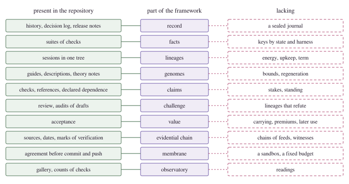

# Case 1. The Science Infrastructure: A Revision of the Earlier Design

*Status: seed (2026-11-21). The first of four cases. The design of a garden for this infrastructure exists already, in [An ecology that improves the infrastructure](../2026-11-19-an-ecology-that-improves-the-infrastructure.md) and in the paper drawn from it; at the user's word this case revises that design and does not repeat it. It reads the infrastructure as a site of [the general framework](case-3-the-general-framework.md), says what the generalisation changes, what the repository already holds of the framework, and how a first trial could be made here. Nothing is built, and nothing here changes the repository's structure or conventions; every suggestion about them is a proposal for the user.*

## 0. Summary

The earlier design stands. Six things change in it.

1. The infrastructure is a hybrid of code, theory, data, papers and applications, so it is an instance of the programming-project case and of the inquiry case together. Its claim kinds and the meaning of its facts move from the ground to a declared site.
2. Its units gain genomes. The repository already holds them in fragments: the guide at its root, each library's guide, each unit's description, declaration and theory note. The revision gives them standing through the claim that a unit can be developed again from its genome, which is a fact decided by sampling.
3. Its focus is declared and plural, and enters through demand, collection, references and the founders. The table of sciences with their priorities and the user's requests are a focus already written.
4. Mechanism comes in rungs, and the first rung has been tried on three units (Section 6.4).
5. People hold reserved acts that the repository's guide already names: agreement before a change of structure or convention, and before a push. Commits are made at the user's word by the practice of the sessions, which the guide does not state.
6. Persons may hold seats inside, which matters for the theory notes, where the fourth case applies.

The general framework counts four changes to the earlier design (its Section 1.3): kinds of claim declared by the site, genomes of units, facts decided by sampling, and seats inside. The six above are those four as they fall on this site, with its focus and its rungs, which the general framework introduces as new ideas.

The repository is nearer to a garden than the earlier design said. Several sessions of one model already work in one tree under one guide, with a decision log, checks and a person who directs and accepts. What it lacks is an account of energy, claims with stakes, challengers, and records of the outside with their chains.

## 1. The Infrastructure as a Site

### 1.1 Materials and the Procedures That Decide Them

| Kind of material | Location | Procedure of decision |
|---|---|---|
| Computational code | The foundations and the domains, in C++ and provisional JavaScript | The suites of checks, against authoritative references, published values, closed forms and exhaustive enumeration; the check of declared dependence; each domain run alone with its down-set |
| Reference values | Each unit's fixtures, with source and date | Regeneration by the script that ran the reference library |
| Theory notes | Each unit's `theory/` | Derivations, where a checker is applied; correspondence with the code that computes what the note proves |
| Schemas stated as categories | Units that declare them | The foundation of categories, statement by statement |
| Data products | The data library's cache, never committed | Digests, provenance, recomputation from the registered source |
| Records drafted by a model | Canons, catalogues, records of objects | Passages verified against sources; marked as proposals until a person confirms |
| Applications | One folder per work | Their suites; pages driven in a browser, which a person looks at |
| Reports and papers | `docs/reports/`, `research/` | Reference ledgers, recomputed numbers, figure manifests, checks before a build |
| Surveys | `research/literature/reports/`, and idea folders | Marks of verification work by work |
| The guide, decisions, ideas | The root guide, the decision log, the ideas | People |

: The infrastructure's materials and the procedures that decide them.

The decidable part is large for computational code and small for the guide and the decisions. The infrastructure has a property that few projects have: its own foundations supply procedures for kinds of material that are elsewhere decided only by people. Derivations can be checked, countermodels found, evidence weighed under readings, provenance and custody verified, and observation designs analysed, by libraries that the project holds. The general framework does not depend on this, in keeping with the user's sixth intuition. It makes this site's harness unusually strong, and it is the second recursion of the paper: the garden improves instruments by which it is itself checked and informed.

### 1.2 Links between Kinds

The principle of the unity of theory and computation is a set of typed links. Every implemented formula cites its derivation; every result that can be checked numerically is checked by code; notation in a note corresponds to names in the code. In the general framework these are the links *implements*, *derives* and *checks*, and a claim may be made of each. They are where most of this site's facts live, and they are why a change to a note and a change to code refute one another.

### 1.3 The Units and the Order of Dependence

The units are the modules of the foundations and the domains, the edges and the works. Their order is declared, acyclic and checked, and it is the order along which a refutation cascades: a fault in a foundation disturbs every domain above it.

## 2. Genomes That the Repository Already Holds

### 2.1 The Fragments

| Level | Text | Organs it carries |
|---|---|---|
| The project | The guide at the root | Identity (purpose, scope, the three tiers), laws (the dependency rules, the conventions of units, time and frames), development (the working procedures), regulation (the status vocabulary, the discipline of change), perception (the first domains, the table of sciences to come) |
| A foundation | Its own guide, its theory note, its decisions | The same, for one library |
| A domain or module | Its description, its declaration of dependence, its theory note, its checks and fixtures | Identity, laws, exemplars (the fixtures), development (the note), regulation (its status) |
| A work | Its description and its recipe | Identity and development |

: Texts of the repository read as genomes.

Two observations follow from reading them so.

*The status vocabulary is the organ of regulation.* A unit marked `stable` is one that others rely on, and the mark is a promise about its interface. In the framework that promise is the claim *keeps*, with a stake, so that reliance on a stable unit is covered and a change to it is priced by what rests on it.

*The guide at the root has two natures.* Its sections on purpose, philosophy, architecture, conventions and procedure are generative: an agent that reads them works as the project works. Its section on the current state is a chronicle of what was built, which can be derived from the decision log and the release notes. In the language of the framework the first is genome and the second is body kept inside the genome. The chronicle is now about half of the guide, as long as all the rest together (some 190 thousand of its 369 thousand characters on 21 November 2026), and every session reads all of it. *This is an observation offered to the user, who decides what the guide holds.* A bounded generative guide with the chronicle kept in the record would be the form that the framework suggests.

### 2.2 Standing through Regeneration

The revision gives these texts no authority by rule. A unit's genome has standing when the claim *regenerates* holds: a developer that has the unit's description, its note and the interfaces of what it depends on writes a body that passes the unit's checks.

Applied here, the claim is a probe of the project's health. A unit that regenerates poorly is one whose knowledge lies only in its body, and such units are where the project depends on memory that no text holds. The probe is costly, since each development is a run of a model and a build, so it is sampled, and the units with most above them in the order come first.

The second prototype is the smallest instance: a unit of 120 lines was developed again from about a hundred words so that its 42 checks passed, the identity alone lost the unit's particular conventions, and laws or ten exemplars restored them. The fixtures of this repository are exemplars in exactly that sense.

The case studies then tried the claim on three units of the repository, and the result qualifies the heading of this section. From the repository's own texts the unit of the sphere was developed again whole, as it was from its identity alone, and the unit of the Sun in 4 developments of 7, against 3 from the identity, since the models supply published formulas themselves; the third unit was developed again in five of its six functions in every development. What the texts lost differed by unit. The label that one function of the third unit returns is written in the body and in a check and in no document, and it was lost in all 7 developments. The names of the classes of daylight were lost in 3 of 7, although the unit's note gives them in a table. And the five developments of the cheap model took the mean radius from a comment whose formula differs slightly from the constant in the body. On two units of three the repository's texts added little or nothing to the bare identity, which the plan of the studies had named as a result that would count against this section, and on the third they restored most functions and no development whole. A sequenced genome carried the conventions that they lost, and in two developments of the third unit its classifying function was faulty where theirs had been sound, once in its rule and once in the names it returns.

### 2.3 Two Modes of Change

A unit of the infrastructure may be patched or reseeded. The repository has a practice that is reseeding under another name: the provisional JavaScript of a domain is replaced by C++ that must pass the same checks. The checks are the anchor, the note and the description are the genome, and the body is developed again in another language. The framework generalises the practice and prices it by the same claims.

## 3. The Focus of the Infrastructure

### 3.1 The Declared Focus

The infrastructure's focus is already written in three places. The table of the sciences that are to join, each with a priority, is a set of weights. The user's requests are demand: nearly every domain and work in the record begins with one. And the reference projects, standards and data sources named in each unit are its references.

The earlier design named the environment's components: problems, goals, values and policy, the economy, knowledge, use. The revision adds what Definition 2 of the general framework asks: the focus is a partition of states by the response they call for, so its declaration says what the infrastructure must be able to tell apart, such as a method that a domain newly needs, a reference that has been superseded, a field whose questions have moved, a user's need that no unit serves.

### 3.2 Founders by Focus

The founders of a garden here are seeded across the focus with full support: lineages for the foundations and for each family of domains, weighted by the declared priorities, and some for what no priority names. Proposition 3 of the general framework gives the reason. A population that works only where the present priorities point loses without bound when the world rewards something else, and the price of keeping many foci is the logarithm of their number.

The founders also differ by role, as the general framework's Section 3.10 sets out, and the infrastructure adds two roles of its own: a lineage that keeps a unit's note and code in correspondence, and one that carries a general method down from a domain to the foundation where it belongs, which is the project's rule of reuse before writing.

### 3.3 Witnesses

The witnesses of this site are the bodies whose records it reads (statistical offices, the keepers of reference data, the literature's own record) and the people who use its works. The paper's provisions hold: a feed enters with the record of its chain, reports that share an origin count once, and the instruments applied to feeds are those of the bedrock.

## 4. People and Reserved Acts

The guide already states most of the reservations of this site, as its discipline of change.

| Reserved act | In the guide |
|---|---|
| A change of structure, a new or renamed domain, a moved foundation, a changed convention | Proposed, and done only with the user's agreement |
| A decision that shapes structure, conventions or tooling | Recorded in the decision log, never rewritten |
| A commit | No rule in the guide; by the practice of the sessions, at the user's word |
| A push | Only with the user's agreement |
| A model's statement entering a record | As a proposal, until a person confirms it |

: Reserved acts that the repository already names or practises.

In the framework these are crossings of the membrane and changes of the site. Two are the acts that a garden's lineages most plainly must not perform: the revision of the project's own genome in its regulatory part, and the recording of a decision. Lineages may propose both, as ideas and as drafts of decision records, which is what a session does today.

The user holds all three roles at present, as source, witness and steward, and for the theory notes also the inquirer's seat of the fourth case. The design admits others in each role without change.

## 5. Present Practice and Gaps

Figure 8 sets the repository's present practice beside the framework.

| Part of the framework | Present in the repository | Lacking |
|---|---|---|
| The record | The history of the repository, the decision log, the release notes, the surveys | A journal of acts and facts that is sealed |
| Facts | Some sixteen thousand checks in sixty-nine suites, as counted in mid-November 2026 | Facts keyed by state and harness version, recomputable by any party |
| Lineages | Several sessions of one model working in one tree, with one memory that they share, kept outside the repository | Energy, upkeep, a term; more than one family of models |
| Genomes | The guides, the descriptions, the notes | Bounds; standing by regeneration |
| Claims | Checks that pass; references that agree; units that build alone | Stakes; a record of each claim's standing |
| Challenge | Review by the user; audits of the user's drafts | Lineages that live by refutation |
| Value | The user's acceptance | Carrying, premiums, later use |
| The evidential chain | Sources and dates on data; marks of verification on surveys | The chain of each feed; witnesses beside the steward |
| The membrane | Agreement before a push, and by practice before a commit | A sandbox; a budget fixed in advance |
| The observatory | The gallery, the counts of checks | The readings of the paper and of the general framework |

: The framework's parts in the repository as it stands.

The sessions that share the tree today are a population without an economy. They coordinate by convention: who holds which decision number, which files another session has touched. The framework replaces convention with a ground in the places where convention has already been found wanting.

## 6. Rungs and a First Trial

### 6.1 The Order of the Rungs Here

The earlier design's stages (jar, terrarium, garden, several gardens) are stages of scope and risk. The rungs of the general framework are stages of mechanism, and they order the work within each stage.

*The first rung on one unit.* A producer answers a need on one unit and stakes on claims; a challenger of another model family is paid for a counterexample; the user reviews what stands. This needs a ground of the size of the third prototype's, the unit's existing checks run out of the producer's reach, and a budget of a few dollars.

*The second rung* adds persistence, memory and upkeep on several units, with needs of classes A and B. It is the terrarium of the earlier design.

*The third rung* adds division with variation and reseeding. It should wait for answers to the open questions of the general framework's Section 9 that concern genomes.

### 6.2 A Unit for the First Trial

The unit should have strong checks that run quickly, a reference independent of any lineage, and a note. This section first proposed that the provisional JavaScript modules of the domains of the Earth and the sky meet all three. The case studies corrected the proposal. Their checks do run in seconds without a build, and they are few: ten, six and seven for the three units tried, killing 69, 87 and 43 percent of distinct mutants. Only some rest on a reference fetched from an authoritative source, and only some units have a note. The three units tried were the Sun seen from the Earth, the Earth as a sphere and the classification of climates. A C++ module of a foundation has stronger checks and needs a build of minutes for each fact, which makes it the second unit and not the first.

The trial's arms and measures are those of the second case's Section 7, with one addition proper to this site: the correspondence of note and code is among the claims, so that a change to either is challenged through the other.

### 6.3 Questions Decided by the Trial

It would decide whether stakes ration the user's review, whether challengers of another family find what the producer's own checks miss, and what a regenerated unit of this repository loses. A result against any of these returns the design to the earlier stage of the jar, which needs no model at all.

### 6.4 Findings of the First Studies

[The case studies](case-studies/README.md) ran the founding steps of sequencing and of measuring the harness, and the first rung without a person as reviewer, on three units. Five of their findings bear on the repository itself and are offered to the user.

1. Seven exported names of the three units have no check that kills any mutant of theirs, among them the classes of daylight, the area of a zone of the sphere and the classification of a whole grid.
2. The check of the mean radius of the sphere compares a distance with the unit's own constant, so that no value of the constant can fail it; and the unit's comment describes the radius by a formula whose value differs from the constant by 0.03 m.
3. The check of the Sun's azimuth looks from a place due south of the subsolar point, where the azimuth is zero. A function that mirrors east and west passes it, as two developments did.
4. The label of the warmer half-year that one function returns is written in the body and in a check and in no document. The classes of daylight are named in the unit's note, which does not say that these names are the strings returned.
5. Of 23 developments that held a fault the repository's checks rejected 22, and a failing check called the faulty function itself in 29 cases of 56. The one fault in a development that passed was a class of daylight decided wrongly at its exact boundary.

The studies leave the second and third rungs untried, and they had no reviewer and one family of models.

## 7. Consequences for the Paper

The paper describes this case. A later revision of it could take five things from the general framework, and none is made now: the genome of a unit with the claims *regenerates* and *keeps*, and the two modes of change; the rungs, beside the stages; the three results on selection, on variation by part and on the cost of a focus; the readings of the general framework's Section 6; and the prototypes as first evidence on heredity and regeneration, which the paper lists among its open empirical questions.

## 8. Open Points for the User

1. Whether the guide at the root should be read as proposed in Section 2.1, and whether its chronicle should stay in it.
2. Which unit should be the first, and whether the first trial should be made before the simulation of the earlier design.
3. Whether the status `stable` should come to carry a stated promise, as the claim *keeps* suggests.
4. Who beside the user would hold the roles of source, witness and steward, if anyone.
5. Whether the foundations of evidence should be used as this site's harness for the kinds of material that only people now decide, and in what order.
6. Whether the findings of Section 6.4 should be acted on: the label stated nowhere written into its unit's text, the names of the classes of daylight said to be the strings returned, the azimuth given a check that a mirror fails, and the names without a killing check given checks. No file of the repository outside this folder was changed by the studies.
