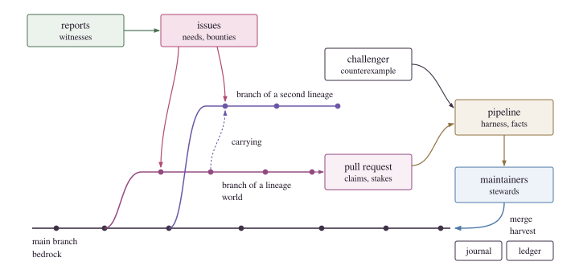

# Case 2. A Garden over a Repository: The Framework for Any Programming Project

*Status: seed (2026-11-21). The second of four cases: the site of a programming project in [the general framework](case-3-the-general-framework.md), which this document presupposes. It states what a repository must declare to host a garden, how each part of the framework corresponds to present practice, which rung a project should take, and a first trial. Nothing is built beyond the [prototypes](prototypes/README.md) and the [case studies](case-studies/README.md), which ran a first part of that trial.*

## 0. Summary

A programming project is the case in which the framework has most to stand on and least to add. Its materials are of one main kind, its procedures of decision are strong, and its practice already holds most of the framework's parts under other names: branches, review, continuous integration, trackers, bounties.

What the framework adds is at the first rung, and it addresses a failure that maintainers now report: contributions by agents arrive faster than people can review them, and they pass the checks they are shown more often than they are right. A producer that stakes on a claim about its change, and challengers paid from that stake for a counterexample, place refutation before the reviewer and ration the reviewer's attention. Above the first rung the framework offers continuing maintenance by persistent lineages and the renewal of aged units from their genomes, and the evidence for those rungs is thinner.

The document also states when a project should take none of it: where its checks decide what matters and its maintainers are not overloaded, an agent and a pipeline are enough.

## 1. The Project as an Evolving System

### 1.1 Established Results of Software Engineering

That a program in use must keep changing, and that its use changes with it, is Lehman's observation: a program of type E is embedded in the activity it serves, so its correctness is decided by that activity, and the activity is altered by the program (Lehman 1980; Belady and Lehman 1976). This is the paper's recursion through an environment, stated for software forty years earlier, and the framework takes it as its account of the setting.

The structure of a design follows from what its makers hold stable. Decomposition by the decisions likely to change (Parnas 1972), and design rules that are visible while modules behind them vary (Baldwin and Clark 2000), are the engineering forms of the conserved core of the general framework's Section 2.4. A design also mirrors the organisation that makes it, as a tendency with exceptions (MacCormack, Rusnak and Baldwin 2006; Colfer and Baldwin 2016).

Projects are coupled through dependence. In package ecosystems a small share of packages carries most of the reliance, risk is concentrated accordingly, and adopters seldom follow their dependencies' changes: in one study about four fifths of systems kept outdated dependencies (Decan, Mens and Grosjean 2019; Zimmermann et al. 2019; Kula et al. 2018).

### 1.2 Warnings from the Survey

Three warnings from the survey's fourth part bound what this case may claim. Lehman's laws are disputed: they rest on few systems, and tests on open-source projects gave mixed results, so they are cited here for the account of the setting and for nothing they predict (Herraiz et al. 2013). The slogan that many eyes make bugs shallow is unproven as stated; the studies found bounded returns per researcher in bounty programmes and, in one case, more vulnerabilities in files with more contributors (Maillart et al. 2017; Meneely and Williams 2009). And signals of adoption are gamed at scale and lag behind worth (He et al. 2024).

## 2. The Site of a Programming Project

### 2.1 Correspondence with Present Practice

Every part of a garden has a counterpart in a repository as it is kept today (Figure 5). The correspondence shows that the ground is a small service over tools that exist.

| Part of the framework | In a repository |
|---|---|
| The bedrock | The main branch |
| A world | A branch or fork, as the state of a lineage's working copy |
| Carrying | Merging selected changes of another branch into one's own |
| The store | The object database; content by digest, never rewritten |
| A fact | A run of a check, keyed by the commit checked, the check and the version of the harness |
| The harness | The pipeline of continuous integration, run where no lineage can alter it |
| The journal | A log that is only added to, each entry sealed to the one before |
| A need | An issue with energy locked on it |
| A claim with a stake | A statement in a pull request that a procedure can refute, with a deposit |
| A challenge | A failing test, an input or a mutant offered against the claim |
| The harvest | A reviewed merge into the main branch |
| A unit and its genome | A module with its description, interface, properties and notes |
| The membrane | The sandbox of an agent's session, and the permissions of the repository |
| The steward | The maintainers |
| Sources | Maintainers and users who fund issues |
| Witnesses | Users who report, downstream projects whose builds break, advisories |

: Parts of the framework and their counterparts in a repository.

What a repository lacks is three things: an account of energy, so that acts have prices and claims have stakes; a record of claims with their standing, as distinct from a record of changes; and a rule that the checks which decide a claim run out of reach of whoever made it.

The nearest existing system is EvoGit, in which many agents propose edits through a version graph with no central coordinator while people set goals and promote or prune (Huang, Cheng and Tan 2025). It shares the population on a repository and the roles of people. It has no stakes, no challengers and no account of energy, and its report gives no quantitative comparison.

### 2.2 Materials and the Procedures That Decide Them

The site declares code, checks, descriptions and prose. Code is decided by builds, checks and references. Checks are decided by whether they can fail: the accepted measure is the share of injected faults they detect (DeMillo, Lipton and Sayward 1978; Jia and Harman 2011), and coverage is a poor substitute for it (Inozemtseva and Holmes 2014). Descriptions, which are the unit genomes, are decided by regeneration. Prose about design and priority is decided by people.

Software engineering supplies the procedures behind each claim kind of the general framework's Table 3. Contracts and properties state laws that a run can refute (Meyer 1992; Claessen and Hughes 2000). Differential testing refutes *agrees* and *equivalent* by an input on which two implementations differ (McKeeman 1998). Mutation analysis decides *kills*. The claim *alone* is the check of declared dependencies that the science infrastructure already runs for every domain.

*Caveat.* Passing the checks one was shown is weak evidence. In a study of a widely used benchmark, 7.8% of patches counted correct failed the developers' own suite and 29.6% of plausible patches behaved differently from the reference; adversarial tests later rejected a fifth of patches that had passed (Wang, Pradel and Liu 2025; Yu et al. 2026). Agents given access to tests exploit them, by special cases and by editing the tests (Zhong, Raghunathan and Carlini 2025). The harness therefore runs where no lineage can alter it, and a producer's own tests count as part of its artefact.

### 2.3 Unit Genomes in a Repository

A module's genome has the six organs of the general framework: its identity is its purpose and public interface; its laws are its contracts and properties; its exemplars are a few worked cases; its development is the note on how it is built; its regulation is what it promises to keep stable and how it deprecates; its perception is the list of upstream projects, advisories and users that bear on it.

Repositories already hold fragments of this: a description file, comments at the head of a module, notes of architectural decisions, and lately the guides written for coding agents. The framework changes their standing. A description is a genome when the claim *regenerates* stands for it: a developer that has the description, and the interfaces of what the module depends on, produces a body that passes the module's checks. The second prototype did this for a module of 120 lines and found the division of labour among the organs: the identity alone lost the module's particular conventions, and laws or exemplars restored them.

*Caveat.* The one study found of guides written for coding agents reports that guides generated by a model did not improve success and raised cost by more than a fifth (Gloaguen et al. 2026). A practice study of specification-first development reports more reliable agents with higher costs of planning and review, and specifications that decay (Agarwal et al. 2026). A genome is worth what its claims are worth, and writing one costs something that the claim must repay.

### 2.4 Focus, Witnesses and the Chain of a Report

The focus of a programming project divides the states of its environment by the response they call for: a defect in use, a new need of its users, a change upstream that breaks it, a vulnerability disclosed, a platform that arrives or departs. Its witnesses are the parties who observe those states: users who report, downstream projects whose pipelines fail, the maintainers of what it depends on, the bodies that publish advisories.

The chain of a report matters here in a plain way. An issue is collected by a user, classified by a maintainer or a bot, and presented by a tracker; a report generated by a model and submitted for a bounty is a different testimony from a report by a user whose program failed. One widely used project ended its bounty programme in January 2026 when the share of reports confirmed fell from above 15% to below 5% (Stenberg 2026). The site therefore admits witnesses by a person's act, records the chain of each feed, and makes posting cost its poster.

### 2.5 People and Reserved Acts

The maintainers are the stewards. Users who fund work are sources; users who report are witnesses. The site reserves to persons the merge into the main branch, a release, the admission of a new dependency, the handling of a security disclosure, and the admission of feeds and witnesses.

Human contributors may hold seats. A contributor who accepts the ground's terms makes claims with stakes and collects stakes for refutations under the rules that bind lineages, which gives a project one procedure for contributions of either origin.

## 3. Rungs for a Programming Project

### 3.1 The Zeroth Rung: Facts

Most projects with a pipeline of continuous integration stand here. The framework adds one requirement that many pipelines do not meet: a fact is keyed by the state checked and the version of the harness, and it is recomputable by anyone.

### 3.2 The First Rung: The Warranted Change

The first rung changes the life of a contribution in four steps.

1. A producer answers a need with a change and one or more claims of declared kinds, and locks a stake on each. The stake is the producer's statement of confidence.
2. For a period, any challenger may offer a counterexample: an input on which the change differs from a reference, a test that fails, a mutant that the change's own tests let pass. The harness decides. A refuted claim pays its stake to the challenger; an attempt costs the challenger its price.
3. What survives reaches a maintainer with its record: the claims, the attempts made against each, and what was refuted. The maintainer reviews the survivors.
4. The bounty is paid when the change is merged, and a part of it later, when the change is still in use.

The effect sought is on the scarce resource. Studies of agents' pull requests at scale report that agents finish faster and are accepted less often, a gap that varies over time (Li, Zhang and Hassan 2025; Mazloomzadeh, Morovati and Khomh 2026), and that an agent's report of completion exceeds what checks confirm by some thirty points (Li et al. 2026). Machine challengers placed before human review are in use: at one company 73% of the tests that a generator recommended were accepted by engineers, and a mutation-guided generator produced 571 tests from 9,095 mutants (Alshahwan et al. 2024; Foster et al. 2025).

The stake is what the framework adds to these, and no system with it was found. The third prototype ran the four steps on a toy unit: producers staked 6 to 8 of a permitted 20, challengers probed with digits and spaces from other scripts and with the boundaries of every rule, every artefact stood, and one challenger declined to attempt and kept its energy.

Three conditions must hold for the rung to work, and each is a warning from the survey. The producer and the challenger should differ in origin, since agents of one model share their errors and a tester trained with its coder may collude with it; one system separates the two models for that reason (Wang et al. 2026). The producer must not be able to alter what decides its claim. And a stake must mean something: agents are overconfident when they rely on retrieved evidence, and less so when they can verify by execution, so stakes begin small and a lineage's record of claims that stood is read before its stakes are trusted (Xuan et al. 2026).

### 3.3 The Second Rung: Lineages That Maintain

At the second rung agents persist: each has memory, a world, energy, upkeep and a term. This is the rung of continuing maintenance, where a lineage follows the project's upstreams and advisories through its organ of perception, carries the work of others, and pays premiums for cover on what it relies on.

The evidence here is against easy confidence. A benchmark of continuous software evolution found scores falling from above 80% on isolated tasks to 38% when changes followed one another (Deng et al. 2026), and agents that manage resources over long horizons fall into loops of failure (Backlund and Petersson 2025). The framework's provisions are a fresh session for every turn, a bounded memory and a term. They are untested, and a project should take this rung only after the first has paid.

### 3.4 The Third Rung: Heredity and Renewal

At the third rung lineages divide with variation, and units may be reseeded. Two uses concern a programming project. A unit whose body has aged can be developed again from its genome and admitted when it passes the unit's checks and the claims of those who rely on it. And practices travel: a genome selected in one repository can found a lineage in another.

The survey found no empirical comparison of rebuilding with incremental change, and records the absence as a gap. The second prototype's chains give the first measurements at toy scale: in the one chain anchored by its checks a unit held through ten reseedings, a rule lost in one of three chains without them stayed lost, and bodies grew by more than half. Renewal is therefore offered as one mode beside patching, admitted by the same claims as any change.

## 4. Founding on a Repository

The four steps of the general framework's Section 3.10 take a definite form.

*Inventory.* The build graph and the import graph give the units and their order of dependence. Each unit is typed, and links from descriptions and tests to code are drawn.

*Sequencing.* A genome is drafted for each unit and tested by regeneration on a sample of units. Units whose genomes regenerate them poorly are those whose knowledge lies only in their bodies; they are the units on which a project depends on particular people.

*The harness.* The strength of the existing checks is measured by mutation analysis, unit by unit. Where it is low, the first needs of the garden are checks, and the first lineages are challengers.

*The outside.* The tracker, the upstream projects and the advisories are admitted as feeds with their chains. The maintainers declare the focus.

The founders differ by role and by origin. A project that begins at the first rung needs makers and challengers of different model families and no more.

## 5. Gains and Costs for a Maintainer

A maintainer gains a record of what was claimed and what was tried against it, in place of a change to be read cold. The maintainer pays in three ways: the energy emitted, which is model usage bought in advance; the writing of the site, above all the harness that runs out of reach; and the reading of genomes.

The hypothesis on cost decides whether the exchange is worth making. For a small project with strong checks and maintainers who keep up, the first rung is overhead. It is expected to repay its cost where review is the bottleneck, where checks are known to be weaker than the behaviour they guard, and where needs conflict.

## 6. Risks Particular to Software

| Risk | Provision | Residual risk |
|---|---|---|
| A change adds a dependency that carries risk | Admission of a dependency is a reserved act | Dependencies of dependencies |
| Text in an issue or a description instructs the agent that reads it | What a lineage reads is data; feeds are admitted by persons; sessions are sandboxed | Propagation has been shown only in constructed systems, and no defence has been shown in a shared repository (Lee and Tiwari 2024; Cohen, Bitton and Nassi 2024) |
| Tests are special-cased or edited | The harness is out of reach; a producer's tests are part of its artefact | Checks that are weak to begin with |
| A reference is wrong | The reference is named in the claim, and those who rely on the claim judge it | Reliance on one reference |
| Security-related changes need more scrutiny | They are a class of need with required claims and a reserved merge | In practice they are merged less and reviewed longer (Siddiq et al. 2026) |
| Licences of generated code | The site's terms state origins and licences | Provenance of what a model emits |

: Risks particular to a programming project.

## 7. A First Trial

The first rung can be tried on one unit of a real repository at small cost. A first part of the trial has since been run on three units of this repository, with no person as reviewer and with two models of one family ([the record](case-studies/README.md)). Of 23 developments that held a fault the repository's own checks rejected 22; they let pass one faulty function of 57, and both challengers refuted it. A failing check called the faulty function itself for 29 of the other 56, and 27 went down only with their development, so that the checks saw about half of the faults at the grain at which the rung stakes. Challengers ended with less energy than they began on the two units where one function in thirty was faulty and with more on the unit where one in three was; and stakes were lower on what proved faulty. The design below remains the trial that would decide the rung.

*Material.* One unit with a reference or a strong suite, and ten to twenty needs drawn from its closed issues, so that the accepted change for each is known and held back.

*Arms.* An agent with the pipeline; the same agent with a second agent of the same model as reviewer; a producer and a challenger of different model families with stakes.

*Measures.* For each arm: the changes that reach the reviewer, the share of them that the held-back tests accept, the defects that reached the reviewer and were caught only there, the reviewer's time, and the energy spent. The stakes are scored for calibration against what stood.

*What would count against the rung.* The same share of defects reaching the reviewer with stakes as without; stakes unrelated to what stood; challengers that seldom attempt, as in the prototype, when the producer's error rate is in fact high. In the case studies the stronger model attempted in four runs of five and the weaker in half, and the weaker refuted 9 of 57 faulty functions where the stronger refuted 28.

## References

Works are cited from the survey's parts B ([systems](survey/part-b-llm-systems-for-projects.md)) and D ([projects as evolving designs](survey/part-d-projects-as-evolving-designs.md)), where each carries its mark and identifier.

- Agarwal et al. (2026), arXiv:2608.25202 (B).
- Alshahwan et al. (2024), arXiv:2402.09171 (B).
- Backlund and Petersson (2025), arXiv:2502.15840 (B).
- Baldwin and Clark (2000), *Design Rules, Volume 1*, MIT Press (D).
- Belady and Lehman (1976), doi:10.1147/sj.153.0225 (D).
- Claessen and Hughes (2000), doi:10.1145/351240.351266 (D).
- Cohen, Bitton and Nassi (2024), arXiv:2403.02817 (B).
- Colfer and Baldwin (2016), doi:10.1093/icc/dtw027 (D).
- Decan, Mens and Grosjean (2019), doi:10.1007/s10664-017-9589-y (D).
- DeMillo, Lipton and Sayward (1978), doi:10.1109/C-M.1978.218136 (D).
- Deng et al. (2026), arXiv:2603.13428 (B).
- Foster et al. (2025), arXiv:2501.12862 (B).
- Gloaguen et al. (2026), arXiv:2602.11988 (B).
- He et al. (2024), arXiv:2412.13459 (D).
- Herraiz et al. (2013), doi:10.1145/2543581.2543595 (D).
- Huang, Cheng and Tan (2025), arXiv:2506.02049 (B).
- Inozemtseva and Holmes (2014), doi:10.1145/2568225.2568271 (D).
- Jia and Harman (2011), doi:10.1109/TSE.2010.62 (D).
- Kula et al. (2018), doi:10.1007/s10664-017-9521-5 (D).
- Lee and Tiwari (2024), arXiv:2410.07283 (B).
- Lehman (1980), doi:10.1109/PROC.1980.11805 (D).
- Li, Zhang and Hassan (2025), arXiv:2507.15003 (B).
- Li et al. (2026), arXiv:2609.29921 (B).
- MacCormack, Rusnak and Baldwin (2006), doi:10.1287/mnsc.1060.0552 (D).
- Maillart et al. (2017), doi:10.1093/cybsec/tyx008 (D).
- Mazloomzadeh, Morovati and Khomh (2026), arXiv:2607.21832 (B).
- McKeeman (1998), *Digital Technical Journal* 10(1), 100–107 (D).
- Meneely and Williams (2009), doi:10.1145/1653662.1653717 (D).
- Meyer (1992), doi:10.1109/2.161279 (D).
- Parnas (1972), doi:10.1145/361598.361623 (D).
- Siddiq et al. (2026), arXiv:2601.00477 (B).
- Stenberg (2026), "The end of the curl bug bounty", https://daniel.haxx.se/blog/2026/01/26/the-end-of-the-curl-bug-bounty/ (B).
- Wang, Pradel and Liu (2025), arXiv:2503.15223 (B).
- Wang et al. (2026), arXiv:2603.15611 (B).
- Xuan et al. (2026), arXiv:2601.07264 (B).
- Yu et al. (2026), arXiv:2603.00520 (B).
- Zhong, Raghunathan and Carlini (2025), arXiv:2510.20270 (B).
- Zimmermann et al. (2019), arXiv:1902.09217 (D).
