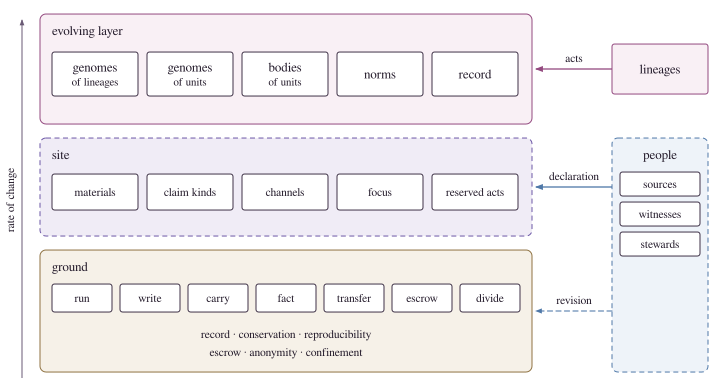
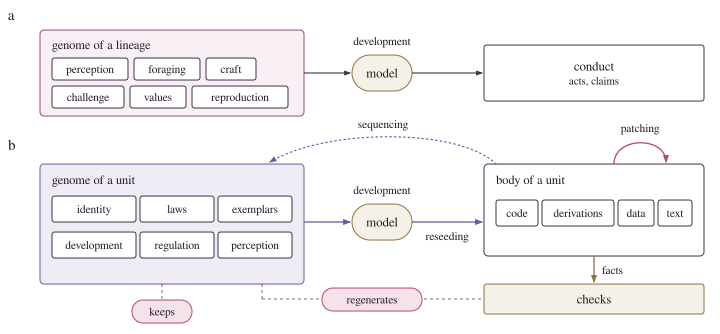
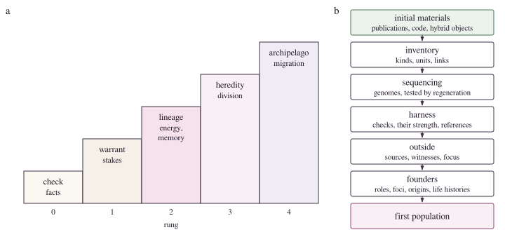
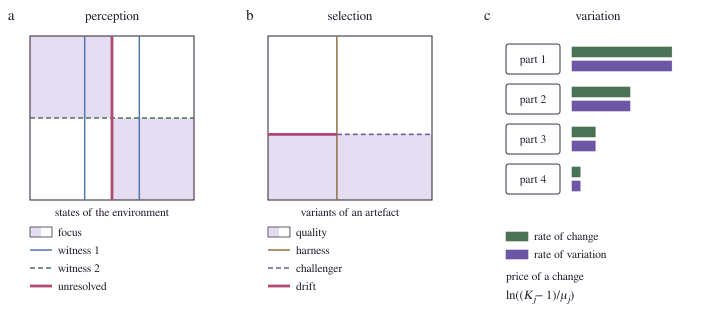
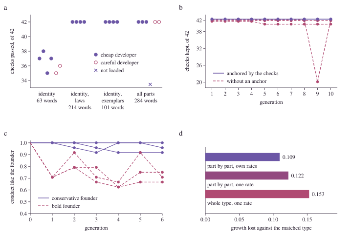
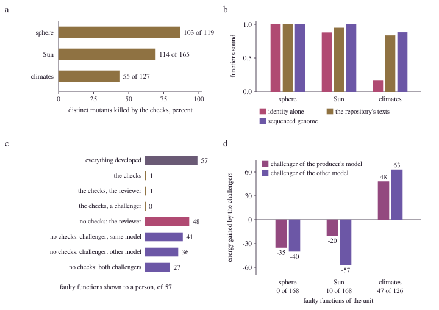

# A Generative Ecology of Projects: The General Framework

*Status: seed (2026-11-20 and 21). The general form of the framework in which a population of language-model agents improves a body of work by evolution, with people in defined roles. It is the third of four cases asked for (any project) and the one from which the other three are read: [any programming project](case-2-programming-projects.md), [the science infrastructure](case-1-the-science-infrastructure.md) and [theory and papers](case-4-inquiry-and-papers.md). Nothing here is built beyond the [prototypes](prototypes/README.md) and the [case studies](case-studies/README.md), and nothing changes the repository's structure. The [survey](survey/README.md), the prototypes and the case studies are its evidence; [the figures](publication/README.md) are drawn for publication. Names are provisional.*

## 0. Summary

A project is a body of work that people care about, in a world that changes. This document states one framework for the continuing improvement of any such body of work by a population of agents, of which the earlier design for the science infrastructure is an instance.

The framework has three layers. The *ground* is invariant: it conserves a resource, keeps a sealed record, runs reproducible procedures, enforces promises held in escrow, and confines every act. The *site* is declared by people for one project: its kinds of material and the procedures that decide statements about them, its kinds of claim, its channels from the outside, its focus, and the acts reserved to people. What *evolves* lies above both: the genomes of agents, the genomes and bodies of the project's units, norms, and the record.

Four ideas are added to the earlier design. Every unit of a project carries a *genome*, a bounded text from which its body can be developed again and checked, so that a project passes through a compact generative form as living things do. A *focus* is the partition of the world's states by the response they call for from the project, with weights; it enters through demand, collection, references and the founders, and stays out of evaluation. Mechanism comes in *rungs*, from facts alone to full heredity, and a project takes the lowest rung that answers its failure. And people hold *reserved acts* that differ by site: crossing the boundary everywhere, and in inquiry the question, the reading, the acceptance and the authorship.

Three formal results organise the whole. Selection acts through what its payers can tell apart, as perception acts through what its witnesses can tell apart. Variation part by part pays for a change only within the part concerned. A focus is a prior whose error costs its relative entropy to the world, and many foci cost the logarithm of their number.

The prototypes support the two suppositions on which the design most depends, at small scale: a genome written in words was inherited over six generations with its boldness of variation, and a unit of 120 lines was developed again from about a hundred words so that its 42 hidden checks passed. They also showed what the design had left out: variation fell on one place unless told where, bodies grew under reseeding, a lineage staked beyond its means when it was not shown its balance, and a bounded search supported implications that were false.

Three case studies on real material of this repository followed, from a plan written before the runs. The mechanisms ran end to end on three units of code, on the documents of this design and on a fragment of theory. They also corrected the design. What a genome added was what is particular to a unit, its conventions and its choice among variants, since the models supplied published formulas from their own stock. The repository's checks proved weaker than supposed, and at the grain of the function they saw about half of the faults of development. Challenge paid only where faults were common, and a lineage shown its balance still staked beyond it. Two later readings of these documents, one by hand and one by an independent reviewer, then corrected the record of the studies and three statements of Section 4; [the record](case-studies/README.md) says how.

## 1. Origin and Scope

### 1.1 The Request

On 2026-11-20, with the paper on the science infrastructure revised, the user set four tasks of idea and design: to revise the self-evolution framework for this project; to generalise it to any programming project; to generalise that to all projects, "possible, because the evolution generally prompts driven"; and a self-evolution framework for "our theoretical system and paper writing". They gave three further intuitions, numbered here after the ten of the [earlier record](../2026-11-19-an-ecology-that-improves-the-infrastructure.md).

- **I11, one framework with different foci.** "I think the basic framework can be unified, they are generally the same … the external environment knowledge reconstruction focusing are differs, our knowledge infrastucture may focusing on global science development directions, our interests, etc. I think such should also involve in initial population generation? Other part whether need modeling such focusing?" And later: "in fact 1-4 can all finally abstract to a framework. With some initial materials (not matter publications, codes, or hybrid objects, etc) envoluntionary explore / improve the project, which well reconstruct the external environment and its dynamics, but different project can has different focusing of knowledge."
- **I12, inquiry stays with people.** For the fourth task: "with our exist publications, where contains our theoretical system, like an economics!! Evoluntionary try discovery and evolve new knowledges. But I think for 4. is better human involve, because inquery shouldn't be delegated."
- **I13, a compact generative core.** "Analogy to biology and ecosystem mechaism is highly important. I think no matter what kinds of project, we should remain something compact and hold high generativity things in the project (just like biological genome), they preserve a candidate's generativity, but allow variated in evoluntionary, and even some part may control evolutionary (like human's sexual chrome part, etc)."

The user also asked that the design be considered until it should work, with a survey and small prototypes, that the order of the four be changed if a higher abstraction came first, and, as before, that their intuitions be examined and held open to correction.

### 1.2 The Reading Given to It

The four tasks are one framework and four declarations. The general form is designed first, since the science infrastructure is itself a hybrid of code, theory, data and papers and is an instance of the second case and of the fourth.

Three amendments to the intuitions were put to the user in discussion and are carried here.

The first concerns I11's ground for generality. That agents act through prompts makes variation universal: any text can be varied by a model. Selection is the part that does not generalise, since it needs something beyond the reach of the agents selected, and projects differ greatly in how much of what matters can be decided in that way. The framework generalises through what a project can expose to refutation, and Section 4.1 states the limit as a result.

The second concerns where a focus may act. A focus that scored agents would be the fitness function that the earlier design removed. It enters where the environment already enters and in the founders, and it stays out of the ground and of evaluation (Section 3.7).

The third concerns I13. The earlier design gave a genome to agents and none to the project, whose working copies were inherited whole. The user's intuition is taken in its strong form: every unit of a project has a genome and a body, and the body can be developed again from the genome (Section 3.5). The analogy with sex chromosomes is taken with a caution that biology itself supplies: a part of the genome sheltered from recombination degenerates (Section 2.8).

### 1.3 Relation to the Earlier Design and the Paper

The earlier record designs a *garden* for the science infrastructure, and the paper *Towards a Non-Equilibrium Evolutionary Agent Ecology for Science Infrastructure under Evidentially and Humanistically Reconstructed World Dynamics* (`docs/reports/2026-11-20-evolutionary-improvement-framework/`) states it with its results. Everything in them stands: the ground and its seven primitives, lineages with genomes of organs, reproduction as an organ, claims and warranties, evaluation as interaction, the membrane, the evidential chain with its witnesses, and the propositions on equilibrium, selection, tracking, signals and the chain.

This document changes four things in that design and says so where it does. Claim kinds and the meaning of a fact move from the ground to the site. Units of the project gain genomes. Facts may be sampled as well as deterministic. And persons may hold seats inside a garden as well as roles at its boundary.

### 1.4 Conditions under Which the Framework Is the Wrong Instrument

The paper's hypothesis on cost applies with more force in general. Where a check decides what matters, a fixed evaluator is adequate and an ecology around it is overhead. The methods that optimise any artefact given in text all take such an evaluator as an input: a user's objective in TextGrad (Yuksekgonul et al. 2024), a trace with feedback in Trace (Cheng, Nie and Swaminathan 2024), a metric in DSPy (Khattab et al. 2023). They are the right instruments for a project with a trustworthy metric.

The framework is for a body of work with three properties together: its worth is decided outside it by parties who disagree; some measure of that worth can be gamed; and the outside changes. The closed loop is its limiting case, a site with one source, every need decidable and no witness, and Section 3.9 lets a project stop at the rung that suffices.

## 2. Principles Drawn from Life

The earlier design took eight principles from natural evolution. I13 asks for more of the same kind, and the survey's first part was made to check each against the primary literature with its limits ([Part A](survey/part-a-biology-and-evolvability.md)).

### 2.1 The Compact Generative Core

A genome is short beside the organism it helps to produce. It is a description read by a machinery in an environment, and the organism is developed afresh in each generation. The compactness has a reason on the side of heredity: the information that selection can maintain falls as the length copied grows, by Eigen's threshold, whose position depends on the landscape (Eigen 1971; Bull, Meyers and Lachmann 2005). It has a consequence on the side of form: a description that reuses its parts generates bodies with regularity, which is what the generative and indirect encodings of evolutionary computation exploit (Stanley and Miikkulainen 2003; Hornby and Pollack 2002; O'Neill and Ryan 2001).

An agent built on a language model stands in the same condition for another reason. Each of its acts is developed from a bounded text: what it reads at the start of a turn. Whatever in a project is to shape the work of such agents must pass through that bound. The context of a turn is the bottleneck through which every act of development passes, and it is the reason why prompt-driven work has a genome whether or not one is designed.

Compactness has no absolute measure. The length of the shortest description is uncomputable, and a description is short only for a given reader (Rissanen 1978). A genome in this framework is short for a given model, which supplies from its own training what the genome leaves unsaid. Section 4.4 and the second prototype show what that supply is worth and what it costs.

### 2.2 Germ and Body

In many organisms a line of cells set apart carries heredity, and the body that feeds and defends it is rebuilt in each generation and discarded (Buss 1987; Kirkwood 1977). Passage through a single cell exposes the whole genome to selection at once and purges what a body accumulates; the same holds, with its costs, for the bottleneck of mitochondria (Grosberg and Strathmann 2007; Bergstrom and Pritchard 1998). A lineage that only copies its body accumulates deleterious change without remedy (Muller 1964).

A body of work that is only ever patched is such a lineage. Software engineering has its own names for the result: aging, debt, erosion, documentation that no longer describes what stands (Parnas 1994; Cunningham 1992; Li, Avgeriou and Liang 2015; de Silva and Balasubramaniam 2012). Plants show the alternative as a pair: vegetative growth, which is cheap and faithful, and reproduction by seed, which is costly and renews (Vallejo-Marín, Dorken and Barrett 2010). Section 3.5 gives a unit of work both.

### 2.3 Control of Evolution from within the Genome

Parts of a genome bear on how it varies. Alleles that raise the rate of mutation spread by hitchhiking with the beneficial changes they cause (Sniegowski, Gerrish and Lenski 1997; Taddei et al. 1997). Some loci of pathogens are built to mutate fast where the environment presses hardest (Moxon et al. 1994). Stress raises rates of mutation (Galhardo, Hastings and Rosenberg 2007). Loci of self-incompatibility decide with whom a plant may cross (Takayama and Isogai 2005), modifiers set the rate of recombination (Otto and Lenormand 2002), and organelles are commonly inherited from one parent (Birky 2001).

The earlier design placed this control in the organ of reproduction, which writes the offspring's genome and so varies itself. The present design adds what the first prototype showed to be necessary: the organ must say where variation falls and how much in each part, since a model left to choose varies the same place each time.

### 2.4 Modularity and Conserved Cores

Complex systems that evolve are nearly decomposable (Simon 1962). The theory of facilitated variation gives the mechanism for organisms: a small set of conserved core processes, robust and versatile, linked weakly by regulation, so that a small regulatory change yields a coordinated and viable change of form (Kirschner and Gerhart 1998; Gerhart and Kirschner 2007; Carroll 2008). The theory of designed artefacts says the same of them: design rules that are visible and stable let hidden modules vary, and most of a design's option value lies in that freedom (Parnas 1972; Baldwin and Clark 2000).

Modularity is produced under conditions. It arose in simulation when goals varied in a modular way and shared structure, and it arose under a cost on connections; pressure for performance alone did not produce it (Kashtan and Alon 2005; Parter, Kashtan and Alon 2008; Clune, Mouret and Lipson 2013). Section 4.2 states what modular variation buys and under what condition.

### 2.5 Neutral Variation and Degeneracy

Many genotypes yield one phenotype, and a population can drift among them without loss while its reach changes (Schuster et al. 1994; Wagner 2005, 2008). Structures of different make that perform one function are common in living systems and are held to underlie both their robustness and their capacity to change (Edelman and Gally 2001; Whitacre 2010).

Both have exact counterparts in work. A change that preserves behaviour, which engineers call refactoring, is neutral variation: it alters what can be reached next. And a result that stands in several forms of different make, as a derivation, a program, a measurement and a sentence, is degenerate in the biologists' sense; agreement among such forms is the triangulation that the philosophy of science treats as robustness (Wimsatt 1981). Section 3.2 builds on it, with the caution of Section 2.8.

### 2.6 Succession on Bare Material

Life arrives on bare ground in an order. The first comers change the conditions for those that follow; whether they ease their way, hinder it or leave it unaffected differs from case to case (Connell and Slatyer 1977). A project met for the first time is bare ground of this kind: it may have no checks, no genomes and no charted environment. Section 3.10 founds a garden in stages for that reason, and takes from the ecologists the warning that first comers do not always prepare the way.

### 2.7 Mechanisms of Life and Their Counterparts

| Mechanism in life | Its work there | Counterpart in the framework | Limit of the correspondence |
|---|---|---|---|
| Genome and development | A compact description is read by a machinery and a body results | The genome of a lineage and of a unit; development by a model | The reader is a model that the genome did not make and cannot alter |
| Error threshold | Bounds the length that selection maintains | Bounds on every genome, enforced by the ground | Fidelity of copying by a model is not a rate per symbol |
| Germ and body | Heredity passes through a compact stage; the body is rebuilt | Genome and body of a unit; reseeding | Bodies are also kept, since the store loses nothing |
| Vegetative and seed reproduction | Cheap faithful copying beside costly renewal | Patching and reseeding | The two modes interact; neither removes the other's cost |
| Conserved core processes, weak linkage | Regulatory change gives coordinated viable variation | Stable interfaces and laws; regulation as an organ of the unit genome | Which parts are core is known in retrospect |
| Modularity | Change in one part leaves the others | Units; variation part by part (Proposition 2) | Pays when the environment's changes follow the parts |
| Neutral networks | Drift without loss changes what is reachable | Behaviour-preserving change, claimed as *equivalent* | Equivalence is decided only on a declared domain |
| Degeneracy | Different structures perform one function | Forms of different kind that check one another | Forms from one maker fail together |
| Mutators and contingency loci | The genome bears on its own rates of variation | The organ of reproduction states rates by part | Selection for evolvability is slow and disputed |
| Stress-induced variation | Rates rise when conditions worsen | A lineage varies more as its income falls | Seeded, and observed before it is relied on |
| Recombination and its modifiers | Brings together what arose apart | Recombination organ by organ; merging of unit versions | A merge can break what each parent kept |
| Self-incompatibility | Prevents crossing with close kin | Recombination preferred between different origins | Origins among agents of one model are few |
| Uniparental inheritance | Limits conflict among organelles | The organ of reproduction inherited whole from one parent | A sheltered part degenerates unless it is itself varied and selected |
| Selfish genetic elements | Parts that copy themselves at the whole's cost | Texts that instruct their own copying | No defence is shown to hold in a shared repository |
| Immunity with memory | Recognition of what harmed before | The organ of immunity; refutations in the record | Recognition by a model can be argued with |
| Horizontal transfer | Capacities move between lineages | Carrying of artefacts; teaching of organs | Carried text is data to its reader, never instruction |
| Niche construction | Organisms make part of their conditions | Worlds, the bedrock and the harness that lineages extend | The bedrock changes only through a person |
| Plasticity and assimilation | What is learned in a life may later be inherited | Memory, testament and their passage into the genome | Deliberate, and bounded |
| Cues and signals | Organisms act on correlates, many produced by others | Feeds as the testimony of witnesses; warranties as costly signals | Witnesses are people with positions and standing |
| Succession | Early comers change conditions for later ones | Founding in stages; pioneers that build the harness | Early comers may hinder as well as help |
| Disturbance | Resets what has locked | The sources of disturbance of the paper | The benefit of intermediate disturbance is contested |
| Islands and metapopulations | Linked populations persist where one would end | Several gardens with migration by genome | The parameters have no direct counterparts |

: Mechanisms of life, their counterparts in the framework, and the limit of each correspondence.

### 2.8 Limits of the Analogy

The survey gives five limits that the design must carry.

*Evolvability as an adaptation is unsettled.* Whether selection favours the capacity to evolve, as opposed to its being a by-product, remains open, and the drift-barrier account holds that selection presses rates of mutation downward, weakly in small populations (Pigliucci 2008; Sniegowski and Murphy 2006; Lynch et al. 2016). Gardens are small populations. The selection of rates of variation is therefore stated as a hypothesis, as the paper states it.

*A sheltered controller degenerates.* Regions of suppressed recombination, sex chromosomes among them, lose function over time (Charlesworth, Charlesworth and Marais 2005). The part of a genome that governs reproduction is accordingly kept whole at recombination and remains subject to variation and selection at its own rate; it is given no exemption.

*A reported bias of mutation toward unimportant regions is contested.* It should not be cited as established (Monroe et al. 2022; Liu and Zhang 2022).

*Transmission through a learner converges to the learner's prior.* Chains of Bayesian learners that sample from their posterior forget their data and return their prior (Griffiths and Kalish 2007). Chains of language models develop attractors and content biases, more strongly under open instructions (Perez et al. 2024; Acerbi and Stubbersfield 2023), and models trained on their own output lose the tails of their distributions unless earlier data are kept beside the new (Shumailov et al. 2024; Gerstgrasser et al. 2024). Reseeding is such a chain. Section 4.4 treats it, and the design keeps bodies and the record beside genomes for this reason.

*Agreement among independent forms is weaker than it appears.* Versions developed independently from one specification fail together, at the places where the specification is hard or ambiguous; this was shown for programmers and again for coding agents, where majority voting among three versions still removed most failures (Knight and Leveson 1986; Ron, Baudry and Monperrus 2026). Forms made by one model share that model's errors (Kim et al. 2025).

## 3. The Framework

### 3.1 Three Layers and the People at the Boundary

An instance of the framework is a garden, as before. It has three layers, distinguished by who may change them (Figure 1).



The *ground* is the invariant program that advances the state. No party inside a garden can change it, and people revise it rarely and by recorded decision. The *site* is the declaration by which people fit a garden to one project. It is fixed while a garden runs and is revised at its boundary. What *evolves* is everything that lineages write: their own genomes at division, the genomes and bodies of units in their worlds, norms, and the record that all of it leaves.

People stand at the boundary as sources, witnesses and stewards, and on some sites they also hold seats inside (Section 3.8).

### 3.2 Materials, Kinds and Links

The materials of a project are content of declared kinds. A kind is defined by what can be decided about it. Code can be built and run. A formal statement can be searched for a countermodel, and a derivation can be checked step by step. A datum can be recomputed from its source. A citation can be opened and its quoted passage found. A figure can be made again from its data. A number in prose can be bound to the computation that yields it. A plan can be tested for feasibility against its constraints. Prose that argues has no such procedure and is decided by people.

Materials are joined by typed links: a program *implements* a statement, a derivation *derives* it, a check *checks* a program, a datum *measures* a quantity, a sentence *cites* a source, a figure *illustrates* a result, a unit *depends* on a unit, a body *develops from* a genome. The relation "rests on" of the earlier design is the union of these links, and a refutation travels along it.

A project of several kinds has a property that a project of one kind lacks: its kinds check one another. A derivation checks what a program computes, the program checks the theorem on cases, data check a model, and a sentence stands or falls with the computation it reports. Most of the facts of a hybrid project live on links between kinds. The science infrastructure is built on this principle, which it calls the unity of theory and computation, and the user's own practice of making a draft exact by implementing it is the same principle used on theory.

*Caveat.* Forms check one another to the extent that they were made independently. Two forms written in one turn by one model are one form for this purpose.

### 3.3 The Ground

The ground keeps its seven primitives (run, write, carry, fact, transfer, escrow, divide) and its six invariants. Four changes follow from generality and from the prototypes.

*The meaning of a fact belongs to the site.* The ground runs a procedure that the site supplies and records its outcome. It contains no word about tests, proofs or data. The third prototype's ground is of this form, and it ran a software site and a theory site unchanged.

*A fact is deterministic or sampled.* The outcome of a deterministic procedure is a function of its inputs and can be recomputed by anyone. Development by a model is random, so a statement about what a genome yields is decided by a sample of developments of a declared size, every one of them kept. A claim that rests on a sampled fact is a statistical statement with a declared test.

*Bounds are enforced.* The second prototype asked for genomes within stated limits and received longer ones. A bound on a genome is checked by the ground, and a genome beyond it is refused. The case studies enforced bounds in words, and the bounds did not bind, no part of a genome having passed two thirds of its bound. Words proved an unsteady measure, since a formula written without spaces counts as one word, and a bound is better stated in characters or tokens; this is a choice of design that the studies suggest and do not test. They also found that the exemplars of a unit of numbers must be facts: the sequencer chooses the calls, and the ground computes their results.

*Typed channels.* The ground offers no primitive by which one party writes the genome or the memory of another. What a lineage reads of others' content reaches it as data.

### 3.4 The Site

A site is a declaration written as data, admitted when its constraints hold, and revised by a recorded act. It states the following.

1. *Materials.* The kinds of material in the project, and for each the procedures that decide statements about it, with their versions. A kind with no procedure is marked as decided by people.
2. *Claims.* The kinds of claim admitted (Section 3.6), each with its procedure of decision and the object, independent of the maker, to which it refers.
3. *Units.* The units of the project, where each one's genome is kept, and the bounds on genomes.
4. *Channels.* Who may post needs and with what budget; which witnesses and feeds are admitted, each feed with the record of its chain; which references are held.
5. *Focus.* The declared focus and who declares it (Section 3.7).
6. *Reserved acts.* The acts that only persons perform (Section 3.8).
7. *Rung and parameters.* The rung of mechanism in force (Section 3.9) and the parameters of the ground.
8. *Founding.* How the founders' genomes are made (Section 3.10).
9. *Terms.* What of the materials may leave the machine, to which provider of models, under what licence.

The constraints of admission are few. Every claim kind names an object independent of its maker. Every kind of material has a procedure or is marked as decided by people. The reserved acts include every crossing of the boundary. The focus has full support (Proposition 3). The budget is fixed in advance. Appendix B gives a declaration in outline.

*Remark.* The site is where a project's particularity lives, and it is the answer to the question whether one framework can serve projects of every kind. The ground does not know the kind. Two projects differ in their sites.

### 3.5 Genomes and Bodies

**Definition 1 (genome and body).** A *genome* is a bounded text from which a model, in an environment, develops a *body*. The genome of a lineage is the text from which it acts, and its body is its conduct. The genome of a unit of a project is a text from which the unit's materials can be developed, and its body is those materials.

The earlier design had the first half of this definition. The second half is I13 (Figure 2).



**The organs of a unit genome.** A unit genome has six parts.

| Organ | Content |
|---|---|
| identity | What the unit is for, and its interface: the names by which the rest of the project uses it |
| laws | What must hold of it, stated as claims where a procedure can decide them |
| exemplars | A few worked cases, chosen for the rules that are easiest to get wrong |
| development | How its body is produced: methods, conventions, sources |
| regulation | How it may change: what it promises to keep, what may be developed freely, what it is compatible with |
| perception | What of the outside bears on it: the feeds, references and sources that concern it |

: The organs of the genome of a unit.

The division follows the second prototype, in which the identity alone lost the unit's particular rules and either the laws or ten exemplars restored all of them. For a theory the same parts are a research programme in Lakatos's sense: its commitments and primitives, the heuristics by which it is extended, and what it holds fixed against refutation (Lakatos 1978), with Kuhn's exemplars as the cases from which practice is learnt (Kuhn 1970). The fit is an analogy, and the fourth case examines it.

**Sequencing, development and the two modes.** *Sequencing* writes a unit's genome from its body. *Development* writes a body from a genome. A unit changes in two modes. *Patching* changes the body directly, as the earlier design supposed throughout. *Reseeding* changes the genome, or leaves it, and develops the body again. A lineage chooses between them unit by unit, as a plant grows vegetatively and also sets seed: patching while it is cheap, reseeding when a body has aged or when a change is one of regulation that should reach the whole body coherently.

**Two claims give a genome standing.** No office decides what a genome must contain. Its adequacy is claimed and exposed to refutation like anything else.

- *regenerates*: from the unit's genome and the identities of the units it depends on, a developer of a named model and budget produces a body on which at least a stated share of the unit's checks pass, in at least a stated number of a stated number of developments. The fact is sampled.
- *keeps*: a named part of the unit's interface will satisfy its checks on the maker's world for a stated number of turns. This is a promise about the future, held in escrow, and it is what makes an interface something others can build on.

A source may require *regenerates* of a need, so that work is paid for only when its genome carries it. Documentation that works thereby becomes a fact, and the hoarding of know-how in a body that nobody else can develop loses its reward.

*Remark (the developer's stock).* What a unit is may lie in three places: in its genome, in its body alone, or in the developer's own stock of knowledge. The case studies developed one unit of published formulas whole from its identity alone, a second in most of its functions, and a third, which follows one variant of a classification among several, in none of its developments (Section 7.3). The claim *regenerates* is therefore read against the same developments from the identity alone, and a genome has standing for what it adds to them. What it added in the studies was convention and choice: the names of returned values, the sense of an angle, the side of a boundary, the variant followed. A short genome can also lose what longer texts keep: the sequenced genome of the third unit dropped part of its rule in two developments of seven.

*Caveat.* The nearest prior work is the measure of round-trip correctness, which describes code and regenerates it (Allamanis, Panthaplackel and Yin 2024), and PROOF, which verifies a hierarchical specification of a codebase by regenerating code (Zhang et al. 2026). Evidence that a specification should be the source of truth is advocacy and practitioners' reports, with decay of specifications among the costs reported (Agarwal et al. 2026), and descriptions written by a model for coding agents did not help in the one study found and raised cost by a fifth (Gloaguen et al. 2026). A genome is therefore given no authority by fiat. It has the standing of its claims.

**What a genome is for.** Four uses follow. A unit whose genome regenerates it can be renewed, which sheds what its body accumulated. A change of regulation reaches the body as a whole. A person can read the genome of a unit where the body is too long to read, so review at the boundary can attend to genomes and to facts. And a unit can travel to another garden, or another model, as a genome and be developed there.

### 3.6 Claims by Kind of Material

A claim is, as before, a sentence for which the harness can decide whether a given input is a counterexample. The site declares the kinds. Table 3 lists those met in the four cases.

| Material | Claim kind | The claim | Refuted by |
|---|---|---|---|
| Code | *passes* | Named checks pass on this world | A run |
| Code | *agrees* | On a declared domain the result agrees with a named reference | An input |
| Code | *equivalent* | Two implementations give the same result on a declared domain | An input |
| Code | *no slower* | A benchmark runs within a factor of a baseline | A run |
| Checks | *kills* | The checks fail on a stated share of injected faults | A sample of faults |
| Any unit | *alone* | The unit builds with its declared dependencies only | A build |
| Formal statement | *implies*, and its kin | A statement holds in every structure of a declared class | A countermodel |
| Derivation | *derives* | Each step follows by a rule of a declared calculus | A step that a checker rejects |
| Datum, number in prose | *recomputes* | A value is obtained from a named source by a declared computation | A recomputation |
| Citation | *cites* | A quoted passage stands in the source named | The source |
| Figure | *redraws* | The figure is produced from named data by a declared program | A redrawing |
| A unit and its genome | *regenerates* | The genome develops a body that passes the unit's checks | A sample of developments |
| An interface | *keeps* | A promise about the future of an interface | A later run |
| The outside | *predicts* | A statistic of a named feed in a later period falls in an interval | The later records |

: Kinds of claim by kind of material.

Three rules hold of every kind. A claim refers to an object that its maker did not make. A fact counts for a claim only when it is a fact about that claim's object: in the case studies the failure of a development's checks was no knowledge of each function in it, and 27 of 56 faulty functions lay in rejected developments without any failing check that calls them. And a claim that stands under a bounded search says so in its standing: the third prototype supported sixteen implications by a search of all structures of up to three elements, and six of them are false in a structure of seven. "Stands; no counterexample within the bound" and "proved" are different standings, and a record that merges them misleads.

### 3.7 Focus

**Definition 2 (focus).** Let $\mathcal{E}$ be the states of the environment and $A(e)$ the responses of a project that are viable in the state $e$. The *focus* of the project is the partition of $\mathcal{E}$ into classes of states with the same $A$, together with a weight on each class.

The partition says what the project must be able to tell apart; the weights say where it expects to be needed. By Proposition 6 of the paper the evidence of a set of witnesses is adequate for a project when the partition that they jointly distinguish refines the partition of its focus. Two projects in one world have different foci and may share witnesses, so one archive of evidence can serve many gardens, each taking from it what its own partition needs.

**Where a focus enters.** A focus acts in five places.

1. *Demand.* Sources pay for what they want. This is the plainest expression of a focus and needs no new mechanism.
2. *Collection.* The witnesses admitted, and what they are asked to observe, settle what the garden can perceive at all. Since nothing downstream recovers what was not collected, this is where a focus has most effect, and where an error of focus is least visible.
3. *References.* The measured values that the harness holds are chosen for the quantities in focus.
4. *The founders.* The organs of perception and foraging of the first lineages are written with foci. This answers the user's first question in I11: a focus belongs in the generation of the initial population, as a prior.
5. *The harvest.* What stewards take into the bedrock expresses a focus in any case.

A focus stays out of the ground, which treats all parties alike, and out of evaluation among lineages. A measure of how well a lineage serves the focus would be a judge, and the paper's eighth amendment applies to it. This answers the second question in I11: no other part models the focus.

**Two rules for founders.** Proposition 3 gives them. A focus in a founder is a prior, and its error costs the relative entropy between the world's distribution of rewards and the founder's. A founder whose focus gives no weight to a state that occurs loses without bound there. A population of founders with different foci grows as the best of them, less a term that vanishes with time, the logarithm of the inverse of that founder's initial share, which is the logarithm of their number when the shares are equal. Founders are therefore seeded with many foci, weighted by the declared focus, and with none of the weights at zero.

**Two things under one word.** The directions of science, of a market or of a field are evidence: they are reconstructed through the evidential chain, and a scout may contest them. The interests of the people of a project are a value: they are declared, and the people who hold them are their witnesses. The framework keeps the two apart, lets a declared focus be revised by a recorded act as scouts report that the world has moved, and reports the distance between the focus declared and the places where lineages in fact work (Section 6).

### 3.8 People: Roles, Seats and Reserved Acts

People hold three roles at the boundary, as in the paper: sources, who want something and pay for it; witnesses, who take part in the evidential chain; and stewards, who answer for the garden. The general framework adds two things.

**Reserved acts.** A site lists the acts that only persons perform. Every site reserves the crossings of the boundary: a merge into the bedrock, a publication, spending beyond the budget, a change to the ground or the site, the admission of a feed or a witness, access beyond the harness. A site may reserve more. The fourth case reserves the question, the reading, the acceptance and the authorship. The ground enforces a reservation as it enforces any rule: in the third prototype a need posted by a lineage was refused.

**Seats.** A person may hold an account inside a garden, through which the person posts needs, makes claims with stakes and carries artefacts under the rules that bind lineages. A seat pays no upkeep and has no term, since persons are not selected. It gives a person a part in the interactions by which value forms, and it leaves the standing of claims to facts and refutation.

The principle of separation of the paper holds in a refined form: people shape the representation of the world and act as parties under the common rules, and no person holds an office that scores lineages.

### 3.9 Rungs of Mechanism

The earlier design presents the framework as a whole. A project needs only as much of it as answers its failure, and each rung is of use without those above it (Figure 4a). The rungs are numbered from zero, which is the practice of a well-kept project today, so that the first rung is rung 1.

| Rung | Adds | Answers | Counterpart in present practice |
|---|---|---|---|
| 0. Check | The record and facts | Unreproducible assertion | Continuous integration |
| 1. Warrant | Claims with stakes, challenges, an account of energy | Checks that are gamed; review that is overloaded | Adversarial test generation; bounties |
| 2. Lineage | Persistent agents with memory, worlds, energy, upkeep and term; carrying and premiums | Needs that are plural and continuing | Maintainers and their forks |
| 3. Heredity | Division with variation; reseeding of units | A changing environment over a long horizon | No counterpart |
| 4. Archipelago | Several gardens; migration by genome | Lock-in of the parameters of the ground | Ecosystems of projects |

: The rungs of mechanism.



Most projects will rest at the first or second rung. The first rung alone addresses a failure that is documented and costly: agents report completion far more often than checks confirm it (Li et al. 2026), adversarial tests reject a fifth of patches that pass the usual ones (Yu et al. 2026), and maintainers are burdened by plausible, wrong contributions to the point that one widely used project ended its bounty when the share of confirmed reports fell below one in twenty (Stenberg 2026). A producer that stakes on its claim, and a challenger paid from that stake, ration the attention of the person who reviews.

*Caveat.* No system was found in which a producer posts a stake that a challenger wins by a counterexample; the nearest are machine challengers placed before human review (Alshahwan et al. 2024; Foster et al. 2025) and separate coder and tester models. The mechanism is the design's own. Higher rungs meet a documented difficulty of their own: agents that persist and manage resources lose coherence over long horizons (Backlund and Petersson 2025; Deng et al. 2026). The term, the bounded memory and the fresh session of each turn are the design's answer. It is untested, and one of the studies cited found that such failures did not follow the filling of the context, so that a bound on memory may not reach their cause.

### 3.10 Founding on Initial Materials

A garden is founded on whatever materials a project has: publications, code, or objects of several kinds. The founding has four steps, which are work at the first rung, and it ends with the first population (Figure 4b).

1. *Inventory.* The materials are listed and typed, and their links are drawn. The result is the order of dependence on which cascades will run.
2. *Sequencing.* Units are proposed and their genomes drafted, as proposals. Each draft is tested by the claim *regenerates*, so that a genome that fails to carry its unit is known as such before anything rests on it.
3. *The harness.* The checks that exist are gathered and their strength is measured by the claim *kills*. For a project with weak checks this step is the first work of the garden, since facts are the precondition of every rung above the lowest. References are collected from authoritative sources.
4. *The outside.* Sources, witnesses and feeds are charted. People declare the focus; scouts may propose it.

The founders are then written as a set that spans four dimensions: roles (maker, challenger, scout, sequencer, and one that renews aged units), foci, origins (families of models, and for inquiry rival traditions), and life histories (quick and cheap, slow and careful). A person takes each founder's genome from a model's draft, and the founding is an act in the record.

The composition of the founders follows the stage of the project, as succession does. On bare material the founders are mostly sequencers and builders of the harness. On a mature project they are mostly makers and challengers.

### 3.11 The View of a Lineage and Its Realisation

A lineage acts on what it is shown. The third prototype is the reason this section exists: a producer that was not shown its balance staked nine or ten units on each of eleven claims and ran out of energy after three. The case studies found the provision necessary and insufficient: a producer shown a balance of 100 staked beyond it in six of eighteen developments, and on the theory site eight claims were refused although every producer had been told what it held. The view informs a lineage, and the refusal of the ground is what keeps its budget.

The view of a turn holds the lineage's genome and memory; its balance and the prices of the ground's acts; the needs open, with their bounties and required claims; the genomes of the units concerned, with their bodies on request; and queries on the record. Reading costs energy, as before.

With agents that use tools, the realisation is direct. The primitives of the ground are the tools of a session, the view is what the session is given, and confinement is the sandbox in which the session runs. In terms of present practice, worlds are branches, carrying is a merge of selected changes, the bedrock is the main branch, the harvest is a reviewed merge, facts are runs keyed by the state checked and the version of the harness, and the journal is a log that is only added to. The second case draws this correspondence in full.

## 4. Formal Results

The paper's nine propositions stand. Three results are added, with proofs in Appendix A. They concern what a population can select, what it can reach, and what a focus costs (Figure 3).



### 4.1 Resolution of Selection

Let $X$ be a set of variants of an artefact. A *payer* is any party whose acts move energy to makers: a source, a carrier, a challenger, a person, or an escrow whose condition is a fact. Over a period the payers of a set $P$ act in rounds $t = 1, \dots, n$. In each round every payer receives an observation of the variant, which comprises the facts and records about it that reach the payer and whatever the payer can itself tell of it, and then acts. An observation may be random, as a sampled fact or the outcome of a challenger's search is, and it may depend on what was done before, as a fact that a payer asks for does. Write $\kappa^t(x, h; \cdot)$ for the joint law of the observations of round $t$ when the variant is $x$ and the history of earlier observations and acts is $h$. Two variants are *indistinguishable to* $P$ when $\kappa^t(x, h; \cdot) = \kappa^t(x', h; \cdot)$ for every round and every history, and $\Pi_P$ is the partition of $X$ into the classes of this relation. Where every observation is a function $o_p(x)$ of the variant alone, the classes are the common level sets of the maps $o_p$.

**Proposition 1 (selection acts through what payers distinguish).** Suppose that every payer's act in a round depends on the variant only through the history and that payer's observations, by a rule that may be random.

1. Two variants in one block of $\Pi_P$ bring their makers the same law of payments.
2. For every quantity $q$ on $X$, the expected incomes of two variants in one block are equal whatever their difference in $q$.
3. If the laws $\kappa^t$ depend on a variant only through a measure $m(x)$, then two variants equal in $m$ are selected alike, and where the expected payment increases with $m$, a variant higher in $m$ and lower in $q$ is favoured.
4. A further payer, or a further observation open to a payer, refines $\Pi_P$ exactly when its law differs between two variants of one block.
5. If the payments to a maker over the period lie between $0$ and $B$, the expected incomes of two variants differ by at most $B$ times the total variation distance between the laws of their histories.

*Interpretation.* The proposition is the counterpart, for selection, of the paper's Proposition 6 for perception. Witnesses settle what a garden can perceive of the world; payers settle what it can select among its works. A difference in quality that no payer can observe drifts. The third part is the pursuit of a measure in place of the quality it was meant to indicate (Campbell 1979), stated as a consequence of what the payers see. The fifth part is the first in degrees: selection between two variants is as weak as what the payers see of them is alike, whether or not they fall in one block, which is the case of facts that are sampled.

Three conclusions for design follow. The harness alone induces a partition, and the part of a need that it decides is the part on which its partition is as fine as the partition by quality; where it is coarser, selection waits for payers who see more, and for needs of class C those are people. Challengers refine the partition: a counterexample is an observation that separates two variants which passed the same checks, which is why a check that cannot fail distinguishes nothing and why the strength of checks is itself claimed (*kills*). And a payer adds to selection only what its observations hold beyond those of the payers present, by the fourth and fifth parts. For agents of one origin this is little, and it is more than nothing: ten agents tuned from one model forecast like about 1.4 independent ones (Begin et al. 2026), and in the case studies two challengers of one family, set on the same 57 faulty functions, refuted 16 and 21 of them, with 7 in common. Payers are counted by what they add, and diversity of origin is sought for that reason.

The proposition also bounds the generality of the framework. A project can be improved by selection among agents as far as its payers' partition reaches, and by people beyond it.

### 4.2 Variation Part by Part

Let a type be a tuple $i = (i^1, \dots, i^J)$ of parts, part $j$ having $K_j \ge 2$ alternatives, so that there are $K = \prod_j K_j$ types, present initially in equal shares. In turn $t$ type $i$ is multiplied by $w_i(t) > 0$. After growth, for each part $j$, a share $\mu_j$ of every type, with $0 < \mu_j < 1$, changes that part and is spread equally over its $K_j - 1$ other alternatives, the parts changing independently of one another. Types are followed as shares of a whole, as in the paper.

**Proposition 2 (the price of tracking, part by part).** For every sequence of types $i_1, \dots, i_T$ in which part $j$ changes $S_j$ times,

$$\frac1T \ln\frac{N_T}{N_0} \;\ge\; \frac1T\sum_{t=1}^{T} \ln w_{i_t}(t) \;-\; \frac1T \sum_{j=1}^{J}\Big[\ln K_j + S_j \ln\frac{K_j - 1}{\mu_j} + (T - 1 - S_j)\ln\frac{1}{1-\mu_j}\Big].$$

**Corollary 1 (rates by part).** The bracket of part $j$ is least at $\mu_j = S_j/(T-1)$: each part should vary at the rate at which the best alternative for that part changes. By the argument of the paper's Corollary 2, for $T \ge 3$ and when every part changes at least once ($S_j \ge 1$), a population whose members inherit different vectors of rates finds these rates at an additional cost of at most $\sum_j (S_j \ln 2 + \ln M)/T$, with $M = \lceil \log_2(T-1) \rceil$.

*Interpretation.* Under variation of the whole type at one rate, the paper's Proposition 3 prices every change at $\ln\big((K-1)/\mu\big)$, the logarithm of all the alternatives of the whole. Under variation part by part a change in part $j$ is priced at $\ln\big((K_j - 1)/\mu_j\big)$, the logarithm of the alternatives of that part. A genome divided into parts that vary independently pays for each change within the part concerned. This is the formal content of modular organisation, of an organ of reproduction that varies organ by organ, and of the intuition in I13 that part of a genome governs evolution: the rates by part are that part.

*Caveat.* The comparison favours variation part by part when the best type changes in one part at a time. When the environment demands coordinated changes of several parts at once, the prices add, and the modular genome loses. A change of all $J$ parts together is priced at $\sum_j \ln\big((K_j - 1)/\mu_j\big)$, which at a common rate $\mu$ exceeds the price $\ln\big((K-1)/\mu\big)$ under variation of the whole by $(J-1)\ln(1/\mu) - \ln\big((K-1)/\prod_j (K_j-1)\big)$, an amount that is positive for every rate below one third, and every turn without a change is paid for $J$ times. In a numerical check with all three parts changing together, variation part by part lost 0.041 and 0.257 nats of growth a turn at two rates of change, where variation of the whole lost 0.021 and 0.157 ([the prototypes' record](prototypes/README.md), Section 6). The decomposition into parts must follow the structure of the environment's changes, which is the condition under which modularity arose in the simulations of Section 2.4, and the decomposition is itself under selection.

The fourth prototype checked the bound numerically in a model of three parts with four alternatives each, changing at rates a hundredfold apart. Variation part by part at each part's own rate lost 0.109 nats of growth a turn against the type that matches at every turn, which grows by 1.410, where variation of the whole at its best single rate lost 0.153. Every growth was at least its bound.

### 4.3 The Cost of a Focus

Take the model of the paper's Proposition 4: the environment is in state $e$ with probability $p(e)$, a lineage places a share $b(e)$ of its effort on the type suited to $e$, and its long-run rate of growth is $G(b) = \sum_e p(e)\ln\big(b(e)\,o(e)\big)$.

**Proposition 3 (a focus is a prior).**

1. $G(b) = G(p) - D(p \,\|\, b)$, where $D$ is the relative entropy. The cost of a focus $b$ in a world $p$ is $D(p\,\|\,b)$ per turn, and it is infinite when $b(e) = 0 < p(e)$ for some state.
2. Let $K$ founders with foci $b_1, \dots, b_K$ be present in initial shares $\pi_1, \dots, \pi_K > 0$, each lineage keeping its focus. Then for every $T$ the expected rate of growth of the whole satisfies $\mathbb{E}\big[\tfrac1T \ln (N_T/N_0)\big] \ge \max_k \big(G(b_k) - \ln(1/\pi_k)/T\big)$, which for equal shares is $\max_k G(b_k) - \ln K / T$.

*Interpretation.* To write a focus into a founder is to give it a prior. A wrong prior costs its distance from the world in every turn, and a prior that excludes a state costs everything when the state comes. Selection among founders of different foci corrects the prior of the population at a price that vanishes with time: the logarithm of the inverse of the best founder's initial share, which is the logarithm of their number when they start equal. The two rules of Section 3.7 are these two statements. When the world's distribution itself moves, the best focus moves with it, and the population follows it by variation of the organ of perception at the price that Proposition 2 states. Both parts were checked numerically on worlds and foci drawn at random ([the prototypes' record](prototypes/README.md), Section 6).

### 4.4 Reseeding and the Copier's Prior

Reseeding passes a unit through a model twice in each generation: once to write its genome, once to develop its body. A simple model shows what such a chain keeps. Let a unit have rules particular to it. In one reseeding without an anchor, a rule present is lost with probability $\lambda$, and a rule absent returns with probability $\rho$, the probability that the model supplies it unasked. The expected share of the rules present after $g$ generations is

$$\frac{\rho}{\lambda + \rho} + \Big(1 - \frac{\rho}{\lambda+\rho}\Big)(1 - \lambda - \rho)^g ,$$

which tends to $\rho/(\lambda+\rho)$: the share that the model's own habits supply. For a rule that is particular to the unit $\rho$ is near zero, and the rule is eventually lost. This is the convergence of iterated learning to the learner's prior in its smallest form (Griffiths and Kalish 2007).

A check on a rule changes the chain. Let each generation develop $k$ bodies from its genome and keep one that passes the check. A rule that the genome states is then lost in development only when all $k$ bodies drop it. If one development drops it with probability $\lambda_d \le \lambda$ and the developments were independent, this would have probability $\lambda_d^{\,k}$. They are not independent, since bodies developed from one genome by one model fail together where the genome is weak (Section 2.8), and the probability lies between $\lambda_d^{\,k}$ and $\lambda_d$. A rule that the genome itself has dropped shows in the same generation, since no body then passes unless the model supplies the rule unasked: the genome fails its claim *regenerates*, and the body from which it was sequenced stands. A rule that no check holds has no such protection. The closed form, and the power $k$ under independence, were checked by simulation (the prototypes' record, Section 6).

The second prototype bears on each term, and it corrects the model in one respect. From the unit's identity alone, four conventions of the unit were absent from all six developments and a fifth from five, so that for them the model's habits supply nothing and $\rho$ is near zero; the refusal of a leading zero was supplied unasked in four developments of six. In the chains, which carried full genomes, one rule was lost for good and the others were kept; an accident of one development, a body that passed 20 checks of 42, was not inherited. The rule lost was that refusal of a leading zero, the rule with the least text behind it in the genome, once in three chains of ten generations and once in the first run of four, and it did not return in the six generations that followed its two losses, although the model supplies it from the bare identity more often than not. A genome sequenced from a body that lacks a rule describes the body as it is, and development follows the genome. Absence is therefore inherited through sequencing, and the rate of return after a loss is lower than the model's habit alone would give: a chain regresses towards what its genomes say, and the copier's prior is its limit only where the genomes are silent. Anchored by the checks, the one chain of ten generations kept all forty-two: in two consecutive generations two of its three developments failed a check, and the one that passed was kept. Those failures came together, four of six developments in the two generations and none of twenty-four in the other eight, which is the dependence that the bound above allows for. Bodies grew by more than half in every chain, since no check sees length.

*Remark.* Three provisions follow. The laws and exemplars of a genome carry what is particular to a unit, and the checks hold it. Bodies and the record are kept beside genomes, as the store keeps everything, so that a rule lost from a genome can be found again; accumulation of earlier material beside the new is what prevented collapse in the study cited in Section 2.8. And reseeding is one mode of two.

### 4.5 Results Carried from the Paper

The general framework uses the paper's results as they stand: a fitness function exists exactly under detailed balance (its Proposition 1); selection matches the best type in hindsight (2); tracking requires variation at the environment's rate, a rate that selection can find (3, Corollaries 1 and 2); a signal is worth its information, and improvement is paced by disclosure (4, Corollary 3); information is bounded by collection and vanishes for a closed evidential loop (5, Corollary 4); plural observation identifies what one representation merges (6); and the results on symmetric rules, linear weights and stocks that pay upkeep (7 to 9).

## 5. The Four Cases as Sites

| | Case 1: the science infrastructure | Case 2: a programming project | Case 3: any project | Case 4: theory and papers |
|---|---|---|---|---|
| Materials | Code, theory notes, data products, papers, applications | A repository | Documents, plans, designs, data, models | Published works, notes, derivations, programs that implement theory |
| Decided by procedure | Checks against references and closed forms; correspondence of note and code; dependence rules | Builds, tests, benchmarks, mutation analysis | Recomputation, citation, consistency, feasibility; often little | Derivations, countermodels, recomputation, citation |
| Decided by people | Design, scope, what is worth building | Interfaces, priorities, maintainability | Most of what matters | The question, the reading, significance |
| Unit genomes | The project's guide, each library's guide, each unit's description, declaration and theory note | Architecture notes, interface descriptions, contribution guides | Briefs, outlines, charters | A programme's core: primitives, commitments, exemplars, heuristics |
| Focus | Directions of science, global problems, the people's interests | Users, the ecosystem, security | The stakeholders | The field, the phenomena, rival traditions, the inquirer's questions |
| Witnesses | Statistical offices, the literature's record, users | Users, downstream projects, advisories | Whoever observes the outcomes | Readers, reviewers, the phenomena's records |
| Reserved acts | Crossing the boundary; changes of structure and convention | Merge, release | Crossing; most acceptance | Asking, reading, accepting, signing |
| Typical rung | 2, rising to 3 by stages | 1 or 2 | 1 | 1 or 2, with a seat for the inquirer |
| Document | [Case 1](case-1-the-science-infrastructure.md) | [Case 2](case-2-programming-projects.md) | This document | [Case 4](case-4-inquiry-and-papers.md) |

: The four cases as sites of one framework.

The cases stand in an order of specialisation. Every site is a case of the third column. A programming project specialises it by materials of one main kind with strong procedures. The science infrastructure specialises both that and the fourth, since it holds code and theory bound to each other. Theory and papers specialise the general case by a seat for a person and the widest reservation of acts.

## 6. Readings

The paper lists the readings by which the regime of a garden is diagnosed. The general framework adds those of its new parts. Each is computed from the record and serves observation alone.

| Reading | Definition | What it shows |
|---|---|---|
| Regenerative capacity and gain | The share of a unit's checks and functions that developments from its genome re-establish, by model and budget, and its excess over the same developments from the identity alone | Whether what the unit is lies in its genome, in its body alone or in the developer's stock |
| Drift under reseeding | The checks lost per generation in chains of reseeding, with and without an anchor | The rate at which a unit regresses to the model's habits |
| Growth of bodies | The length of a unit's body over its reseedings and patches | Accumulation that no check sees |
| Place of variation | The distribution of variations over the organs of genomes, set against the rates their organs of reproduction state | Whether variation falls where it is directed |
| Resolution of the harness | The share of injected faults that a unit's checks detect, and the share of needs with at least one claim kind that a procedure decides | How fine the partition of selection is without people |
| Focus and coverage | The distribution of lineages' work over the classes of the declared focus; the classes that no lineage reads or works on; the work outside every class | Blind spots, herding and exploration |
| Horizontal spread of text | Passages shared verbatim among genomes and memories of unrelated lineages | Texts that propagate themselves |
| Load on people | The reserved acts awaiting a person, their age, and the share decided without reading | Whether the reservation is still exercised |

: Readings added by the general framework.

## 7. Evidence

### 7.1 From the Prototypes

Four prototypes were run at small scale; [their record](prototypes/README.md) gives every result, the failed runs included (Figure 7).



*Heredity.* A genome of ten organs in 229 words was copied by its own organ of reproduction in eight lines of descent, six of them over six generations and two over three. Under an instruction to copy and change one number, conduct on twenty-four decisions agreed with the founder's in 22 to 24 after six generations. Under an instruction to rewrite everything, the text moved far from the founder's and conduct agreed in 16 to 18. No organ was lost. The instruction of the organ of reproduction was itself inherited, unchanged in the first case and reworded with its sense kept in the second.

*Regeneration.* A unit of 120 lines was developed again from genomes of 63 to 284 words. The identity alone gave 35 to 38 of 42 hidden checks; with laws or with ten exemplars, all 42.

*One ground.* A ground with no word about software or theory carried the life of a need on a site of each kind in eighteen trials, with energy conserved and the journal sealed.

*Variation by part.* Reported under Proposition 2.

Six results were not expected and changed the design: variation fell on one number in fifteen of eighteen cases (Sections 2.3 and 6); ten exemplars carried as much as a paragraph of laws (Section 3.5); bodies grew under reseeding (Sections 4.4 and 6); a producer staked beyond its means when not shown its balance (Section 3.11); requested bounds were exceeded (Section 3.3); and a bounded search supported false implications (Section 3.6).

### 7.2 From the Survey

The survey has five parts and 243 entries, each marked by how far its record was opened; 172 carry an identifier, and each identifier was fetched again by script and found to name the work cited ([the survey's guide](survey/README.md)). Its bearing on the design is as follows.

*Nearest prior work.* For the genome of a unit: round-trip correctness and PROOF. For staked claims and challenges: adversarial test generation before human review, and co-evolved coder and tester models. For persistent agents with budgets: Economy of Minds, with auctions, payments and bankruptcy (Qi et al. 2026), and a simulated society with upkeep in energy (Hansen et al. 2026). For theory with standing kept apart from opinion: the Equational Theories Project, which settled some twenty-two million implications among 4,694 laws of magmas, each proved or refuted and checked by a proof assistant (Bolan et al. 2025). For a project as an evolving system coupled to its use: Lehman's programs of type E (Lehman 1980), with the caution that his laws are disputed (Herraiz et al. 2013).

*What was not found.* A stake posted by a producer and won by a counterexample; a test of regeneration used across a project as a pressure of selection; a comparison of rebuilding with incremental change; a study of infectious texts in a population of agents that share a repository; a study of recording one's own answer before consulting a model in theoretical work. Each absence is the result of broad searches and is stated as such.

*Warnings.* They are gathered in Section 8.

### 7.3 From the Case Studies

Three case studies were then made on real material of this repository, from a plan written before the runs and not sealed before them; [their record](case-studies/README.md) reports every result with the departures from the plan (Figure 9).



*Three units of code.* Genomes of three units were sequenced within enforced bounds, and 63 bodies were developed from three genomes of each: the identity alone, the repository's own texts, and the sequenced genome. Two units implement published formulas, and from their identity alone 7 of 7 and 3 of 7 developments had every function sound; the second lost conventions, which the sequenced genome restored in 7 developments of 7. The third follows one variant of a classification among several: from its identity alone 7 of 42 functions were sound, from the repository's texts 35, and from the sequenced genome 37, though the sequenced genome dropped part of the rule itself in 2 developments of 7. The repository's own checks kill 69, 87 and 43 percent of the distinct mutants of the three units. On the ground, in 126 sealed runs, 56 of 57 faulty functions lay in developments that failed a check, and the one that passed was refuted by both challengers. A failing check called the faulty function itself for 29 of the 56; the other 27 went down only with their development, among them an azimuth mirrored east for west that passed its check. Challengers lost energy on the two units where faults were rare and gained on the third. Stakes were lower on what proved faulty, with a mean of 6.6 against 11.2.

*The documents of this design.* Fifty-nine sentences about the prototypes were bound to their data, and six of them were wrong in the documents as first written, the present one among them. Paragraphs that lineages wrote with a binding for every number were wrong in none of 68 bindings evaluated; these were 20 facts of one table, so the two figures do not compare two ways of writing. A reading by hand of the sentences that no binding covered, and an independent review, then found errors that bindings cannot find: what a count was said to mean, hypotheses missing from Section 4, and statements about the repository.

*A fragment of theory.* Section 1 of the theory note of the economics domain was declared as a site with exact procedures. Lineages given only its definitions warranted 33 implications and 17 separations, which are 11 and 9 distinct statements, none of them refuted. Most of the implications lie near the note's own proposition; three of them, with the separations, go beyond it. Four challengers of four refuted a claim that the audit of the papers had found wrong, from a task that gave the formula on which the refutation turns.

Ten consequences follow for the design: regeneration is read against the developer's stock, and a short genome can lose what longer texts keep (Section 3.5); exemplars of numeric units are facts, and bounds are better stated in characters (Section 3.3); checks come first where they are weak (Section 3.10); a fact counts for a claim only when it is a fact about that claim's object (Section 3.6); the price of an attempt is a parameter read against the rate of faults (Section 8); a difference of origin among challengers remains untested, since the stronger of two models of one family found more in either seat; a shown balance is no budget (Section 3.11); a lineage's account of its own work is no fact, and the same holds of the assistant's record of these studies; the contract of a site is itself a claim, one tolerance of the plan having been refuted by the developments; and a plan is a claim that the ground should seal before a study runs.

## 8. Risks and Provisions

| Risk | Evidence | Provision | What remains |
|---|---|---|---|
| Agents of one model err together | On one benchmark, models agree in 60% of the cases where both err; ten agents of one model forecast like 1.4 (Kim et al. 2025; Begin et al. 2026); versions from one specification fail together (Ron, Baudry and Monperrus 2026) | Diversity counted by origin; challengers and persons as payers of other origins (Proposition 1) | With one family of models, many judgements are one |
| Completion is claimed beyond what checks confirm | A gap of 29 to 38 points (Li et al. 2026) | A claim is a stake; facts are run by the harness | The checks themselves may be weak |
| Stakes presuppose calibration | Agents using tools are overconfident (Xuan et al. 2026) | Stakes are small at first; the calibration of a lineage's claims is a reading | Calibration of models on their own work is unmeasured here |
| A genome written by a model misleads | Generated context files did not help and raised cost (Gloaguen et al. 2026); specifications decay (Agarwal et al. 2026) | A genome has only the standing of *regenerates* and *keeps* | A genome can pass its claim and omit what no check holds |
| Reseeding regresses to the model's habits | Section 4.4; chains of models show attractors (Perez et al. 2024) | Laws, exemplars and checks; bodies and record kept; two modes | Rules that no check holds |
| Persistent agents lose coherence | Loops of failure over long horizons; scores fall from above 80% to 38% in continuous work (Backlund and Petersson 2025; Deng et al. 2026) | Fresh sessions, bounded memory, the term | Untested |
| Texts that copy themselves | Propagation shown in constructed systems; memory injected by queries (Lee and Tiwari 2024; Cohen, Bitton and Nassi 2024; Dong et al. 2025) | Typed channels; bounded genomes; the reading of horizontal spread | No defence shown in a shared repository |
| Payment for reports draws floods | A bounty ended as confirmed reports fell below 5% (Stenberg 2026) | A challenge costs its maker; a refutation is decided by a procedure | Needs whose refutation only a person can judge |
| Signals of adoption are gamed and lag | Fake stars in the millions; most systems keep outdated dependencies (He et al. 2024; Kula et al. 2018) | Carrying costs upkeep and is recorded; reliance pays for scrutiny | Reliance can still outlast worth |
| People are overloaded or pass without reading | Stress and burnout among maintainers; quality control that drives newcomers away (Raman et al. 2020; Halfaker et al. 2013) | The first rung rations review; genomes are short enough to read; the reading of load | A reservation exercised in name only |
| A bounded search is read as proof | Section 3.6 | The bound is part of the standing | Readers who ignore it |
| Challenge goes quiet where work is sound | In the case studies challengers lost energy on two units with faults in one function of thirty and gained on a third | The price of an attempt and the stake are parameters of the site, read against the rate of faults | Faults that pass both the checks and a quiet challenge |
| The site's own contract is wrong | A tolerance fixed in advance mislabelled five sound developments (Section 7.3) | A contract is revised by a recorded act, with both analyses kept | Contracts that no result happens to test |
| Materials leave the machine | | The site's terms state what may be sent to a provider | The provider's own conduct |

: Risks, the evidence for them, the provisions of the design, and what remains.

## 9. Open Questions and Order of Work

The questions that the paper lists remain. The general framework adds six.

*The grain of units.* Units too small have genomes as long as their bodies; units too large have genomes that carry little. The grain at which regenerative capacity is highest for its cost is unknown, and it will differ by kind of material.

*Genomes of several units together.* The prototype developed one unit from its own genome. A unit developed from its genome and the identities of what it depends on is the design; whether interfaces stated in a few lines suffice across a real order of dependence is the first thing to test on a real project.

*The independence of forms.* The value of a second form that checks a first depends on how independently it was made, and for forms made by models no measure of that independence is agreed.

*The price of a reserved act.* People's attention is the scarcest resource of every site. How a garden should ration it, beyond the stake and the challenge of the first rung, is open.

*Stated rates of variation.* Whether a model follows an organ of reproduction that states rates by organ, and how exactly, decides whether Corollary 1 can be used.

*Selection against drift.* The first prototype showed transmission without selection. Whether selection on conduct maintains a genome that is rewritten boldly in each generation is the next experiment.

The order of work proposed is the order of the rungs. The first rung, with the founding steps of sequencing and of measuring the harness, has been tried on three units of this repository (Section 7.3). What remains of it is a trial with a person who reviews what survives, with challengers of another family of models, and on needs whose accepted answers are held back. Nothing above the second rung should be built before the questions of this section that concern genomes have answers.

## Appendix A. Proofs

**Proposition 1.** Fix the payers' rules, and let $H_t$ be the history after round $t$: the observations and acts of rounds $1$ to $t$. For two variants $x$ and $x'$ in one block the laws of $H_t$ are equal for every $t$, by induction. $H_0$ is empty. If the laws of $H_{t-1}$ are equal, the observations of round $t$ are drawn from $\kappa^t(x, H_{t-1}; \cdot) = \kappa^t(x', H_{t-1}; \cdot)$, and the acts of round $t$ by rules that take $H_{t-1}$ and these observations and do not otherwise depend on the variant, so the laws of $H_t$ are equal. The energy that reaches the maker is a function of the history: what the payers transfer is among their acts, and an escrow releases according to a fact, which is among the observations. (1) follows. (2) Equal laws have equal expectations, whatever other quantity distinguishes the variants. (3) If every $\kappa^t$ depends on $x$ only through $m(x)$, variants equal in $m$ are indistinguishable and the expected payment is a function of $m$; if it increases with $m$, the variant with the greater $m$ has the greater expected income, whatever its $q$. (4) With a further payer or observation, indistinguishability asks for the equality of more laws, so that classes can only split, and a class splits exactly when one of the new laws differs between two of its members. (5) The income $Y$ is a function of the history with $0 \le Y \le B$, and for two laws $\mu$ and $\nu$ and such a function, $\big|\int Y\,d\mu - \int Y\,d\nu\big| \le B\,\sup_A |\mu(A) - \nu(A)|$. $\square$

**Proposition 2.** Follow the mass that is of type $i_t$ in turn $t$ for every $t$. It begins as $N_0 / K$ with $K = \prod_j K_j$. In turn $t$ it is multiplied by $w_{i_t}(t)$. Between turns $t$ and $t+1$ the share of the mass of type $i_t$ that becomes type $i_{t+1}$ is $\prod_j \tau_j$, where $\tau_j = 1 - \mu_j$ if part $j$ is unchanged and $\tau_j = \mu_j/(K_j - 1)$ if it changes, since the parts change independently and each change is spread equally over the other alternatives of its part. Over the $T - 1$ steps part $j$ contributes $(1-\mu_j)^{T-1-S_j}\big(\mu_j/(K_j-1)\big)^{S_j}$. Variation conserves the whole, so $N_T$ is at least the mass followed:
$$N_T \;\ge\; \frac{N_0}{\prod_j K_j}\;\prod_{t=1}^{T} w_{i_t}(t)\;\prod_{j=1}^{J}(1-\mu_j)^{T-1-S_j}\Big(\frac{\mu_j}{K_j-1}\Big)^{S_j}.$$
Taking logarithms and dividing by $T$ gives the result. $\square$

**Corollary 1.** Each bracket depends on its own $\mu_j$ alone and is minimised as in the paper's Corollary 1. For the second statement, let the population consist initially of $M^J$ equal parts, one for each vector of rates in $\{2^{-1}, \dots, 2^{-M}\}^J$, each passing its vector to its descendants. Let $T \ge 3$, so that $M \ge 1$. With $\mu_j^{*} = S_j/(T-1)$ and $S_j \ge 1$, choose for each $j$ the rate $\mu_j' = 2^{-m_j}$ with $\mu_j^{*}/2 \le \mu_j' \le \mu_j^{*}$, as in the paper's Corollary 2. The part with that vector starts with $N_0 / M^J$ and exchanges no members with the others, so the bound of Proposition 2 holds for it with $\mu_j'$ and a further term $J \ln M / T$. Replacing $\mu_j'$ by $\mu_j^{*}$ costs at most $S_j \ln 2 / T$ for each part. $\square$

**Proposition 3.** (1) $G(b) - G(p) = \sum_e p(e)\ln\big(b(e)/p(e)\big) = -D(p\,\|\,b)$, the terms in $o$ cancelling. If $b(e) = 0 < p(e)$ the sum is $-\infty$. (2) The lineage with focus $b_k$ begins as $\pi_k N_0$ and is multiplied in turn $t$ by $w_k(t) = b_k(e_t)\,o(e_t)$. The whole is at least this lineage, so for every realisation $\tfrac1T\ln(N_T/N_0) \ge \tfrac1T\sum_t \ln w_k(t) - \ln(1/\pi_k)/T$ for each $k$, which is the argument of the paper's Proposition 2 with unequal shares. Taking expectations, $\mathbb{E}\big[\tfrac1T \ln(N_T/N_0)\big] \ge G(b_k) - \ln(1/\pi_k)/T$ for each $k$, and hence for the greatest. $\square$

**The model of Section 4.4.** The presence of a rule is a Markov chain on two states with transition probabilities $\lambda$ from present to absent and $\rho$ from absent to present. Its stationary probability of presence is $\rho/(\lambda+\rho)$ and its second eigenvalue is $1 - \lambda - \rho$, which gives the expression. If one that passes its check is kept whenever one exists, the rule is lost in development only when all $k$ bodies lose it, an event whose probability is $\lambda_d^{\,k}$ for independent developments that each lose it with probability $\lambda_d$, is at most $\lambda_d$ in every case, and is at least $\lambda_d^{\,k}$ when the developments are positively dependent, as bodies from one genome are. $\square$

## Appendix B. A Site Declaration in Outline

The declaration below is an outline of the form, for a small programming project. It is illustrative, and no parser of it exists.

```
site: refcode
rung: 1
materials:
  code:        {decided_by: [build, checks, reference], versions: {harness: 1}}
  description: {decided_by: [regeneration]}
  prose:       {decided_by: persons}
claims:
  passes:      {object: "the unit's checks",          refuted_by: run}
  agrees:      {object: "a reference in the harness", refuted_by: input}
  kills:       {object: "a set of injected faults",   refuted_by: sample}
  regenerates: {object: "the unit's checks",          refuted_by: sample, developments: 5, at_least: 4, share: 1.0, against: identity}
units:
  refcode:     {genome: units/refcode/GENOME.md, bound_characters: 3000, body: units/refcode/}
channels:
  sources:     [{who: maintainer, budget: 500}]
  witnesses:   [{who: "users of the register", feed: issues, chain: {collected_by: users, classified_by: maintainer}}]
  references:  [{name: "the register's published rules", held_as: reference.py}]
focus:
  declared_by: maintainer
  classes:     {correctness: 0.5, new_codes: 0.3, speed: 0.1, elsewhere: 0.1}
reserved:      [merge, release, admit_feed, admit_witness, change_site, post_need]
founding:
  roles:       [maker, challenger, sequencer]
  origins:     [model_family_a, model_family_b]
terms:
  may_leave:   [code, description]
  provider:    "the maintainer's own account"
```

## References

Works are cited from the survey's parts, where each carries its mark and identifier: A for [biology and evolvability](survey/part-a-biology-and-evolvability.md), B for [systems](survey/part-b-llm-systems-for-projects.md), C for [inquiry with AI](survey/part-c-inquiry-with-ai.md), D for [projects as evolving designs](survey/part-d-projects-as-evolving-designs.md), E for [the philosophy of inquiry](survey/part-e-philosophy-of-inquiry.md). The paper's bibliography holds the works marked P.

- Acerbi and Stubbersfield (2023), doi:10.1073/pnas.2313790120 (A).
- Agarwal et al. (2026), arXiv:2608.25202 (B).
- Allamanis, Panthaplackel and Yin (2024), arXiv:2402.08699 (B).
- Alshahwan et al. (2024), arXiv:2402.09171 (B).
- Backlund and Petersson (2025), arXiv:2502.15840 (B).
- Baldwin and Clark (2000), *Design Rules, Volume 1: The Power of Modularity*, MIT Press (D).
- Begin et al. (2026), arXiv:2606.26583 (B).
- Bergstrom and Pritchard (1998), doi:10.1093/genetics/149.4.2135 (A).
- Birky (2001), doi:10.1146/annurev.genet.35.102401.090231 (A).
- Bolan et al. (2025), arXiv:2512.07087 (C).
- Bull, Meyers and Lachmann (2005), doi:10.1371/journal.pcbi.0010061 (A).
- Buss (1987), *The Evolution of Individuality*, Princeton University Press (A).
- Campbell (1979), in the paper's bibliography (P).
- Carroll (2008), doi:10.1016/j.cell.2008.06.030 (A).
- Charlesworth, Charlesworth and Marais (2005), doi:10.1038/sj.hdy.6800697 (A).
- Cheng, Nie and Swaminathan (2024), arXiv:2406.16218 (B).
- Clune, Mouret and Lipson (2013), doi:10.1098/rspb.2012.2863 (A).
- Cohen, Bitton and Nassi (2024), arXiv:2403.02817 (B).
- Connell and Slatyer (1977), doi:10.1086/283241 (A).
- Cunningham (1992), doi:10.1145/157709.157715 (D).
- de Silva and Balasubramaniam (2012), *Journal of Systems and Software* 85(1), 132–151 (D).
- Deng et al. (2026), arXiv:2603.13428 (B).
- Dong et al. (2025), arXiv:2503.03704 (B).
- Edelman and Gally (2001), doi:10.1073/pnas.231499798 (A).
- Eigen (1971), doi:10.1007/BF00623322 (A).
- Foster et al. (2025), arXiv:2501.12862 (B).
- Galhardo, Hastings and Rosenberg (2007), doi:10.1080/10409230701648502 (A).
- Gerhart and Kirschner (2007), doi:10.1073/pnas.0701035104 (A).
- Gerstgrasser et al. (2024), arXiv:2404.01413 (A).
- Gloaguen et al. (2026), arXiv:2602.11988 (B).
- Griffiths and Kalish (2007), doi:10.1080/15326900701326576 (A).
- Grosberg and Strathmann (2007), doi:10.1146/annurev.ecolsys.36.102403.114735 (A).
- Halfaker et al. (2013), doi:10.1177/0002764212469365 (D).
- Hansen et al. (2026), arXiv:2607.14865 (B).
- He et al. (2024), arXiv:2412.13459 (D).
- Herraiz et al. (2013), doi:10.1145/2543581.2543595 (D).
- Hornby and Pollack (2002), doi:10.1162/106454602320991837 (A).
- Kashtan and Alon (2005), doi:10.1073/pnas.0503610102 (A).
- Khattab et al. (2023), arXiv:2310.03714 (B).
- Kim et al. (2025), arXiv:2506.07962 (B).
- Kirkwood (1977), doi:10.1038/270301a0 (A).
- Kirschner and Gerhart (1998), doi:10.1073/pnas.95.15.8420 (A).
- Knight and Leveson (1986), doi:10.1109/TSE.1986.6312924 (D).
- Kuhn (1970), *The Structure of Scientific Revolutions*, 2nd ed., University of Chicago Press (E).
- Kula et al. (2018), doi:10.1007/s10664-017-9521-5 (D).
- Lakatos (1978), *The Methodology of Scientific Research Programmes*, Cambridge University Press (E).
- Lee and Tiwari (2024), arXiv:2410.07283 (B).
- Lehman (1980), doi:10.1109/PROC.1980.11805 (D).
- Li, Avgeriou and Liang (2015), doi:10.1016/j.jss.2014.12.027 (D).
- Li et al. (2026), arXiv:2609.29921 (B).
- Liu and Zhang (2022), doi:10.1093/molbev/msac169 (A).
- Lynch et al. (2016), doi:10.1038/nrg.2016.104 (A).
- Monroe et al. (2022), doi:10.1038/s41586-021-04269-6 (A).
- Moxon et al. (1994), doi:10.1016/S0960-9822(00)00005-1 (A).
- Muller (1964), doi:10.1016/0027-5107(64)90047-8 (A).
- O'Neill and Ryan (2001), doi:10.1109/4235.942529 (A).
- Otto and Lenormand (2002), doi:10.1038/nrg761 (A).
- Parnas (1972), doi:10.1145/361598.361623 (D).
- Parnas (1994), doi:10.1109/ICSE.1994.296790 (D).
- Parter, Kashtan and Alon (2008), doi:10.1371/journal.pcbi.1000206 (A).
- Perez et al. (2024), arXiv:2407.04503 (A).
- Pigliucci (2008), doi:10.1038/nrg2278 (A).
- Qi et al. (2026), arXiv:2606.02859 (B).
- Raman et al. (2020), ICSE-NIER 2020 (D).
- Rissanen (1978), doi:10.1016/0005-1098(78)90005-5 (A).
- Ron, Baudry and Monperrus (2026), arXiv:2606.20158 (D).
- Schuster et al. (1994), doi:10.1098/rspb.1994.0040 (A).
- Shumailov et al. (2024), doi:10.1038/s41586-024-07566-y (A).
- Simon (1962), *Proceedings of the American Philosophical Society* 106(6), 467–482 (A, D).
- Sniegowski, Gerrish and Lenski (1997), doi:10.1038/42701 (A).
- Sniegowski and Murphy (2006), doi:10.1016/j.cub.2006.08.080 (A).
- Stanley and Miikkulainen (2003), doi:10.1162/106454603322221487 (A).
- Stenberg (2026), "The end of the curl bug bounty", https://daniel.haxx.se/blog/2026/01/26/the-end-of-the-curl-bug-bounty/ (B).
- Taddei et al. (1997), doi:10.1038/42696 (A).
- Takayama and Isogai (2005), doi:10.1146/annurev.arplant.56.032604.144249 (A).
- Vallejo-Marín, Dorken and Barrett (2010), doi:10.1146/annurev.ecolsys.110308.120258 (A).
- Wagner (2005), doi:10.1016/j.febslet.2005.01.063; Wagner (2008), doi:10.1098/rspb.2007.1137 (A).
- Whitacre (2010), doi:10.1186/1742-4682-7-6 (A).
- Wimsatt (1981), "Robustness, Reliability, and Overdetermination", reprinted doi:10.1007/978-94-007-2759-5_2 (D, E).
- Xuan et al. (2026), arXiv:2601.07264 (B).
- Yu et al. (2026), arXiv:2603.00520 (B).
- Yuksekgonul et al. (2024), arXiv:2406.07496 (B).
- Zhang et al. (2026), arXiv:2609.06383 (B).
