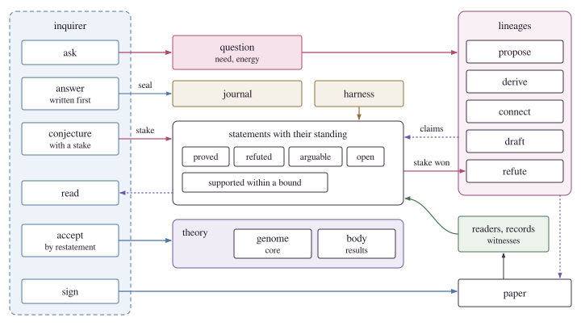

# Case 4. Inquiry with the Person Inside: The Framework for a Theoretical System and Its Papers

*Status: seed (2026-11-21). The fourth of four cases: the site of theoretical inquiry and of the writing of papers in [the general framework](case-3-the-general-framework.md), which this document presupposes. It answers the user's request for a self-evolution framework for "our theoretical system and paper writing", and their position that inquiry should not be delegated. Nothing is built beyond the [prototypes](prototypes/README.md) and one rehearsal among the [case studies](case-studies/README.md). Several of its rules have no precedent that the survey found and are marked as the design's own.*

## 0. Summary

A theoretical system can be developed with a population of agents, and the person whose inquiry it is belongs inside the process. This case differs from the others in one respect that changes the membrane: four acts are reserved to the person. The person *asks* the question, *reads* what a result means, *accepts* a result into the theory, and *signs* what is published. Agents propose, derive, search for counterexamples, connect to the literature and draft.

Three rules protect the inquiry. The person writes an answer before seeing the agents'. The person stakes on their own conjectures, so that refutation of them is paid. And the standing of a statement, whether proved, refuted, supported within a bound, arguable or open, is kept apart from the person's acceptance of it.

A theory is given the structure that the general framework gives every unit: a compact generative core and a developed body, with the test that results can be derived again from the stated core. A paper is a unit of the same kind, and the report packages that this repository already produces contain most of its harness.

The case rests on an argument and on norms, and on little measurement. The survey found no study of any of the three rules in theoretical work.

## 1. The Position That Inquiry Is Not Delegated

### 1.1 The Statement and Its Support

The user wrote: "with our exist publications, where contains our theoretical system, like an economics!! Evoluntionary try discovery and evolve new knowledges. But I think for 4. is better human involve, because inquery shouldn't be delegated."

Three bodies of work bear on the position, and the fifth part of the survey sets out each with its opponents.

*On questions.* For Dewey inquiry is the transformation of an indeterminate situation, which is someone's situation, and for Collingwood a statement is understood only as the answer to the question it was meant to answer (Dewey 1938; Collingwood 1939). On these accounts the question constitutes the inquiry, and whoever supplies it is the inquirer.

*On understanding.* Several philosophers hold that understanding is an achievement of the one who understands and differs in this from knowledge, which testimony can pass on (Hills 2016; Pritchard, Millar and Haddock 2010). The position is disputed. Others deny that testimony cannot transmit understanding, and a larger tradition shows that rational inquiry already rests on results taken from others unchecked (Hardwig 1985, 1991) and that deference to a reliable authority can be rational (Zagzebski 2012). The claim that this case needs is the narrow one on which the parties agree: a person who has not worked through a result has not understood it.

*On authorship.* The bodies that set the norms of publication reserve authorship and accountability to persons and require disclosure of assistance (the recommendations of the ICMJE; the position of COPE; Thorp 2023).

*Caveat.* The four reserved acts are this design's choice. No source argues for that list, and the reservation is not a philosophical theorem.

### 1.2 The Informational Reason

The paper's Corollary 4 gives a reason of another kind. A process fed by a corpus and by its own outputs receives nothing about the world that the corpus and the model did not hold. What it can do is considerable and has limits of a definite shape.

A theory has a formal part: definitions, statements and derivations. Here search and checking can run almost as a closed loop and still find what nobody knew, since the consequences of a set of commitments are not known by knowing the commitments. The Equational Theories Project settled some twenty-two million implications among 4,694 laws of magmas by human and automated proofs, each checked by a proof assistant (Bolan et al. 2025), and search against an evaluator that cannot be argued with has produced new results in mathematics (Romera-Paredes et al. 2024; Georgiev et al. 2025).

A theory also has a part that bears on the world: whether it is adequate to the phenomena, and whether it matters. For that part the loop must open, to data, to other readers, and to the situation of the person whose question it is. The person is therefore a source of information that the garden lacks, as well as the holder of the reserved acts.

### 1.3 The Record of Systems That Delegate

Systems that carry inquiry from idea to manuscript without a person report results that support the reservation. An independent evaluation of one found that 42% of its experiments failed from coding errors, that its check of the literature often labelled established ideas as novel, and that some numerical results were invented (Beel, Kan and Baumgart 2025). The developers of another report that independent scientists judged 79.4% of the statements in its reports accurate, which leaves one statement in five (Mitchener et al. 2025). An early study of two chat models found 55% and 18% of the citations they supplied fabricated (Walters and Wilder 2023); models have changed since, and the failure it names, the invented support, remains the one to design against.

The best-known working model of the alternative is in mathematics: a system detected relations among mathematical objects, and the mathematicians formulated the conjectures and proved them (Davies et al. 2021).

## 2. A Theoretical System as Materials

### 2.1 Kinds of Material and Their Links

A theoretical system consists of definitions; statements, among them theses, theorems and conjectures; derivations; worked cases; programs that implement its constructions; data; prose that argues; and papers. The links of the general framework apply: a derivation derives a statement, a program implements a construction, a case instantiates a definition, a datum measures a quantity, a sentence cites a source, a paper presents statements.

The procedures that decide are these. A derivation in a declared calculus is checked step by step. A universal statement over a declared class of structures is refuted by a countermodel, and supported, never proved, by a search that finds none within a bound. A number is recomputed. A citation is opened and its passage found. A program is run against the cases. The theory's being right about the world, and its being worth holding, are decided by no procedure.

A theory that is also implemented gains facts, since its forms then check one another. The user's practice of making a draft exact by building it is this principle, and the repository holds five instances of it: the audits of the drafts on group grammars (eleven amendments), on chemical structure generation (four errors found among thirty-four claims), on the market formalism (five amendments), on landscapes and on loop deficits, each with a theory note that proves what holds and says what is not yet precise.

### 2.2 The Standing of a Statement

**Definition 1 (standing).** The *standing* of a statement is the record of what has been done to establish or refute it.

| Standing | Meaning | Decided by |
|---|---|---|
| Proved | A checker accepted a derivation of a stated formalisation | The checker, named with its version |
| Refuted | A counterexample was exhibited and verified | The harness |
| Supported within a bound | A search of a declared extent found no counterexample | The harness; the bound is part of the standing |
| Derived informally | An argument is given that no checker has verified | The author of the argument, named |
| Arguable | It holds under some admissible readings of its open terms and fails under others | The readings, each with its source |
| Open | Nothing of the above | |
| Withdrawn | Its maker has retracted it | Its maker |

: The standings of a statement.

*Acceptance* is a different thing: the person's act of taking a statement into the theory. A proved statement may be left out as beside the point, and an open one may be held as a commitment. The record shows both and merges neither.

The third prototype gives the reason for the third row. With ten laws of magmas, sixteen implications passed a search of all structures of up to three elements, and six of them are false in a structure of seven. A statement "supported within a bound" that is recorded as "holds" misleads its reader.

*Caveat.* "Proved" means that a given checker accepted a given formalisation. Whether the formalisation says what the informal statement meant is a reading, and belongs to the person. "Arguable" and "open" are judgements, and a model assigns them with more confidence than it has grounds for. The nearest existing record of this kind is the Equational Theories Project's graph of implications, each proved or refuted and formally checked, whose significance people remain free to judge.

### 2.3 The Genome of a Theory

A theory has a genome in the sense of the general framework's Section 3.5: a bounded text from which its body of results can be developed.

| Organ | In a theory |
|---|---|
| identity | Its primitives and central commitments |
| laws | Its axioms, and the conventions it holds itself to |
| exemplars | The worked cases from which its practice is learnt |
| development | The heuristics by which it is extended to new matter |
| regulation | What it holds fixed against refutation, and what it leaves open |
| perception | The phenomena, the literatures and the rival accounts that bear on it |

: The organs of the genome of a theory.

The structure follows Lakatos's research programme, with its hard core, its protective belt and its positive and negative heuristics (Lakatos 1978), and Kuhn's exemplars (Kuhn 1970); Laudan's research traditions add that a programme is judged by the problems it solves (Laudan 1977). The fit is an analogy. These authors describe programmes in retrospect and do not propose that a core be written down, and Polanyi's account of tacit knowledge says that part of any practice resists being written (Polanyi 1958). A written genome is therefore a part of a theory's core, the part that agents can be given.

A theoretical system that has produced theories in several fields has a genome at two levels. Each theory has its own, and the system has one above them: the commitments that recur, from which each theory was developed as an expression in its field.

### 2.4 Derivation from the Stated Core

The claim *regenerates* takes the following form for a theory: from the genome of a theory, a developer derives its stated results, each derivation checked where a checker exists. Its failure is informative. Where the core is formalised, a result that cannot be derived from the stated core shows that a premise was used and not stated, or that a step was invalid. Where the core is informal, a failed derivation may show a weakness of the developer, and the finding is a question for the person.

This rule is the design's own. It is a plain logical remark for formal cores, the survey found it stated nowhere, and it is the method of the five audits: every amendment they list is a premise that a draft used without stating or a step that did not follow.

## 3. The Site of Inquiry

### 3.1 Roles

The *inquirer* is the person whose question it is, and holds a seat inside the garden. Co-inquirers may hold seats of their own. *Readers* are witnesses: colleagues, reviewers, and the communities whose situations a theory describes, each of whom may contribute, amend, review and contest as the paper's evidential chain provides. The records of the phenomena are feeds. The inquirer, or an institution, is the steward.

### 3.2 Reserved Acts

**Ask.** A question becomes a need only by a person's act, with energy locked on it. Agents may propose questions; a proposed question is a proposal.

**Read.** What a result means, under which reading of its open terms, is stated by a person. Agents may propose readings, each marked as proposed, and may show what follows under every admissible reading.

**Accept.** A statement enters the theory when a person takes it, in the person's own formulation. Acceptance by restatement is the form of the narrow claim of Section 1.1: what the person has restated the person has worked through.

**Sign.** A person is the author of what is published and answers for it, and assistance is disclosed.

Everything else is open to lineages: to propose conjectures and questions, to derive, to search for counterexamples, to implement and run, to find and connect the literature, to draft.

### 3.3 Three Rules That Protect the Inquiry

*The answer written first.* Before the garden's answers to a question are shown, the person writes an answer, however provisional, and it is sealed in the journal. Two effects are sought. What the garden adds becomes visible as the difference from what the person held. And the person's view is formed before it can be led: assistants lean towards the view of whoever asks (Sharma et al. 2023), and the separation of what one expects from what one then finds is the principle of preregistration (Nosek et al. 2018). The rule extends that principle from the testing of data to the consulting of an assistant; the extension is the design's own and untested. One work of this repository already asks it of a reader, who writes an answer before a record's is shown.

*A stake on one's own conjectures.* The person's conjectures enter as claims with stakes, and a lineage that refutes one collects the stake. Refutation of the inquirer's own ideas is thereby the best-paid work in the garden, which sets the incentive against flattery. Markets in which many traders stake on whether findings will replicate have forecast replication better than surveys (Dreber et al. 2015), and adversarial collaboration binds opponents to a test agreed in advance (Mellers, Hertwig and Kahneman 2001). No precedent was found for one person staking against agents on their own theoretical conjectures. A refutation must be decided by a procedure, a countermodel or a failed check, for the rule to reward validity and not rhetoric.

*Standing apart from acceptance.* Section 2.2.

### 3.4 Claims on This Site

The claim kinds are those of the general framework's Table 3 that suit the materials: *derives*, *implies* with its countermodels, *recomputes*, *cites*, *regenerates*, and *predicts* where a theory bears on records to come. A claim of novelty is refuted by exhibiting prior work with its passage; whether the prior work is the same result is a reading, so such a claim is of class C and is settled by a person.

## 4. The Life of a Question

Figure 6 shows the loop. Its steps are as follows.

1. The inquirer asks a question and locks energy on it. The question names the kinds of claim that would count as an answer.
2. The inquirer writes an answer, which is sealed.
3. Lineages answer: conjectures with their claims and stakes, derivations, cases, programs, readings as proposals, and what the literature holds, each citation with its passage.
4. Lineages challenge one another's claims and the inquirer's. The harness decides what it can.
5. The garden returns the question with what stands: each statement with its standing, the attempts made against it, what was refuted, and what no procedure decides. The sealed answer is shown beside it.
6. The inquirer reads: states what the results mean, chooses among readings, and marks what calls for a further question.
7. The inquirer accepts what is taken into the theory, restated. If a result touches the core, the genome of the theory is revised, and this is recorded as a change of the programme.
8. Energy is paid: to the makers of what stood, to the refuters of what fell, and later to the makers of what further work came to rest on.

The third prototype ran a small form of this loop on the implications among laws of magmas. The person's sealed answer named three implications. Lineages warranted seven or eight in four of five trials, all true, of which four or five went beyond the sealed answer, and in a further run a bold lineage's false claim was refuted by a challenger's countermodel.

## 5. Lines of Inquiry

### 5.1 The Founders

The population of this site is a set of lines of work around one inquiry. The founders differ by role: a formaliser, which states what was informal; a challenger, which lives on refutation; a connector, which reads the literature for others; an applier, which tries the theory on cases; a generaliser; and lines seeded with the commitments of other traditions, which answer the same questions from other cores.

They differ also by origin, in families of models, since agents of one model err together. The purpose is the one for which philosophers of science defend a division of cognitive labour: a community does better when its members do not all pursue the most promising approach (Kitcher 1990; Strevens 2003). Assistance by one model narrows the range of what people produce with it (Doshi and Hauser 2024), ideas generated by models are less diverse than those of people (Si, Yang and Hashimoto 2024), and one researcher's reliance on a tool can pass for understanding while the range of questions asked contracts (Messeri and Crockett 2024).

*Caveat.* A line seeded with a rival tradition is a model's portrait of that tradition. It is a device for raising objections and is no substitute for a reader who holds the tradition. The result that limited communication preserves diversity is sensitive to its assumptions (Zollman 2007; Rosenstock, Bruner and O'Connor 2017), and no study was found of diversity in a population of agents that builds theory.

### 5.2 The Evolving Layer

Four things are copied with variation here, as in every garden. The genomes of the lineages change: their ways of working with this inquirer and this theory. The genomes of the theories change, rarely and by the inquirer's acceptance. The body of results grows by what is accepted and by what stands unaccepted in the record. And the conventions of the programme, its norms, are copied from the cases in which they were applied.

### 5.3 Operations on a Theory

The variations that lineages propose are the familiar moves of theoretical work: to generalise a statement, to specialise it, to find the case at the boundary where it fails, to state its dual, to unify two results under one, to carry a construction to another field, to formalise an argument, and to implement a construction so that it can be run. Each yields material of a declared kind with claims of a declared kind, and none of them decides what is worth doing.

### 5.4 Sources of Disturbance

A programme locks in as a design does. The disturbances proper to inquiry are the anomaly, which is a fact that the theory does not fit; the rival account of the same phenomena; the reader from outside; and the case held back, on which a theory is tried once after it has been stated. The last is the practice of this repository's work on theories of a case and of the law, in which each account is tested once on what was withheld and the test is sealed.

## 6. Papers

### 6.1 A Paper as a Unit

A paper is a unit with a genome and a body. Its genome states its thesis and contributions, its claims with the standing of each, its readers, and the rules of style it holds itself to. Its body is the text, the figures and the references. Drafting is development, and a change of framing is a change of the genome from which sections are developed again.

Variants of a genome can be developed side by side: two titles, two orders of argument, two statements of the contribution. The author carries one. The choice of the title of the paper that precedes this document went so: the author proposed, the assistant objected to one word and gave its reason, and the author decided.

### 6.2 The Harness of a Paper

Much of a paper can be decided by procedure, and the report packages of this repository already do it. Every reference is checked against a bibliographic record, and a ledger states what was verified and what was not. Every number in the text is produced by a program kept beside it. Every figure is drawn by a program from data, with a manifest of digests. Cross-references, labels and the order of figures are checked before a build. A table states the evidential status of each claim. The rules of style that the author has set, declarative headings and positive statement among them, are checks of the same kind where they can be stated exactly.

The claims of a paper site are *cites*, *recomputes*, *redraws* and *derives*, with one more that is particular to it: that every claim made in the abstract appears in the body with its standing.

### 6.3 Acts Kept by the Author

The argument is the author's. A model's draft is a proposal, and the author signs what the author has read and holds. The disclosure of assistance belongs to the paper, as the norms of publication require, and the record of how each part came to be is kept beside it.

## 7. The Corpus at Hand

The first materials of this site are the user's publications and drafts and the theory notes that the infrastructure wrote from them. They hold a system of thought with a core that recurs across fields, and theories and drafts developed from it in economics, markets, urban systems, law, policy and multilateral practice, with drafts on the generation of chemical structure and on the grammar of genomes.

Founding on this corpus follows the general framework's four steps. The inventory lists the works and types their contents. Sequencing proposes, for each theory and for the system above them, a genome; every statement extracted is a proposal tied to its passage until the author confirms it, as the infrastructure's rule for a model's reading requires. The harness gathers what already decides: the checks of the domains that implement the theories, and the theory notes' proofs. The outside is charted as the literatures and rival accounts that each work names.

The first needs are already written. Each paper and each theory note lists what is not yet precise and what remains open, and those lists are questions that the author has already asked.

## 8. Risks

| Risk | Evidence | Provision | Residual risk |
|---|---|---|---|
| The garden becomes a mirror | Assistants lean to the asker's view (Sharma et al. 2023) | The answer written first; a stake on one's own conjectures; lines of other origins | Selection for what persuades |
| Support is invented | Fabricated citations and numbers (Walters and Wilder 2023; Beel, Kan and Baumgart 2025) | Every citation with its passage found; every number recomputed | Passages that exist and do not support |
| A bounded search is read as proof | The third prototype | The bound is part of the standing | Readers who pass over it |
| Generated conjectures are over-read | The apparent power of early programs of discovery came largely from the fit of their representation to their subject (Lenat and Brown 1984) | Standing is the record of refutation attempts; significance is a reading | The pleasure of a result that looks deep |
| The range of thought narrows | Homogenisation of what people produce with one model (Doshi and Hauser 2024) | Lines of several origins; outside readers as witnesses | A population of one model |
| The written core loses what is tacit | Polanyi (1958) | The genome is a part of the core; exemplars carry practice | What neither states |
| The inquirer is overloaded | | One page per question; the reading of load | A reservation exercised in name only |
| Thinking is handed over | Studies link reliance on assistants with less critical thought, on weak designs (Lee et al. 2025; Gerlich 2025) | The answer written first; acceptance by restatement | Unmeasured in theoretical work |

: Risks of the site of inquiry.

## 9. A First Trial

A first trial can be made on one published result of the corpus, with the author.

1. The author chooses a result and its paper. A genome of the result's theory is drafted and corrected by the author.
2. Developers that have only the genome derive the result. Each failure is examined for a premise unstated.
3. The author asks one new question about the result, writes an answer, and seals it.
4. Lines of two model families answer and challenge, with stakes, under a harness that checks what it can.
5. The author reads, accepts or declines, and records why.

The measures are what the garden returned beyond the sealed answer, how much of it stood, what was refuted and by whom, what the derivation exposed, and the author's time. A trial in which nothing stood beyond what the author had written, or in which the author's time exceeded the time of working alone, would count against the site as designed.

A rehearsal of the second and fourth steps was made without the author on one fragment, Section 1 of the theory note of the economics domain ([the case studies](case-studies/README.md), Study C). The fragment could be declared as a site whose procedures decide claims with exact arithmetic. Lineages given only its definitions warranted 33 implications and 17 separations, none refuted, which are 11 and 9 distinct statements. Most of the implications lie near the note's proposition on prices; three of them and the separations go beyond it in one direction: they separate the closed walks that follow the legs from those that may go against them. And all four challengers refuted the claim, found imprecise by the audit of the papers, that the position which absorbs a deficit is fixed by the network; the task had given them the formula on which the refutation turns. [A dossier](case-studies/dossier-transfer-networks.md) sets the statements out with their standing. The question was the assistant's, posed to exercise the site; the rehearsal performed none of the reserved acts and shows nothing about what an inquiry gains.

## References

Works are cited from the survey's parts C ([inquiry with AI](survey/part-c-inquiry-with-ai.md)) and E ([the philosophy of inquiry](survey/part-e-philosophy-of-inquiry.md)), where each carries its mark and identifier; many of the philosophical positions are stated there from secondary sources, as the parts say. The paper's bibliography holds the works marked P.

- Beel, Kan and Baumgart (2025), arXiv:2502.14297 (C).
- Bolan et al. (2025), arXiv:2512.07087 (C).
- Collingwood (1939), *An Autobiography*, Oxford University Press (E).
- COPE (2023), position on authorship and AI tools (C).
- Davies et al. (2021), *Nature* 600, 70–74 (C).
- Dewey (1938), *Logic: The Theory of Inquiry*, Henry Holt (E).
- Doshi and Hauser (2024), *Science Advances* 10(28), eadn5290 (C).
- Dreber et al. (2015), *PNAS* 112(50), 15343–15347 (C).
- Georgiev et al. (2025), arXiv:2511.02864 (C).
- Gerlich (2025), doi:10.3390/soc15010006 (C).
- Hardwig (1985), doi:10.2307/2026523; Hardwig (1991), doi:10.2307/2027007 (E).
- Hills (2016), doi:10.1111/nous.12092 (E).
- ICMJE, recommendations on the use of AI by authors (C).
- Kitcher (1990), doi:10.2307/2026796 (C, E).
- Kuhn (1970), *The Structure of Scientific Revolutions*, 2nd ed., University of Chicago Press (E).
- Lakatos (1978), *The Methodology of Scientific Research Programmes*, Cambridge University Press (E).
- Laudan (1977), *Progress and Its Problems*, University of California Press (E).
- Lee et al. (2025), doi:10.1145/3706598.3713778 (C).
- Lenat and Brown (1984), doi:10.1016/0004-3702(84)90016-X (C).
- Mellers, Hertwig and Kahneman (2001), doi:10.1111/1467-9280.00350 (C).
- Messeri and Crockett (2024), doi:10.1038/s41586-024-07146-0 (C, E).
- Mitchener et al. (2025), arXiv:2511.02824 (C).
- Nosek et al. (2018), *PNAS* 115(11), 2600–2606 (C).
- Polanyi (1958), *Personal Knowledge*, University of Chicago Press (E).
- Pritchard, Millar and Haddock (2010), *The Nature and Value of Knowledge*, Oxford University Press (E).
- Romera-Paredes et al. (2024), in the paper's bibliography (P).
- Rosenstock, Bruner and O'Connor (2017), doi:10.1086/690717 (E).
- Sharma et al. (2023), arXiv:2310.13548 (C).
- Si, Yang and Hashimoto (2024), arXiv:2409.04109 (C).
- Strevens (2003), doi:10.5840/jphil2003100224 (C, E).
- Thorp (2023), "ChatGPT is fun, but not an author", *Science* (C).
- Walters and Wilder (2023), doi:10.1038/s41598-023-41032-5 (C).
- Zagzebski (2012), *Epistemic Authority*, Oxford University Press (E).
- Zollman (2007), doi:10.1086/525605 (E).
