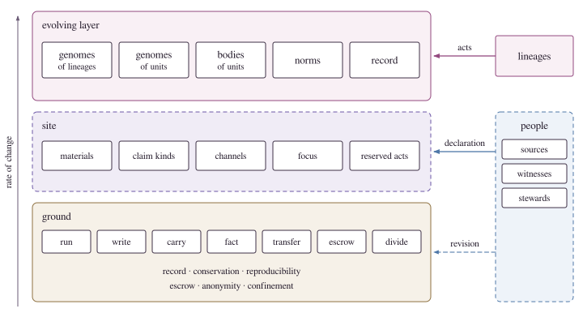
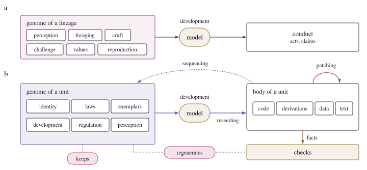
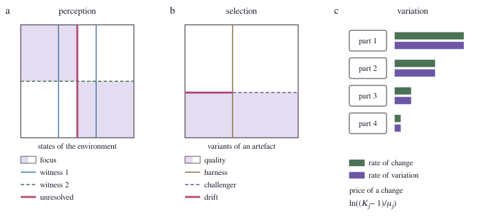
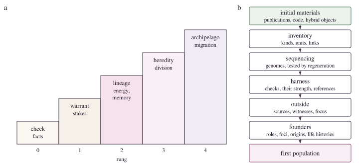
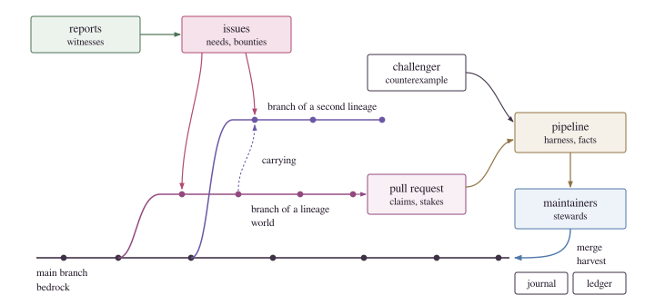
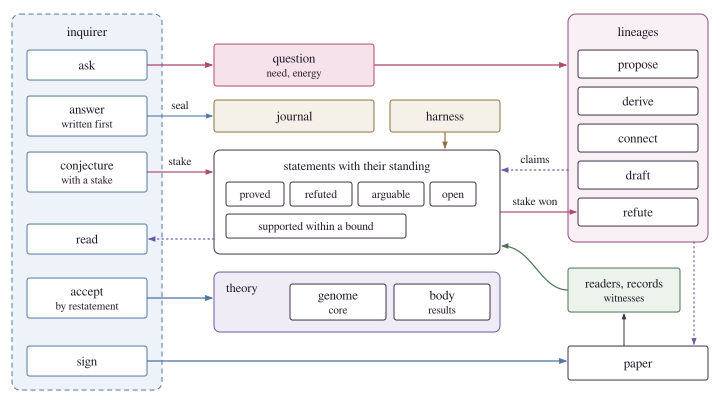
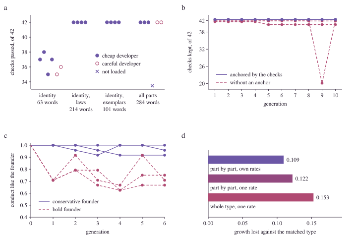
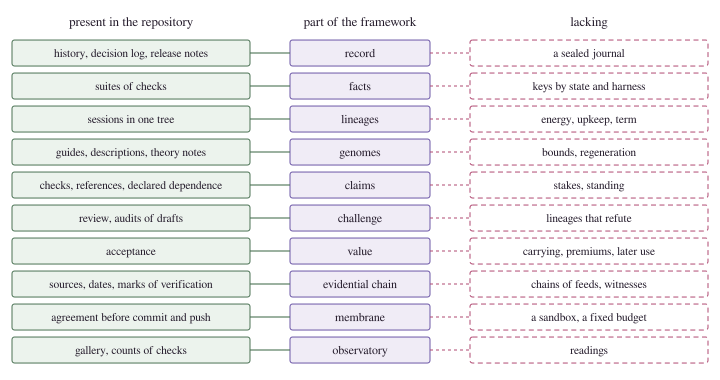

# Figures of the Generative Ecology of Projects

*Seed (2026-11-21). Eight figures drawn for publication, with their captions. They follow the conventions of the figures of the paper that precedes this design: a canvas 720 units wide for a text width of 162 mm, no lettering under 7 pt, formal labels and notation only inside a figure, and everything that explains in the caption.*

## 1. Conventions

Each figure exists in three forms. The SVG is the source and is what the documents of this folder show. The PDF is the vector form for a paper, its page sized to the figure. The PNG is 2160 pixels wide, which is 339 dots to the inch at the printed width.

Colour is used with one meaning in the drawn figures. Orchid marks lineages and what they write. Lilac marks genomes, declarations and knowledge. Sand marks the ground, the harness and facts. Rose marks demand, stakes and claims, and in Figures 3 and 8 what is unresolved or lacking. Moss marks witnesses and what is already present. Blue marks people. In the plots of Figure 7, lilac and rose tell two series apart and mean nothing more. A dashed outline marks what is declared or stands outside a garden, and a dotted arrow carries knowledge where a solid arrow carries an act or a payment. No figure depends on colour alone: every mark is also told apart by its label, its line or its place.

## 2. Captions

**Figure 1. The three layers of a garden.** The layers are distinguished by who may change them and are ordered by their rate of change. The ground is the invariant program, with its seven primitives and six invariants. The site is the declaration by which people fit a garden to one project; five of its nine parts are shown. What evolves is everything that lineages write. People stand at the boundary as sources, witnesses and stewards: they declare the site, and they revise the ground rarely and by recorded decision (dashed arrow). Used in [the general framework](../case-3-the-general-framework.md), Section 3.1.



**Figure 2. Genome and body of a lineage and of a unit.** (a) The genome of a lineage is the text from which it acts, and a model develops it into conduct; six of its organs are shown. (b) The genome of a unit of a project has six organs. Development writes the unit's body from the genome, and sequencing writes the genome from the body. A unit changes in two modes: patching alters the body directly, and reseeding develops the body again from the genome. The checks decide facts about the body. Two claims give a genome standing: *regenerates*, that bodies developed from it pass the unit's checks, which is a sampled fact; and *keeps*, a promise about an interface that is held in escrow. Used in the general framework, Section 3.5.



**Figure 3. Three resolutions: of perception, of selection and of variation.** (a) The square stands for the states of the environment. The focus of a project partitions them into classes of states that call for the same response (tinted cells), and each witness distinguishes a partition of its own (lines). A boundary of the focus that no witness's line follows is unresolved: the evidence cannot tell its two sides apart. (b) The square stands for the variants of an artefact, partitioned by their quality (tinted cells). The harness and a challenger are payers, and each distinguishes a partition of the variants. Selection acts along the boundaries that some payer distinguishes, and across the remainder quality drifts (Proposition 1). (c) A genome in four parts whose best alternatives change at different rates. Variation part by part prices a change in part *j* at ln((*K*<sub>*j*</sub> − 1)/*μ*<sub>*j*</sub>), where *K*<sub>*j*</sub> is the number of alternatives of the part and *μ*<sub>*j*</sub> its rate of variation, and the total price is least when each part varies at the rate at which its best alternative changes (Proposition 2 and Corollary 1). The figure is schematic. Used in the general framework, Section 4.



**Figure 4. Rungs of mechanism and the founding of a garden.** (a) The five rungs, each with what it adds to those beneath it. A project takes the lowest rung that answers its failure. (b) The founding of a garden on initial materials: the four steps of inventory, sequencing, the harness and the outside, and then the founders, who are written to span roles, foci, origins and life histories and who form the first population. Used in the general framework, Sections 3.9 and 3.10.



**Figure 5. A garden over a repository.** The parts of a garden are set over the practice of a repository as it is kept today. Reports from users and from projects downstream are the reports of witnesses, and they become issues, which carry needs and bounties. Each lineage works on a branch, which is its world, and may carry the work of another lineage into its own. A change is offered as a pull request with claims and stakes. The pipeline runs the harness and records facts, and a challenger's counterexample enters the same pipeline. Maintainers, as stewards, merge into the main branch, which is the bedrock; the merge is the harvest. The journal and the ledger are kept beside the repository. Used in [the case of programming projects](../case-2-programming-projects.md), Section 2.1.



**Figure 6. Inquiry with the person inside.** The inquirer holds a seat in the garden and performs the reserved acts (left): asking, reading, accepting and signing. Two rules protect the inquiry: the inquirer's answer is written and sealed in the journal before the garden's answers are shown, and the inquirer's conjectures enter as claims with stakes. Lineages (right) propose, derive, connect the literature, draft and refute. Every statement carries a standing that the harness and the record decide, apart from its acceptance, and a lineage that refutes a claim wins its stake. What the inquirer accepts, restated, enters the theory, whose genome is its core and whose body is its results. Readers and the records of the phenomena are witnesses. Solid arrows are acts and payments, and dotted arrows carry knowledge. Used in [the case of inquiry and papers](../case-4-inquiry-and-papers.md), Section 4.



**Figure 7. Results of the prototypes.** (a) Regeneration. Checks passed, of 42 hidden from the developer, by bodies developed from four genomes cut from one sequencing of a unit of 120 lines. Each mark is one development, by the cheap or the careful model; one development from the full genome produced a body that did not load (cross). (b) Reseeding in chains of ten generations of body, genome and body: the checks that the body of each generation keeps, in three chains without an anchor and in one chain anchored by the checks, in which three bodies are developed in each generation and the one that passes most is kept. The four series are displaced vertically by less than half a check so that coincident values can be told apart. (c) Heredity. The share of twenty-four decisions on which a descendant's conduct agrees with its founder's, in three lines from a founder whose organ of reproduction copies the genome and changes one number, and in three lines from a founder whose organ rewrites every organ; the cheap model, with no selection. (d) Variation part by part. The rate of growth lost against the type matched to the environment at every turn, under three schemes of variation, in a model of three parts with four alternatives each whose best alternatives change at rates a hundredfold apart. Computed from [the prototypes' results](../prototypes/results/); the record of the prototypes gives the failed and unexpected runs that the figure does not show. Used in the general framework, Section 7.1.



**Figure 8. The science infrastructure as a site.** For ten parts of the framework (centre), what the repository's present practice already holds (left) and what a garden would add (right, dashed). Used in [the case of the science infrastructure](../case-1-the-science-infrastructure.md), Section 5.



## 3. Making the Figures

`figures.mjs` writes the eight SVGs on the helpers of `lib.mjs` and records each with its SHA-256 in `manifest.json`. Figure 7 is computed from the JSON files under `../prototypes/results/`; the others are drawn. `render.mjs` makes the PDF and the PNG of each SVG with headless Chrome and Source Serif 4.

```
node figures.mjs          # every figure; node figures.mjs 3 7 for two of them
node render.mjs           # PDF and PNG of every SVG; node render.mjs 5 for one
```

`render.mjs` keeps its wrapper pages and Chrome's profile in the system's temporary folder, or in the folder that `FIGURE_WORK` names. Both scripts were taken from the figures of the paper in `docs/reports/2026-11-20-evolutionary-improvement-framework/figures/`, so that a later paper on the general framework can set these figures beside those without redrawing.

## 4. Changes Made after First Rendering

Every figure was looked at as rendered before it was kept. The first rendering was corrected in six places, which are recorded because the same faults recur. Labels that overlapped lines were moved to clear ground (Figures 5 and 6). Chips narrower than their words were widened (Figure 2). Two lines drawn along the same boundary hid one another, and the partition of the focus and of quality was redrawn as tinted cells so that a witness's or a payer's line along a boundary stays visible (Figure 3). A formula ran past the right edge and was set on two lines (Figure 3). Axis labels that collided were set on two lines, the legends were moved off the data, and a development that did not load, which the first drawing left out, was given a mark of its own (Figure 7). In Figure 6 the paper was moved beneath the witnesses so that the arrow from the lineages' drafting no longer passed behind another box, and the harness was added as the source of standing.
