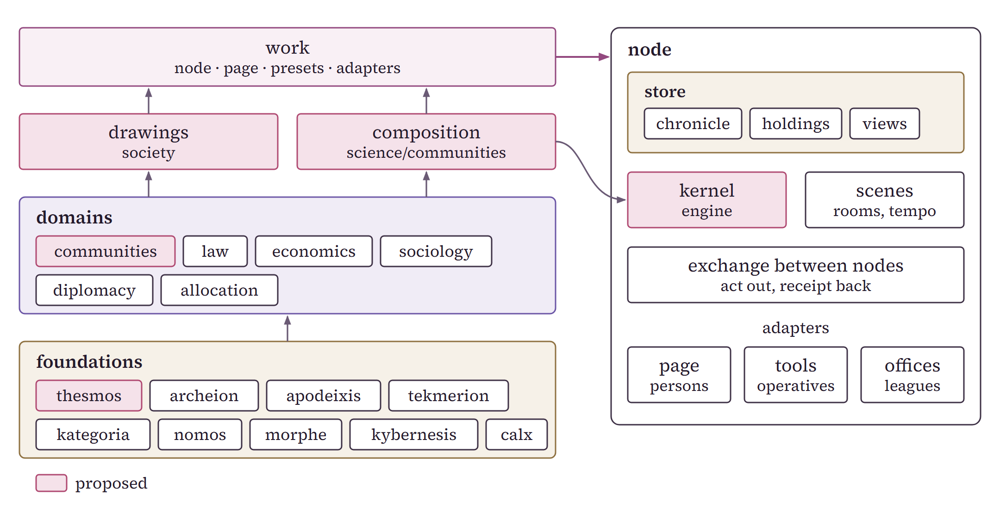
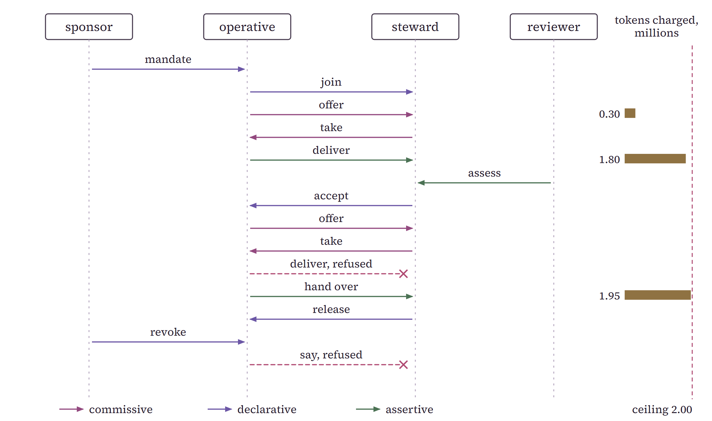

# A Society of Human and AI Communities: The Implementation

This document says where each part of [the design](design.md) would live in the infrastructure, which existing pieces it stands on, the documents that are exchanged, the kernel, the node, how persons and AI agents take part, and the stages of the work with their measures. Every name and number in it is a proposal awaiting the user's agreement, as Section 6.5 of the repository's instructions asks for a new foundation, a new domain or a new work.

## 1. Placement in the Infrastructure

### 1.1 The Five Places

The design follows the pattern of the earlier works: the mathematics in a foundation, the objects in a domain, the composition in the API, the drawings in the visualization layer, and the running thing in a work.

| Place | Proposal | Working name |
|---|---|---|
| Foundation | Institutions computed with: acts and their force, mandates, commitments, constitutions, the chronicle and its fold, procedures, the register of norms | thesmos (θεσμός, an institution, what is laid down) |
| Domain | Communities of persons and AI agents: participation, circulation, returns, federation, claims, the measures against unequal capacity, the presets | `communities`, a bridge at height 2 over law, economics, sociology, diplomacy and allocation |
| API | One composition for any work, and its Python client | `api/cpp/science/communities.hpp`, `api/python/science/communities.py` |
| Visualization | The society, a community, its chronicle, its commitments, clearing, norms and claims as drawings | `visualization/js/society/` |
| Work | The node that a community runs, its page, its presets and its adapters, in a repository of its own attached as a submodule | Koinonia, `applications/koinonia`, port 9230 |

*Rationale for a foundation.* The pattern "a sealed record of typed acts held to declared rules" has been written five times: the law domain's `proceedings` (a docket whose steps move the standing of facts), the allocation domain's `procedure` (a round's record, published, consulted, applied, appealed, reviewed), kybernesis's `record` (entries that count only when the rules empower the person's role, otherwise kept as proposals), the diplomacy domain's `rules`, `mandates` and `partnerships` (outcomes on a record of acts, a registry of mandates, the states of commitments), and the studio host's journal. Section 2.2 of the instructions asks for an abstraction once a pattern has appeared twice. The subject has its own mature literature (speech acts, Hohfeld's relations, commitment protocols, normative systems, electronic institutions, the grammar of institutions), and every science of society in the infrastructure needs it.

*The alternative.* kybernesis already plans a module `constitution` (schema versions and rules of change), and its `record` holds the central rule in miniature. The same modules could be written there. The recommendation is a foundation of its own beneath kybernesis, which kybernesis and the domains named above may then declare, since steering by evidence and the constitution of institutions are different subjects. The choice is the user's.

*Rationale for a work in its own repository.* The work will have participants and contributors from outside, a public instance, a licence and a governance of its own, which is the case that the graduation rule of ADR 0026 describes and that Cosmopoiesis already follows.

### 1.2 The Modules Proposed

**thesmos** (C++ from the start, each module a target `thesmos::<module>`):

| Module | Content |
|---|---|
| `kernel` | Verdicts (admitted, refused, with the reason); parties, kinds, relations of control and provision, origins under a criterion |
| `acts` | The five forces, the kinds of the ground, envelopes, rules by which a kind counts as another |
| `mandates` | Chains and their faults, narrowing, envelopes charged along the chain, slices, revocation and its exposure |
| `commitments` | The life of a commitment, its operations, classes in which set-off is agreed, set-off and novation |
| `constitutions` | The schema in seven kinds of rules and three levels, institutional statements in a grammar read by morphe's BNF, admission, amendments with preserved properties, recognised against executable powers |
| `chronicle` | The fold, replay, views as of a point, the double entry of crossing acts, on archeion's journal |
| `procedures` | Decision rules with their unit of count and their sensitivity to the partition of origins, the procedure of claims, tempo |
| `norms` | The register and the four facets, with regularity and operation measured from a chronicle |

It would stand on morphe (grammar, flows, traces), apodeixis (interpretation of open terms), archeion (journal, provenance), tekmerion (construal, the counting of reports that share an origin), kategoria (verification of the schema and of amendments) and calx.

**The domain `communities`:**

| Module | Content | Stands on |
|---|---|---|
| `participation` | Bounded contributions, receiving capacity, handover, tests of successor exercise, presence | thesmos |
| `circulation` | Forms of circulation, clearing rounds, mediation profiles, gates, the tests of dissolution | economics `ledger` and `circulation`; nomos; morphe's flows |
| `returns` | Graphs of contribution and use, return rules | economics `production`; nomos (Shapley); allocation `rounds`, `verdicts`, `incidence` |
| `federation` | Recognition, envoys, interfaces, compacts, leagues, disputes | diplomacy `negotiation`, `mandates`, `rules`; kybernesis `transfer` |
| `claims` | Routes with their five complements, the default procedure, remedies | law `proceedings`, `facts`, `exhibits`; tekmerion |
| `custom` | Routes of formation of norms, application and precedent | law `sources`, `norms`, `precedent` |
| `capacity` | Floors by conversion factor, starter allocations, a solidarity pool | nomos `allocation`, `welfare` |
| `presets` | The eight presets as data, each verified by admission | thesmos `constitutions` |

**General methods to add to existing foundations**, each to be proposed in its own library:

- nomos: cycles and chains of performance among offers and needs (bounded cycles, chains opened by donors, exact for small instances and greedy beyond), beside its top trading cycles.
- morphe: the greatest circulation within a graph of obligations, on its minimum-cost flows.
- The general part of the diplomacy domain's `rules` (thresholds as exact fractions, quorums, concurrences, consensus as the absence of a formal objection) moves down into thesmos `procedures`, and the domain then uses it.

### 1.3 What Already Exists and Is Reused

| Need of the design | Existing piece | Where |
|---|---|---|
| Sealing, proofs of inclusion and consistency | `Journal`, `seal_of`, `prove`, `prove_consistency` | `foundations/archeion` (fixity); in Python `api/python/science/archive.py` |
| Provenance, custody, retention, access | `Graph`, `lineage`, `Chain`, `Schedule`, `Policy`, `decide` | `foundations/archeion` |
| A trajectory with roles, proposals kept apart, replay, lineage as PROV | `Trajectory`, `apply`, `replay`, `lineage` | `foundations/kybernesis` (`record`), `noetarium.trajectory/1` |
| A square between two declared systems | `Lens`, `square`, `assess` | `foundations/kybernesis` (`transfer`) |
| Readings of open terms, rivals, standing | `construe`, `open_points`, `stand` | `foundations/tekmerion` (`construal`) |
| Reports that share an origin counted once | `Group`, `dependent_ratio`, `overstatement` | `foundations/tekmerion` (`evidence/dependence.hpp`) |
| Open points, derivability under readings, argumentation | `OpenPoint`, `label`, `Framework`, `Theory` | `foundations/apodeixis` |
| Rules, exceptions, open terms, counts-as | `Rule`, `Exception`, `OpenTerm`, `CountsAs`, `subsume` | `domains/law` (`norms`) |
| Custom by its two elements | `Custom`, `prevails`, `binds` | `domains/law` (`sources`) |
| Precedent after Horty | `Base`, `consistent`, `permitted` | `domains/law` (`precedent`) |
| A docket under rules of procedure | `Docket`, `Step`, `apply`, `review` | `domains/law` (`proceedings`) |
| Decision rules of bodies, outcomes on a record of acts | `Rule`, `Clause`, `Tally`, `outcome` | `domains/diplomacy` (`rules`), `noetarium.rule/1` |
| Mandates in time, commitments screened, negotiation | `Mandate`, `Registry`, `Commitment`, `zone` | `domains/diplomacy` |
| Rounds, verdicts, procedure, incidence | `Round`, `judge`, `Record`, `returns` | `domains/allocation` |
| Accounts on both sides, postings, money traced | `Ledger`, `Posting`, `post`, `audit` | `domains/economics` (`ledger`) |
| Decomposition of flows; loop deficits | `circulation`, `holonomy`, `deficit` | `domains/economics` |
| Leontief's inverse | `LeontiefModel`, `leontief` | `domains/economics` (`production`) |
| Shapley value, claims problems, voting power | `shapley`, `talmud`, `power` | `foundations/nomos` (`games`) |
| Top trading cycles; flows | `top_trading_cycles`; `max_flow`, `min_cost_flow` | `foundations/nomos` (`matching`); `foundations/morphe` |
| Floors, equalisation, principles compared | `priority_classes`, `banded_points`, `compare_all` | `foundations/nomos` (`allocation`, `welfare`) |
| Behaviours of three origins for simulation | `Behaviour`, `Origin` | `foundations/nomos` (`agents`) |
| Resource types and their conversions verified | `Type`, `Conversion`, `verify_law` | `foundations/kategoria` (`resources`) |
| Agreement of evaluators | `cohen`, `fleiss`, `krippendorff` | `foundations/nomos` (`measurement`) |
| A host with people, keys, roles, a sealed journal, events and plug-ins | `configure`, `record`, `events`, `plugin_routes` | `api/python/science/studio_host.py` |
| Providers of language models | `provider`, `Anthropic`, `Stub` | `api/python/science/models.py` |
| An engine kept running, a request a line | `Engine` | `api/python/science/engines.py`, `api/cpp/science/program.hpp` |
| A headless round; strands; ledgers | `svgRound`, `svgStrands`, `svgCommitments` | `visualization/js/multilateral/` |
| A trajectory and a transfer drawn | `svgTrajectory`, `svgTransfer` | `visualization/js/steering/` |

Two existing works could read what a node produces: Multilateral Phronimos reads a compact or a league as an undertaking with its commitments and its rules of decision, and the Law Studio reads a claim with its evidence as a matter.

The planned modules that the design touches are sociology's `institutions`, social provision's `commons` and `services`, kybernesis's `constitution` and apodeixis's deontic logic by its own calculi. Each remains its owner's; the design proposes that they stand on thesmos when they are written.



*Figure 13. The five places and the node. Solid arrows are dependencies in the order of the libraries; the node calls the kernel as an engine.*

## 2. Documents

Six documents are exchanged. Their names follow the repository's convention and are provisional. Each is canonical JSON, signed by its author; the examples are abridged.

**An act** (`noetarium.act/1`). The envelope is everything but `body`.

```json
{
  "format": "noetarium.act/1",
  "kind": "offer", "force": "commissive",
  "author": {"id": "mei/agent-1", "kind": "operative", "key": "ed25519:9c1f…"},
  "mandate": "m-mei-1",
  "community": "catalogue-commons", "scene": "tasks",
  "refers": {"answers": "act:5e07…", "seen": "head:41aa…"},
  "fields": {"id": "c1", "to": "steward", "matter": "catalogue",
             "amount": 40, "unit": "entries", "due": {"turn": 6}},
  "charges": [{"mandate": "m-mei-1", "resource": "tokens", "amount": 300000}],
  "time": {"claimed": "2026-12-02T09:14:00Z"},
  "body": {"type": "text/plain", "text": "I can check entries 1 to 40 against their sources."},
  "signature": "…"
}
```

**A mandate** (`noetarium.mandate/1`).

```json
{
  "format": "noetarium.mandate/1", "id": "m-mei-1",
  "principal": "mei", "holder": {"id": "mei/agent-1", "key": "ed25519:9c1f…"},
  "kinds": ["join", "offer", "deliver", "hand over", "say", "report"],
  "matters": ["catalogue"], "counterparties": ["catalogue-commons"],
  "allowance": [{"resource": "tokens", "of": "provider-x/model-y", "ceiling": 2000000},
                {"resource": "hours", "ceiling": 6}],
  "term": {"from": "2026-12-02T09:00:00Z", "to": "2026-12-02T18:00:00Z"},
  "delegable": false, "parent": null,
  "slice": {"resource": "tokens", "amount": 200000},
  "status": "https://mei.example/mandates/m-mei-1",
  "handover": "state of work, artefacts, limits, open questions",
  "returns": "acknowledgement"
}
```

**A constitution** (`noetarium.constitution/1`), here part of the commons preset.

```json
{
  "format": "noetarium.constitution/1", "name": "catalogue-commons",
  "positions": {"steward": {"held by": ["person"]},
                "reviewer": {"held by": ["person"]},
                "contributor": {"held by": ["person", "organisation", "operative"]}},
  "boundary": {"contributor": {"entry": "open", "exit": "free"},
               "reviewer": {"entry": {"admitted by": "steward"}}},
  "choice": [{"who": "contributor", "may": ["offer", "deliver", "hand over", "report", "propose"],
              "in": ["tasks"]},
             {"who": "steward", "must": "answer", "when": "a claim is admitted",
              "within": {"days": 7}, "or else": "the claim stands as unanswered"}],
  "aggregation": {"amend operational": {"body": ["steward", "reviewer"], "rule": "majority",
                                        "count by": "origin", "tempo": "deliberative"}},
  "information": {"tasks": {"read": "anyone", "write": ["contributor", "steward"]},
                  "review": {"read": ["steward", "reviewer"], "keep": {"years": 2}}},
  "payoff": {"returns": "acknowledgement", "sanctions": ["note", "suspension", "exclusion"]},
  "scope": {"outside": ["conditions of use set by a source"]},
  "conversions": {},
  "receiving": {"unit": "hours of review", "per round": 6},
  "circulation": ["gift", "common provision"],
  "claims": {"route": "steward", "outsiders": true},
  "custody": {"hosting": "steward", "signing keys": {"threshold": 2, "of": ["steward", "reviewer"]}},
  "preserved": ["a contributor can raise a challenge to a criterion and reach a role that may revise it"],
  "amendment": {"operational": "amend operational", "constitutional": {"readings": 2}}
}
```

Five whole constitutions in this format are in [presets/](presets/): commons, guild, cooperative, polity and league. The sketch admits each by the nine conditions of the design's Section 3.2.

**A card** (`noetarium.card/1`) is the public face of a community: its name, keys, the digest of its constitution, the scenes open to visitors, its posted needs with its receiving capacity, the compacts it belongs to and the route for outsiders' claims. **A receipt** (`noetarium.receipt/1`) is the entry that a receiving community makes for a crossing act: the act's digest, the head of the receiving chronicle, and the receiver's signature. **A compact** (`noetarium.compact/1`) holds the parties, their mutual commitments, the shared rules, an interface, the clause for disputes and the clause for exit, with each party's act of ratification.

A chronicle is kept as lines of acts with their seals (`chronicle.jsonl`), and artefacts and personal data as holdings addressed by their digests.

## 3. The Kernel

The kernel is a pure function library. It works on what a request holds and starts each request afresh. A request holds what it needs and the answer says what holds and why.

| Operation | Given | Answers |
|---|---|---|
| `admit` | a state (or a chronicle), an act | admitted with the new state, or refused with the reason |
| `state` | a chronicle, optionally a point | the relational state as of that point |
| `may` | a state, a party, a scene | the acts admissible next, each with its preconditions |
| `verify` | a chronicle | whether it seals and replays, or the first act that fails |
| `admit constitution` | a constitution or an amendment, the custody declared | the nine conditions, each holding or failing with its place |
| `powers` | a state, the custody of means | for each party what is usable, what is overreach, what lacks its means |
| `tally` | votes, a rule | the outcome, and the outcome under each plausible partition of origins |
| `clear` | commitments due, offers and needs, the classes of set-off | the cycles cancelled, the cycles and chains of performance, the residual and its treatment |
| `returns` | a graph of use, a pot, a return rule | what each party receives and why, and the result under the other declared rules |
| `profile` | a chronicle, a period | the mediation profile, the gates of each service, the seven tests |
| `facets` | a chronicle, a register of norms | the four facets of each norm and its marks |
| `routes` | open claims, a transition | for each claim whether a route survives, and what is missing |

The sketch in this folder implements a first version of ten of these in Python (`admit`, `state`, `verify`, `admit constitution`, `powers`, `tally`, `clear`, `returns`, `facets` and `routes`, several of them in part), as a statement of the definitions. The proposal is that the C++ kernel pass the sketch's checks before the sketch is retired, as the domains' C++ passes the checks of their provisional JavaScript.

## 4. The Node

A node is the server of one or more communities. It is the API's host for project-based works given a new kind of project: a community.

- **Store.** For each community a folder: `constitution.json` and its history, `chronicle.jsonl`, `holdings/` by digest, `views/` (derived, each with its rule and the head it read), and for each party a ledger of what concerns it, exported on request.
- **Keys.** Persons and organisations hold their keys in their own settings folder, as the works already keep a model's key, outside the repository. The community's own keys are held under the threshold that its constitution declares. An operative receives a key for its session, named in its mandate.
- **Engine.** The kernel, built by `science.engines` and kept running, a request a line.
- **Scenes.** Rooms with live events, as the host already serves several people; each room applies its scene's rules of information, presence and tempo.
- **Exchange between nodes.** An outbox and an inbox over HTTPS, each crossing act answered with a receipt. A node keeps the other's signature for every exchange.
- **Offices.** A node may run any of the six offices of a league as plug-ins.
- **Plug-ins.** Presets, protocols of scenes, tools, return rules and views are directories, as subjects are in the existing studios.

The node writes to a chronicle only what the kernel has admitted, and it serves any party its own record at any time.

The formats on the wire are open, and three standards are candidates. Signed statements with receipts of registration (RFC 9943 with RFC 9942) fit acts and their receipts between nodes, with a league's notary as the transparency service. Signatures over canonical JSON, as agent cards are signed, fit cards and constitutions. Credentials with selective disclosure, as the Agent Payments Protocol uses them, fit the part of a mandate that concerns payment. The documents of Section 2 fix the content, and a format is chosen at stage 4, when two nodes first exchange.

## 5. How Participants Take Part

**Persons** use the page (Section 7). Every action on the page is an act: the page shows what may be done next from the person's seat, and the person signs.

**AI agents** connect through an adapter that presents the community as a set of tools and resources to any agent that speaks the Model Context Protocol. The tools are the kinds of act that the agent's mandate covers, one tool for each kind, with the typed fields of that kind as its arguments and the body as free text. The resources are the constitution, the scenes that the mandate may read, the views of state and the agent's own ledger. Three properties follow from the design. An agent's acts stay inside its mandate, since the tools outside it are absent and the kernel would refuse the act. The kind of an act is chosen by the agent when it calls a tool, and prose is left uninterpreted. And whatever the agent reads arrives as quoted material with the envelope's facts beside it. This is the arrangement of Tabula's agent, whose tools are the board's own operations, carried from a board to a community.

The revision of the protocol dated 2026-07-28 was read for this record (the design, Section 2.9). It is stateless: a request carries its own context, sessions and the opening handshake are gone, long work is an extension for tasks, and a server that needs more returns a result that asks for input and is called again. The adapter follows that form. Every call carries the reference of the mandate and the head of the chronicle that the agent saw; the node answers with the admitted act and its receipt, or with a refusal and its reason; and a call that needs a person's ratification returns a request for input. The protocol's own authorisation, OAuth 2.1 with scopes as strings, admits the client software to the node, and the mandate decides what the act may be. The features that the revision deprecates (sampling, roots, logging) are left unused.

Where two agents of different communities exchange tasks directly, the Agent2Agent protocol in its version 1.0 is a candidate transport. Its specification says that it "does not define the scope, representation, validity, or revocation semantics" of credentials requested within a task, which is the part that mandates supply.

**Communities** take part in one another's affairs through envoys and the exchange between nodes.

[The survey of protocols](survey/agent-protocols.md) records what was read and what rests on excerpts. The specifications are to be read again at the revisions current when stage 1 begins.

### 5.1 The First Run of a Lent Agent

The request's central case is a person who sends an agent to help for some hours or up to a limit of tokens. Step by step, with the acts of the worked record of the sketch:

1. The community's card shows its open needs and its receiving capacity: six hours of review this round.
2. The sponsor writes a mandate: the matters, six hours, two million tokens of a named model, a slice of 200,000, delegation closed, acknowledgement as the return. The sponsor signs it and starts an agent with it.
3. The agent connects to the community's adapter. The node checks the chain (its root is a person) and the boundary rule (the position of contributor is open), and admits the agent's act of joining. An operative that lacks a mandate is refused at this step.
4. The agent reads the register of tasks and offers to check forty entries. A steward takes the offer, and a commitment stands whose debtor is the sponsor.
5. The agent works on the sponsor's account and delivers an artefact with its warrants. A reviewer assesses it; the steward accepts; the commitment is discharged; the acknowledgement is recorded.
6. The agent offers forty more. Its next delivery would pass the ceiling and is refused; it hands over twelve checked entries with what remains open, and the steward releases the rest.
7. The sponsor revokes the mandate, or its term ends. A later act by the agent is refused.
8. The sponsor's ledger holds the receipts; the community's chronicle holds the acts; the task register shows entries 53 to 80 open, with the handover attached for whoever comes next.

In the second mode of Section 6.2 of the design the sponsor gives a budget and the community runs the agent through `science.models`; steps 2 to 7 are the same, and the node meters the tokens.



*Figure 14. A bounded contribution, act by act, from the worked record of the sketch.*

## 6. Security

The design's table of threats (its Section 10) fixes the principles. In the node they become these practices.

- Signatures are checked over canonical JSON, and each act names the head it saw, which prevents replay elsewhere.
- Bodies and artefacts are data. Delivered code runs only inside a harness that a community chose, whatever a message says.
- Secrets stay out of bodies, and the adapter refuses fields that look like keys.
- Rates are limited by origin, and receiving capacity is charged before work is accepted for review.
- Revocations are propagated at once to the nodes that hold a mandate's acts, and the slice bounds what a late one costs.
- A public instance follows the existing practice of the works: reading and computing for the public, changes only with a key, and scripts only at the node's own address.
- Incidents are acts of a declared kind, with notice to the parties concerned.

## 7. The Page

The page is the society drawn as itself. The entry is a field of communities, each a headless round, as the diplomacy drawings show an undertaking. A community opens in place: seats on a ring by position; each operative beside the seat of the party that answers for it; commitments as threads between seats, toned by their state; the chronicle as strands beneath; scenes as rooms entered from the ring. A person sees the community from their own seat, with what they may do next offered on the thing it concerns. A claim is a knot on a thread, opened where it stands. A league is a round of rounds, and a compact a bridge between two.

A working palette, until the user chooses: a warm plum (#8C4A73) only on what is chosen or in the hand; honey (#B98A3E) for what is owed; sage (#6F8F7B) for what is discharged; on paper (#FAF6F2) by day and a plum night (#1E1722). The state of a commitment, the kind of an author and the force of an act are each told by a glyph and a word as well as a tone. Type is Source Serif 4 with hairlines, as in the other works.

## 8. Stages and Measures

| Stage | What is built | What shows that it is done |
|---|---|---|
| 0 | This record: the design, the sketch and its checks, five presets | done: 152 statements, all holding |
| 1 | The kernel in C++ with its theory note; the schema verified by kategoria | done on 2026-11-25: the foundation thesmos, eight modules, 68 checks, the worked record run on the constitution's written form, the schema of the ground answered by kategoria (ADR 0167) |
| 2 | A jar: communities of scripted parties under the presets, with clearing rounds and reports | begun on 2026-11-25: the domain `communities` with its presets, circulation, lending and jar (34 checks); the user's hypothesis put to a construction ([its note](../../../domains/communities/theory/circulation-under-scarcity.md)); drills of withdrawal to come |
| 3 | A first living community with the user as steward and a few lent agents | a section of unverified data checked with warrants; a handover survives a change of agent; the page drawn |
| 4 | Two communities and a compact | an interface checked as a square; crossing acts on both sides; a dispute walked through the default procedure; a clearing round across |
| 5 | A public instance | a legal vehicle, a charter, a privacy notice and an incident process in place |
| 6 | A league with its offices | two independent directories and two notaries in use |

**The first community.** The infrastructure holds data that a language model drafted and that nobody has verified, each said to be so where it stands: the catalogue of 1,536 indexes of cities, the canons of the history domain, the 245 statements of the record *Tuning and temperament*, and the values of a planning scheme read by a survey. A commons whose mission is to check them against their sources is a bounded, valuable and honest first case. Its scarce resource is real: the steward's hours of review. Its work is checkable, since each entry has a source. And its success or failure is visible in the repository.

**Measures.** Stage 3 follows the observation profile of the Foundations paper's protocol.

| Object | Measure |
|---|---|
| Contribution and receiving work | offers, usable acceptances, hours and tokens by role; reported over all offers, declined ones included |
| Successor exercise | whether another participant can use an accepted piece four weeks later with the handover and the declared supports |
| Human encounter and learning | the persons' own accounts; what questions changed |
| Authority and response | each objection, the body that answered, the reply and what followed |
| Continuation or conclusion | withdrawals, loss of support, successor undertakings, claims left |
| Rules in use | the report of recognised against executable powers; norms marked operative and unadopted |
| Circulation | the mediation profile and the gates of each service |
| A record against an instrument | one service run with an instrument and with commitments on record alone; cooperation and free riding compared (after the experiment cited in the design, Section 6.5) |

These observations are the evidence that the papers reserve for their implementation study.

## 9. Proposed Decisions

Three decisions would open the work, each to be recorded when the user agrees. The next free number at the time of writing is 0167.

1. The foundation for institutions: its name, its modules, its dependencies, and the move of the general part of the diplomacy domain's `rules`.
2. The domain of communities: its name, its place in the order and its modules.
3. The work: its name, its repository, its port and the licence of the specification.

The commit order of the foundations would place the new library after archeion and tekmerion, on which it stands, and before kybernesis.

## 10. Risks

- **Scope.** A society is a large thing to build. The stages each end in something that stands alone, and stage 3 is useful to the infrastructure whatever follows.
- **The thickness of the ground.** G7 and G8 are choices, stated as such. A community that finds them too much belongs on another ground, and a compact that finds them too little adds to them.
- **The burden of records.** A small community must be able to run with a light envelope. The presets are tested for it at stage 3, and proportion is a rule of the design. Practice gives the warning: organisations that kept scores and ledgers have wound down, and a study of the Sarafu network records the complexity of the interface as the price of its ledger (the design, Section 6.9). A node has to run on one small machine with one steward, and its page has to show a commitment in the words of the people who made it.
- **Cooperation on a record alone.** One experiment with persons found cooperation stronger with tokens than with a public record. The stages keep an instrument available as a declared form, and stage 3 measures a record against it before any claim of dissolution is made.
- **Licences of neighbouring systems.** The software of Cosmo-Local Credit is under AGPL-3.0 and its documentation under CC BY-SA 4.0. The design takes ideas from it and writes its own code, so the repository's licence stays as it is.
- **Law.** A public instance raises questions of data protection and of liability for agents' acts that need legal advice before stage 5. The survey reports duties of transparency under Article 50 of the European Union's AI Act in application since 2 August 2026, and a model law of UNCITRAL that attributes an automated act to the person who uses the system; both were read in excerpts and are to be read in their sources.
- **Cost.** Models cost money that comes from outside the society. The design keeps that boundary visible and leaves it in place.
- **Low participation.** Clearing needs enough parties to find cycles, and review needs persons. Stage 3 measures both before anything larger is attempted.
- **The reference node as a centre.** The steward of the reference implementation is the first candidate for capture. Section 8.5 of the design applies, and stage 6 asks for two independent offices of each kind before the word league is used.
